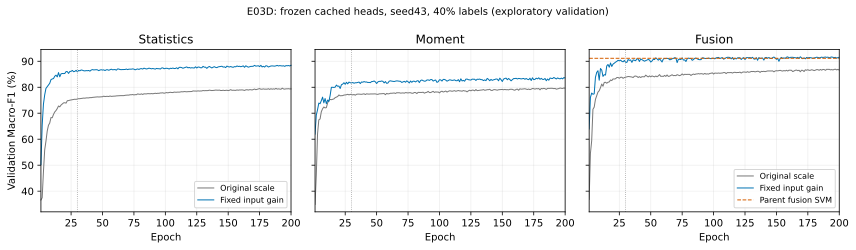

# E03D 结果：冻结头的预算与输入尺度影响明显

> 2026-10-18；正式汇总套件 `e03d_head_diagnostic_20261018_v2`。
> 六次头训练、十二个预算单元全部完成并审计通过。**没有执行 Transformer、训练 LoRA 或评价 test。**
> seed43、40% 标签，9,827 train + 3,510 validation；单 seed 探索，不是独立确认。

## 1. 数值事故与修订必须保留

v1在第4项 statistics_fanin_gain 第132轮因非有限梯度中止，loss scale已增长到32768。相同131轮模型、optimizer、RNG下重放训练集：scale32768第50窗口复现故障；scale1024全部77窗口有限。重放没有评价validation/test，权重丢弃。

v2单独冻结176个文件及依赖，于10:23:24启动，**六组全部从相同初值重跑**，统一固定scale1024。没有混入v1已完成或部分结果，没有更换数据、模型、学习率、预算和判定门槛。v1原文件与失败状态保持完整，已另行备份。

详见 [`e03d_numerical_revision_20261018.md`](e03d_numerical_revision_20261018.md)。本次技术修订发生在已知部分v1结果之后，不能写成完全盲法预注册。

## 2. 完整结果

以下为预算内最高 **validation Macro-F1（%）**；两种模式均使用原30轮warmup/cosine前缀，之后LR固定1e-4，训练至200轮，不早停。

| 支路 | 原尺度30轮 | 原尺度200轮 | 增益尺度30轮 | 增益尺度200轮 |
|---|---:|---:|---:|---:|
| 统计 | 75.49 | 79.65 | 86.51 | 88.45 |
| MOMENT | 77.28 | 79.72 | 81.99 | 83.76 |
| MOMENT + 统计 | 83.85 | 86.94 | 90.43 | **91.72** |

增益是固定全局输入乘数 `sqrt(1039/有效支路数)`，不是新增可训练层，也不是搜索出来的最优权重；支路内变换、相对支路平衡、头参数初值和模型容量保持不变。



图仅作事后描述，不参与选择。

## 3. 诊断规则

| 支路 | 原尺度增加预算：最好分差 | 原尺度增加预算：精确端点差 | 同30轮增益尺度差 |
|---|---:|---:|---:|
| 统计 | +4.16 pp | +3.88 pp | +11.02 pp |
| MOMENT | +2.44 pp | +2.38 pp | +4.71 pp |
| 融合 | +3.09 pp | +2.71 pp | +6.58 pp |

三个支路均达到预设“更多预算有帮助”和“早期尺度敏感”规则。端点差也为正，不能把全部改善解释为只多看了几个最好分。

训练集前1024行无标签探针显示，原头第一层初始激活RMS约0.024–0.029，增益后约0.49–0.55。数据支持原冻结头在该预算、缩放和初始化组合下尚未充分优化。**不证明唯一原因或普遍正确的增益**：输入缩放也会影响优化及有效正则化。

原尺度三支路以及增益统计/MOMENT的最佳点仍位于200轮最后10轮；不能宣布所有头完全收敛。融合增益最佳169轮，不在最后10轮。

## 4. 候选门槛：通过，但优势很小

最优为增益融合，epoch169：

- Macro-F1 **91.7225%**，Accuracy **91.5954%**。
- 同 seed/预算既有融合SVM：Macro-F1 **91.1459%**，Accuracy **91.0256%**。
- Macro-F1差 **+0.5766 pp**，达到事先固定的≥0.5 pp门槛；不是多个seed均值。
- 同模式仅MOMENT为83.7576%，融合差 **+7.9649 pp**，达到≥0.25 pp要求。
- 本轮最强非融合头为统计增益88.4516%；父匹配统计SVM89.4826%。因此最强比较者仍是父融合SVM91.1459%。
- 原尺度融合不合格；增益融合列为**可建议复制**的候选，未自动启动复制。

仍需强调选择机会：增益融合第200轮精确端点为 **91.5515%**，只比父SVM高约 **0.4056 pp**，并未达到0.5 pp。候选通过依据的是预设预算内最佳模型，不得将其改写成所有后期模型都至少提高0.5 pp。

超过门槛的余量只有0.0766 pp，validation又被反复使用，**不能声称统计显著、稳健领先或已在test获胜**。

## 5. 对 E03P 的影响

E03P 原“LoRA融合相对同头冻结提高约5.13pp”的数值不撤销，但其冻结头只有83.85%。本轮不改骨干就能将冻结融合头提高到91.72%，比旧LoRA融合88.98%还高约2.75pp，说明此前的弱冻结头不足以支持稳健的适配优势解释。

这不是同新头训练设置下的LoRA消融，所以**不能断言LoRA产生负贡献**；也不意味着已修复或通过了原E03P失败的门控。若以后再测LoRA，须使用充分优化的同头冻结参照，并重新冻结方案。

## 6. 下一步与停止

优先建议复制这个廉价的**冻结表征 + 增益融合头**，而非立即再跑数小时LoRA：单独冻结其余seed、训练/选模规则，并为统计NN及既有强SVM保留比较。特别注意单MOMENT83.76%仍不强，主要可用结果是融合管线，不是MOMENT单分支全面领先。

本轮只给出复制建议；尚未授权或启动新复制，没有自动扩标签预算、训练LoRA、解锁test。若复制失败，应保留负结果，不回改0.5pp门槛或只汇报本seed。

## 7. 成本、审计与备份

- v2结束：2026-10-18 **10:32:09（Asia/Shanghai）**，冻结到结束约8分45秒；六运行wall time合计约 **7.03min**。
- epoch计时合计约 **6.44min**，包含每轮validation；不含全部准备和存储开销，不是线上推理成本。
- 101 tests、6 subtests通过；176个冻结文件/依赖及42,120行预算预测/概率复核通过。
- 独立检查全部 **1,200个epoch**：scale始终1024，跳过optimizer step为0。
- 模型/快照/标签编码器 **37/37哈希一致**，prepared train/validation **2/2 NPZ哈希一致**。
- v2本地备份约96MiB；另含v1失败现场后，总备份约176MiB。公共基座权重不在这些头文件中；部署仍需要原已校验checkpoint和预处理。
- GPU已空闲，未开始下一训练。

路径：

- v2状态/汇总：`artifacts/improvements/e03d_head_diagnostic_stable/e03d_head_diagnostic_20261018_v2_analysis/`
- `summary.json`、`summary.md`、`local_backup_status.json`、`model_backup_sha256.json`
- 无标签训练探针：`prepared/training_only_scale_probe.json`
- 事后成本：`derived_cost_diagnostics.json`，不用于选择。
- 本地：`artifacts/imports/e03d_head_validation_20261018/`，其中 `v1_failed/` 保留事故阶段。
- 日志：`artifacts/logs/e03d_head_diagnostic_20261018_v2.log`
- 图：`docs/figures/e03d_head_diagnostic_20261018.svg`

复核（不重训、不评价test）：

```bash
python -m tcn_moment.run_e03d_stable verify
python -m tcn_moment.run_e03d_stable summarize
```
