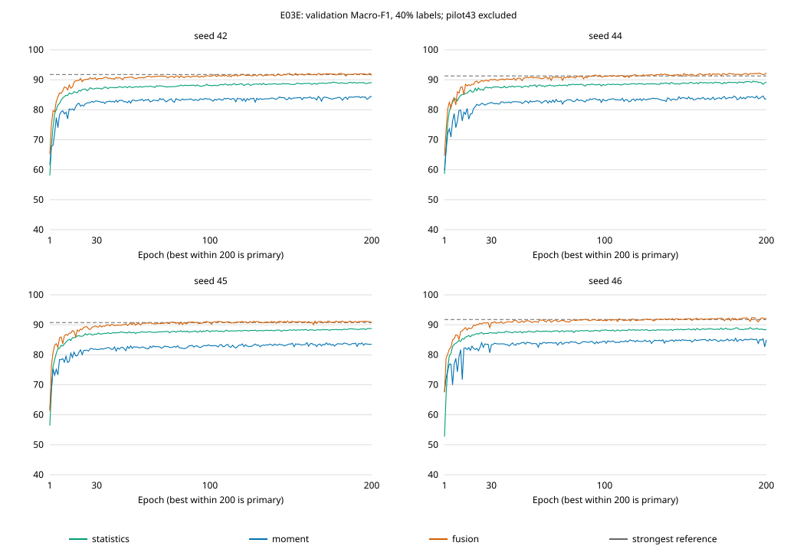

# E03E 增益融合头四种子复制结果（validation-only）

日期：2026-10-18。按预先冻结协议完成，不修改门槛，不自动执行 test、LoRA 或扩大预算。

## 协议与审计

- seed42/44/45/46，40%训练标签；pilot43严格排除，未加入均值或成功判定。
- 每seed 9,827个训练标签 + 3,510个validation标签；未适配MOMENT缓存，统计/仅MOMENT/融合三个增益头，各200轮，共12训练。
- 208个冻结文件及依赖核验通过；协议SHA-256：`f34f3fbedfbd910be32752e694640b2edd8d96c9dcf03ea7b659b591e357963d`。
- 套件于10:46:53冻结、11:10:45完成（Asia/Shanghai，约23分52秒）。接管后再次执行原模块verify/summarize，42,120行NN预测、参照、2,400个epoch、共享初值及模型哈希通过；固定scale1024、零跳步，无监督encoder训练。
- 训练前preflight为106 tests、6 subtests通过；此结果报告未改训练实现或重新调参。

## 主结果

以下均为validation Macro-F1（%），每个seed采用预算内最好checkpoint。最强参照取本轮两单分支NN及父统计RF/SVM、匹配统计SVM、父融合SVM的最大值；本轮四seed均为父融合SVM。

| Seed | 统计NN | MOMENT NN | 融合NN | 最强参照 | 配对增量pp | 融合200轮端点 | 最好epoch | Accuracy % |
|---:|---:|---:|---:|---:|---:|---:|---:|---:|
| 42 | 89.25 | 84.45 | 92.16 | 91.75 | +0.403 | 91.46 | 181 | 92.02 |
| 44 | 89.56 | 84.60 | 92.33 | 91.28 | +1.043 | 92.33 | 200 | 92.14 |
| 45 | 88.76 | 84.03 | 91.27 | 90.75 | +0.517 | 90.97 | 173 | 91.11 |
| 46 | 89.07 | 85.54 | 92.42 | 91.76 | +0.661 | 92.23 | 191 | 92.34 |

融合Macro-F1均值 **92.04% ± 0.53%**（样本SD），Accuracy **91.90% ± 0.54%**。
相对最强参照平均 **+0.656pp**，**4/4正向**；描述性95%配对t区间 **[+0.213, +1.099]pp**。均值≥0.5pp且≥3/4正向，主规则通过。
相对仅MOMENT平均 **+7.387pp**，4/4正向，描述性区间 **[+6.744, +8.031]pp**，0.25pp消融规则通过；因此整体复制规则通过。
200轮固定端点相对最强参照平均 **+0.359pp**、3/4正向；这是描述性结果，不能代替预算内最好模型的主规则。

## 类别与电池异常边界

| 类别 | 融合F1均值 % | 父融合SVM F1均值 % | 配对均值差pp |
|---|---:|---:|---:|
| 0：正常 | 90.98 | 90.24 | +0.73 |
| 1：充电器故障 | 94.17 | 93.44 | +0.73 |
| 2：电池异常 | 90.98 | 90.47 | +0.50 |

电池异常（类别2）融合头的AP均值 **96.71%**，默认argmax Recall **88.89%**，one-vs-rest FPR **3.81%**。AP由保存的validation概率重算，未选新阈值；不是固定高召回安全运行点，不等于部署保证。逐运行与各支路结果见CSV/JSON。

## 成本、曲线与限制

12个缓存头训练epoch计时合计 **12.78分钟**；不包含骨干提取、SVM补控制、准备与审计，不可当作线上延迟。融合头135,555个参数，公共341M量级骨干依然是完整推理依赖，不可只报头大小。

- 同数据集、重叠随机划分、反复复用validation；seed42用于过往探索，旧参照分数已知，不是独立外部确认。区间仅描述，不作显著性或总体泛化保证。
- NN有200次epoch validation选择，旧SVM用CV选择，预算不等，不能把净差归因于单一架构优势。
- seed44融合最好点在epoch200边界，seed46在191；至少两seed仍有末段最好点，不能称全部已充分收敛，也不据此自动增加轮数。
- 这是40%预算下冻结表征+统计增益头的复制结果，不是完整标签test结果；不能与历史TCN/完全微调test直接排名。
- E03P门控失败、E03D-v1数值事故及E01C整体实用增量规则失败保持原判；本轮未重测新头LoRA。

## 下一步待决定（不自动执行）

建议停止本轮探索，单独冻结最终比较清单与测试预算，再由用户明确批准一次正式test。候选包含本轮增益融合、同预算单分支、父融合SVM及匹配统计SVM；历史TCN/完全微调仅在协议可比时列为正式对照。若继续研究LoRA，应另立预算和新头公平参照，不回改本轮门槛。

完整保全与关机证据以 `artifacts/imports/autodl_preservation_20261018/preservation_verified.json`、`shutdown_verification.json` 和无人值守runbook为准。
本次最终保全2,727文件、4,714,447,031 bytes，remote/local SHA全部一致（含旧E01完整分类器/缓存、E03D失败现场、E03E及实体公共基座）。11:19:06远程AutoDL关机命令返回0，11:19:21一次SSH复验为Connection refused；已验证SSH不可达，未另查平台电源/计费API。
派生AP已用远程sklearn对12运行交叉核对，最大差1.85e-13个百分点；生成器合成AP检查与SVG XML解析通过。最终本地报告/脚本/台账副本及SHA另见保全目录的completion_bundle。
机器可读派生：`artifacts/analysis/e03e_replication_20261018/derived_results.json`、`per_run_metrics.csv`；原始summary位于保全目录中，不覆盖原结果。
