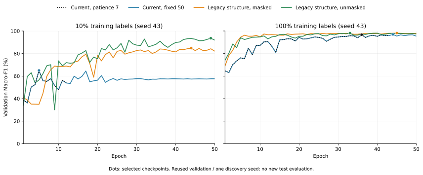

# E05B：legacy TCN结构与早停诊断结果（validation-only）

单seed43、原始序列、统一split/AdamW/FP32；已知历史test之后的validation探索。没有新的test评价。

| 标签预算 | 条件 | 轮数 | 选择epoch | 选择F1 % | 真峰值F1 % | 末轮F1 % | 参数 | 训练分钟 |
|---:|---|---:|---:|---:|---:|---:|---:|---:|
| 10% | current_early7 | 12 | 5 | 64.9645 | 64.9645 | 53.8634 | 218691 | 0.19 |
| 10% | current_fixed50 | 50 | 5 | 64.9645 | 64.9645 | 57.6062 | 218691 | 0.75 |
| 10% | legacy_masked50 | 50 | 44 | 84.8182 | 84.8182 | 82.1165 | 247299 | 0.62 |
| 10% | legacy_unmasked50 | 50 | 49 | 93.6000 | 93.6000 | 91.9146 | 247299 | 0.60 |
| 100% | current_early7 | 43 | 36 | 96.7023 | 96.7023 | 95.8655 | 218691 | 5.15 |
| 100% | current_fixed50 | 50 | 44 | 96.9684 | 96.9684 | 95.4680 | 218691 | 6.01 |
| 100% | legacy_masked50 | 50 | 45 | 98.1412 | 98.1412 | 97.9255 | 247299 | 4.90 |
| 100% | legacy_unmasked50 | 50 | 33 | 98.1048 | 98.1048 | 97.3877 | 247299 | 4.79 |

选择F1按当前min_delta=0.0001规则；真峰值独立保存，端点不冒充最佳模型。

- 10%标签：固定50轮−early7 **+0.0000pp**；legacy masked−当前固定50轮 **+19.8537pp**；legacy unmasked−masked **+8.7818pp**。
- 100%标签：固定50轮−early7 **+0.2661pp**；legacy masked−当前固定50轮 **+1.1728pp**；legacy unmasked−masked **-0.0364pp**。

独立审计355epoch、84240行保存validation预测（每条件选择/峰值/端点各3510行）、参数起点、训练ID、科学轨迹前缀、更新步数与SHA均通过。

本轮只回答这些固定训练配置下的诊断问题。legacy移植统一了初始化规则、优化器和padding，与原Keras的Glorot/Adam/val_loss调度不同；没有学习率/正则化搜索，也没有多seed验证，不能声称已穷尽原模型性能。

seed43与validation多次复用；不据此改写E03T门槛、不自动扩seed或消费已有test。原完整标签TCN历史95.99%±0.73%是另一实验的test，不能与本表validation直接排名。

证据：`artifacts/improvements/e05b_tcn_legacy_pilot/e05b_tcn_legacy_pilot_20261019_v1/summary.json`、`output_manifest.json`、各条件保存checkpoint/历史/预测及冻结源码。

本地终态归档：`artifacts/imports/e05b_tcn_legacy_pilot_20261019/terminal_artifacts`；`preservation_verified.json`记录逐文件SHA核验。

