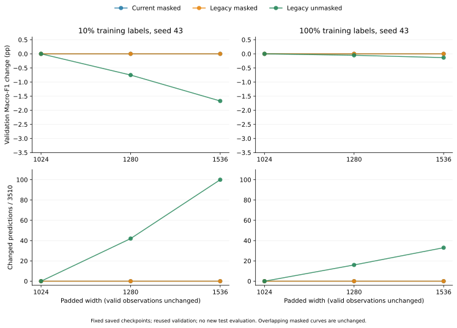

# N1：seed43长度与padding诊断（四seed复核前的独立分析）

只使用已有TCN权重和train/validation；不重新训练TCN，不读取test预测。pilot43不进入四seed复核均值。

| 标签预算 | 浅树输入 | 最佳树深 | Validation Macro-F1 % |
|---:|---|---:|---:|
| 10% | length | 5 | 43.2441 |
| 10% | statistics15 | 5 | 75.5304 |
| 100% | length | 5 | 36.3936 |
| 100% | statistics15 | 5 | 76.4047 |

两控制同4候选×5折，15统计含length；浅树是机制诊断，不等价于已优化统计SVM。length与类别可能相关，但仅length的这些分数不足以说明TCN高分只由长度造成，也不能作为因果或泄漏判断。

| 预算 | TCN | Padding | 预测改变数（相对1024） | F1 % | 最大logit差 |
|---:|---|---:|---:|---:|---:|
| 10% | current_fixed50 | 1024 | 0 | 64.9645 | 0 |
| 10% | current_fixed50 | 1280 | 0 | 64.9645 | 0 |
| 10% | current_fixed50 | 1536 | 0 | 64.9645 | 0 |
| 10% | legacy_masked50 | 1024 | 0 | 84.8182 | 0 |
| 10% | legacy_masked50 | 1280 | 0 | 84.8182 | 0 |
| 10% | legacy_masked50 | 1536 | 0 | 84.8182 | 0 |
| 10% | legacy_unmasked50 | 1024 | 0 | 93.6000 | 0 |
| 10% | legacy_unmasked50 | 1280 | 42 | 92.8480 | 250.8 |
| 10% | legacy_unmasked50 | 1536 | 100 | 91.9287 | 418 |
| 100% | current_fixed50 | 1024 | 0 | 96.9684 | 0 |
| 100% | current_fixed50 | 1280 | 0 | 96.9684 | 0 |
| 100% | current_fixed50 | 1536 | 0 | 96.9684 | 0 |
| 100% | legacy_masked50 | 1024 | 0 | 98.1412 | 0 |
| 100% | legacy_masked50 | 1280 | 0 | 98.1412 | 0 |
| 100% | legacy_masked50 | 1536 | 0 | 98.1412 | 0 |
| 100% | legacy_unmasked50 | 1024 | 0 | 98.1048 | 0 |
| 100% | legacy_unmasked50 | 1280 | 16 | 98.0534 | 318.6 |
| 100% | legacy_unmasked50 | 1536 | 33 | 97.9705 | 531 |

所有有效序列完全相同，只增加尾部无效零。masked模型在本次1024/1280/1536比较中logit与预测不变；unmasked模型对padding长度敏感。只证明依赖这种输入表示，不能证明长度是性能收益的唯一机制，也不能用新padding分数重选模型。

1024恢复已通过保存checkpoint/预测核对，允许概率绝对漂移1e-5且argmax零差异，容差在诊断前固定；实际漂移记录于机器summary。长度分层阈值来自选定train，逐类长度分布与全部分组指标一并保留。

独立标准库核验77220行CSV预测、混淆/指标及变化计数，F1最大误差1.11e-16；所有原始输出文件SHA通过。四seed36次训练的完成状态与结果另行报告，不把本诊断写成复制成功。

证据：`artifacts/imports/e05c_tcn_replication_20261019/diagnostics/summary.json`、`independent_saved_output_audit.json`及CSV/NPZ/model/CV文件。
