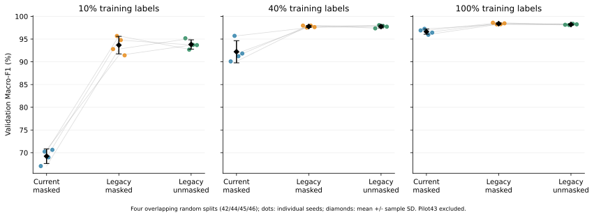

# E05C / N1：TCN四seed复核与长度诊断结果

2026-10-19；套件于15:42:45（Asia/Shanghai）完成。seed42/44/45/46，pilot43不进入复核均值。所有结果为validation，既有test已知后的探索，无新test评价。

## 核心结果

| 训练标签预算 | 当前残差 masked F1 % | Legacy masked F1 % | Legacy unmasked F1 % |
|---:|---:|---:|---:|
| 10% | 69.2305 ± 1.6101 | 93.6758 ± 1.9260 | 93.8161 ± 1.0299 |
| 40% | 92.2159 ± 2.4400 | 97.7790 ± 0.2277 | 97.7648 ± 0.3034 |
| 100% | 96.6367 ± 0.5722 | 98.3959 ± 0.1729 | 98.2154 ± 0.1131 |

表中为四seed均值±样本SD；原始raw输入、统一split/嵌套子集、AdamW、固定50轮和FP32。按min_delta0.0001选selected，真峰值与端点另存，不按本轮结果换模型。

| 预算 | 配对差 | 均值pp | 正向seed | 描述性95%区间pp |
|---:|---|---:|---:|---|
| 10% | legacy_masked50-current_fixed50 | +24.4453 | 4/4 | [+20.5598, +28.3309] |
| 10% | legacy_unmasked50-legacy_masked50 | +0.1403 | 2/4 | [-4.0578, +4.3384] |
| 10% | legacy_unmasked50-current_fixed50 | +24.5856 | 4/4 | [+20.5262, +28.6451] |
| 40% | legacy_masked50-current_fixed50 | +5.5631 | 4/4 | [+1.3705, +9.7557] |
| 40% | legacy_unmasked50-legacy_masked50 | -0.0142 | 2/4 | [-0.7722, +0.7439] |
| 40% | legacy_unmasked50-current_fixed50 | +5.5489 | 4/4 | [+2.0512, +9.0466] |
| 100% | legacy_masked50-current_fixed50 | +1.7592 | 4/4 | [+0.8341, +2.6843] |
| 100% | legacy_unmasked50-legacy_masked50 | -0.1805 | 1/4 | [-0.5374, +0.1764] |
| 100% | legacy_unmasked50-current_fixed50 | +1.5787 | 4/4 | [+0.4891, +2.6683] |

所有区间为重叠随机split上的描述性配对t区间，不能当独立外部实验的总体置信保证。

## 判断与后续选择

- legacy masked相对当前残差结构在三个预算均4/4正向，平均+24.4453/+5.5631/+1.7592pp；说明原低标签TCN参照配置没有充分代表这份数据上的TCN潜力。不是原Keras完整重现，也不是所有TCN架构的性能上限。
- unmasked−masked均值为+0.1403/−0.0142/−0.1805pp，正向分别2/4、2/4、1/4，描述性区间均跨0。没有支持全padding池化稳定更强，seed43的+8.78pp不能概括到四seed均值。
- 后续建议以legacy masked为主要TCN参照：其多seed表现强，且已有固定权重诊断显示对额外padding不敏感；unmasked完整保留为池化对照，不删除或改写任何原结果。这个主参照建议是在本轮结果后提出的，不冒充原E03T预先声明方法。
- 尚未补1%/5%新TCN曲线、学习率/dropout有界搜索或受限validation标签实验，不能宣称低标签优势问题已全部解决。下一步仅建议N2/N3，不自动启动。
- 40% legacy masked validation97.7790%是强参照。历史E03E同四seed融合validation约92.04%，仅作已知管线上下文；需要逐行/选择预算核对才能形成新的成对比较，不与91.516%的历史test跨split排名。

## 逐seed与电池指标

| 预算 | seed | 条件 | Accuracy % | Macro-F1 % | 电池AP % | 电池Recall % | 电池FPR % | selected epoch |
|---:|---:|---|---:|---:|---:|---:|---:|---:|
| 10% | 42 | current_fixed50 | 67.0655 | 67.0602 | 80.1052 | 65.3549 | 18.6089 | 9 |
| 10% | 42 | legacy_masked50 | 92.9060 | 92.7994 | 97.7276 | 94.9846 | 4.2457 | 44 |
| 10% | 42 | legacy_unmasked50 | 95.1567 | 95.1801 | 98.6006 | 93.5185 | 1.5808 | 48 |
| 40% | 42 | current_fixed50 | 90.0285 | 90.0923 | 97.2802 | 76.2346 | 0.1355 | 34 |
| 40% | 42 | legacy_masked50 | 97.9487 | 97.9749 | 99.3666 | 96.9136 | 0.9033 | 34 |
| 40% | 42 | legacy_unmasked50 | 97.3219 | 97.3612 | 99.2364 | 95.1389 | 0.5420 | 24 |
| 100% | 42 | current_fixed50 | 96.8661 | 96.9123 | 99.3993 | 93.6728 | 0.3162 | 34 |
| 100% | 42 | legacy_masked50 | 98.6040 | 98.6059 | 99.8362 | 98.3025 | 0.7678 | 37 |
| 100% | 42 | legacy_unmasked50 | 98.1197 | 98.1495 | 99.4896 | 96.5278 | 0.4065 | 35 |
| 10% | 44 | current_fixed50 | 70.7692 | 70.2457 | 86.5444 | 48.8426 | 0.4968 | 20 |
| 10% | 44 | legacy_masked50 | 95.7550 | 95.6915 | 98.1232 | 97.2222 | 2.0777 | 47 |
| 10% | 44 | legacy_unmasked50 | 92.7066 | 92.6781 | 97.1037 | 90.4321 | 1.6260 | 45 |
| 40% | 44 | current_fixed50 | 95.6410 | 95.7139 | 98.9784 | 92.2840 | 0.7678 | 40 |
| 40% | 44 | legacy_masked50 | 97.4929 | 97.5339 | 98.9410 | 95.4475 | 0.5872 | 42 |
| 40% | 44 | legacy_unmasked50 | 98.0627 | 98.0730 | 99.4825 | 97.2994 | 0.5872 | 46 |
| 100% | 44 | current_fixed50 | 97.2365 | 97.2614 | 99.3794 | 95.8333 | 0.5872 | 33 |
| 100% | 44 | legacy_masked50 | 98.2051 | 98.2380 | 99.7425 | 96.6821 | 0.3613 | 50 |
| 100% | 44 | legacy_unmasked50 | 98.0627 | 98.1038 | 99.3400 | 96.5278 | 0.3613 | 45 |
| 10% | 45 | current_fixed50 | 69.5726 | 68.9805 | 83.6692 | 47.3765 | 0.7227 | 15 |
| 10% | 45 | legacy_masked50 | 94.8148 | 94.7868 | 98.5411 | 94.2901 | 1.8970 | 46 |
| 10% | 45 | legacy_unmasked50 | 93.7892 | 93.7255 | 98.1554 | 92.2068 | 1.8519 | 38 |
| 40% | 45 | current_fixed50 | 91.1111 | 91.2361 | 97.2272 | 85.0309 | 0.5872 | 36 |
| 40% | 45 | legacy_masked50 | 97.9487 | 97.9708 | 99.2989 | 97.5309 | 0.9937 | 46 |
| 40% | 45 | legacy_unmasked50 | 97.8348 | 97.8954 | 99.6415 | 95.7562 | 0.4065 | 50 |
| 100% | 45 | current_fixed50 | 95.8689 | 95.9513 | 99.2439 | 91.3580 | 0.2258 | 29 |
| 100% | 45 | legacy_masked50 | 98.2336 | 98.2717 | 99.5909 | 96.9136 | 0.4968 | 37 |
| 100% | 45 | legacy_unmasked50 | 98.3191 | 98.3581 | 99.5663 | 97.0679 | 0.4968 | 47 |
| 10% | 46 | current_fixed50 | 70.8547 | 70.6356 | 84.4705 | 53.2407 | 1.0840 | 17 |
| 10% | 46 | legacy_masked50 | 91.3390 | 91.4257 | 97.5230 | 87.7315 | 1.4905 | 47 |
| 10% | 46 | legacy_unmasked50 | 93.6752 | 93.6808 | 98.4195 | 91.2037 | 1.4905 | 40 |
| 40% | 46 | current_fixed50 | 91.6809 | 91.8213 | 98.4978 | 83.5648 | 0.4968 | 47 |
| 40% | 46 | legacy_masked50 | 97.6068 | 97.6365 | 99.2763 | 95.9105 | 0.5420 | 42 |
| 40% | 46 | legacy_unmasked50 | 97.7208 | 97.7298 | 99.3209 | 96.5278 | 0.6775 | 46 |
| 100% | 46 | current_fixed50 | 96.3533 | 96.4219 | 99.2770 | 92.8241 | 0.4968 | 30 |
| 100% | 46 | legacy_masked50 | 98.4900 | 98.4682 | 99.6416 | 98.6111 | 0.8130 | 46 |
| 100% | 46 | legacy_unmasked50 | 98.2621 | 98.2502 | 99.4566 | 98.0710 | 0.8130 | 44 |

电池为原标签2，默认argmax；AP由完整保存概率计算，没有调阈值。不把Recall单独提高写成安全保证。各类F1、peak/endpoint完整保存于summary。

## Early7轨迹回放

| 预算 | 四seed回放停止epoch | 固定50轮selected−回放selected，均值pp |
|---:|---|---:|
| 10% | [16, 12, 22, 24] | +0.2220 |
| 40% | [41, 39, 43, 50] | +0.0726 |
| 100% | [22, 31, 24, 37] | +0.8335 |

只沿原轨迹回放patience7，不新增训练。延长当前模型的平均收益远小于结构差，不把早停视作唯一问题。

## 长度与padding诊断

seed43已有权重的18组padding及4树控制见[独立诊断报告](e05c_length_padding_diagnostics_20261019.md)。仅length浅树10%/100% F1为43.2441/36.3936%，15统计浅树为75.5304/76.4047%；两树具有相同候选/折数，但不是最强SVM或去长度消融。
masked在1024/1280/1536保持输出不变，unmasked增至1536分别改变100/33条预测。说明padding依赖，不证明长度是唯一机制或泄漏；本轮没有length旁路训练。

## 执行加速、硬件与计时边界

原实现完成seed42后，独立resident/async执行层从已提交checkpoint恢复；不改模型/数据/batch/精度/优化器/选模。合成和9827行train回放的权重、AdamW、所有指标/概率及RNG逐位一致；真实单轮回放速度比1.292/1.335/1.307倍。不是整套运行或部署延迟保证。
基准期间SIGSTOP操作等待计入少数原epoch_seconds；不据这些长epoch估计纯计算速度，也不改写其原日志。整体套件06:15:33至07:42:44 UTC约87.2分钟，包含诊断、暂停、重启、已完成条件哈希审计、保存及训练；不当作纯训练计时。
**备份时实例已变化**：冻结运行记录为`autodl-container-f0c94cb49a-92794602` / NVIDIA GeForce RTX 4080 SUPER；本轮保全观察为`autodl-container-de774f9d7d-2319c4b0` / NVIDIA GeForce RTX 4080。切换发生时刻未经独立核实，因此不认证所有训练计时来自同一物理GPU。
首次备份因旧hostname保护拒绝，随后显式指定新hostname。原协议/执行冻结文件与此前本地副本逐字节一致，模型及所有保存输出通过SHA；本轮不加载模型推理，不因备份实例不同重新计算旧结果。

## 独立审计与保全

- 标准库独立复核1800epoch及379080行预测，原CSV真值、有序ID、3类/电池混淆指标、AP、selected/peak、逐seed均值/SD/差值区间与SHA均通过；最大指标误差2.22e-16、AP误差2.22e-15。
- 终态521文件/248784612bytes，逐SHA核验零失败，含原冻结源码、36条件模型/optimizer/RNG/history/预测、诊断及加速修订快照。
- 本地根：`artifacts/imports/e05c_tcn_replication_20261019/terminal_artifacts`；`preservation_verified.json`、`artifacts/imports/e05c_tcn_replication_20261019/independent_output_audit.json`及`backup_instance_observation.json`为证据。
- 本轮没有新test、阈值选择、自动N2/LoRA、pi-wake或关机；检查时GPU计算进程为空。

