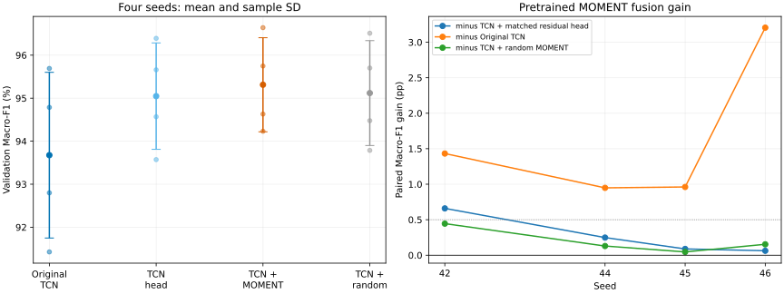

# E06：强TCN与冻结MOMENT互补结果

本轮为已知历史test后的train/validation探索，不是新test或外部确认。
固定10%训练池标签（每seed2456条）、validation3510条、seed42/44/45/46。
TCN与MOMENT均冻结，只训练相同形状的残差头。原始TCN另作固定强参照。

## 四seed结果

单位%，均值±样本SD。

| 方法 | validation Macro-F1 |
|---|---:|
| Original TCN | 93.6758 ± 1.9260 |
| TCN + matched residual head | 95.0480 ± 1.2368 |
| TCN + pretrained MOMENT | 95.3127 ± 1.0932 |
| TCN + random MOMENT | 95.1193 ± 1.2198 |

## 原先冻结的三个成功门槛

| MOMENT融合减参照 | 均值pp | 正向seed | 描述性95%区间pp | 达到门槛 |
|---|---:|---:|---|---|
| TCN + matched residual head | +0.2647 | 4/4 | [-0.1742, +0.7035] | 否 |
| Original TCN | +1.6369 | 4/4 | [-0.0652, +3.3389] | 是 |
| TCN + random MOMENT | +0.1934 | 4/4 | [-0.0830, +0.4698] | 否 |

**三条全部通过：否。**
仅在三个预设规则均满足时，称达到本轮探索性实用增量标准；否则不改变门槛、参照或seed。

### 如何解释

必须区分相对原TCN的总增益与相对同形TCN头的净增益：前者也包含重新训练残差头的作用，不能全部归给MOMENT。
本轮实用门槛是否通过只由上表三个固定比较决定；方向一致的小幅增量可如实报告，但不替代幅度门槛，也不构成独立外部确认。

## 逐seed与类别/电池指标

| seed | 方法 | Macro-F1 % | Accuracy % | 电池AP % | 电池Recall % | 电池FPR % | selected epoch |
|---|---|---:|---:|---:|---:|---:|---:|
| 42 | Original TCN | 92.7994 | 92.9060 | 97.7276 | 94.9846 | 4.2457 | parent |
| 42 | TCN + matched residual head | 93.5719 | 93.6467 | 98.1456 | 93.1327 | 2.6649 | 87 |
| 42 | TCN + pretrained MOMENT | 94.2315 | 94.2735 | 98.1216 | 93.1327 | 2.0777 | 19 |
| 42 | TCN + random MOMENT | 93.7868 | 93.8462 | 97.9075 | 93.3642 | 2.5745 | 38 |
| 44 | Original TCN | 95.6915 | 95.7550 | 98.1232 | 97.2222 | 2.0777 | parent |
| 44 | TCN + matched residual head | 96.3918 | 96.4103 | 98.2491 | 96.6049 | 1.5357 | 18 |
| 44 | TCN + pretrained MOMENT | 96.6402 | 96.6382 | 98.2070 | 96.6821 | 1.5357 | 10 |
| 44 | TCN + random MOMENT | 96.5110 | 96.5242 | 98.2689 | 96.8364 | 1.5808 | 14 |
| 45 | Original TCN | 94.7868 | 94.8148 | 98.5411 | 94.2901 | 1.8970 | parent |
| 45 | TCN + matched residual head | 95.6597 | 95.6980 | 98.7382 | 95.6790 | 1.9422 | 100 |
| 45 | TCN + pretrained MOMENT | 95.7480 | 95.7550 | 98.6016 | 95.0617 | 1.8067 | 7 |
| 45 | TCN + random MOMENT | 95.7019 | 95.7265 | 98.6397 | 95.2160 | 1.7615 | 30 |
| 46 | Original TCN | 91.4257 | 91.3390 | 97.5224 | 87.7315 | 1.4905 | parent |
| 46 | TCN + matched residual head | 94.5686 | 94.5869 | 97.8600 | 94.9846 | 2.5745 | 78 |
| 46 | TCN + pretrained MOMENT | 94.6311 | 94.6724 | 97.7907 | 95.2932 | 2.5294 | 43 |
| 46 | TCN + random MOMENT | 94.4775 | 94.5014 | 97.6027 | 94.9074 | 2.6649 | 84 |

## 设计、计时与边界

- 同形1152→128→3残差头，输出零初始化，epoch0恢复原TCN且允许选中；每条件固定100轮、batch128、AdamW1e-3、WD1e-4、FP32且关闭TF32。
- TCN-only的1024维旁路为零，参数数目相同但有效信息/自由度不同；随机MOMENT控制补充检验预训练价值。
- 每分支scaler只在2456条所选训练样本拟合；父TCN已用validation选模型，新头又用同validation选轮数。存在重复选择/开发偏差，不能称独立泛化确认。
- 训练标签2456与开发/选模标签3510分别报告，不能宣称全流程总标注仅2456条。
- 预训练MOMENT和seed44/45/46随机表征复用历史缓存；seed42随机控制在本机补提取。不是统一端到端训练/推理成本比较。
- 区间只描述四个重叠split；电池指标使用默认argmax，不调阈值，不作安全保证。
- 冻结时间：2026-10-19T12:05:37.738898+00:00；协议SHA：`de6464bedfaafcaa525cf4d8464e04b753b74ecfd1b28609cf533e576ca88203`。
- 运行host/GPU：`autodl-container-de774f9d7d-2319c4b0` / `NVIDIA GeForce RTX 4080`。

## 完整性与保全

- 独立标准库审计1200轮训练、98280行保存预测；原CSV真值、有序split ID、概率、混淆指标、AP、选轮和三条门槛核对通过。
- 最大指标误差2.22e-14，AP误差2.22e-15。
- 本地结果前冻结文件与终态冻结字节一致；模型/特征/scaler/预测/源码快照通过输出manifest核对。
- 保全根：`artifacts/imports/e06_tcn_moment_complement_20261019/`；完整结果在`terminal_artifacts/`，逐文件传输核验见`preservation_verified.json`。
- 本轮结束，不自动追加实验、访问test、关机或启用pi-wake。

