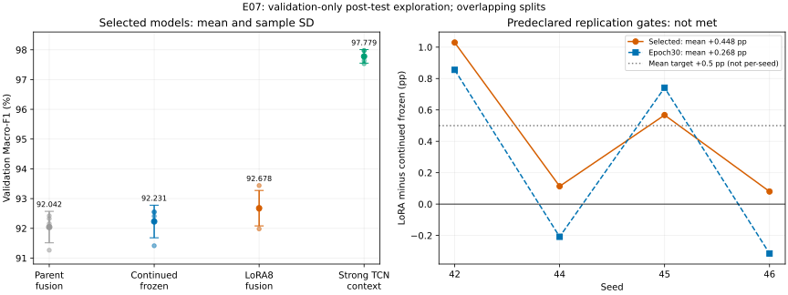

# E07：强融合头LoRA精简复制结果（2026-10-20）

**8条件/240轮全部完成；原定实用增量门槛未通过。**
所选模型LoRA相对继续冻结的validation Macro-F1平均+0.4475pp，4/4 seed正向；原门槛为平均≥+0.5pp且至少3/4正向。
这是已有强MOMENT融合管线上的小幅适配增量，不等于超过强TCN，也不是独立test确认。

## 范围与执行

- 固定seed42/44/45/46，排除提出假设的pilot seed43；每seed9827个训练标签（40%训练池）和3510个开发/选择validation标签，分别披露。
- 两处理从同seed E03E best-within-200融合头及normalizer出发；均在线运行MOMENT编码器、重置optimizer/scheduler并追加30轮，无早停或rank/LR搜索。
- LoRA仅24个encoder block的q/v，rank8/alpha16/dropout0.05；物理batch64、有效128、AdamW LR1e-4/WD0.01、固定FP16 scale1024。epoch0–30按原validation规则选择，epoch30端点另报。
- 套件起止：2026-10-19 20:33:11—2026-10-20 00:48:02（Asia/Shanghai），墙钟15290.721秒（4.247小时），未触及8小时上限。
- 没有追加test、自动重试、扩大预算、下一实验、pi-wake或关机。

## 主结果：validation所选模型

均值±样本SD，单位%。TCN是事前固定的同训练标签上下文，训练/选择预算不同。

| 方法 | 四seed Macro-F1 % |
|---|---:|
| 原E03E强融合头（追加训练前） | 92.0423 ± 0.5294 |
| 继续冻结融合，追加30轮 | 92.2306 ± 0.5480 |
| LoRA8融合，追加30轮 | 92.6782 ± 0.5958 |
| E05C同40%强TCN（legacy masked，上下文） | 97.7790 ± 0.2277 |

| seed | 原融合头 % | 继续冻结 % | LoRA8 % | LoRA−冻结 pp | 选中epoch 冻结/LoRA |
|---:|---:|---:|---:|---:|---:|
| 42 | 92.1561 | 92.4089 | 93.4383 | +1.0294 | 16/19 |
| 44 | 92.3258 | 92.5418 | 92.6553 | +0.1135 | 30/14 |
| 45 | 91.2655 | 91.4147 | 91.9819 | +0.5671 | 16/28 |
| 46 | 92.4219 | 92.5572 | 92.6373 | +0.0801 | 18/5 |

LoRA相对旧父头的总差为+0.6359pp，但继续训练冻结头本身也有收益，不能把这整个差值归给编码器适配；匹配继续训练控制后的净增量是+0.4475pp。

## 原先冻结的两条判定

两项均须平均≥+0.5pp且至少3/4 seed严格正向；未按结果改门槛或删seed。

| LoRA减参照 | 平均pp | 正向seed | 描述性95%配对t区间pp | 达标 |
|---|---:|---:|---|---|
| 继续冻结融合 | +0.4475 | 4/4 | [-0.2637, +1.1588] | 否 |
| 固定集合内逐seed最强非适配 | +0.4475 | 4/4 | [-0.2637, +1.1588] | 否 |

本次固定非适配集合的最大值恰好均来自继续冻结融合，所以两项数值相同，不是两份独立证据。集合包含本轮冻结、父融合/统计/仅MOMENT NN、融合SVM、统计RF/SVM及匹配统计SVM，未事后增删。
LoRA−强TCN平均-5.1008pp，0/4正向。强TCN不是适配门槛，但总体参照仍明显更高。
配对区间仅描述四个重叠随机split；主差区间跨0，不能写成显著或独立确认的普遍改善。

## 预先要求的epoch30端点

端点只作敏感性报告，不替换原所选模型门槛，也不据此另选轮数。

| seed | 冻结端点 % | LoRA端点 % | 差pp |
|---:|---:|---:|---:|
| 42 | 92.2195 | 93.0749 | +0.8554 |
| 44 | 92.5418 | 92.3335 | -0.2082 |
| 45 | 91.0674 | 91.8088 | +0.7415 |
| 46 | 92.3138 | 91.9991 | -0.3148 |

- 继续冻结融合端点均值±SD：92.0356 ± 0.6595%。
- LoRA8融合端点均值±SD：92.3041 ± 0.5578%。
- 端点平均差+0.2685pp，只有2/4正向；因此主表4/4正向指validation所选模型，不能说所有训练终点均有收益。

## 类别与电池异常指标

均为所选模型、默认argmax；不调阈值。单位%，下表为四seed均值。

| 指标 | 继续冻结 | LoRA8 | 差pp |
|---|---:|---:|---:|
| 正常F1 | 91.2519 | 91.6510 | +0.3991 |
| 充电器故障F1 | 94.1683 | 94.9631 | +0.7948 |
| 电池异常F1 | 91.2717 | 91.4204 | +0.1487 |
| Accuracy | 92.1011 | 92.5214 | +0.4202 |
| 电池AP | 96.7773 | 96.9166 | +0.1393 |
| 电池Recall | 89.9691 | 89.7184 | -0.2508 |
| 电池FPR | 4.2005 | 3.8392 | -0.3613 |

电池平均AP略升、FPR降低，但Recall下降；各seed并非一致改善，不构成电池安全或部署优势。

### 逐seed电池指标与类别F1

| seed | 条件 | 正常F1 % | 充电器F1 % | 电池F1 % | 电池AP % | 电池Recall % | 电池FPR % |
|---:|---|---:|---:|---:|---:|---:|---:|
| 42 | 继续冻结融合 | 91.7177 | 94.3489 | 91.1602 | 96.5729 | 89.1204 | 3.7489 |
| 42 | LoRA8融合 | 92.7942 | 95.7214 | 91.7994 | 96.8162 | 88.9660 | 2.8455 |
| 44 | 继续冻结融合 | 91.2424 | 95.0820 | 91.3009 | 96.9692 | 89.8920 | 4.1102 |
| 44 | LoRA8融合 | 91.2439 | 95.5090 | 91.2131 | 97.0505 | 90.5093 | 4.6522 |
| 45 | 继续冻结融合 | 90.4155 | 93.3729 | 90.4558 | 96.6425 | 89.5833 | 4.9684 |
| 45 | LoRA8融合 | 90.8130 | 94.7108 | 90.4218 | 96.9077 | 88.5031 | 4.2457 |
| 46 | 继续冻结融合 | 91.6321 | 93.8695 | 92.1698 | 96.9246 | 91.2809 | 3.9747 |
| 46 | LoRA8融合 | 91.7530 | 93.9113 | 92.2475 | 96.8919 | 90.8951 | 3.6134 |

## 追加训练成本

同一记录环境：`autodl-container-de774f9d7d-2319c4b0` / `NVIDIA GeForce RTX 4080`，PyTorch `2.12.1+cu126`。

| 条件 | 每seed追加30轮均时 min | 可训练参数 | 管线总参数 | 峰值allocated MiB |
|---|---:|---:|---:|---:|
| 继续冻结融合 | 18.671 | 135,555 | 341,378,950 | 1996.8 |
| LoRA8融合 | 42.911 | 921,987 | 342,165,382 | 19127.5 |

本次LoRA逐epoch累计时间约为冻结在线控制的2.30倍。
逐epoch时间含validation，不含历史父头训练、预训练、前置合成测试/冻结及完整部署开销；套件墙钟另含准备、迁移、审计和写盘。冻结控制也在线执行encoder，不等于缓存头训练成本。峰值为PyTorch allocated而非设备总显存或端到端内存。
LoRA可训练参数不到百万，但完整推理仍依赖约3.42亿参数骨干/头管线；公共基础权重经哈希核验，不包含在仅learned-state的checkpoint体积里。没有开展统一端到端推理速度基准。

## 完整性、迁移与保全

- 结果前167项回归通过；四seed真实强头batch64合成检查、A/B梯度、冻结参数不变、learned-state重载一致均通过。
- 任何真实更新前，四seed迁移已通过：seed42相对旧父预测1条变化、F1漂移0.026751pp，其他seed0条；未放宽原≤1条/≤0.05pp容差。每seed两处理epoch0概率完全相同。
- 原协议SHA：`92b75f5493fd2553dea00a2fecb9eaa49d6ee3c4af507321eeb356e70bf667d6`；终态冻结文件与本地结果前副本字节一致，397个冻结输入及运行环境终态复核通过。
- 独立标准库审计240轮、84240行初始/最佳/端点预测：原CSV真值、有序ID、概率、混淆指标、AP、选轮与原门槛核对通过；最大指标误差1.48e-14，AP误差1.67e-15。
- 32份事前固定参照预测另保全并重算，共112320行；与冻结哈希和指标一致，另核对8组所选模型类别F1。
- CPU读取16个best/last checkpoint；最佳状态与已提交记录一致，全部30epoch、每条件2310次optimizer更新（合计18480次）、固定scale1024、零跳步、optimizer/scaler/CPU/CUDA/shuffle RNG均核对。没有重新运行模型推理。
- 完整终态套件与执行日志保全436文件/171950897 bytes，逐SHA零不匹配；固定参照另32文件/4859076 bytes。
- 本地根：`artifacts/imports/e07_fusion_lora_replication_20261019`，原科学输出在`terminal_artifacts/`；核对证据见`independent_output_audit.json`、`checkpoint_audit.json`、`independent_reference_audit.json`、`preservation_verified.json`。

## 可用表述与停止边界

> 在已知test之后的四seed验证集探索中，从已优化的MOMENT统计融合头出发，rank8 LoRA使validation所选模型Macro-F1由92.231%提高到92.678%，四seed配对差均为正，但平均+0.448pp未达到事先设定的+0.5pp实用增量门槛。该结果表明本设置下存在小幅适配收益，不足以主张强适配优势或总体优于TCN。

- 父头已在同一validation选过200轮，本次再选epoch0–30；validation与旧test历史已被消费，不是新的独立盲测或外部泛化确认。
- split相互重叠，四seed不是四个独立设备/人群；9827训练标签之外还有3510个开发/选模标签及历史方案开发成本，不宣称总标签效率。
- 本轮没有新的rank-matched仅MOMENT条件，也没有随机骨干适配对照；不能把增量解释为统计分支×适配的交互或新的预训练因果优势。
- LoRA额外dropout使两处理随机轨迹不同；匹配的是起始头、数据和追加更新机会，不是相同计算量。
- E03F seed43 pilot门槛通过仍保留；E07复制幅度门槛未通过，E03P及E01C/E06原失败记录均不更改。
- 建议停止继续扩大LoRA参数搜索，按已有统计互补主线成稿，将本轮作为小幅收益与成本取舍的补充；不自动启动下一阶段。

协议：[E07结果前方案](e07_fusion_lora_replication_protocol_20261019.md)。

