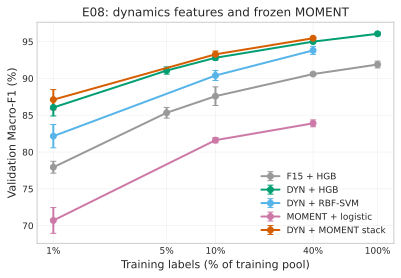

# E08：强动力学特征基线与冻结 MOMENT 堆叠结果（2026-10-20）

**状态：四 seed、22 条件/seed、88 条件全部完成；四条事前门槛全部通过；仅 validation，未构造或评价 test。**

核心结论：把 E01 的 15 维统计特征扩成 60 维原始尺度动力学特征后，HGB 在 40% 标签下的
validation Macro-F1 从 **90.60%** 提高到 **95.00%**（+4.41pp，4/4 seed）；再做冻结 MOMENT
概率堆叠可到 **95.46%**（再 +0.46pp，4/4 seed）。同预算 legacy masked TCN 仍为
**97.78%**，比堆叠高 **2.32pp**。因此本轮支持“强特征基线 + MOMENT 小幅增量”，不支持
“冻结 MOMENT 融合综合最优”。

## 1. 协议与执行

- 冻结时间 `2026-10-20T01:31:13Z`（Asia/Shanghai 09:31:13）；协议 SHA-256
  `de3ad5e74c1571bd74d923cf6bc744d4214e104a40c710edfe01e67e9f0d06e9`；特征契约 SHA-256
  `0948dfb183cd71d9e2189fe52a7b3b08a7ac7b77bdc0da4f76b01a7cfc52edce`。
- seed 42/44/45/46；排除产生假设的 seed43。训练标签预算 1%/5%/10%/40%/100%。
- 特征集：
  - `f15`：不修改 E01 的 15 维统计特征；
  - `dyn`：15 维基础特征 + 45 维原始尺度动力学/频谱/形状特征，共 60 维，只用有效观测，
    padding 不影响特征。
- 模型：HGB、RBF-SVM、MOMENT+logistic、HGB(dyn)+logistic(MOMENT) 概率堆叠。
- 选择：全部超参数只在所选训练子集内做分层 CV；validation 每个条件只评一次。没有 test。
- 运行：4 seed 并行、每进程 4 线程；每 seed 约 700 秒，总墙钟约 11.5 分钟。
- 完整性：88 个条件的逐样本 prediction CSV 独立复算 Macro-F1，最大误差 **0.0**；source
  drift 为空；MOMENT cache signature 全部核对通过。

## 2. 主结果（validation Macro-F1 %，均值 ± 样本 SD）

| 方法 | 1% | 5% | 10% | 40% | 100% |
|---|---:|---:|---:|---:|---:|
| F15 + HGB | 77.93 ± 0.80 | 85.34 ± 0.73 | 87.59 ± 1.27 | 90.60 ± 0.20 | 91.89 ± 0.46 |
| **DYN + HGB** | **86.05 ± 1.16** | **91.07 ± 0.49** | **92.81 ± 0.30** | **95.00 ± 0.17** | **96.06 ± 0.20** |
| F15 + RBF-SVM | 74.28 ± 1.36 | — | 86.48 ± 0.40 | 89.84 ± 0.56 | — |
| DYN + RBF-SVM | 82.16 ± 1.58 | — | 90.40 ± 0.68 | 93.81 ± 0.54 | — |
| MOMENT + logistic | 70.71 ± 1.75 | — | 81.62 ± 0.36 | 83.90 ± 0.47 | — |
| **DYN + MOMENT stack** | **87.12 ± 1.37** | — | **93.28 ± 0.45** | **95.46 ± 0.19** | — |
| E05C legacy masked TCN（上下文） | — | — | — | 97.78 ± 0.23 | — |

说明：

- `—` 表示该预算未在协议中运行，不是失败。
- MOMENT 单支明显弱于 F15/DYN；它只有在与强特征堆叠时才有增量。
- TCN 一行来自 E05C，训练/选择预算不同，只作同训练标签数的上下文，不作配对显著性主张。

## 3. 配对差与事前门槛

| 比较 | 预算 | 平均差 pp | 正向 seed | 描述性 95% 区间 | 门槛 |
|---|---:|---:|---:|---|---|
| DYN − F15（HGB） | 1% | +8.12 ± 0.60 | 4/4 | [+7.17, +9.07] | — |
| DYN − F15（HGB） | 5% | +5.74 ± 0.95 | 4/4 | [+4.22, +7.25] | — |
| DYN − F15（HGB） | 10% | +5.22 ± 1.13 | 4/4 | [+3.43, +7.01] | G2 ≥+2.0，**通过** |
| DYN − F15（HGB） | 40% | +4.41 ± 0.10 | 4/4 | [+4.24, +4.57] | G1 ≥+2.0，**通过** |
| DYN − F15（HGB） | 100% | +4.17 ± 0.60 | 4/4 | [+3.22, +5.12] | — |
| DYN − F15（SVM） | 1% | +7.87 ± 2.21 | 4/4 | [+4.35, +11.39] | — |
| DYN − F15（SVM） | 10% | +3.92 ± 0.66 | 4/4 | [+2.88, +4.97] | — |
| DYN − F15（SVM） | 40% | +3.97 ± 0.63 | 4/4 | [+2.97, +4.97] | G4 ≥+1.0，**通过** |
| stack − DYN（HGB） | 1% | +1.06 ± 0.40 | 4/4 | [+0.43, +1.70] | — |
| stack − DYN（HGB） | 10% | +0.47 ± 0.17 | 4/4 | [+0.20, +0.74] | — |
| stack − DYN（HGB） | 40% | +0.46 ± 0.10 | 4/4 | [+0.30, +0.62] | G3 ≥+0.3，**通过** |
| stack − F15（HGB） | 40% | +4.87 ± 0.18 | 4/4 | [+4.57, +5.16] | — |
| F15 SVM − F15 HGB | 40% | −0.76 ± 0.56 | 0/4 | [−1.66, +0.14] | — |

要点：

- G1/G2 说明“15 维 → 60 维”不是小幅调参，而是把统计基线整体抬高了 4–5pp；在 1% 标签下
  差距更大（+8.12pp）。
- G3 是**小幅但四 seed 同向**的 MOMENT 增量：40% 为 +0.46pp，10% 为 +0.47pp，1% 为
  +1.06pp。标签越少，MOMENT 的相对贡献越大，但绝对水平仍低于 TCN。
- F15 上 HGB 已优于 RBF-SVM；这说明旧 E01 “统计 SVM 是强基线”的结论只对 15 维特征成立，
  不能外推到更强的特征集。

### 逐 seed 40% 结果

| Seed | F15 HGB | DYN HGB | F15 SVM | DYN SVM | MOMENT logit | stack |
|---:|---:|---:|---:|---:|---:|---:|
| 42 | 90.39 | 94.83 | 90.18 | 93.81 | 83.70 | 95.42 |
| 44 | 90.87 | 95.17 | 90.32 | 94.47 | 83.88 | 95.60 |
| 45 | 90.60 | 95.13 | 89.06 | 93.83 | 83.47 | 95.62 |
| 46 | 90.53 | 94.87 | 89.79 | 93.13 | 84.56 | 95.21 |

seed44–46（未参与特征设计的确认 seed）上 DYN−F15 为 +4.30/+4.53/+4.35pp，
stack−DYN 为 +0.43/+0.48/+0.34pp；方向与 seed42 一致。

## 4. 电池异常（40% 标签，默认 argmax）

| 方法 | Recall % | FPR % | Average Precision % |
|---|---:|---:|---:|
| F15 + HGB | 89.56 | 4.92 | 96.85 |
| DYN + HGB | **95.10** | **2.71** | **98.98** |
| F15 + RBF-SVM | 86.86 | 4.27 | 94.42 |
| DYN + RBF-SVM | 93.09 | 3.17 | 97.10 |
| MOMENT + logistic | 77.84 | 9.58 | 88.12 |
| DYN + MOMENT stack | 95.52 | 2.44 | 98.61 |

动力学特征同时改善电池 recall 和 FPR，不是“用更多误报换召回”。这比 E03T 的
87.96%/3.90% 在量级上好得多，但两者数据角色不同（validation vs test），不能直接配对排名。
没有为电池类重新选阈值；以上是默认 argmax。

## 5. 特征组消融与重要性（40% 标签）

| 组 | 特征数 | 去掉该组 F1 % | 相对全特征 pp | 只用该组 F1 % |
|---|---:|---:|---:|---:|
| amplitude | 17 | 94.96 | −0.04 | 78.01 |
| length | 2 | 95.03 | +0.03 | 40.81 |
| **roughness** | 12 | **90.87** | **−4.13** | **90.48** |
| shape | 4 | 94.87 | −0.13 | 75.19 |
| spectral | 7 | 95.04 | +0.03 | 76.68 |
| trend | 18 | 94.61 | −0.40 | 82.55 |

- 去掉 roughness 组损失 4.13pp，是唯一大幅掉分的组；只用 roughness 就有 90.48%，超过
  完整 15 维特征。电池异常曲线的“粗糙度/转折/平台”信息是主要增益来源。
- 置换重要性前 8：`increasing_fraction`、`diff_abs_mean`、`max_abs_diff`、
  `diff_abs_over_mean`、`direction_turn_rate`、`plateau_fraction`、
  `diff_autocorrelation`、`length`。重要性是描述性的，且特征相关，不能作因果解释。
- length 单独只有 40.81%；去掉 length 不掉分，说明本轮不是长度捷径驱动的。

## 6. 训练成本

以下为单条件“含训练内 CV 选择”的中位耗时，单位秒；同一进程 4 线程，不含数据解析、
特征提取和 MOMENT cache 生成。

| 方法 | 10% | 40% | 100% |
|---|---:|---:|---:|
| F15 + HGB | 25.7 | 34.7 | 45.4 |
| DYN + HGB | 34.0 | 54.5 | 71.7 |
| F15 + RBF-SVM | 1.1 | 10.1 | — |
| DYN + RBF-SVM | 1.2 | 9.6 | — |
| MOMENT + logistic | 5.6 | 56.3 | — |
| DYN + MOMENT stack | 34.8 | 127.3 | — |

这不是端到端推理/部署成本，也没有与 GPU 上的 MOMENT 特征提取合并计时；不能把
“分类头秒级”写成“MOMENT 管线秒级”。冻结 MOMENT 的完整管线仍依赖 3.41 亿参数骨干。

## 7. 对论文结论的影响

E08 之后，旧的“融合 NN 91.52% 超过统计 SVM 90.95%”不能再作为主结果，因为 15 维统计
基线本身被证明弱了 4–5pp。可保留为历史 test 证据，但主表必须换成强特征基线。

当前可辩护的主张应按以下顺序组织：

1. **强特征基线**：紧凑的原始尺度动力学特征 + HGB，在 40% 标签下达到 95.00%，
   训练成本秒级；这是本任务必须报告的新基线。
2. **MOMENT 的小幅增量**：在强特征之上，冻结 MOMENT 的 OOF 概率堆叠带来
   +0.46pp（40%）、+0.47pp（10%）、+1.06pp（1%），四 seed 全部正向；它更适合作为
   “低标签时的补充信息”，而不是主引擎。
3. **TCN 仍是精度上限**：同 40% 标签 legacy masked TCN 为 97.78%，比堆叠高 2.32pp；
   不能宣称冻结 MOMENT 融合综合最优。
4. **机理**：增益集中在 roughness；电池异常类同时获得更高 recall 和更低 FPR。这支持
   “RevIN/z-score 的全局池化会丢局部动力学，原始尺度动力学特征把它补回来”的解释。
5. **成本取舍**：DYN+HGB 在 CPU 上秒级；MOMENT 堆叠额外几十秒；完整 MOMENT 管线仍
   需要 GPU 和大骨干。论文应把“精度—成本”作为一个明确的 trade-off，而不是只排名。

## 8. 必须保留的边界

- 这是 **validation-only** 研究；test 在历史研究中已被消费，本轮没有打开 test，也没有
  新的独立外部数据。
- 四个 seed 的 split 相互重叠，不是四个独立设备/人群；配对区间只描述本数据上的变异。
- 60 维特征是在 seed42 探索性探针之后冻结的；seed42 不构成独立确认，seed44–46 的方向
  一致，但同一数据集、同一验证集仍反复使用。
- 特征组高度相关，drop-group 结果不能解释为“该组单独因果贡献”；组消融和置换重要性
  只用于描述。
- 没有保存 sklearn 模型文件；逐样本预测、特征矩阵、选中参数和协议已保存，可用固定
  参数确定性重拟合。MOMENT cache 为 E01 FP32 z-score 版本。
- 没有做同硬件端到端推理基准、没有做校准/保形预测、没有做鲁棒性扰动；这些属于 E10。
- 没有做 TCN 与 DYN/MOMENT 的联合堆叠；这是下一步 E12，不能在当前结果里预判。

## 9. 下一步建议

1. **N2**：补 legacy TCN 的 1%/5% 学习曲线（4 seed），把低标签对照补完整；当前 1% 只有
   DYN/stack 的 86–87%，缺 TCN 的同预算点。
2. **E09**：给 MOMENT 增加动力学输入（原序列 + ΔP 双流，或 patch-token 动态统计），检验
   能否把 MOMENT 单支从 83.9% 提高到 86–88%，并把 stack 推到 95.5–96%。
3. **E12**：TCN logits + DYN + MOMENT 的 OOF 堆叠（需在训练子集内做 TCN 交叉拟合），
   目标是把 40% 的 97.78% 再抬高 0.3–0.6pp，形成“最佳系统”。
4. **E10**：校准/保形预测、幅值/噪声/缺失/前缀鲁棒性、同硬件端到端成本；用已保存的
   预测与模型做，不再追 test。
5. 若保留低标签价值主张，必须把 N2 + E12 一起报告；不能只报 1% 的 stack 87.12%。

## 10. 证据与复现

- 远程根：`/root/autodl-tmp/ElecClassification/artifacts/improvements/e08_strong_features/e08_strong_features_20261020_v1/`
- 本地保全：`artifacts/imports/e08_strong_features_20261020/e08_strong_features_20261020_v1/`（71 MB）
- 机器可读汇总：`analysis/summary.json`、`analysis/aggregate.csv`、`analysis/paired.csv`
- 逐 seed：`seed<seed>/seed_results.json`、`features.npz`、`conditions/<budget>/<method>/predictions.csv`
- 冻结协议：`frozen_protocol.json`；协议 JSON：
  `configs/experiments/improvements/e08_strong_features_protocol.json`
- 特征模块：`src/tcn_moment/dynamics_features.py`；分析模块：`src/tcn_moment/e08_analysis.py`
- 入口：`python -m tcn_moment.run_e08 {freeze,run}`；远程脚本：`scripts/run_e08_remote.sh`
- 图：`docs/figures/e08_macro_f1_vs_budget_20261020.svg/.png`

