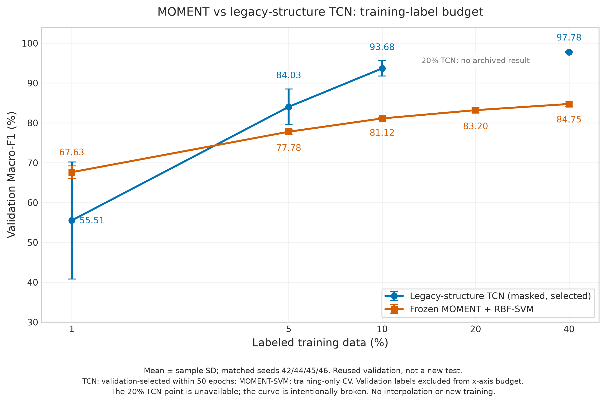

# 还原 legacy 结构后，MOMENT 的少标签优势还成立吗？

2026-10-21；仅复算已有 validation 预测并重画图，无训练、模型推理或新 test 评价。

## 结论

**原图“冻结 MOMENT + RBF-SVM 在 1%/5%/10% 均优于 TCN”的结论，不能推广到还原后的 legacy-structure TCN。**
在当前四个 seed 的 validation 上，MOMENT 只在 **1%** 预算平均领先；5%、10%、40% 均由新 TCN 平均领先。
这里比较的是原图对应的冻结 MOMENT + RBF-SVM 管线，不是后来加入 DYN、差分和 TCN 的融合系统。

| 训练标签比例 | MOMENT + RBF-SVM | Legacy masked TCN | MOMENT − TCN（pp） | MOMENT 更高的 seed |
|---:|---:|---:|---:|---:|
| 1% | 67.63 ± 1.57 | 55.51 ± 14.67 | +12.11 | 3/4 |
| 5% | 77.78 ± 0.68 | 84.03 ± 4.50 | −6.25 | 1/4 |
| 10% | 81.12 ± 0.22 | 93.68 ± 1.93 | −12.55 | 0/4 |
| 20% | 83.20 ± 0.68 | 未有本地已验收结果 | — | — |
| 40% | 84.75 ± 0.53 | 97.78 ± 0.23 | −13.03 | 0/4 |

数值为 **validation Macro-F1（%），四 seed 均值 ± 样本标准差**；固定 seed42/44/45/46。

1% 的 MOMENT−TCN 逐 seed 差为 +0.50、−2.37、+31.40、+18.93 pp。平均优势受两个 TCN 低分运行影响，
不能写成每次都明显领先，也不能视为 TCN 架构性能上限。可以保留“在此极少训练标签设置下，冻结表征的
平均表现更好、跨 seed 波动更小”的描述。该结论不意味着 MOMENT 优于 DYN 等非预训练强特征基线。
连线只作视觉引导，不能根据交点宣称已经测得准确的优势分界比例。

## 为什么不能直接替换旧图的一条线？

旧图 `docs/figures/few_shot_macro_f1_20260728.png` 是旧 TCN 与历史 MOMENT 的 **五 seed test** 结果。
新 TCN 来自 **四 seed validation**，不能把新 TCN validation 与旧 MOMENT test 拼在一张排名图里。
旧图保留作为历史记录，新图统一重新计算两个方法的四 seed validation 结果。

- MOMENT：E01 的 `moment_paper_svm`，冻结 FP32 表征、原论文对齐 RBF-SVM；训练内五折 CV 选 C。
  不使用五 seed 汇总，而是重新筛取相同四个 seed。与旧图的 AMP/test 管线也有精度和评价集差异。
- TCN：1%/5% 来自 N2，10%/40% 来自 E05C；固定 legacy masked 结构、raw 输入、50 轮，
  使用原规则的 validation-selected checkpoint，不换成 E12 固定端点，也不逐 seed 挑 N2b 最好学习率。
- 两方法在同 seed、同预算下的**有序训练 ID 完全一致**，validation 的有序 ID 和原始真值一致。
- 20% 的 E18 协议/代码已存在，但本轮没有本地已验收结果，不启动 E18，不插值造点；TCN 连线在该位置断开。
- legacy 是受控 PyTorch 结构移植，不是原 Keras 训练过程的逐位复现。

## 评价边界

TCN 使用 validation 选 checkpoint 和调学习率，MOMENT-SVM 使用训练内 CV；这是既定管线比较，
不是相同选模预算的单因素架构消融。横轴仅表示**训练池标签比例**，不包含 3510 个 validation 标签
以及历史开发成本，不能直接称为全流程标注效率。validation 已反复使用，四个划分相互重叠，
误差条是描述性样本 SD，不是独立外部实验的置信区间。

## 复核与产物

- 复算 36 个条件、126,360 行保存预测；原始 CSV 真值、有序 validation ID、TCN 概率/argmax 通过。
- 16 个配对条件的实际有序训练 ID 和记录指纹一致，TCN 预测及训练 ID 文件匹配其保存 SHA-256。
- Macro-F1 与保存值最大差 `2.22e-16`；本轮读取的源文件 SHA-256 记录在新汇总中。
- 新绘图检查的 5 个单元测试通过；没有运行模型训练/推理或完整项目测试套件。
- 脚本：`scripts/plot_legacy_tcn_moment_low_label.py`
- 数据与核验：`artifacts/analysis/legacy_tcn_moment_curve_20261021/{summary.json,per_seed.csv,aggregate.csv}`
- 图：`docs/figures/few_shot_legacy_tcn_validation_20261021.{png,svg}`

```bash
PYTHONPATH=src uv run --no-project --python /usr/bin/python3 --with matplotlib \
  python scripts/plot_legacy_tcn_moment_low_label.py
python3 -m unittest discover -s tests -p 'test_legacy_tcn_moment_plot.py' -v
```


