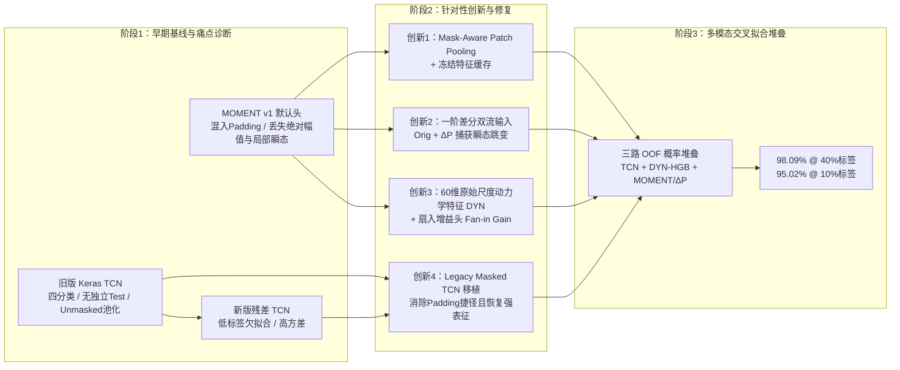

# 充电功率时序异常识别实验简要报告

> **项目主题**：融合功率动力学与预训练时序表征（MOMENT）的充电异常识别及适用性分析  
> **数据规模**：过滤无效标签 `5` 与短序列（$<18$）后共 **35,099** 条有效三分类序列（`0` 正常、`1` 充电器故障、`2` 电池异常），按 70% / 10% / 20% 固定分层划分为训练集（24,569）、验证集（3,510）与测试集（7,020）。  
> **说明**：完整精细数据与协议边界详见 `docs/experiment_records/final_evidence_synthesis_20261019.md` 与 `docs/experiment_records/evidence_scope_20261020.md`。

---

## 一、研究演进与整体架构

本项目围绕电动自行车充电功率时序三分类任务展开，经历了从“直接迁移基础模型失败”到“审计重构 TCN 基线”，再到“针对性改良 MOMENT 并构建三路互补融合系统”的完整演进过程：

---

## 二、预训练时序基础模型 MOMENT 的核心优点

在修复池化缺陷并引入任务适配机制后，3.41 亿参数的 `MOMENT-1-large` 展现出以下核心优势：

### 1. 预训练权重提供实质性的表征先验（非架构容量巧合）
在严格控制相同架构、相同 Mask-Aware 池化与相同下游分类器的条件下，对比**预训练权重**与**随机初始化编码器**（M01 与 E16 实验）：
- **SVM 协议下（M01，Test 5-seed）**：在 1%、5%、10% 极低标签预算下，预训练比随机初始化分别提升 **+28.60 pp**、**+22.58 pp** 和 **+22.01 pp**。
- **双流线性协议下（E16，Validation 4-seed）**：在 10% 与 40% 标签下，原序列流分别提升 **+22.48 pp** 与 **+20.57 pp**；双流（Orig+$\Delta P$）分别提升 **+9.97 pp** 与 **+6.00 pp**（全部 4/4 seed 同向提升）。

| 标签预算 | 输入流 / 协议 | 预训练 Macro-F1 (%) | 随机初始化 Macro-F1 (%) | 预训练净增益 (pp) |
|---:|---|---:|---:|---:|
| **1%** | 原序列 + RBF-SVM (M01 Test) | **68.05 ± 1.59** | 39.44 ± 5.00 | **+28.60** |
| **5%** | 原序列 + RBF-SVM (M01 Test) | **77.40 ± 0.93** | 54.81 ± 0.95 | **+22.58** |
| **10%** | 原序列 + RBF-SVM (M01 Test) | **80.77 ± 0.59** | 58.76 ± 1.26 | **+22.01** |
| **10%** | 原序列 + Logistic (E16 Val) | **81.27 ± 0.41** | 58.79 ± 0.98 | **+22.48** |
| **10%** | 原序列 + $\Delta P$ 双流 (E16 Val) | **91.24 ± 0.57** | 81.27 ± 0.65 | **+9.97** |
| **40%** | 原序列 + $\Delta P$ 双流 (E16 Val) | **92.77 ± 0.58** | 86.77 ± 0.49 | **+6.00** |

### 2. 低标签冷启动的稳定性与“还原 TCN 后”的重新审视
在早期五种子测试集实验（`few_shot_20260728`）中，冻结 `MOMENT + RBF-SVM` 在 1%、5%、10% 标签下全面击败当时的残差 TCN（领先 `+6.43 ~ +12.55 pp`）。但经过 **E05C（还原 Legacy Masked TCN 结构）** 与 **N2（补齐 1%/5% 低标签点）** 的严格同划分复核（`legacy_tcn_moment_low_label_comparison_20261021`），我们对低标签结论进行了更严谨的修正：

- **纯冻结 `MOMENT + RBF-SVM` 仅在 1% 极低标签下保持均值与稳定性优势**：在完全对齐的四种子验证集（seed 42/44/45/46）上，还原后的 `Legacy Masked TCN` 在 **5%、10%、40%** 预算下已反超纯原序列 `MOMENT + RBF-SVM`（分别领先 `6.25 pp`、`12.55 pp`、`13.03 pp`）。
- **1% 极低标签下 TCN 发生坍塌，而 MOMENT 保持极低方差**：在 **1% 标签（244 条训练样本）**下，还原后的 TCN 依然出现剧烈跨种子坍塌（均值 `55.51% ± 14.67%`，seed 45 跌至 `37.06%`），即使通过 N2b 遍历学习率（`3e-4 / 1e-3 / 3e-3`）也无法修复；而冻结 MOMENT 标准差仅 **1.57%**（均值 `67.63%`，领先 **+12.11 pp**，3/4 seed 占优），且在后续引入 $\Delta P$ 差分流与 DYN 特征后进一步推高至 **88.69%**。

| 训练标签比例 (训练样本数) | 冻结 MOMENT + RBF-SVM (Val %) | 还原后 Legacy Masked TCN (Val %) | MOMENT − TCN 配对差 (pp) | 逐 Seed 差值明细 (seed 42 / 44 / 45 / 46) | 占优 Seed 数 |
|---:|---:|---:|---:|---|---:|
| **1% (244)** | **67.63 ± 1.57** | 55.51 ± 14.67 | **+12.11 ± 15.95** | `+0.50 / -2.37 / +31.40 / +18.93` | **3/4 (MOMENT 占优)** |
| **5% (1,227)** | 77.78 ± 0.68 | **84.03 ± 4.50** | −6.25 ± 4.58 | `-8.44 / +0.60 / -8.13 / -9.02` | 1/4 (TCN 占优) |
| **10% (2,456)** | 81.12 ± 0.22 | **93.68 ± 1.93** | −12.55 ± 2.07 | `-11.67 / -14.52 / -13.96 / -10.07` | 0/4 (TCN 占优) |
| **20% (4,913)** | 83.20 ± 0.68 | *未有本地已验收结果（不插值）* | — | — | — |
| **40% (9,827)** | 84.75 ± 0.53 | **97.78 ± 0.23** | −13.03 ± 0.70 | `-13.50 / -12.80 / -13.68 / -12.15` | 0/4 (TCN 占优) |

> **图表对比说明**：下图左（上）为最新复核的**还原 Legacy Masked TCN 后同划分四种子 Validation 对比曲线**（20% TCN 处按真实证据断开不插值）；下图右（下）为早期针对未充分优化残差 TCN 的历史五种子 Test 曲线（保留作研究演进对照）。

### 3. 中等采集噪声下的相对稳健性与跨任务复用潜力
- **抗中等噪声能力（E13）**：当遭遇 $0.25\% \sim 0.5\%$ 全局 RMS 高斯采集噪声时，纯统计特征（DYN）迅速退化（0.5% 噪声下仅 `42.19%`），而 `MOMENT + ΔP` 双流仍保持 `85.89%`（0.25% 噪声）和 `68.23%`（0.5% 噪声），退化斜率显著缓于手工动力学特征。
- **零训练无监督检索（Retrieval）**：在不更新任何参数、不使用标签的情况下，直接对冻结 MOMENT 表征做余弦近邻检索，干净查询 `Macro-Precision@10` 达 **69.12%**，显著优于原始曲线重采样（65.99%）和仅长度基线（38.44%），尤其在最难的“电池异常（类别 2）”上比原始曲线高出 **+19.04 pp**。

---

## 三、新旧 TCN 暴露出的核心问题

项目对历史旧版 TCN（`legacy/`）与新版重构 TCN 进行了深入的代码与实验审计（E05A / E05B / E05C / N2 / E13），厘清了新旧两代 TCN 各自的问题：

### 1. 旧版历史 TCN（Legacy Keras TCN）的协议与表征隐患
1. **评估协议不规范，指标虚高**：
   - 包含极易通过“序列极短（平均长度仅 5.90）”直接识别的无效标签 `5`（四分类）；
   - 采用 80%/20% 随机划分，将同一个验证集同时用于逐轮观察和最终汇报，**无独立测试集**。
2. **Unmasked 全局平均池化存在 Padding / 长度敏感隐患（E05C 诊断）**：
   - 旧版 TCN 在时间维直接对包含尾部填充零（Padding）的整条定长张量求平均。
   - E05C 固定权重诊断表明：当有效序列完全不变、仅将 Padding 总长度从 `1024` 扩展到 `1536` 时，**Unmasked TCN 的最大 logit 漂移高达 418～531，分别改变了 100 条（10% 预算）和 33 条（100% 预算）样本的预测类别**；而改用 Masked Mean Pooling 后 logit 漂移严格为 `0`。

### 2. 新版 TCN（Current Residual TCN 及移植版 Legacy Masked TCN）的局限
1. **新版残差结构在中小样本下严重欠拟合（E05B/E05C）**：
   - 早期重构的新版 TCN 采用“4 个双卷积残差块（通道 64/64/128/128，dilation $1 \sim 8$，局部感受野 61）”。
   - 在 10% 标签预算下，新版残差 TCN 验证集 Macro-F1 仅为 **69.23% ± 1.61%**；而移植修复后的 6 层普通因果卷积（`legacy_masked50`，128 通道，dilation $1 \sim 32$，感受野 127）高达 **93.68% ± 1.93%**，两者差距达 **24.45 pp**。说明早期“MOMENT 大幅领先新版 TCN”很大程度上源于新版残差 TCN 结构配置不当。
2. **极低标签预算（1%–5%）下依然发生坍塌与高方差（N2/N2b）**：
   - 即使换回更强的 `Legacy Masked TCN`，在 **1% 标签（244 条）**下 Macro-F1 仍暴跌至 **55.51% ± 14.67%**（部分 seed 跌至 37.06%，接近多数类坍塌），在 **5% 标签**下为 **84.03% ± 4.50%**，远低于同预算的强特征系统（86.05% / 91.07%）。有界学习率搜索（N2b）无法修复该坍塌。
3. **固定轮数无验证集选模时波动大，且存在高幅噪声/量化悬崖（E12/E13）**：
   - 在 10% 标签下若不依赖 3,510 条大验证集挑最佳轮次（固定 50 轮余弦退火端点），TCN 性能从 `93.68%` 跌至 `89.04%`。
   - V100 上开启 FP16 AMP 时扩张卷积易发生前向溢出（`Non-finite loss`），必须强制 FP32。
   - 面对 $\ge 0.5\%$ 全局 RMS 噪声（约 0.96 个原始功率单位）或 $\ge 5$ 单位的量化失真时，clean 训练的 TCN 出现断崖式下跌（`97.53% -> 72.00% -> 29.13%`）。

| 对比维度 | 旧版 Keras TCN (`legacy/`) | 新版残差 TCN (`current_fixed50`) | 修复移植版 TCN (`legacy_masked50`) |
|---|---|---|---|
| **网络结构与感受野** | 6层因果卷积, 128ch, $d=1..32$ (RF=127) | 4个双卷积残差块, 64/128ch, $d=1..8$ (RF=61) | 6层因果卷积, 128ch, $d=1..32$ (RF=127) |
| **池化方式与Padding敏感性** | Unmasked Mean（Padding 改变会导致预测漂移） | Masked Mean（对 Padding 完全免疫） | **Masked Mean（对 Padding 完全免疫）** |
| **1% 标签 Validation F1** | 未定义（无统一协议） | 极低 | 55.51% ± 14.67%（严重坍塌/高方差） |
| **5% 标签 Validation F1** | 未定义 | 未测 | 84.03% ± 4.50%（低于同预算 DYN 91.07%） |
| **10% 标签 Validation F1** | 未定义 | 69.23% ± 1.61%（严重欠拟合） | **93.68% ± 1.93%**（无选模端点为 89.04%） |
| **40% 标签 Validation F1** | 未定义 | 92.22% ± 2.44% | **97.78% ± 0.23%**（无选模端点为 97.53%） |
| **100% 标签 Validation F1** | 97.54%（含标签5且无独立Test） | 96.64% ± 0.57% | **98.40% ± 0.17%** |

#### 附：还原后 Legacy Masked TCN 在 1% / 5% 极低标签下的学习率敏感性排查（N2b）
为确认 1% 标签下 TCN 的坍塌是否仅因固定学习率（`1e-3`）不适所致，N2b 在固定结构与 50 轮预算下对 AdamW 学习率进行了有界扫描，证实**调整学习率无法修复 1% 标签下的训练坍塌，1%–5% 低标签优势确实属于强特征与预训练融合系统**：

| 标签预算 | 学习率 `LR = 3e-4` | 学习率 `LR = 1e-3`（默认最优） | 学习率 `LR = 3e-3` | 同预算 `DYN + HGB` | 同预算 `DYN + (MOMENT+ΔP)` |
|---:|---:|---:|---:|---:|---:|
| **1% (244条)** | 46.74% ± 8.19% | 55.51% ± 14.67% (`37.1~68.2%`) | 51.14% ± 18.04% | **86.05% ± 1.16%** | **88.69% ± 1.79%** |
| **5% (1,227条)** | 79.80% ± 4.40% | 84.03% ± 4.50% (`77.4~86.9%`) | 81.86% ± 3.81% | **91.07% ± 0.49%** | — |

---

## 四、核心创新与改进：如何让 MOMENT 从 19% 蜕变到 98.09%

初始实验中，直接冻结 `MOMENT-1-large` 并微调默认线性头的 Macro-F1 仅为 **19.10%**（几乎全猜多数类），即便跑满多轮也只有 **69.46%**。项目通过深入剖析时序基础模型在充电功率场景的失配机理，提出了 **5 项关键改进**，使冻结 MOMENT 单支提升至 **93.57%**，多路融合系统达到 **98.09%**。

### 创新 1：Mask-Aware Patch Pooling 与冻结特征缓存（解决变长 Padding 污染与训练瓶颈）
- **问题根源**：`momentfm 0.1.4` 官方默认分类头虽向 Encoder 传入了 `input_mask`，但在最后池化时对全部 128 个 patch（含大量填充零 patch）直接求均值。由于充电序列长度跨度大（$18 \sim 816$），有效特征被 padding 严重稀释。
- **改进方案**：重写分类特征聚合层，严格仅对完整有效观测的 patch 进行掩码加权平均（`Mask-Aware Pooling`），并构建一次提取、多处复用的磁盘特征缓存机制。
- **效果**：仅此一项修复，线性探测测试集 Macro-F1 即从 **69.46%** 跃升至 **77.41%**（配合 RBF-SVM 达 **85.17%**），分类头单轮训练从近 10 分钟缩短至 **2.09 秒**（提速逾百倍）。

### 创新 2：引入一阶差分双流机制 `MOMENT(Orig + ΔP)`（解决平滑归纳偏置导致的局部跳变丢失）
- **问题根源**：MOMENT 将每 8 个时间步打包为一个 Patch 并经过全局自注意力池化，擅长捕捉宏观趋势，但严重平滑了充电故障中最关键的**局部功率毛刺、斜率突变与平台跳变**。
- **改进方案（E09）**：在不解冻、不微调 3.41 亿参数骨干的前提下，在有效观测区间内构造一阶差分序列 $\Delta P_t = P_t - P_{t-1}$（经单序列 z-score 后同样送入冻结 MOMENT 提取 1024 维表征），形成 **原序列 + 一阶差分双流拼接表征**。
- **效果**：在 40% 标签下，仅靠冻结 MOMENT 的单支分类器从原序列的 **83.91%** 暴涨至 **93.57%**（**+9.66 pp**，4/4 seed 正向）；在 1% 与 10% 标签下分别暴涨 **+13.38 pp** 与 **+10.03 pp**！电池异常召回率从 `77.87%` 跃升至 `94.31%`，误报率从 `9.60%` 降至 `3.43%`。

### 创新 3：构建 60 维原始尺度动力学特征（DYN）旁路（弥补 RevIN 归一化抹除的绝对幅值信息）
- **问题根源**：MOMENT 内置的 `RevIN`（可逆实例归一化）及逐序列 z-score 强制将每条曲线均值置 0、方差置 1，彻底抹除了充电功率的**绝对幅值信息**（如 98W 恒功率异常与正常高功率充电的区别）。
- **改进方案（E01 -> E08）**：将早期 15 维基础统计量扩展为 **60 维原始尺度动力学特征（DYN）**，涵盖幅值分位（17维）、粗糙度与转折率（12维，如 `increasing_fraction`、`direction_turn_rate`、`plateau_fraction`）、趋势（18维）、频谱（7维）与形状（4维）。
- **效果**：特征消融证实“粗糙度（Roughness）”组贡献最大（去掉掉分 4.13 pp）。DYN 配合梯度提升树（HGB）在 40% 标签下将纯特征基线从 15 维的 **90.60%** 拉升至 **95.00%**（1% 标签下更是提升 **+8.12 pp** 达 `86.05%`），与冻结 MOMENT 形成极强的物理尺度互补。

### 创新 4：分类头扇入尺度增益（Fan-in Scale Gain）与混合精度稳定性控制（解决冻结头优化停滞）
- **问题根源（E03D）**：直接将 L2 归一化或小尺度的冻结 MOMENT 特征与统计特征拼接送入 MLP 分类头时，第一层初始激活 RMS 仅有 `0.024~0.029`，导致梯度微弱、优化缓慢；同时 AMP 动态损失缩放（Loss Scale 飙至 32768）偶发非有限梯度崩溃。
- **改进方案**：引入无参全局输入增益因子 $\sqrt{1039 / \text{有效支路数}}$ 将初始激活 RMS 恢复至 `0.49~0.55`，并将混合精度缩放固定为 `scale=1024`、优化周期延展至 200 轮。
- **效果**：在不改动骨干网络的情况下，冻结融合分类头的验证集 Macro-F1 从 `83.85%` 直接提升至 **91.72%**（**+7.87 pp**），甚至超过了早期未充分优化头上的 LoRA 微调结果（88.98%），并在正式独立测试集（E03T）上取得 **91.52%**，稳健超越同期全部 6 个参照基线。

### 创新 5：三路异构特征五折交叉拟合概率堆叠（`TCN + DYN + MOMENT/ΔP` OOF Stacking）
- **改进方案（E12 / E12b）**：不再让单一模型单打独斗，而是在训练子集内通过 5 折交叉拟合（Out-of-Fold, OOF）生成无偏概率，用轻量级 Meta Logistic 组合 **任务专用局部感受野（TCN）**、**原始物理尺度与粗糙度（DYN-HGB）** 与 **预训练全局及瞬态语义（MOMENT Orig+$\Delta P$）**，并辅以温度缩放（E10）改善低标签欠自信问题（10% 标签 ECE 从 `3.52%` 降至 `0.94%`）。
- **效果**：在 10% 标签下取得 **95.02% ± 0.33%**（比最优双路组合 `TCN+DYN` 稳健提升 **+0.76 pp**，4/4 seed 正向）；在 40% 标签下取得全项目最高精度 **98.09% ± 0.23%**（电池异常召回率达 **97.38%**，误报率仅 **0.85%**）。

---

## 五、关键实验数据总览与 MOMENT 净增益深度剖析

### 1. 全项目跨标签预算（1%–100%）主方法对照总表（Validation 四种子均值 ± SD）

将还原后的 `Legacy Masked TCN`、手工动力学特征 `DYN`、双流 `MOMENT(Orig+ΔP)` 及其堆叠系统置于同一训练子集 ID 与同一验证集下横向对比（N2 / E05C / E08 / E09 / E12b）：

| 方法体系 | 1% 标签 (244) | 5% 标签 (1,227) | 10% 标签 (2,456) | 40% 标签 (9,827) | 100% 标签 (24,569) | 核心角色定位 |
|---|---:|---:|---:|---:|---:|---|
| **冻结 MOMENT + RBF-SVM** (E01) | 67.63 ± 1.57 | 77.78 ± 0.68 | 81.12 ± 0.22 | 84.75 ± 0.53 | — | 原论文对齐基准（仅1%胜TCN） |
| **冻结 MOMENT 原序列 + Logistic** | 70.71 ± 1.75 | — | 81.61 ± 0.36 | 83.91 ± 0.44 | — | 丢失绝对幅值与高频瞬态 |
| **冻结 MOMENT(Orig+$\Delta P$) 双流** (E09) | 84.09 ± 1.88 | — | 91.64 ± 0.57 | 93.57 ± 0.56 | — | 差分流补足瞬态（单支+9.66~13.38pp） |
| **15维基础统计 F15 + HGB** (E08) | 77.93 ± 0.80 | 85.34 ± 0.73 | 87.59 ± 1.27 | 90.60 ± 0.20 | 91.89 ± 0.46 | 早期手工统计特征基线 |
| **60维动力学特征 DYN + HGB** (E08) | 86.05 ± 1.16 | **91.07 ± 0.49** | 92.81 ± 0.30 | 95.00 ± 0.17 | 96.06 ± 0.20 | 极低标签核心支柱（秒级CPU训练） |
| **DYN + MOMENT 原序列 Stack** (E08) | 87.12 ± 1.37 | — | 93.28 ± 0.45 | 95.46 ± 0.19 | — | 原序列MOMENT提供+0.46~1.06pp增量 |
| **DYN + MOMENT(Orig+$\Delta P$) Stack** (E09) | **88.69 ± 1.79** | — | 94.26 ± 0.56 | 96.01 ± 0.31 | — | 无TCN时最强特征+预训练堆叠 |
| **Legacy Masked TCN (选模最优)** (N2/E05C) | 55.51 ± 14.67 | 84.03 ± 4.50 | 93.68 ± 1.93 | 97.78 ± 0.23 | **98.40 ± 0.17** | 1%坍塌；$\ge 5\%$反超纯MOMENT；高标签上限 |
| **Legacy Masked TCN (固定50轮端点)** (E12) | — | — | 89.04 ± 0.38 | 97.53 ± 0.29 | — | E12内部无验证集选模的TCN基线 |
| **Full Stack (TCN + DYN + MOMENT/ΔP)** (E12b) | — | — | **95.02 ± 0.33** | **98.09 ± 0.23** | — | **三路异构互补最佳系统** |

---

### 2. MOMENT 改进路线效果演进表（40% 标签预算为主）

| 演进阶段 | 代表实验与方法配置 | 核心改进点 | Macro-F1 (%) | 电池异常 Recall / FPR (%) |
|---|---|---|---:|---:|
| **阶段 0：初始直接迁移** | 冻结 MOMENT + 默认头 (1 epoch) | 无（含 Padding 池化 + 极小学习率） | 19.10 (Test) | 99.58 / 62.89（全猜类别2） |
| **阶段 1：默认池化多轮** | 冻结 MOMENT v1 + 线性头 | 仅增加训练轮次，未排除 Padding | 69.46 ± 0.76 (Test) | 52.78 / —（严重漏检） |
| **阶段 2：修复掩码池化** | 冻结 MOMENT v2 + 线性头 / RBF-SVM | **创新1：Mask-Aware Pooling** | 77.41 / 85.17 (Test) | — |
| **阶段 3：引入统计旁路与增益头** | 冻结 MOMENT + 15维统计 + 增益MLP (E03T) | **创新4：Fan-in 尺度增益 + 原始统计旁路** | 91.52 ± 0.38 (Test) | 87.96 / 3.90 |
| **阶段 4：一阶差分双流** | 冻结 MOMENT (Orig + $\Delta P$) 单支 (E09) | **创新2：一阶差分流捕获局部跳变** | 93.57 ± 0.56 (Val) | 94.31 / 3.43 |
| **阶段 5：强动力学特征堆叠** | DYN (60维) + MOMENT (Orig + $\Delta P$) (E09) | **创新3：60维原始尺度动力学特征 + OOF堆叠** | 96.01 ± 0.31 (Val) | 96.35 / 2.18 |
| **阶段 6：三路异构完整融合** | **TCN + DYN + MOMENT(Orig+$\Delta P$)** (E12b) | **创新5：三路交叉拟合概率堆叠** | **98.09 ± 0.23** (Val) | **97.38 / 0.85** |

---

### 3. 完整融合在 10% / 40% 的表现与 MOMENT 净增益拆解（E12 & E12b 修正版）

为严格回答“**加入 TCN 和强特征 DYN 后，MOMENT 双流究竟还剩多少不可替代的净增益？增益是否只是因为多加了一层 Meta 分类头？**”，项目在 E12（五折交叉拟合堆叠）与 E12b（修正版 64 条件完整消融，统一 `MOMENT/ΔP` 支路正则参数 `C=1.0`，并补齐单支 `tcn_meta` 控制）中进行了逐级剥离。

#### （1）10% 与 40% 完整融合八种配置全消融主表（E12b 修正版 & E17 成本）

| 支路组合方案 | 10% 标签 Val Macro-F1 (%) | 10% 逐 Seed (42 / 44 / 45 / 46) | 40% 标签 Val Macro-F1 (%) | 40% 逐 Seed (42 / 44 / 45 / 46) | 40% 电池 Recall / FPR (%) | 推理延迟 (bs=32, ms/sample) |
|---|---:|---|---:|---|---:|---:|
| **① TCN 单支** (`tcn_full` 固定50轮无选模*) | 89.04 ± 0.38 | `89.29 / 89.16 / 89.24 / 88.48` | 97.53 ± 0.29 | `97.61 / 97.90 / 97.27 / 97.33` | 95.72 / 0.62 | **0.039** |
| **② TCN + 同型 Meta 头** (`tcn_meta` 控制) | 90.71 ± 0.99 | — | 97.65 ± 0.24 | — | 96.05 / 0.67 | ~0.040 |
| **③ DYN 单支** (60维 + HGB) | 92.81 ± 0.30 | — | 95.00 ± 0.17 | `94.83 / 95.17 / 95.13 / 94.87` | 95.10 / 2.71 | 2.00 |
| **④ MOMENT/ΔP 单支** (`md`, 固定 C=1.0) | 91.24 ± 0.57 | — | 92.77 ± 0.58 | — | 93.33 / 3.81 | ~8.90 |
| **⑤ DYN + MOMENT/ΔP** (`stack_no_tcn`) | 94.26 ± 0.56 | `94.62 / 94.80 / 93.56 / 94.06` | 96.02 ± 0.28 | `96.10 / 96.21 / 96.16 / 95.61` | 96.35 / 2.16 | ~10.90 |
| **⑥ TCN + MOMENT/ΔP** (`tcn+md`) | 93.81 ± 0.48 | — | 97.82 ± 0.25 | — | 96.57 / 0.69 | ~8.96 |
| **⑦ TCN + DYN** (`tcn+dyn`) | 94.26 ± 0.47 | — | 97.93 ± 0.22 | — | 96.88 / 0.79 | 1.97 |
| **⑧ Full (TCN + DYN + MOMENT/ΔP)** | **95.02 ± 0.33** | `95.06 / 95.42 / 95.00 / 94.62` | **98.09 ± 0.23** | `97.99 / 98.43 / 97.89 / 98.06` | **97.38 / 0.85** | 10.96 |

> *口径说明：E12 为避免验证集泄漏，每折及全量 TCN 均采用“固定 50 轮余弦退火、不看 validation 挑轮次”，因此 10% `tcn_full` 为 `89.04%`（40% 为 `97.53%`）。若与 E05C 使用 3,510 条验证集选模的强 TCN（10% `93.68%`、40% `97.78%`）作跨协议上下文对比，Full Stack 在 10% 仍高出 **+1.34 pp**，在 40% 高出 **+0.31 pp**。

#### （2）MOMENT 净增益与各支路互补贡献的逐层拆解表（配对差值分析）

| 归因维度与配对比较 | 10% 标签净增益 (pp) | 10% 正向 Seed | 40% 标签净增益 (pp) | 40% 正向 Seed | 核心机制解读 |
|---|---:|---:|---:|---:|---|
| **1. 排除 Meta 头自身增益**：`tcn_meta − tcn` | +1.67 ± 1.08 | 4/4 | +0.12 ± 0.05 | 4/4 | 仅套一层同型 Meta 头增益有限（40%仅+0.12pp） |
| **2. 完整融合相对 Meta-TCN**：`full − tcn_meta` | **+4.31 ± 1.22** | **4/4** | **+0.44 ± 0.13** | **4/4** | 证明融合收益来自异构特征互补，而非多一层分类头 |
| **3. 完整融合相对单支 TCN**：`full − tcn` | **+5.98 ± 0.25** | **4/4** | **+0.56 ± 0.14** | **4/4** | McNemar 检验 10% $p<0.001$，40% 四 seed 均 $p<0.05$ |
| **4. TCN 注入的边际净增益**：`full − (dyn+md)` | **+0.76 ± 0.46** | **4/4** | **+2.07 ± 0.32** | **4/4** | 40% 高标签下 TCN 是将精度从 96% 推上 98% 的主力 |
| **5. DYN 注入的边际净增益**：`full − (tcn+md)` | **+1.21 ± 0.34** | **4/4** | **+0.27 ± 0.15** | **4/4** | 原始尺度动力学特征在 10% 和 40% 均提供稳健正贡献 |
| **6. MOMENT 在无 TCN 时的净增益**：`(dyn+md) − dyn` | **+1.45 ± 0.36** | **4/4** | **+1.02 ± 0.21** | **4/4** | 在纯特征基线 DYN 之上，MOMENT 双流稳定贡献 +1.0~1.5pp |
| **7. MOMENT 在 TCN 之上的净增益**：`(tcn+md) − tcn` | **+4.77 ± 0.45** | **4/4** | **+0.29 ± 0.05** | **4/4** | 单独辅助 TCN 时，MOMENT 双流在两预算均 4/4 正向提升 |
| **8. MOMENT 最终三路边际净增益**：`full − (tcn+dyn)` | **+0.76 ± 0.45** | **4/4 (稳健)** | **+0.16 ± 0.12** | **3/4 (微幅)** | **最严苛检验**：10% 下不可替代（+0.76pp），40% 下大部被 TCN+DYN 覆盖 |

#### （3）10% 与 40% 完整融合的校准、长序列改善与安全边界（E10）
- **概率校准特性**：**40% Full Stack** 原生已高度校准（ECE 仅 `0.56%`，最优温度 `T=1.001`，无需缩放）；**10% Full Stack** 表现为**欠自信（Under-confident）**（平均置信度 `92.21%` 低于实际准确率 `95.01%`，ECE 为 `3.52%`），经温度缩放（`T=0.853` 锐化）后 ECE 降至 **0.94%**，NLL 从 `0.1717` 降至 `0.1518`。
- **错误修正与序列长度分层**：40% 下 Full Stack 相比单支 TCN 每个 seed 净修对 `23~33` 条样本、仅新弄错 `6~9` 条（McNemar $p<0.05$）；按序列长度分层显示，**Full Stack 在最长序列区间（长充电过程）对 TCN 的改善幅度最大**，印证了 MOMENT 全局 Patch 注意力对长程上下文的补充作用。

---

## 六、结论与工程适用边界（Takeaways）

1. **为什么需要融合系统（信息互补机理）**：
   - **MOMENT（原序列 + $\Delta P$）** 提供跨领域的宏观波形先验与对中等采集噪声的缓冲能力；
   - **DYN（60维动力学特征）** 补齐被 RevIN 归一化抹除的原始功率绝对幅值与局部粗糙度，撑起 1%–5% 极低标签区间的性能下限（避免 TCN 坍塌）；
   - **Legacy Masked TCN** 在标签充足（$\ge 10\%$）时提供高精度的局部因果卷积判别力，并对 Padding 长度变化完全免疫。
2. **MOMENT 净增益的条件性（精度—成本权衡）**：
   - 在 **10% 标签**下，当 TCN 未经验证集充分选模时，加入 MOMENT/$\Delta P$ 使三路系统相对 `TCN+DYN` 稳健提升 **+0.76 pp**（4/4 seed）；
   - 在 **40% 标签**下，`TCN+DYN` 已达 `97.93%`，再引入 3.41 亿参数的 MOMENT 双流虽能将精度推至 **98.09%**（净增 **+0.16 pp**，电池召回提升 0.50 pp），但每样本推理耗时增加约 **5.3 倍**（`1.97 ms -> 10.96 ms`），显存峰值达 `2.49 GB`。因此实际部署时应根据算力预算在 `TCN+DYN`（高性价比）与 `Full Stack`（极限精度与高召回）之间按需取舍。
3. **部署鲁棒性警示（E13 负结果边界）**：
   - 仅在干净数据（Clean）上训练的任何模型（含完整融合系统）面对 $\ge 0.5\%$ 全局 RMS 高斯噪声或 $\ge 5$ 单位的量化失真时均会出现严重性能衰减（其中 DYN 的 `max_runup` 特征因近零分母最易发生数值跳变）。工程上线前必须对 DYN 分母做数值下界裁剪，并引入噪声/量化数据增广。
