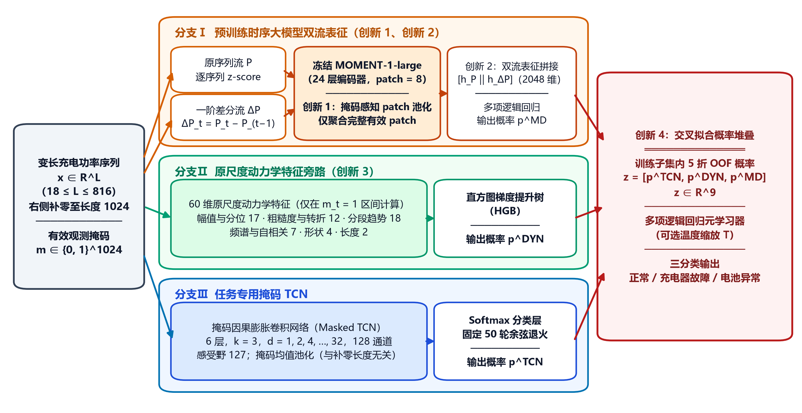
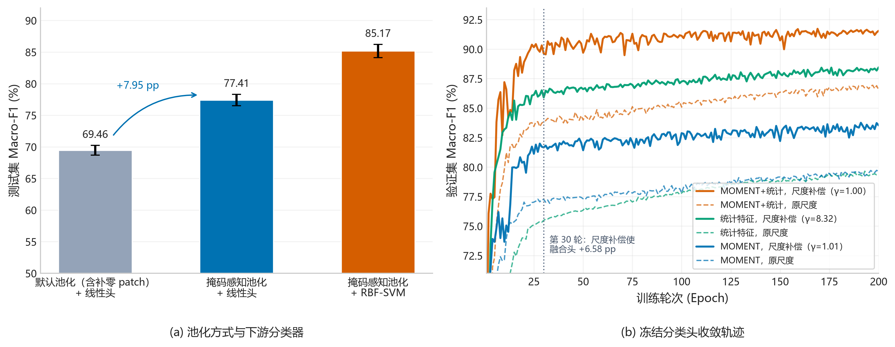
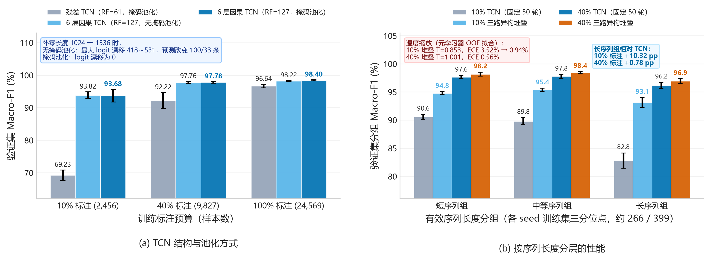
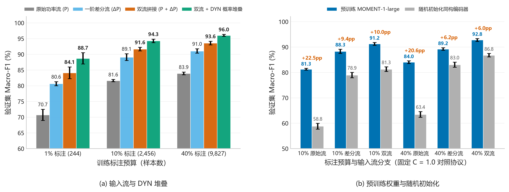
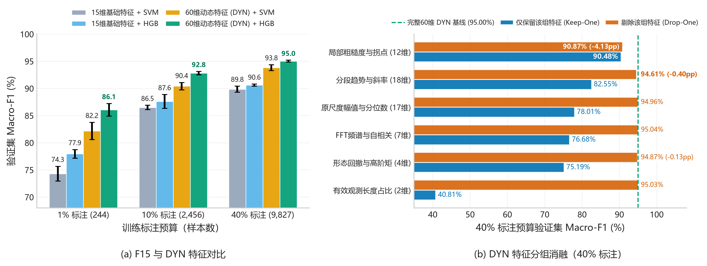
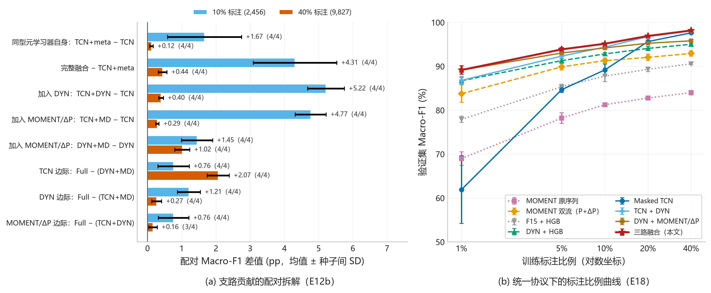
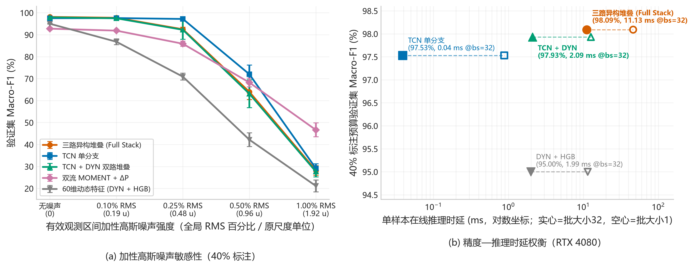

# 基于时序大模型的锂电池充电功率曲线分类方法研究与实现

（作者姓名）$^{1}$，（作者姓名）$^{1}$

（1. 单位全称 学院，城市 邮编）

**摘　要**：电动自行车锂电池充电功率曲线隐含充电器故障与电池异常信息，但曲线长度差异大（18～816 个采样点）、标注成本高，直接迁移通用时序大模型效果欠佳。针对这一问题，提出一种融合冻结时序大模型表征、原尺度动力学特征与掩码时间卷积网络的三分类方法。首先，针对 MOMENT 默认分类头将补零 patch 计入池化的问题，设计掩码感知 patch 池化，使冻结表征线性探测的测试集 Macro-F1 由 69.46% 提高到 77.41%；其次，在不更新骨干参数的前提下引入一阶差分双流输入，以补偿 patch 化编码对局部跳变的平滑，40% 标注下单支 Macro-F1 由 83.91% 提高到 93.57%；然后，构建 60 维原尺度动力学特征旁路，恢复逐序列归一化抹除的绝对功率幅值信息；最后，通过训练子集内 5 折交叉拟合概率堆叠融合三路异构判别信息。在 35,099 条真实充电记录上的 4 种子实验表明：40% 与 10% 标注下完整模型的验证集 Macro-F1 分别为 98.09%±0.23% 与 95.02%±0.33%，40% 标注下电池异常召回率 97.38%、误报率 0.85%；同架构对照显示，预训练权重相对随机初始化使双流分支提高 6.00～9.97 个百分点。研究同时给出了精度—时延权衡与采集噪声敏感性边界，可为充电安全监测中的模型选型提供参考。

**关键词**：时序大模型；MOMENT；锂电池；充电功率曲线；时间序列分类；特征融合；掩码池化

**中图分类号**：TP391；TM912　　**文献标志码**：A

---

**Research and Implementation of a Charging Power Curve Classification Method for Lithium Batteries Based on a Time-Series Foundation Model**

(Author Name)$^{1}$, (Author Name)$^{1}$

(1. School, University, City Postcode, China)

**Abstract**: Charging power curves of lithium batteries for electric bicycles carry information about charger faults and battery anomalies, yet the curves vary greatly in length (18–816 samples) and labels are costly, so directly transferring a general time-series foundation model performs poorly. A three-class method that fuses frozen foundation-model representations, raw-scale dynamics features and a masked temporal convolutional network is proposed. First, a mask-aware patch pooling is designed to exclude padded patches that the default MOMENT head averages, raising the test Macro-F1 of a frozen linear probe from 69.46% to 77.41%. Second, a first-order difference stream is added without updating the backbone to compensate for the smoothing of local jumps by patch encoding, improving the single-branch Macro-F1 from 83.91% to 93.57% with 40% labels. Third, a 60-dimensional raw-scale dynamics feature branch restores the absolute power amplitude removed by per-series normalization. Finally, the three heterogeneous branches are combined by five-fold cross-fitted probability stacking inside the training subset. Experiments on 35,099 real charging records with four random seeds show validation Macro-F1 of 98.09%±0.23% and 95.02%±0.33% with 40% and 10% labels, respectively; with 40% labels the battery-anomaly recall is 97.38% at a false positive rate of 0.85%. A same-architecture control shows that pretrained weights improve the dual-stream branch by 6.00–9.97 percentage points over random initialization. The accuracy–latency trade-off and the sensitivity to acquisition noise are also reported to guide model selection for charging safety monitoring.

**Key words**: time-series foundation model; MOMENT; lithium battery; charging power curve; time series classification; feature fusion; masked pooling

---

## 0　引　言

电动自行车保有量大、充电场景分散，充电过程中的充电器故障与电池异常是引发热失控和火灾的重要诱因。与依赖电芯电压、温度等多维 BMS 信号的电池故障诊断[1]不同，大量充电桩只能稳定采集单通道的充电功率序列。若能仅凭功率曲线识别“正常 / 充电器故障 / 电池异常”三类状态，即可在不加装传感器的条件下实现低成本的非侵入式安全监测[2-3]。

该任务有三点难度。其一，充电时长差异大，有效序列长度从 18 到 816 不等，批处理时需大量补零，而序列长度本身又与类别相关，模型容易借补零长度形成“捷径”；其二，故障判别同时依赖绝对功率水平、局部跳变和整体形态，单一模型难以兼顾；其三，人工核验标注成本高，可用标注常常只占全部数据的一小部分。

近年来，MOMENT[4]、TimesFM[5]、Chronos[6] 等时序大模型在大规模跨领域数据上预训练，在少样本与零样本场景展现出较好的迁移能力，也开始被用于工业故障诊断[7]与工程监测预测[8]。然而本文实验发现，直接冻结 MOMENT-1-large 并训练其默认分类头，在充电功率三分类上的测试集 Macro-F1 仅为 69.46%，明显低于任务专用的时间卷积网络（TCN）。分析表明失配主要来自三个环节：默认分类头的池化把补零 patch 一并平均；patch 化编码与全局注意力平滑了局部功率跳变；逐序列归一化与可逆实例归一化（RevIN）[9] 抹除了绝对功率幅值。

现有工作多从两个方向改进时序分类：一是设计更强的专用网络，如 TCN[10]、多尺度 Transformer 与形态卷积结合[11]、改进 Transformer[12]；二是使用 ROCKET 系列随机卷积核[13-14] 等高效变换。对于大模型迁移，则多集中在预测任务的输入表示优化，较少讨论变长分类场景中池化、归一化与领域先验之间的失配。针对上述问题，本文的主要工作如下：

1）提出**掩码感知 patch 池化**，仅聚合完整有效观测的 patch 表征，消除补零对冻结表征的稀释，并结合特征缓存使分类头训练由约 2 min/轮降至约 2 s/轮；

2）提出**冻结骨干下的一阶差分双流表征**，以零可训练骨干参数补偿 patch 化编码对局部跳变的平滑；

3）构建 **60 维原尺度动力学特征（DYN）旁路**，显式补回被逐序列归一化抹除的绝对功率幅值与局部粗糙度信息；

4）设计**训练子集内交叉拟合的三路概率堆叠**，融合时序大模型、DYN 与掩码 TCN 的互补判别信息，并通过配对消融、预训练归因、噪声扰动和同机端到端成本测量，给出方法的适用边界。

## 1　问题描述与数据

### 1.1　任务定义

设第 $i$ 条充电记录的有效功率序列为 $\boldsymbol{x}_i=(x_{i,1},\dots,x_{i,L_i})$，$18\le L_i\le 816$。为批处理，将其右侧补零至 $T=1024$，并记二值掩码 $\boldsymbol{m}_i\in\{0,1\}^T$，有效观测处 $m_{i,t}=1$。任务是学习映射 $f:(\boldsymbol{x}_i,\boldsymbol{m}_i)\mapsto y_i\in\{0,1,2\}$，三类分别为正常、充电器故障和电池异常。由于漏检电池异常的代价最高，除 Macro-F1 外，本文同时报告电池异常类的召回率（Recall）与误报率（FPR）。

### 1.2　数据集

数据来自某电动自行车充电运营平台的真实运行记录，原始共 46,535 条。业务标签 5 表示无效或不完整记录（中位长度 1 个采样点），按既定口径不参与三分类；再剔除长度小于 18 的序列后，得到 35,099 条有效记录，其中无重复序列与冲突标签。按 7∶1∶2 分层划分为训练集、验证集和测试集，各类样本数见表 1。

<b>表 1　数据集划分与类别分布</b>

| 子集 | 正常 | 充电器故障 | 电池异常 | 合计 |
|:---:|---:|---:|---:|---:|
| 训练集 | 8,480 | 7,014 | 9,075 | 24,569 |
| 验证集 | 1,212 | 1,002 | 1,296 | 3,510 |
| 测试集 | 2,423 | 2,004 | 2,593 | 7,020 |
| 合计 | 12,115 | 10,020 | 12,964 | 35,099 |

需要指出，仅用“序列长度”一个特征训练的深度为 3 的决策树即可在测试集上取得 35.76% 的 Macro-F1（多数类基线为 17.98%），说明长度与类别存在关联。因此，所有模型都必须用掩码排除补零，并按长度分层报告结果，避免把“补零长度”误当作功率形态信息。

## 2　方法

### 2.1　总体框架

所提方法的总体框架如图 1 所示。输入序列与掩码同时送入三条支路：支路Ⅰ为冻结 MOMENT-1-large 的原序列/差分双流表征，经多项逻辑回归输出概率 $\boldsymbol{p}^{\mathrm{MD}}$；支路Ⅱ在有效观测区间提取 60 维原尺度动力学特征，经直方图梯度提升树（HGB）[15] 输出 $\boldsymbol{p}^{\mathrm{DYN}}$；支路Ⅲ为掩码因果膨胀卷积网络，输出 $\boldsymbol{p}^{\mathrm{TCN}}$。三路概率拼接为 9 维元特征，由逻辑回归元学习器给出最终类别。

<b>图 1　所提方法的总体框架</b>

### 2.2　掩码感知 patch 池化

MOMENT 将长度 $T$ 的输入按 $P=8$ 划分为 $N=T/P=128$ 个不重叠 patch，经 24 层 Transformer 编码器得到 patch 表征 $\boldsymbol{h}_{i,1},\dots,\boldsymbol{h}_{i,N}\in\mathbb{R}^{1024}$。momentfm 0.1.4 的默认分类头虽将掩码传入编码器，但在池化时对全部 $N$ 个 patch 求平均。对于长度为 18 的序列，128 个 patch 中仅 2 个完整有效，其余 126 个补零 patch 主导了序列表征。

本文定义 patch 有效性掩码
$$
\tilde m_{i,n}=\prod_{t=(n-1)P+1}^{nP} m_{i,t},\qquad n=1,\dots,N \tag{1}
$$
即仅当 patch 内全部采样点均为有效观测时才视为有效，并以掩码加权平均得到序列表征
$$
\boldsymbol{z}_i=\frac{\sum_{n=1}^{N}\tilde m_{i,n}\,\boldsymbol{h}_{i,n}}{\sum_{n=1}^{N}\tilde m_{i,n}} . \tag{2}
$$
式（2）使表征与补零长度无关：在固定合成序列上将补零长度由 512 改为 1024 或在掩码外填入随机值，表征最大差异不超过 $4.2\times10^{-7}$（浮点误差量级）。由于骨干冻结，$\boldsymbol{z}_i$ 只需对训练、验证、测试集各提取一次并缓存，下游分类器训练不再重复前向 3.41 亿参数的编码器。

### 2.3　一阶差分双流表征

MOMENT 以 8 点 patch 为最小建模单元，并在输入端做实例归一化，擅长刻画整体趋势，但会平滑功率曲线中的毛刺、斜率突变和平台跳变，而这些恰是充电器故障的主要表现。为此，在有效区间内构造一阶差分序列
$$
\Delta x_{i,t}=x_{i,t+1}-x_{i,t},\qquad t=1,\dots,L_i-1 , \tag{3}
$$
对原序列与差分序列分别做逐序列 z-score 标准化后，送入**同一个冻结编码器**，按式（2）得到 $\boldsymbol{z}_i^{P}$ 与 $\boldsymbol{z}_i^{\Delta P}$，拼接为 2048 维双流表征 $[\boldsymbol{z}_i^{P}\,\|\,\boldsymbol{z}_i^{\Delta P}]$，再训练 L2 正则多项逻辑回归（$C=1.0$）。差分流的掩码长度相应缩短 1。该设计不增加任何骨干参数，也不需要微调。

### 2.4　原尺度动力学特征旁路

z-score 与 RevIN 将每条曲线变换为零均值、单位方差，彻底抹除了绝对功率水平；但对充电过程而言，“恒定在某一低功率平台”与“正常高功率充电”恰恰依赖幅值区分。为此，本文在原始记录尺度、仅在有效观测区间上提取 60 维动力学特征（DYN），分为 6 组（表 2）。其中前 15 维为常用统计量，其余 45 维刻画局部动力学、频谱与形状。

<b>表 2　DYN 特征分组</b>

| 特征组 | 维数 | 代表特征 |
|:---|:---:|:---|
| 幅值与分位 | 17 | 均值、标准差、最值、5%～95% 分位数、变异系数、末/首值比 |
| 粗糙度与转折 | 12 | 差分绝对值均值与 90% 分位、上升占比、方向转折率、平台占比、最长平台占比 |
| 分段趋势 | 18 | 整体及首/尾段斜率、三等分段均值与标准差、尾段−首段差 |
| 频谱与自相关 | 7 | 4 段频带能量、主频、水平自相关、直方图熵 |
| 形状 | 4 | 最大回撤、最大上冲、偏度、峰度 |
| 长度 | 2 | 有效长度及其与最大长度之比 |

DYN 由 HGB 分类，训练只需 CPU 数秒，在所有标注比例下均固定同一组超参数（最大迭代 400、学习率 0.08、叶子数 31）。

### 2.5　掩码 TCN 支路

TCN 支路采用 6 层因果膨胀卷积，卷积核 $k=3$，膨胀率 $d\in\{1,2,4,8,16,32\}$，128 通道，感受野为 $1+2\sum d=127$ 个采样点，各层后接 SpatialDropout（0.3）。与原业务部署版本不同，本文将最后的全局平均池化替换为与式（2）相同形式的掩码均值池化，使输出与补零长度严格无关（3.2 节）。训练采用 AdamW（学习率 $10^{-3}$，权重衰减 $10^{-4}$）、批大小 32、余弦退火 50 轮，为避免利用验证集挑选轮次，取第 50 轮端点模型，全程 FP32。

### 2.6　交叉拟合概率堆叠

若直接在训练集上拟合基模型再用其训练集预测训练元学习器，元学习器会过度信任过拟合的基模型。为此，在每个标注子集内部做 5 折分层交叉拟合：对第 $k$ 折，用其余 4 折训练三条支路，得到该折样本的折外（OOF）概率；三条支路使用**完全相同**的折划分。拼接得到训练元特征
$$
\boldsymbol{u}_i=[\boldsymbol{p}_i^{\mathrm{TCN}},\ \boldsymbol{p}_i^{\mathrm{DYN}},\ \boldsymbol{p}_i^{\mathrm{MD}}]\in[0,1]^{9}, \tag{4}
$$
在 $\{\boldsymbol{u}_i,y_i\}$ 上训练 L2 正则多项逻辑回归元学习器，正则系数仅在 OOF 数据内选择。推理时三条支路使用在完整标注子集上重训的模型。验证集和测试集均不参与任何拟合与选择。如需概率输出，可再在 OOF 元特征上拟合单参数温度缩放[16]。

## 3　实验与分析

### 3.1　实验设置

**评价协议**　为考察标注量影响，从训练集中按类别分层抽取 1%、5%、10%、20%、40% 和 100% 的子集作为可用标注（例如 10% 为 2,456 条，40% 为 9,827 条），所有方法在同一随机种子下使用完全相同的子集与验证集样本。主要指标为三类 Macro-F1，并报告电池异常类 Recall 与 FPR。除特别说明外，结果为 4 个随机种子（42、44、45、46）的均值 ± 样本标准差，配对差值给出正向种子数和描述性 95% $t$ 区间。

需要说明证据口径：早期的 MOMENT 池化与微调对比（3.2 节）在 5 个种子的独立测试集上完成；此后测试集已被查看，为避免反复“看测试集调方法”，后续方法开发与消融全部在验证集上进行，测试集不再重开。因此 3.3 节以后的数值为验证集结果，用于方法间同协议比较，而非独立外推保证。

**实验环境**　Python 3.11、PyTorch 2.12；MOMENT 特征提取在 Tesla V100 32 GB 上完成，端到端推理成本在单张 RTX 4080 上测得。

### 3.2　池化与 TCN 结构的影响

表 3 为冻结 MOMENT-1-large 在不同池化与下游分类器下的 5 种子测试集结果。掩码感知池化使线性头 Macro-F1 提高 7.95 个百分点；配合原论文推荐的 RBF-SVM[17] 下游分类器后达 85.17%。完全微调虽可达 95.37%，但需更新全部 3.41 亿参数、单次训练约 3 h，而冻结方案仅需一次特征提取（约 106 s）。

<b>表 3　冻结 MOMENT 不同池化与适配方式的测试集结果（5 种子）</b>

| 适配方式 | 池化 | 可训练参数 | Macro-F1/% |
|:---|:---:|---:|---:|
| 冻结骨干 + 线性头 | 默认（含补零 patch） | 3,075 | 69.46±0.76$^{\ast}$ |
| 冻结骨干 + 线性头 | 掩码感知（本文） | 3,075 | 77.41±0.89 |
| 冻结骨干 + RBF-SVM | 掩码感知（本文） | 0（骨干） | 85.17±1.03 |
| 解冻最后 2 层 + 线性头 | 掩码感知（本文） | 25.70 M | 81.50±1.06 |
| 完全微调 | 掩码感知（本文） | 341.24 M | 95.37±0.39 |

注：$^{\ast}$ 该配置仅 4 个种子完成。

<b>图 2　池化方式与分类头训练的影响</b>

图 2(b) 还显示，冻结表征直接拼接统计特征后输入 MLP 头时，初始激活 RMS 仅约 0.024～0.029，优化缓慢。按 $\gamma=\sqrt{1039/B}$（$B$ 为有效支路数）对输入施加固定增益后，激活 RMS 恢复至约 0.5，30 轮时融合头 Macro-F1 提高 6.58 个百分点。这说明冻结大模型方案中“分类头是否被充分优化”会显著影响结论，比较时必须保证参照方案的头部训练充分。

同样的补零问题也存在于 TCN。图 3(a) 中，将原业务 TCN 的全局平均池化保持不变、仅把补零总长度由 1024 扩为 1536，最大 logit 漂移达 418～531，并改变了 100 条（10% 标注）和 33 条（100% 标注）样本的预测；替换为掩码池化后漂移严格为 0。此外，感受野仅 61 的 4 块残差 TCN 在 10% 标注下只有 69.23%，恢复 6 层、感受野 127 的结构后达 93.68%，说明早期“大模型远超 TCN”的观察很大程度上来自 TCN 配置不当。本文后续均以掩码 6 层 TCN 作为强基线。

<b>图 3　TCN 结构、池化方式及按序列长度分层的性能</b>

### 3.3　差分双流与预训练归因

表 4 与图 4(a) 比较了不同输入流。差分流单独使用已优于原序列流；双流拼接在 1%、10%、40% 标注下相对原序列流分别提高 13.38、10.03 和 9.66 个百分点，且 4/4 种子同向。40% 标注下电池异常召回率由 77.87% 提高到 94.31%，误报率由 9.60% 降至 3.43%。

<b>表 4　冻结 MOMENT 不同输入流的验证集 Macro-F1</b>

| 输入流 | 1% 标注 | 10% 标注 | 40% 标注 | 40% 电池 Recall / FPR |
|:---|---:|---:|---:|:---:|
| 原序列 $P$ | 70.71±1.75 | 81.61±0.36 | 83.91±0.44 | 77.87 / 9.60 |
| 差分 $\Delta P$ | 80.64±0.63 | 89.08±1.06 | 91.04±0.69 | 92.50 / 4.55 |
| 双流 $P+\Delta P$（本文） | **84.09±1.88** | **91.64±0.57** | **93.57±0.56** | **94.31 / 3.43** |
| 双流 + DYN 堆叠 | 88.69±1.79 | 94.26±0.56 | 96.01±0.31 | 96.35 / 2.18 |

注：本表逻辑回归正则系数在训练集内从 {0.1, 1.0} 中选择；单位为 %。

为确认增益确实来自预训练知识而非编码器容量，保持架构、掩码池化与下游分类器（固定 $C=1.0$）完全相同，仅将 MOMENT 权重替换为随机初始化，结果见图 4(b)。预训练权重在全部 6 组条件、4/4 种子上均优于随机初始化：原序列流提高 20.57～22.48 个百分点，双流在 10% 与 40% 标注下分别提高 9.97 和 6.00 个百分点。差分流使随机编码器也获益明显，说明差分输入与预训练先验是两个相对独立的增益来源。

<b>图 4　差分双流表征与预训练归因</b>

### 3.4　原尺度动力学特征

图 5(a) 显示，60 维 DYN 在各标注比例下均优于 15 维基础统计特征，HGB 优于 RBF-SVM；40% 标注下 DYN+HGB 达 95.00%，1% 标注下达 86.05%，比 F15+HGB 高 8.12 个百分点。图 5(b) 的分组消融表明，粗糙度与转折组最关键：剔除后下降 4.13 个百分点，单独保留即可达 90.48%；其余各组单独剔除影响较小，说明特征间存在冗余而非依赖个别特征。仅长度特征时为 40.81%，与 1.2 节的长度捷径分析一致，DYN 的判别力主要来自形态而非长度。

<b>图 5　DYN 特征性能与分组消融</b>

### 3.5　三路融合消融

表 5 给出 10% 与 40% 标注下 8 种支路组合的消融结果（各支路固定 $C=1.0$，TCN 均为第 50 轮端点）。完整三路融合在两种标注比例下均取得最高 Macro-F1 和最高电池召回率。

<b>表 5　支路组合消融的验证集结果</b>

| 支路组合 | 10% Macro-F1 | 40% Macro-F1 | 40% 电池 Recall | 40% 电池 FPR |
|:---|---:|---:|---:|---:|
| TCN | 89.04±0.38 | 97.53±0.29 | 95.72 | 0.62 |
| TCN + 同型元学习器 | 90.71±0.99 | 97.65±0.24 | 96.05 | 0.67 |
| DYN | 92.81±0.30 | 95.00±0.17 | 95.10 | 2.71 |
| MOMENT/ΔP | 91.24±0.57 | 92.77±0.58 | 93.33 | 3.81 |
| DYN + MOMENT/ΔP | 94.26±0.56 | 96.02±0.28 | 96.35 | 2.16 |
| TCN + MOMENT/ΔP | 93.81±0.48 | 97.82±0.25 | 96.57 | 0.69 |
| TCN + DYN | 94.26±0.47 | 97.93±0.22 | 96.88 | 0.79 |
| **完整三路（本文）** | **95.02±0.33** | **98.09±0.23** | **97.38** | 0.85 |

注：单位均为 %；Recall 与 FPR 为 4 种子均值。

为排除“只是多加了一层元学习器”的解释，表中加入了仅以 TCN 概率为输入的同型元学习器对照。图 6(a) 给出逐种子配对差值：同型元学习器本身在 40% 标注下仅带来 +0.12 个百分点，而完整融合相对它提高 +0.44 个百分点（10% 标注下 +4.31），说明增益主要来自异构信息互补。各支路的边际贡献均为正：在已有 TCN+DYN 的基础上，MOMENT/ΔP 在 10% 标注下仍贡献 +0.76 个百分点（4/4，95% 区间 [0.05, 1.47]）；在 40% 标注下为 +0.16 个百分点（3/4），区间跨 0，属于小幅改善。在 TCN 之外单独补充 MOMENT/ΔP 时，两种标注比例下均 4/4 正向（+4.77 / +0.29）。以 40% 标注为例，完整融合相对单支 TCN 每个种子净修正 14～26 条样本，精确二项检验 $p$ 均小于 0.05。

<b>图 6　支路贡献配对拆解与不同标注比例下的性能</b>

图 3(b) 进一步按序列长度分层：在长序列组（$L>399$，超过 TCN 感受野 127 的数倍），10% 标注下融合相对 TCN 提高 10.32 个百分点，是三组中改善最大的，与 MOMENT 全局注意力补充长程上下文的预期一致。概率质量方面，40% 标注融合模型的期望校准误差（ECE）为 0.56%，最优温度 $T\approx1.001$，无需额外校准；10% 标注时模型偏保守，温度缩放（$T=0.853$）后 ECE 由 3.52% 降至 0.94%。

### 3.6　标注比例的影响

为考察标注量，在统一固定超参数下（不按比例单独调参、TCN 不用验证集选轮次）重新运行了 1%～40% 的全部方法，结果见图 6(b) 与表 6。

<b>表 6　统一协议下不同标注比例的验证集 Macro-F1</b>

| 方法 | 1% | 5% | 10% | 20% | 40% |
|:---|---:|---:|---:|---:|---:|
| MOMENT 原序列 | 68.97±1.55 | 78.21±1.20 | 81.24±0.35 | 82.79±0.42 | 84.00±0.51 |
| MOMENT 双流 | 83.76±1.99 | 89.88±0.72 | 91.28±0.56 | 92.03±0.75 | 92.92±0.62 |
| DYN + HGB | 86.70±0.76 | 91.29±0.53 | 92.81±0.30 | 94.07±0.43 | 95.00±0.17 |
| Masked TCN | 61.91±7.71 | 84.67±0.66 | 89.17±1.32 | 95.63±0.26 | 97.62±0.24 |
| TCN + DYN | 86.80±0.93 | 92.31±0.89 | 94.37±0.38 | 96.76±0.18 | 98.09±0.09 |
| DYN + MOMENT/ΔP | 89.12±0.94 | 93.03±0.45 | 94.18±0.37 | 95.25±0.31 | 95.80±0.29 |
| **完整三路（本文）** | **89.15±0.98** | **93.85±0.43** | **95.13±0.19** | **96.90±0.24** | **98.14±0.01** |

注：该组实验在 RTX 5090 平台重跑，与表 5 存在 0.1～0.5 个百分点的软硬件差异，二者不混合比较；单位为 %。

可以看出：1）TCN 在 1% 标注（244 条）下发生跨种子坍塌（61.91%±7.71%），即使用验证集挑选轮次也仅 64.89%，有界学习率扫描同样无法修复；而引入 MOMENT 双流与 DYN 后，1% 标注即达 89.15%，比 TCN 高 27.24 个百分点。2）完整融合在 1%～10% 标注下均显著优于 TCN+DYN（10% 标注 +0.77 个百分点，95% 区间 [0.30, 1.23]），即**标注越少，时序大模型分支的价值越大**。3）标注达到 20%～40% 后，TCN 自身已接近饱和，完整融合与 TCN+DYN 的差缩小到 0.06～0.14 个百分点，区间跨 0。

### 3.7　推理成本与噪声敏感性

表 7 为单张 RTX 4080 上包含预处理、DYN 提取、双流 MOMENT 前向、TCN 与全部分类头的端到端推理耗时（40% 标注模型）。完整融合在批大小 32 时为 11.13 ms/样本（约 90 样本/s），GPU 峰值显存 2.49 GB，其中两次 MOMENT 前向约占 72%。

<b>表 7　端到端推理耗时（ms/样本，中位数）</b>

| 方法 | 40% Macro-F1/% | 批大小 1 | 批大小 32 | 批大小 128 |
|:---|---:|---:|---:|---:|
| TCN | 97.53 | 0.88 | 0.039 | 0.050 |
| DYN + HGB | 95.00 | 11.43 | 1.99 | 1.83 |
| TCN + DYN | 97.93 | 12.60 | 2.09 | 1.93 |
| 完整三路（本文） | 98.09 | 46.10 | 11.13 | 11.42 |

据此可按场景取舍：标注充足且算力受限时，TCN+DYN 以约 1/5 的成本取得接近的精度；标注稀缺、或对电池异常召回率要求最高时，完整融合更合适。按单台 GPU 约 90 样本/s 估算，理论上每天可处理约 780 万条记录；该数值未计入并发、I/O 与服务化开销，仅作量级参考。

鲁棒性方面，在验证集有效区间叠加加性高斯噪声（标准差为训练集 RMS 的 0.1%～1%），结果见图 7(a)。0.25% 噪声（约 0.48 个原始记录单位）以内，完整融合仍保持 92.49% 以上；噪声增至 0.5% 时，仅在干净数据上训练的全部模型均明显下降。其中 DYN 最敏感，分析发现其“最大上冲”特征以运行最小值为分母，在最小值接近 0 时会因微小噪声产生数量级跳变；而 MOMENT 双流在 0.25% 与 0.5% 噪声下分别为 85.89% 与 68.23%，退化明显慢于 DYN。

<b>图 7　噪声敏感性与精度—时延权衡</b>

## 4　讨　论

**时序大模型的作用**　实验表明，时序大模型在本任务中并非“开箱即用”：不修正池化时冻结表征仅 69.46%，单流冻结表征在 40% 标注下也只有约 84%。但经掩码池化与差分双流适配后，其价值体现在三个方面：一是预训练先验在同架构下带来 6～22 个百分点的实质增益；二是在极低标注下提供 TCN 所缺乏的稳定性，使 1% 标注性能由 61.91% 提升至 89.15%；三是对中等采集噪声的退化慢于手工特征。三路融合的优势正来自这种互补：MOMENT 提供跨领域形态先验与长程上下文，DYN 补回绝对幅值，TCN 提供高标注下精细的局部判别。

**局限性**　1）数据来自单一平台，缺少设备与时间元数据，尚未做跨站点、跨时间外推验证；2）后期消融在重复使用的验证集上完成，4 个种子的划分相互重叠，配对区间不能等同于独立外部检验；3）所有模型仅在干净数据上训练，未做噪声增广，DYN 的数值稳定性有待改进；4）在固定超参数的统一协议下，本文未与 MultiRocket[14] 等全部强时序分类器做系统比较，不宣称在所有时序分类方法中最优。

## 5　结　论

本文针对锂电池充电功率曲线的三分类问题，提出一种以时序大模型为核心的多路融合方法，主要结论如下：

1）掩码感知 patch 池化消除了补零对冻结表征的稀释，线性探测测试集 Macro-F1 由 69.46% 提高到 77.41%，并使分类头单轮训练提速约 50 倍；

2）冻结骨干下的一阶差分双流在不增加骨干参数的前提下，使单支 Macro-F1 提高 9.66～13.38 个百分点，同架构对照证实预训练权重贡献 6.00～9.97 个百分点；

3）60 维原尺度动力学特征有效补回了归一化损失的幅值信息，局部粗糙度类特征贡献最大；

4）交叉拟合三路概率堆叠在 40% 与 10% 标注下分别达到 98.09% 与 95.02% 的 Macro-F1，40% 标注电池异常召回率 97.38%、误报率 0.85%；标注越少，时序大模型分支的增益越明显。

后续将从数值稳定的动力学特征、噪声增广训练以及跨站点、跨时间外推验证三方面继续完善。

## 参考文献

[1] ZHANG J, WANG Y, JIANG B, et al. Realistic fault detection of Li-ion battery via dynamical deep learning[J]. Nature Communications, 2023, 14(1): 5940.

[2] PARK S J, KIM W J, KANG B S, et al. Development of a fault-diagnosis system through the power conversion module of an electric vehicle fast charger[J]. Energies, 2022, 15(14): 5056.

[3] DUAN Y, SHU S, ZHAO Y, et al. Machine learning-based spatiotemporal fusion method for non-intrusive charging pile fault identification[J]. Frontiers in Electronics, 2024, 5: 1490939.

[4] GOSWAMI M, SZAFER K, CHOUDHRY A, et al. MOMENT: a family of open time-series foundation models[C]//Proceedings of the 41st International Conference on Machine Learning. PMLR, 2024, 235: 16115-16152.

[5] DAS A, KONG W, SEN R, et al. A decoder-only foundation model for time-series forecasting[C]//Proceedings of the 41st International Conference on Machine Learning. PMLR, 2024: 10148-10167.

[6] ANSARI A F, STELLA L, TURKMEN C, et al. Chronos: learning the language of time series[EB/OL]. arXiv: 2403.07815, 2024.

[7] 邵海东, 王杰, 张家乐, 等. 大模型驱动的旋转机械多场景通用故障诊断[J/OL]. 机械工程学报, 2026: 1-11.

[8] 赵雄飞, 李子毅, 王志国, 等. 基于Time-LLM的边坡深部位移预测研究[J]. 湖南交通科技, 2026, 52(4): 29-34.

[9] KIM T, KIM J, TAE Y, et al. Reversible instance normalization for accurate time-series forecasting against distribution shift[C]//International Conference on Learning Representations. 2022.

[10] BAI S, KOLTER J Z, KOLTUN V. An empirical evaluation of generic convolutional and recurrent networks for sequence modeling[EB/OL]. arXiv: 1803.01271, 2018.

[11] 刘思捷, 孙建彬, 秦宇琪, 等. 基于多尺度Transformer和形态卷积的时间序列分类方法[J/OL]. 系统工程与电子技术, 2026: 1-14.

[12] 杨煜, 胡凯, 黄宇, 等. 基于改进Transformer的甚低频/低频雷电电场时序信号分类方法[J/OL]. 高电压技术, 2026: 1-16.

[13] DEMPSTER A, PETITJEAN F, WEBB G I. ROCKET: exceptionally fast and accurate time series classification using random convolutional kernels[J]. Data Mining and Knowledge Discovery, 2020, 34(5): 1454-1495.

[14] TAN C W, DEMPSTER A, BERGMEIR C, et al. MultiRocket: multiple pooling operators and transformations for fast and effective time series classification[EB/OL]. arXiv: 2102.00457, 2022.

[15] FRIEDMAN J H. Greedy function approximation: a gradient boosting machine[J]. The Annals of Statistics, 2001, 29(5): 1189-1232.

[16] GUO C, PLEISS G, SUN Y, et al. On calibration of modern neural networks[C]//Proceedings of the 34th International Conference on Machine Learning. PMLR, 2017, 70: 1321-1330.

[17] CORTES C, VAPNIK V. Support-vector networks[J]. Machine Learning, 1995, 20(3): 273-297.
