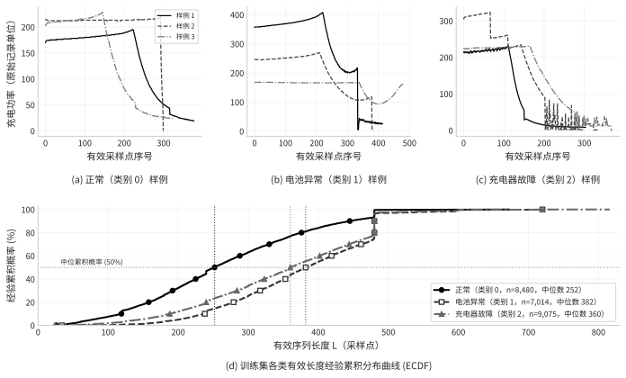
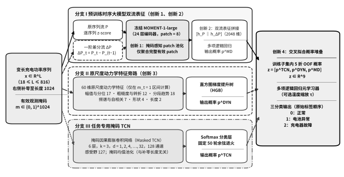
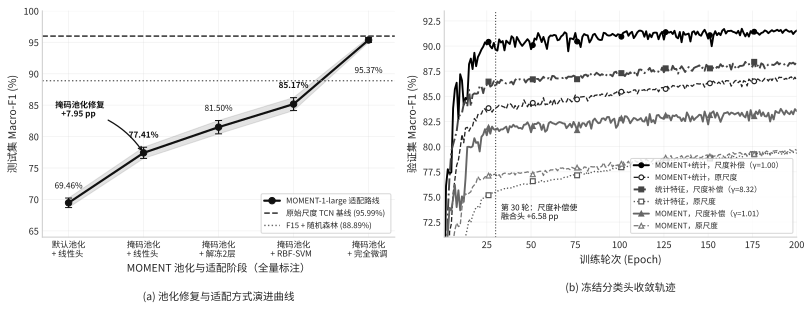
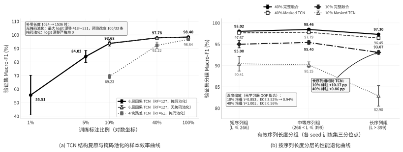
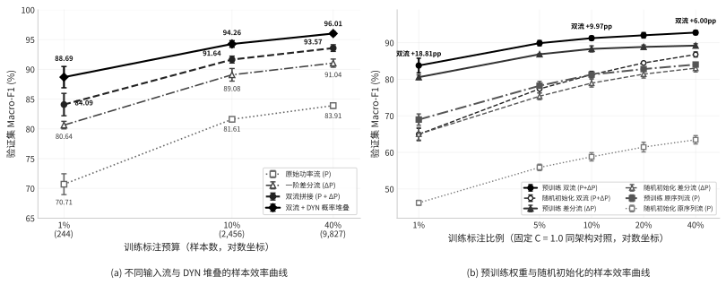
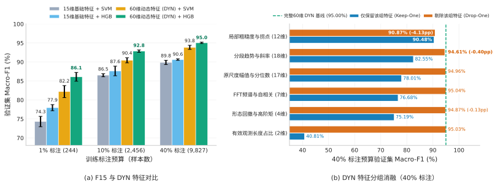
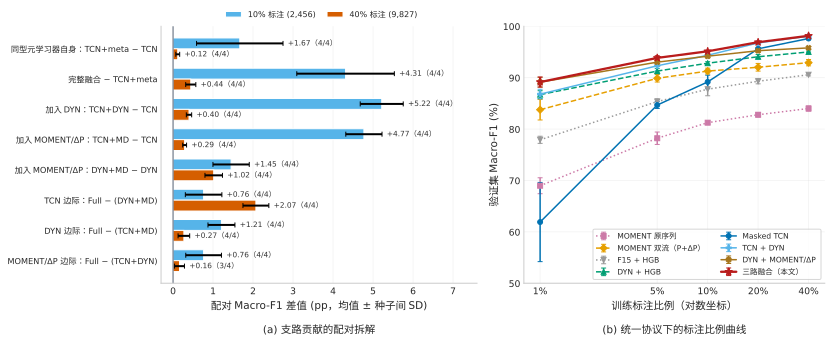
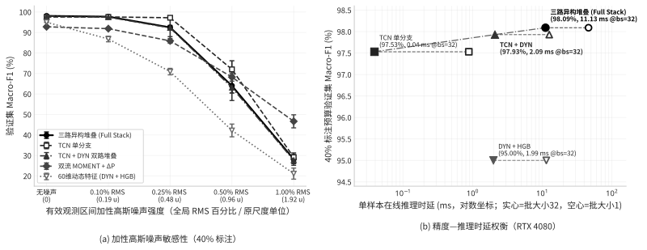

# 基于时序大模型的小样本锂电池充电功率曲线分类方法研究与实现

（作者姓名）$^{1}$，（作者姓名）$^{1}$，（通信作者姓名）$^{1*}$

（1. 单位全称 学院，城市 邮编）

**摘　要**：电动自行车锂电池充电功率曲线中隐含充电器故障与电池异常信息，基于功率曲线的自动分类是实现非侵入式充电安全监测的有效途径。然而，实际运维中故障标注获取成本高，典型小样本条件下可用标注有限，且充电曲线长度差异大（18～816 个采样点），直接迁移通用时序大模型的效果不佳，任务专用深度网络在极小样本下也易发生跨种子坍塌。为此，面向小样本充电异常识别场景，提出一种以时序大模型为核心、融合原尺度动力学特征与掩码时间卷积网络的三分类方法。首先，针对 MOMENT 默认分类头将补零 patch 计入池化的缺陷，设计掩码感知 patch 池化，使冻结表征线性探测的测试集 Macro-F1 由 69.46% 提高到 77.41%；其次，在不更新骨干参数的前提下引入一阶差分双流输入，补偿 patch 化编码对局部功率跳变的平滑，40% 标注下单支路 Macro-F1 由 83.91% 提高到 93.57%；再次，构建 60 维原尺度动力学特征旁路，恢复被逐序列归一化抹除的绝对功率幅值信息；最后，通过训练子集内 5 折交叉拟合概率堆叠融合三路异构判别信息。在 35,099 条真实充电记录上的 4 随机种子小样本与多预算实验表明：仅用 1%（244 条）、5% 和 10% 训练标注时，所提方法的验证集 Macro-F1 分别达 89.15%±0.98%、93.85%±0.43% 和 95.02%±0.33%，其中 1% 小样本下比掩码时间卷积网络高 27.24 个百分点；40% 标注下验证集 Macro-F1 达 98.09%±0.23%，电池异常召回率为 98.23%、误报率为 0.67%。同架构对照实验表明，预训练权重相对随机初始化使双流支路提高 6.00～18.81 个百分点。此外，给出了精度—推理时延权衡和采集噪声敏感性分析，可为小样本充电安全监测场景下的模型选型与部署提供参考。

**关键词**：小样本学习；时序大模型；MOMENT；锂电池；充电功率曲线；时间序列分类；特征融合；掩码池化

**中图分类号**：TP391.4；TM912　　**文献标志码**：A

---

**Few-Shot Charging Power Curve Classification for Lithium Batteries Based on a Time-Series Foundation Model**

(Author Name)$^{1}$, (Author Name)$^{1}$, (Corresponding Author)$^{1*}$

(1. School, University, City Postcode, China)

**Abstract**: Charging power curves of lithium batteries for electric bicycles carry information about charger faults and battery anomalies, and automatic classification of these curves provides an effective route to non-intrusive charging safety monitoring. In practical operations, however, verified fault labels are costly to obtain; under typical few-shot conditions with limited labeled samples and large sequence-length variation (18–816 sampling points), directly transferring a general time-series foundation model performs poorly, whereas task-specific deep networks tend to collapse across random seeds in extreme few-shot regimes. Focusing on few-shot charging anomaly classification, this paper proposes a three-class method centered on a frozen time-series foundation model and fused with raw-scale dynamics features and a masked temporal convolutional network. First, to fix the default MOMENT classification head that averages padded patches, mask-aware patch pooling is designed, raising the test Macro-F1 of a frozen linear probe from 69.46% to 77.41%. Second, a first-order difference stream is introduced without updating backbone parameters to compensate for the smoothing of local power jumps by patch encoding, improving the single-branch Macro-F1 from 83.91% to 93.57% with 40% labels. Third, a 60-dimensional raw-scale dynamics feature branch restores the absolute power amplitude removed by per-series normalization. Finally, five-fold cross-fitted probability stacking within the labeled training subset combines the three heterogeneous branches. Four-seed experiments across few-shot and multi-budget settings on 35,099 real charging records show that with only 1% (244 records), 5% and 10% training labels, the proposed method achieves validation Macro-F1 of 89.15%±0.98%, 93.85%±0.43% and 95.02%±0.33%, outperforming the masked temporal convolutional network by 27.24 percentage points at 1% labels; with 40% labels, it reaches 98.09%±0.23% Macro-F1 with 98.23% battery-anomaly recall at a 0.67% false positive rate. Same-architecture controls confirm that pretrained weights improve the dual-stream branch by 6.00–18.81 percentage points over random initialization. Accuracy–latency trade-offs and acquisition-noise sensitivity boundaries are also analyzed for practical model selection.

**Key words**: few-shot learning; time-series foundation model; MOMENT; lithium battery; charging power curve; time series classification; feature fusion; masked pooling

---

## 0　引　言

电动自行车已成为我国城乡居民短途出行的重要交通工具，集中式充电设施在住宅小区、园区等场景快速普及。锂电池在充电过程中若存在内短路、老化失配，或充电器存在输出异常、保护失效等问题，可能诱发过热乃至热失控，是电动自行车火灾的主要成因之一。因此，在充电阶段及时识别充电器故障与电池异常，对降低火灾风险具有重要意义。

现有锂电池故障诊断方法多依赖电池管理系统（BMS）采集的电芯电压、温度、电流等多维信号<sup>[1]</sup>，诊断精度较高，但需要电池端具备完整的传感与通信能力。电动自行车电池型号繁杂，大量电池不具备对外通信接口，充电设施能够稳定获取的通常只有单通道的充电功率序列。若能仅凭功率曲线识别“正常 / 充电器故障 / 电池异常”三类状态，即可在不加装传感器、不改造电池的条件下实现低成本的非侵入式安全监测。已有研究在电动汽车充电桩上验证了这一思路：PARK 等<sup>[2]</sup>基于功率变换模块的运行信号设计了快充桩故障诊断系统；DUAN 等<sup>[3]</sup>利用时空融合的机器学习方法实现了充电桩故障的非侵入式辨识。但面向电动自行车充电功率曲线的分类研究仍较少。

与通用时间序列分类相比，充电功率曲线分类具有三方面难点。其一，**序列长度差异大**。单次充电记录的有效序列长度为 18～816 个采样点，批处理时需大量补零；同时序列长度本身与类别相关，模型容易借助补零长度形成“捷径”，而非学习真正的功率形态。其二，**判别信息分布在多个尺度上**。区分故障既需要绝对功率水平（例如长期停留在低功率平台），也需要局部跳变（如毛刺、阶跃、平台抖动）和整体形态（如恒功率段与衰减段的转折位置），单一模型难以同时兼顾。其三，**小样本标注约束突出**。故障标签需要结合运维记录人工核验，实际可用的标注往往只占全部数据的一小部分，模型需要在小样本乃至极小样本标注下保持稳定。

时间序列分类方法大致可分为三类<sup>[4-5]</sup>。第一类是基于手工特征的方法，提取统计量、频谱等特征后接随机森林<sup>[6]</sup>、梯度提升树<sup>[7]</sup>或支持向量机<sup>[8]</sup>，可解释性好、训练快，但特征设计依赖经验。第二类是专用深度网络，如时间卷积网络（TCN）<sup>[9]</sup>、融合多尺度 Transformer 与形态卷积的模型<sup>[10]</sup>以及各类改进 Transformer<sup>[11-12]</sup>，在标注充足时精度高，但标注稀缺时容易过拟合或训练不稳定。第三类是基于随机卷积核的变换方法，如 ROCKET<sup>[13]</sup>、MiniRocket<sup>[14]</sup>与 MultiRocket<sup>[15]</sup>，速度快且在公开数据集上精度高。此外，迁移学习<sup>[16]</sup>与自监督表征学习<sup>[17]</sup>也被用于缓解小样本问题。

近年来，以 MOMENT<sup>[18]</sup>、TimesFM<sup>[19]</sup>、Chronos<sup>[20]</sup>为代表的时序大模型（时间序列基础模型）在大规模跨领域数据上预训练，在少样本和零样本场景下表现出较强的迁移能力，已被用于旋转机械故障诊断<sup>[21]</sup>、工程位移预测<sup>[22]</sup>等领域，面向大模型的时序输入表示优化也受到关注<sup>[23]</sup>。将时序大模型用于充电功率分类，有望借助预训练先验缓解标注不足的问题。然而，本文实验发现，直接冻结 MOMENT-1-large 并训练其默认分类头，在充电功率三分类任务上的测试集 Macro-F1 仅为 69.46%，明显低于任务专用的 TCN（95.99%）。进一步分析表明，失配主要来自三个环节：

1）**池化环节**：默认分类头虽将输入掩码传给编码器，却在最终池化时对包括补零在内的全部 patch 求平均，短序列的有效信息被大量补零 patch 稀释；

2）**编码环节**：MOMENT 以 8 个采样点为一个 patch 并经全局自注意力建模<sup>[24]</sup>，擅长刻画整体趋势，但平滑了故障曲线中最关键的局部跳变；

3）**归一化环节**：逐序列 z-score 与模型内置的可逆实例归一化（RevIN）<sup>[25]</sup>使每条曲线零均值、单位方差，抹除了绝对功率幅值这一重要判别信息。

针对上述问题，本文提出一种以时序大模型为核心的充电功率曲线分类方法，主要贡献如下：

1）提出**掩码感知 patch 池化**，仅聚合完整有效观测的 patch 表征，消除补零对冻结表征的稀释，使表征与补零区间严格无关；结合冻结特征缓存，使分类头训练由约 2 min/轮降至约 2 s/轮。

2）提出**冻结骨干下的一阶差分双流表征**，将原序列与一阶差分序列送入同一冻结编码器并拼接表征，在不增加骨干参数、不微调的前提下补偿 patch 化编码对局部跳变的平滑。

3）构建 **60 维原尺度动力学特征（DYN）旁路**，在原始记录尺度上刻画幅值、局部粗糙度、分段趋势、频谱和形状，显式补回被归一化抹除的幅值信息。

4）设计**训练子集内交叉拟合的三路概率堆叠**，融合时序大模型、DYN 与掩码 TCN 三路异构判别信息，并通过逐种子配对消融、预训练归因、标注比例扫描、噪声扰动和同机端到端成本测量，系统给出方法的优势来源与适用边界。

本文其余部分组织如下：第 1 节描述任务与数据；第 2 节介绍所提方法；第 3 节给出实验设置、结果与分析；第 4 节讨论方法的作用机理与局限；第 5 节总结全文。

## 1　问题描述与数据

### 1.1　任务定义

设第 $i$ 条充电记录的有效功率序列为 $\boldsymbol{x}_i=(x_{i,1},x_{i,2},\dots,x_{i,L_i})$，其中 $L_i$ 为有效长度，$18\le L_i\le 816$。为便于批处理，将其右侧补零至统一长度 $T=1024$，并记二值掩码 $\boldsymbol{m}_i\in\{0,1\}^{T}$，有效观测处 $m_{i,t}=1$，补零处 $m_{i,t}=0$。任务是学习映射

$$
f:(\boldsymbol{x}_i,\boldsymbol{m}_i)\mapsto \hat y_i\in\{0,1,2\}, \tag{1}
$$

原始标签 0、1、2 分别对应正常充电、电池异常与充电器故障。理想的 $f$ 应满足**补零不变性**：对任意补零长度和补零区间内的任意取值，输出保持不变。

### 1.2　数据集

数据来自某电动自行车充电运营平台的真实运行记录，每条记录包含匿名样本编号、业务标签和充电功率序列，原始共 46,535 条。业务标签由运维人员结合现场处理记录给出，已用于平台原有 TCN 模型的训练与实际部署。其中，标签 5 表示无效或不完整记录（共 11,435 条，长度中位数仅为 1 个采样点），按平台既定口径不参与故障三分类；再剔除长度小于 18 的序列后，得到 35,099 条有效记录。最短 18 个采样点是既有冻结实验协议沿用的筛选阈值，其独立业务来源仍待数据提供方进一步确认；由于原始记录未附采样时间间隔说明，本文统一以采样点数描述序列长度，不作分钟或小时换算，也不将该阈值解释为硬件或专利规范。经检查，有效记录中不存在重复序列与标签冲突，最长序列为 816 点，在 $T=1024$ 下无截断。按 7∶1∶2 分层随机划分为训练集、验证集和测试集，各类样本数见表 1。所有方法共享同一份划分清单，并通过数据哈希校验保证一致。

<p align="center"><b>表 1　数据集划分与类别分布</b></p>

|  子集  | 正常（0） | 电池异常（1） | 充电器故障（2） |   合计 |
| :----: | --------: | ------------: | --------------: | -----: |
| 训练集 |     8,480 |         7,014 |           9,075 | 24,569 |
| 验证集 |     1,212 |         1,002 |           1,296 |  3,510 |
| 测试集 |     2,423 |         2,004 |           2,593 |  7,020 |
|  合计  |    12,115 |        10,020 |          12,964 | 35,099 |

图 1 给出了训练集中各类别的样例曲线与有效长度经验累积分布曲线（样例按固定随机种子 42 抽取，未经人工挑选）。图 1(a) 中正常样例多呈现平稳功率段后平滑衰减的形态；图 1(b) 的电池异常（类别 1）样例中可见功率平台差异、骤降或尾段回升；图 1(c) 的充电器故障（类别 2）样例中可见阶跃下降或衰减段高频反复跳变。需要说明，这些仅是随机抽样曲线的表观形态描述，不能反向充当故障物理机理的证明。由图 1(d) 的有效长度经验累积分布曲线可见，正常、电池异常与充电器故障三类曲线的有效长度中位数分别为 252、382 和 360 个采样点，差异明显；约 480 点处的集中陡升对应平台单次充电记录的常见截断上限。仅用“序列长度”一个特征训练深度为 3 的决策树，即可在测试集上取得 35.76% 的 Macro-F1（多数类基线为 17.98%），说明长度与类别存在统计关联。因此，本文所有模型均使用掩码排除补零，并按长度分层报告结果，避免把补零长度误当作功率形态信息。

<p align="center"></p>
<p align="center"><b>图 1　训练集各类别样例充电功率曲线及有效长度分布</b></p>

### 1.3　评价指标

三类样本数量接近但不完全均衡，本文以三类 Macro-F1 为主要指标：

$$
\mathrm{Macro\text{-}F1}=\frac{1}{3}\sum_{c=0}^{2}\frac{2P_cR_c}{P_c+R_c}, \tag{2}
$$

式中 $P_c$、$R_c$ 分别为第 $c$ 类的精确率和召回率。考虑到漏检电池异常的安全代价最高，同时报告电池异常类的召回率（Recall）与误报率（FPR，即非电池异常样本被判为电池异常的比例）。对于不平衡的二分类评价，PR 曲线比 ROC 曲线更具信息量<sup>[26]</sup>，因此在单种子分析中补充报告电池异常类的平均精确率（AP）。概率输出质量以期望校准误差（ECE）衡量<sup>[27]</sup>。

## 2　方法

### 2.1　总体框架

所提方法的总体框架如图 2 所示。输入序列 $\boldsymbol{x}_i$ 与掩码 $\boldsymbol{m}_i$ 同时送入三条支路：

- 支路Ⅰ（时序大模型双流表征）：原序列与一阶差分序列分别送入冻结的 MOMENT-1-large 编码器，经掩码感知池化得到两路表征并拼接，由多项逻辑回归输出类别概率 $\boldsymbol{p}^{\mathrm{MD}}$；
- 支路Ⅱ（原尺度动力学特征）：在有效观测区间上提取 60 维原尺度动力学特征，由直方图梯度提升树（HGB）输出 $\boldsymbol{p}^{\mathrm{DYN}}$；
- 支路Ⅲ（掩码 TCN）：6 层因果膨胀卷积网络，以掩码均值池化聚合时序特征，输出 $\boldsymbol{p}^{\mathrm{TCN}}$。

三路概率拼接为 9 维元特征，由逻辑回归元学习器给出最终类别。三条支路的归纳偏置各不相同：支路Ⅰ依赖跨领域预训练的形态先验与全局注意力；支路Ⅱ依赖物理含义明确的统计量；支路Ⅲ依赖在本任务数据上端到端学习的局部卷积模式。这种异构性是融合能够带来增益的前提。

<p align="center"></p>
<p align="center"><b>图 2　所提方法的总体框架</b></p>

### 2.2　掩码感知 patch 池化

MOMENT-1-large 采用 T5-large 编码器结构，包含 24 层 Transformer、隐藏维度 1024、16 个注意力头，共 3.41 亿参数。与 PatchTST<sup>[24]</sup>类似，它将长度为 $T$ 的输入按 $P=8$ 划分为 $N=T/P=128$ 个不重叠 patch，经线性嵌入和编码器得到 patch 表征 $\boldsymbol{h}_{i,1},\dots,\boldsymbol{h}_{i,N}\in\mathbb{R}^{1024}$。

momentfm 0.1.4 的默认分类头虽然将掩码传入编码器的注意力计算，但在最终池化时对全部 $N$ 个 patch 表征直接求平均：

$$
\boldsymbol{z}_i^{\mathrm{default}}=\frac{1}{N}\sum_{n=1}^{N}\boldsymbol{h}_{i,n}. \tag{3}
$$

对于长度为 18 的序列，128 个 patch 中只有 2 个是完整有效的，其余 126 个补零 patch 的表征主导了式（3）的结果；对于长度为 800 的序列，有效 patch 占比约 78%。因此，式（3）得到的表征混入了“补零有多少”这一与形态无关的信息，且不同长度的样本被稀释的程度不同。

本文定义 patch 有效性掩码

$$
\tilde m_{i,n}=\prod_{t=(n-1)P+1}^{nP} m_{i,t},\qquad n=1,2,\dots,N, \tag{4}
$$

即仅当 patch 内全部采样点均为有效观测时才视为有效 patch，不完整的尾部 patch 不参与池化。以掩码加权平均得到序列表征：

$$
\boldsymbol{z}_i=\frac{\sum_{n=1}^{N}\tilde m_{i,n}\,\boldsymbol{h}_{i,n}}{\sum_{n=1}^{N}\tilde m_{i,n}}. \tag{5}
$$

由于 $L_i\ge 18$，每条序列至少包含 2 个有效 patch，式（5）的分母恒为正。

式（5）使池化结果与补零区间的长度和取值无关。在固定的合成序列（有效长度 18～384，含常值序列和非整 patch 尾部）上验证：将补零长度由 512 改为 1024，或在掩码外填入随机值，池化表征的最大差异不超过 $4.2\times10^{-7}$，处于单精度浮点误差量级。需要说明的是，外部 z-score 与模型内置 RevIN 仍会读取不完整尾部的有效采样点，因此该不变性针对补零区间而言。

此外，由于骨干参数冻结，表征 $\boldsymbol{z}_i$ 只需对训练、验证、测试集各提取一次并缓存。此后下游分类器的训练不再重复 3.41 亿参数编码器的前向计算，单轮训练由约 2 min 降至约 2 s，使大量消融与多种子实验成为可能。

### 2.3　一阶差分双流表征

MOMENT 以 8 点 patch 为最小建模单元，并在输入端执行实例归一化。这一设计有利于刻画整体趋势，但会平滑功率曲线中的毛刺、斜率突变和平台跳变，而这些恰恰是充电器故障与电池异常的主要表现（图 1(b)、(c)）。一种直接的做法是微调骨干以学习这些局部模式，但完全微调需更新全部 3.41 亿参数，单次训练约 3 h，且在少量标注下容易过拟合。

本文采用不修改骨干的做法：显式地把“变化量”作为另一路输入。在有效区间内构造一阶差分序列

$$
\Delta x_{i,t}=x_{i,t+1}-x_{i,t},\qquad t=1,2,\dots,L_i-1. \tag{6}
$$

差分运算将缓慢变化的趋势压缩到 0 附近，而将跳变放大为显著的脉冲，使编码器在 patch 粒度下也能“看到”局部突变。对原序列与差分序列分别做逐序列 z-score 标准化后，送入**同一个冻结编码器**，按式（5）分别得到 $\boldsymbol{z}_i^{P}$ 与 $\boldsymbol{z}_i^{\Delta P}$（差分流掩码长度为 $L_i-1$），拼接为 2048 维双流表征：

$$
\boldsymbol{z}_i^{\mathrm{MD}}=[\boldsymbol{z}_i^{P}\,\|\,\boldsymbol{z}_i^{\Delta P}]\in\mathbb{R}^{2048}. \tag{7}
$$

在 $\boldsymbol{z}_i^{\mathrm{MD}}$ 上训练 L2 正则多项逻辑回归（正则系数倒数 $C=1.0$），得到支路Ⅰ的类别概率 $\boldsymbol{p}_i^{\mathrm{MD}}$。

该设计的代价仅为每条样本多一次编码器前向，不引入任何可训练骨干参数。差分输入在时间序列建模中已有使用；本文的着眼点在于：在冻结时序大模型的条件下，差分流能以零骨干训练成本补偿 patch 化编码的平滑效应，且这一增益与预训练先验相互独立（3.4 节）。

### 2.4　原尺度动力学特征旁路

z-score 与 RevIN 将每条曲线变换为零均值、单位方差。这对跨领域预训练是必要的，但对充电过程而言，绝对功率水平具有明确的物理含义：例如“长时间停留在低功率平台”与“正常的恒功率充电”在归一化后可能形态相近，却分属不同类别。早期对照实验也印证了这一点：TCN 使用原始尺度输入时测试集 Macro-F1 为 95.99%，改用逐序列 min-max 归一化后降至 92.00%。

为此，本文在原始记录尺度、仅在有效观测区间上提取 60 维动力学特征（DYN），分为 6 组，见表 2。其中 15 维为常用全局统计量，其余 45 维刻画局部动力学、频谱与形状。所有特征均只使用 $m_{i,t}=1$ 的采样点计算，补零不参与。

<p align="center"><b>表 2　DYN 特征分组及含义</b></p>

| 特征组       | 维数 | 代表特征                                                                | 物理含义                |
| :----------- | :--: | :---------------------------------------------------------------------- | :---------------------- |
| 幅值与分位   |  17  | 均值、标准差、最值、5%～95% 分位数、变异系数、末/首值比                 | 功率水平及其分布        |
| 粗糙度与转折 |  12  | 差分绝对值均值与 90% 分位、上升占比、方向转折率、平台占比、最长平台占比 | 局部抖动与跳变频度      |
| 分段趋势     |  18  | 整体及首/尾段斜率、三等分段均值与标准差、尾段与首段之差                 | 恒功率段与衰减段走势    |
| 频谱与自相关 |  7   | 4 段频带能量占比、主频、水平自相关、直方图熵                            | 周期性与复杂度          |
| 形状         |  4   | 最大回撤、最大上冲、偏度、峰度                                          | 骤降/回升幅度与分布形状 |
| 长度         |  2   | 有效长度及其与最大长度之比                                              | 有效采样点数占比        |

以粗糙度组为例：“方向转折率”定义为去除零差分后相邻差分符号发生翻转的比例，用于刻画功率曲线（如图 1(c) 衰减段）中的高频反复跳变；“平台占比”定义为相邻采样点功率相等（差分绝对值小于 $10^{-3}$）的比例，用于刻画平稳功率段的持续比例。

DYN 特征由直方图梯度提升树（HGB）<sup>[7]</sup>分类，得到 $\boldsymbol{p}_i^{\mathrm{DYN}}$。HGB 在所有标注比例下均固定同一组超参数（最大迭代 400 次、学习率 0.08、最大叶子数 31、叶子最小样本数 20、L2 正则 1.0），不按标注比例单独调参。DYN 提取与 HGB 训练均在 CPU 上完成，40% 标注下仅需数秒。

### 2.5　掩码 TCN 支路

TCN 通过因果膨胀卷积以较少的层数获得较大的感受野<sup>[9]</sup>，适合捕捉功率曲线中的局部时序模式。支路Ⅲ沿用平台原有业务模型的 6 层结构：卷积核大小 $k=3$，膨胀率 $d_l=2^{l-1}$（$l=1,\dots,6$），各层 128 通道，激活函数为 ReLU，各层后接比例为 0.3 的 SpatialDropout。其感受野为

$$
R=1+(k-1)\sum_{l=1}^{6}d_l=1+2\times 63=127. \tag{8}
$$

平台原模型在时间维对整条补零张量做全局平均池化，存在与 2.2 节相同的补零问题。本文将其替换为掩码均值池化：

$$
\boldsymbol{g}_i=\frac{\sum_{t=1}^{T}m_{i,t}\,\boldsymbol{c}_{i,t}}{\sum_{t=1}^{T}m_{i,t}}, \tag{9}
$$

式中 $\boldsymbol{c}_{i,t}$ 为最后一层卷积在时刻 $t$ 的输出。由于采用因果卷积，有效区间内的输出只依赖其左侧的有效采样点，不受右侧补零影响；再经式（9）聚合后，输出与补零长度严格无关（3.3 节）。$\boldsymbol{g}_i$ 经全连接层与 Softmax 得到 $\boldsymbol{p}_i^{\mathrm{TCN}}$。

TCN 使用原始尺度输入，训练采用 AdamW 优化器（学习率 $10^{-3}$，权重衰减 $10^{-4}$）、批大小 32、梯度裁剪阈值 1.0、余弦退火 50 轮。为避免利用验证集挑选最优轮次产生乐观偏差，融合实验统一取第 50 轮端点模型。实验中发现，在 V100 上开启 FP16 混合精度时，膨胀卷积在训练后期易出现数值溢出，故 TCN 全程使用 FP32。

### 2.6　交叉拟合概率堆叠

堆叠集成需要用基模型的预测训练元学习器。若基模型在训练集上拟合后直接用其训练集预测训练元学习器，由于 TCN、HGB 等基模型对训练样本过拟合，元学习器会过度信任某一支路，导致泛化变差。为此，本文在每个标注子集内部做 5 折分层交叉拟合：

1）将标注子集 $\mathcal{D}$ 分层划分为 5 折 $\mathcal{D}_1,\dots,\mathcal{D}_5$，三条支路使用**完全相同**的折划分；

2）对第 $k$ 折，用 $\mathcal{D}\setminus\mathcal{D}_k$ 训练三条支路，对 $\mathcal{D}_k$ 中样本给出折外（out-of-fold，OOF）概率；

3）拼接得到每条训练样本的元特征

$$
\boldsymbol{u}_i=[\boldsymbol{p}_i^{\mathrm{TCN}},\ \boldsymbol{p}_i^{\mathrm{DYN}},\ \boldsymbol{p}_i^{\mathrm{MD}}]\in[0,1]^{9}; \tag{10}
$$

4）在 $\{(\boldsymbol{u}_i,y_i)\}_{i\in\mathcal{D}}$ 上训练 L2 正则多项逻辑回归元学习器

$$
P(\hat y_i=c\mid\boldsymbol{u}_i)=\frac{\exp(\boldsymbol{w}_c^{\top}\boldsymbol{u}_i+b_c)}{\sum_{c'=0}^{2}\exp(\boldsymbol{w}_{c'}^{\top}\boldsymbol{u}_i+b_{c'})}, \tag{11}
$$

其正则系数仅在 OOF 元特征内部用 3 折交叉验证选择；

5）推理时，三条支路使用在完整标注子集 $\mathcal{D}$ 上重新训练的模型，其输出概率经式（11）得到最终预测。

整个过程中验证集和测试集均不参与任何拟合与超参数选择。元学习器只有 30 个参数，几乎不会过拟合，其权重也便于解释各支路的贡献。若下游需要可靠的概率输出（例如按置信度分级告警），可再在 OOF 元特征上拟合单参数温度缩放<sup>[27]</sup>：将式（11）的 logit 除以温度 $\tau>0$，$\tau$ 以最小化 OOF 负对数似然确定。

完整方法的训练与推理流程归纳如下：

<p align="center"><b>算法 1　交叉拟合三路融合的训练与推理</b></p>

```text
输入：标注子集 D = {(x_i, m_i, y_i)}，折数 K = 5
训练：
 1. 用冻结 MOMENT 对 D 及待测数据按式(5)~(7)提取双流表征 z^MD 并缓存
 2. 对 D 中全部样本提取 60 维 DYN 特征
 3. 将 D 分层划分为 K 折；for k = 1..K:
      在 D \ D_k 上训练 TCN、HGB(DYN)、Logistic(z^MD)
      对 D_k 输出折外概率 p^TCN, p^DYN, p^MD
 4. 拼接 OOF 概率得 u_i（式(10)），训练元学习器（式(11)）
 5. 在完整 D 上重训三条支路
推理：
 6. 对新样本计算三条支路概率，拼接后经元学习器输出类别
```

## 3　实验与分析

### 3.1　实验设置

**标注预算**　为考察标注量的影响，在训练集内按类别分层抽取 1%、5%、10%、20%、40% 和 100% 的子集作为可用标注，对应样本数分别为 244、1,227、2,456、4,913、9,827 和 24,569 条。同一随机种子下，所有方法使用完全相同的标注子集和评价样本，差异只来自方法本身。

**随机种子与统计**　除特别说明外，结果为 4 个随机种子（42、44、45、46）的均值 ± 样本标准差。比较两种方法时采用逐种子配对差值，报告均值、正向种子数及描述性 95% 配对 $t$ 区间；单种子的错误修正分析采用精确二项（McNemar）检验。

**证据口径**　研究分为两个阶段。第一阶段（3.2 节表 3 及 3.4 节表 5）在 5 个种子的独立测试集上评价冻结 MOMENT 的池化方式、适配方式与预训练归因。在此之后测试集已被查看，为避免“依据测试集修改方法”带来的乐观偏差，第二阶段的方法开发与消融全部在验证集上进行，测试集不再重开。因此，3.3 节及 3.5 节以后的数值为验证集结果，用于同协议下的方法比较。由于 4 个种子的验证集互有重叠且在开发中被重复使用，配对区间只用于描述不确定性；独立外部检验仍需新数据。

**对比方法**　包括：多数类、15 维统计特征（F15）+ 随机森林 / HGB / RBF-SVM；1D-CNN；平台原有 TCN 及其改进版本；冻结 MOMENT + 线性头 / RBF-SVM；部分微调与完全微调 MOMENT；以及本文方法的各支路组合。

**实验环境**　Python 3.11、PyTorch 2.12.1（CUDA 12.6）、momentfm 0.1.4、scikit-learn。MOMENT 特征提取和神经网络训练在 Tesla V100-PCIE 32 GB 上完成；端到端推理成本在单张 RTX 4080 上测得；3.6 节的标注比例统一重跑实验在 RTX 5090 上完成。

### 3.2　基线方法与冻结时序大模型的初始表现

表 3 给出了第一阶段全量标注下各方法的 5 种子测试集结果。原始尺度 TCN 取得最高的 95.99%；统计特征随机森林为 88.89%，说明简单统计量已包含较强的类别信息。冻结 MOMENT 默认分类头仅为 69.46%，比随机森林低约 19 个百分点；修正池化后的线性头为 77.41%，RBF-SVM 下游分类器为 85.17%，部分微调（仅解冻最后 2 层）为 81.50%，完全微调为 95.37%。

<p align="center"><b>表 3　全量标注下各方法的测试集结果（5 种子）</b></p>

| 方法                                      | 可训练参数 |     Accuracy/% |     Macro-F1/% |
| :---------------------------------------- | ---------: | -------------: | -------------: |
| 多数类                                    |          — |     36.94±0.00 |     17.98±0.00 |
| F15 + 逻辑回归                            |          — |     74.13±0.59 |     73.75±0.60 |
| F15 + 随机森林                            |          — |     88.85±0.23 |     88.89±0.23 |
| 1D-CNN（逐序列 z-score）                  |     0.05 M |     94.29±1.27 |     94.38±1.27 |
| TCN（逐序列 min-max）                     |     0.22 M |     91.79±1.37 |     92.00±1.37 |
| TCN（逐序列 z-score）                     |     0.22 M |     94.92±1.44 |     95.02±1.43 |
| TCN（原始尺度）                           |     0.22 M | **95.94±0.74** | **95.99±0.73** |
| 冻结 MOMENT + 线性头（默认池化）$^{\ast}$ |      3,075 |     69.53±0.78 |     69.46±0.76 |
| 冻结 MOMENT + 线性头（掩码池化）          |      3,075 |     77.02±0.88 |     77.41±0.89 |
| 冻结 MOMENT + RBF-SVM（掩码池化）         |  0（骨干） |     84.77±1.04 |     85.17±1.03 |
| MOMENT 解冻最后 2 层（掩码池化）          |    25.70 M |     81.08±1.13 |     81.50±1.06 |
| MOMENT 完全微调（掩码池化）               |   341.24 M |     95.26±0.41 |     95.37±0.39 |

注：$^{\ast}$ 该配置仅 4 个种子完成训练；RBF-SVM 按 MOMENT 原论文协议在最多 10,000 条训练样本上 5 折选参。

由表 3 与图 3(a) 的适配演进曲线可得三点观察。第一，掩码感知池化本身带来 7.95 个百分点的提升，说明默认池化的补零稀释是冻结 MOMENT 表现差的首要原因。第二，归一化方式显著影响 TCN：原始尺度优于逐序列 z-score，后者又明显优于 min-max，说明绝对幅值是本任务的重要判别信息，这为 2.4 节的 DYN 旁路提供了依据。第三，完全微调虽可接近 TCN，但需更新全部 3.41 亿参数、单次训练约 3.0 h；而冻结方案只需约 106 s 的一次性特征提取，下游训练在 CPU 上即可完成。冻结 MOMENT 单独使用时与 TCN 仍有约 10 个百分点的差距，这是本文后续通过差分双流、DYN 旁路和融合来弥补的部分。

<p align="center"></p>
<p align="center"><b>图 3　池化方式与冻结分类头训练的影响</b></p>

图 3(b) 揭示了另一个容易被忽视的问题：冻结表征与统计特征直接拼接后输入 MLP 分类头时，由于特征尺度较小，第一层初始激活的均方根（RMS）仅约 0.024～0.029，梯度微弱，训练 200 轮仍未收敛。按 $\gamma=\sqrt{1039/B}$（$B$ 为有效支路数）对输入施加固定增益后，初始激活 RMS 恢复至约 0.49～0.55，30 轮时融合头的验证集 Macro-F1 提高 6.58 个百分点，200 轮内最佳值由 86.94% 提升到 91.72%。在 4 个种子的测试集上，该增益融合头取得 91.52%±0.38%，比同输入的 RBF-SVM 稳定高出 0.56 个百分点（4/4 种子，95% 区间 [0.52, 0.61]）。这说明在评价冻结大模型方案时，分类头是否被充分优化会显著影响结论，比较时必须保证参照方案的头部训练充分。

### 3.3　TCN 的补零敏感性与结构复原

同样的补零问题也存在于平台原有的 TCN 中。图 4(a) 的上方文本框给出了固定权重下的诊断结果：保持有效序列完全不变，仅将补零总长度由 1024 扩展到 1536，使用全局平均池化的 TCN 最大 logit 漂移达 418～531，分别改变了 100 条（10% 标注模型）和 33 条（100% 标注模型）验证样本的预测类别；替换为式（9）的掩码均值池化后，logit 漂移严格为 0。由于部署时的补零长度通常由批内最长样本决定，前者意味着同一条曲线的预测结果可能随批次组成而改变。

图 4(a) 还给出了不同 TCN 结构在 1%～100% 标注预算下的样本效率曲线。项目早期重构的 4 块双卷积残差 TCN（通道 64/64/128/128，膨胀率 1～8，感受野 61）在 10% 标注下仅 69.23%±1.61%；复原平台原有的 6 层结构（感受野 127）并保留掩码池化后，在 10%、40% 与 100% 标注下分别达 93.68%±1.93%、97.78%±0.16% 和 98.40%±0.17%（10% 标注下提高 24.45 个百分点）。不过在 1% 与 5% 极小样本标注（固定第 50 轮端点）下，6 层掩码 TCN 分别回落至 55.51%±14.66% 与 84.03%±4.57%，跨种子波动明显增大。这既说明感受野与层数配置对本任务至关重要（早期“冻结 MOMENT 在 10% 标注下大幅领先 TCN”很大程度上源于 TCN 配置不当），也表明纯端到端卷积网络在 1%～5% 小样本区间的稳定性不足。为保证比较的公平性，本文后续均以复原后的掩码 6 层 TCN 作为强基线和融合支路。

<p align="center"></p>
<p align="center"><b>图 4　TCN 结构、池化方式及按序列长度分层的性能</b></p>

### 3.4　差分双流与预训练归因

表 4 与图 5(a) 比较了冻结 MOMENT 在不同输入流下的表现。差分流单独使用时已优于原序列流；双流拼接在 1%、10%、40% 标注下相对原序列流分别提高 13.38、10.03 和 9.66 个百分点，且 4/4 种子同向。40% 标注下，电池类（原始标签 1）的召回率由 89.42% 升到 93.36%，FPR 由 3.81% 降到 2.56%；充电器类（原始标签 2）的召回率由 77.87% 升到 94.31%，FPR 由 9.60% 降到 3.43%。两类都有改善，充电器类的幅度更大。双流再与 DYN 做概率堆叠，1% 标注下达到 88.69%。

<p align="center"><b>表 4　冻结 MOMENT 不同输入流的验证集结果</b></p>

| 输入流                    |        1% 标注 |       10% 标注 |       40% 标注 | 40% 电池 Recall / FPR | 40% 充电器 Recall / FPR |
| ------------------------- | -------------: | -------------: | -------------: | --------------------: | ----------------------: |
| 原序列 $P$                |     70.71±1.75 |     81.61±0.36 |     83.91±0.44 |          89.42 / 3.81 |            77.87 / 9.60 |
| 差分 $\Delta P$           |     80.64±0.63 |     89.08±1.06 |     91.04±0.69 |          91.14 / 4.01 |            92.50 / 4.55 |
| 双流 $P+\Delta P$（本文） | **84.09±1.88** | **91.64±0.57** | **93.57±0.56** |          93.36 / 2.56 |            94.31 / 3.43 |
| 双流 + DYN 堆叠           |     88.69±1.79 |     94.26±0.56 |     96.01±0.31 |          96.01 / 1.64 |            96.35 / 2.18 |

注：Macro-F1 单位为 %；本表逻辑回归正则系数在训练集内从 {0.1, 1.0} 中选择。

双流的增益是否只是因为 3.41 亿参数编码器提供了足够大的随机特征空间，而与预训练无关？为回答这个问题，保持编码器结构、掩码池化、输入预处理和下游分类器完全相同，仅将 MOMENT 预训练权重替换为随机初始化，结果见表 5 与图 5(b)。

<p align="center"><b>表 5　预训练权重与随机初始化的同架构对照</b></p>

|      评价集      | 下游分类器 | 标注 | 输入流 |     预训练 | 随机初始化 | 差值/pp |
| :--------------: | :--------: | :--: | :----: | ---------: | ---------: | ------: |
| 测试集（5 种子） |  RBF-SVM   |  1%  | 原序列 | 68.05±1.59 | 39.44±5.00 |  +28.60 |
| 测试集（5 种子） |  RBF-SVM   |  5%  | 原序列 | 77.40±0.93 | 54.81±0.95 |  +22.58 |
| 测试集（5 种子） |  RBF-SVM   | 10%  | 原序列 | 80.77±0.59 | 58.76±1.26 |  +22.01 |
| 验证集（4 种子） |  逻辑回归  |  1%  | 原序列 | 68.97±1.55 | 46.20±0.68 |  +22.77 |
| 验证集（4 种子） |  逻辑回归  |  1%  |  差分  | 80.57±0.63 | 64.99±1.82 |  +15.57 |
| 验证集（4 种子） |  逻辑回归  |  1%  |  双流  | 83.76±1.99 | 64.95±1.60 |  +18.81 |
| 验证集（4 种子） |  逻辑回归  | 10%  | 原序列 | 81.27±0.35 | 58.79±1.13 |  +22.48 |
| 验证集（4 种子） |  逻辑回归  | 10%  |  差分  | 88.31±0.84 | 78.94±1.07 |   +9.37 |
| 验证集（4 种子） |  逻辑回归  | 10%  |  双流  | 91.24±0.57 | 81.27±0.91 |   +9.97 |
| 验证集（4 种子） |  逻辑回归  | 40%  | 原序列 | 84.02±0.53 | 63.45±1.14 |  +20.57 |
| 验证集（4 种子） |  逻辑回归  | 40%  |  差分  | 89.20±0.51 | 83.03±1.02 |   +6.17 |
| 验证集（4 种子） |  逻辑回归  | 40%  |  双流  | 92.77±0.58 | 86.77±0.69 |   +6.00 |

注：Macro-F1 单位为 %；验证集部分逻辑回归固定 $C=1.0$，故双流数值与表 4 略有不同。图 5(b) 同时绘出了 5% 与 20% 标注预算下的同架构曲线。

预训练权重在表 5 的 12 组条件以及图 5(b) 涵盖的 1%～40% 全部 15 组验证条件、所有随机种子上都优于随机初始化。测试集上 3 组差值的 95% 配对区间分别为 [22.24, 34.97]、[20.89, 24.28] 和 [20.48, 23.53] 个百分点；验证集双流支路在 1%、5%、10%、20% 和 40% 标注下的预训练增益分别为 +18.81（95% 区间 [14.64, 22.97]）、+12.51、+9.97、+7.57 和 +6.00 个百分点，随可用标注减少而单调增大。这说明冻结 MOMENT 的表征能力来自预训练学到的跨领域时序先验，编码器容量本身解释不了这部分差异；越是小样本场景，预训练先验的价值越突出。同时，差分流对随机编码器也有明显帮助（如 10% 标注下原序列 58.79% → 差分 78.94%），可见差分输入与预训练先验是两个相对独立、可以叠加的增益来源。

<p align="center"></p>
<p align="center"><b>图 5　差分双流表征与预训练归因</b></p>

### 3.5　原尺度动力学特征分析

图 6(a) 比较了 15 维基础统计特征（F15）与 60 维 DYN 在两种分类器下的表现。DYN 在各标注比例下均优于 F15，HGB 均优于 RBF-SVM。40% 标注下 DYN+HGB 达 95.00%±0.17%，比 F15+HGB 高 4.40 个百分点；1% 标注下达 86.05%，比 F15+HGB 高 8.12 个百分点，且比同标注量的冻结 MOMENT 双流高约 2 个百分点。DYN 训练只需 CPU 数秒，在低标注区间很有竞争力。

图 6(b) 给出了 40% 标注下的分组消融。“单组剔除”反映该组的不可替代性，“单组保留”反映该组单独的判别能力：

1）粗糙度与转折组最关键：剔除后下降 4.13 个百分点，单独保留即可达 90.48%，说明充电曲线的局部抖动和跳变频度是最主要的判别依据，这也与差分流的大幅增益相互印证；

2）分段趋势组次之：剔除后下降 0.40 个百分点，单独保留为 82.55%；

3）幅值、频谱、形状各组单独剔除时影响很小（≤0.13 个百分点），但单独保留时也有 75%～78% 的判别力，说明组间存在信息冗余，DYN 的表现并不依赖个别特征；

4）仅用长度特征时为 40.81%，与 1.2 节的长度捷径分析一致，说明 DYN 的判别力主要来自功率形态而非充电时长。

<p align="center"></p>
<p align="center"><b>图 6　DYN 特征性能与分组消融</b></p>

### 3.6　三路融合消融与互补性分析

表 6 给出 10% 与 40% 标注下 8 种支路组合的结果。为保证同协议比较，表中各支路的逻辑回归均固定 $C=1.0$，TCN 均为第 50 轮端点。完整三路融合在两种标注比例下的 Macro-F1 都是本表最高；电池召回率则只在 40% 时略高于 TCN+DYN，10% 时低 0.05 个百分点。

<p align="center"><b>表 6　支路组合消融的验证集结果</b></p>

| 支路组合             |   10% Macro-F1 |   40% Macro-F1 | 10% 电池 Recall / FPR | 40% 电池 Recall / FPR |
| -------------------- | -------------: | -------------: | --------------------: | --------------------: |
| TCN                  |     89.04±0.38 |     97.53±0.29 |          93.11 / 2.89 |          97.83 / 0.77 |
| TCN + 同型元学习器   |     90.71±0.99 |     97.65±0.24 |          93.11 / 2.56 |          97.88 / 0.74 |
| DYN                  |     92.81±0.30 |     95.00±0.17 |          92.54 / 2.76 |          95.06 / 2.10 |
| MOMENT/ΔP            |     91.24±0.57 |     92.77±0.58 |          91.42 / 3.75 |          92.61 / 2.88 |
| DYN + MOMENT/ΔP      |     94.26±0.56 |     96.02±0.28 |          93.34 / 2.03 |          96.01 / 1.65 |
| TCN + MOMENT/ΔP      |     93.81±0.48 |     97.82±0.25 |          94.46 / 2.22 |          97.95 / 0.69 |
| TCN + DYN            |     94.26±0.47 |     97.93±0.22 |      **95.33** / 1.97 |          98.18 / 0.67 |
| **完整三路（本文）** | **95.02±0.33** | **98.09±0.23** |      95.28 / **1.87** |      **98.23** / 0.67 |

注：单位均为 %；Recall 与 FPR 为 4 种子均值。

表 6 中，10% 标注下 TCN 的 Macro-F1 为 89.04%，但电池类召回仍有 93.11%，高于 DYN 和 MOMENT/ΔP；此前写作 77.78% 的“电池召回”实际对应充电器类（原始标签 2）。完整融合把电池召回提高到 95.28%，FPR 从 2.89% 降到 1.87%，但 TCN+DYN 的电池召回为 95.33%，略高于完整融合。40% 时，完整融合相对 TCN 把电池召回从 97.83% 提高到 98.23%，FPR 从 0.77% 降到 0.67%；相对 TCN+DYN 则只多约 0.05 个百分点，FPR 四舍五入后相同。总体精度和电池召回是两件事，需要分别比较。

为排除“只是多加了一层元学习器”的解释，表 6 加入了仅以 TCN 概率为输入、结构完全相同的元学习器对照。图 7(a) 给出逐种子配对差值，主要结论如下：

1）**元学习器本身的作用有限**。同型元学习器相对 TCN 在 40% 标注下仅 +0.12 个百分点；而完整融合相对它提高 +0.44 个百分点（10% 标注下为 +4.31），均为 4/4 种子正向，说明融合增益主要来自异构信息互补，而非额外的一层分类器。

2）**各支路的边际贡献均为正**。从完整融合中分别移除某一支路：移除 TCN 下降 0.76（10%）/ 2.07（40%）个百分点；移除 DYN 下降 1.21 / 0.27 个百分点；移除 MOMENT/ΔP 下降 0.76 / 0.16 个百分点。其中 TCN 在高标注下贡献最大，DYN 与 MOMENT/ΔP 在低标注下贡献更大。

3）**时序大模型支路在低标注下有增量，但高标注下不稳定**。在已有 TCN+DYN 的基础上，MOMENT/ΔP 在 10% 标注下贡献 +0.76 个百分点（4/4 种子，95% 区间 [0.05, 1.47]）；单独辅助 TCN 时贡献 +4.77 个百分点，单独辅助 DYN 时贡献 +1.45 个百分点，均为 4/4 正向。40% 标注下，TCN 自身已接近饱和，MOMENT/ΔP 的边际贡献降到 +0.16 个百分点（3/4 种子，区间跨 0）。

<p align="center"></p>
<p align="center"><b>图 7　支路贡献配对拆解与不同标注比例下的性能</b></p>

进一步在样本层面检验融合的有效性。以 40% 标注为例，相对单支 TCN，完整融合在 4 个种子上分别修正了 23、26、28、33 条 TCN 判错的样本，同时新引入 9、7、6、7 条错误，净修正 14～26 条，精确二项检验 $p$ 值分别为 0.020、0.0013、0.0002 和 $4.2\times10^{-5}$，均小于 0.05。

图 4(b) 按各随机种子自身训练集长度的三分位点（约 266 与 399 个采样点）分层比较了 Masked TCN 与完整融合。在长序列组（$L>399$），10% 标注下 TCN 为 82.90%，融合提高到 93.07%，提升 10.17 个百分点，是三组中改善最大的；40% 标注下长序列组提升 0.86 个百分点（97.30% 对 96.45%），同样大于短、中序列组。长序列远超 TCN 的感受野（127），TCN 只能通过池化间接聚合长程信息，而 MOMENT 的全局注意力可直接建模长程依赖，二者在长序列上的互补最为明显。

在概率质量方面，40% 标注的融合模型 ECE 仅为 0.56%，OOF 上拟合的最优温度 $\tau\approx1.001$，本身已校准良好；10% 标注时模型偏保守（平均置信度 92.21% 低于实际准确率 95.01%，ECE 为 3.52%），经温度缩放（$\tau=0.853$）后 ECE 降至 0.94%，负对数似然由 0.1717 降至 0.1518。若进一步围绕电池异常类（原始标签 1，验证集占比 28.55%）在验证集预测概率上做描述性阈值扫描：40% 标注下将目标误报率约束在 0.50% 或 1.00% 时，实际电池召回率分别为 97.38%（实际 FPR 0.52%）与 98.75%（实际 FPR 1.04%）；若按固定 30.00% 告警预算截取高风险样本，10% 与 40% 标注下的电池召回率分别达 97.63%（FPR 2.98%）与 99.28%（FPR 2.32%）。需要说明，该阈值扫描在验证集上构造并原地评价，仅用于描述分数排序质量，实际部署仍需在独立校准集上锁定阈值。

### 3.7　标注比例的影响

为系统考察小样本到全量标注下的性能变化，在统一固定超参数下（HGB 与逻辑回归参数不随标注比例调整，TCN 不使用验证集挑选轮次）运行了 1%～100% 训练标注预算下的对比实验，结果见图 7(b) 与表 7。

<p align="center"><b>表 7　统一协议下不同标注比例的验证集 Macro-F1</b></p>

| 方法                              |             1% |             5% |            10% |            20% |            40% |           100% |
| --------------------------------- | -------------: | -------------: | -------------: | -------------: | -------------: | -------------: |
| F15 + HGB                         |     77.91±0.69 |     85.34±0.55 |     87.75±1.27 |     89.30±0.50 |     90.57±0.22 |     91.87±0.31 |
| MOMENT 原序列                     |     68.97±1.55 |     78.21±1.20 |     81.24±0.35 |     82.79±0.42 |     84.00±0.51 |     85.12±0.55 |
| MOMENT 双流                       |     83.76±1.99 |     89.88±0.72 |     91.28±0.56 |     92.03±0.75 |     92.92±0.62 |     93.03±0.31 |
| DYN + HGB                         |     86.70±0.76 |     91.29±0.53 |     92.81±0.30 |     94.07±0.43 |     95.00±0.17 |     96.06±0.20 |
| Masked TCN                        |     61.91±7.71 |     84.67±0.66 |     89.17±1.32 |     95.63±0.26 |     97.62±0.24 |     98.33±0.11 |
| TCN + MOMENT/ΔP（E18b联合MD对照） |     84.21±1.94 |     91.79±0.39 |     93.98±0.44 |     96.55±0.04 |     97.96±0.18 |              — |
| TCN + DYN                         |     86.80±0.93 |     92.31±0.89 |     94.37±0.38 |     96.76±0.18 |     98.09±0.09 | **98.54±0.18** |
| DYN + MOMENT/ΔP（分开概率支路）   |     89.12±0.94 |     93.03±0.45 |     94.18±0.37 |     95.25±0.31 |     95.80±0.29 |     96.58±0.25 |
| 完整融合（E18）                   | **89.15±0.98** | **93.85±0.43** | **95.13±0.19** | **96.90±0.24** | **98.14±0.01** |     98.53±0.16 |

注：单位为 %。E18 的完整融合由 DYN、MOMENT 原序列、差分和 TCN 四个独立概率块组成（12 维）；表 6 的 E12b 使用联合双流 MD 概率块（9 维）。两者使用的概率块不同（12 维对 9 维），差异还包含架构因素。100% 结果来自独立的 E18-100 实验；E18b 的联合 MD 对照未运行 100%，表中以“—”表示。这里的预算指训练标签比例，验证集的 3,510 个标签不计入该比例，因此 1% 并不表示全流程只标注 244 条。

从表 7 可得以下结论：

1）**TCN 在极低标注下不稳定**。1% 标注（244 条）时 TCN 发生跨种子坍塌（61.91%±7.71%，各种子在 52.62%～71.12% 之间）。使用验证集挑选最佳轮次也只提高到 64.89%；在 $\{3\times10^{-4},10^{-3},3\times10^{-3}\}$ 范围内扫描学习率仍未修复。可见仅靠选轮次或调学习率不够，但是否还有其他因素，需要进一步拆开。

2）**时序大模型支路在低标注下提升明显**。引入 MOMENT/ΔP 后，TCN+MOMENT/ΔP 在 1% 标注下达到 84.21%，比 TCN 高 22.3 个百分点；完整融合达到 89.15%，比 TCN 高 27.24 个百分点。在 1%、5%、10% 标注下，完整融合相对 TCN+DYN 的提升分别为 2.35、1.53 和 0.77 个百分点，95% 配对区间均不含 0（分别为 [1.52, 3.18]、[0.78, 2.29]、[0.30, 1.23]）。在本文测试的 1%～10% 范围内，MOMENT 支路的边际作用随标注减少而增大；这一趋势限于该区间，其他预算需要另测。

3）**高标注下净增量缩小**。20%～40% 时，完整融合与 TCN+DYN 的 Macro-F1 只差约 0.06～0.14 个百分点，描述性区间跨 0。按原始标签 1 复算，E18 在 40% 标注下两者的电池召回分别为 98.33% 和 98.30%，相差约 0.03 个百分点；100% 标注下，两者 Macro-F1 为 98.53% 和 98.54%，电池召回为 98.68% 和 98.80%。这些差异只有 0.03～0.05 个百分点；要支持“稳定净优势”，还需要更大且同向的差异。

4）**排名需限定方法集合和预算**。在表 7 所列主分支中，完整融合在 1%～40% 的均值较高；100% 时 TCN+DYN 更高（98.54% 对 98.53%）；MultiRocket 在 1%～10% 仍更强（4.2 节）。40% 条件下 0.01 个百分点的标准差只描述这四个重叠划分，超出这个范围需要新数据支持。

### 3.8　推理成本

表 8 为单张 RTX 4080 上的端到端推理耗时（40% 标注模型），计时包括原始数据预处理、DYN 提取、双流 MOMENT 前向、TCN 前向及全部分类头，不含磁盘 I/O 与服务化开销。

<p align="center"><b>表 8　端到端推理耗时（ms/样本，中位数）</b></p>

| 方法             | 40% Macro-F1/% | 批大小 1 | 批大小 32 | 批大小 128 |
| :--------------- | -------------: | -------: | --------: | ---------: |
| TCN              |          97.53 |     0.88 |     0.039 |      0.050 |
| DYN + HGB        |          95.00 |    11.43 |      1.99 |       1.83 |
| TCN + DYN        |          97.93 |    12.60 |      2.09 |       1.93 |
| 完整三路（本文） |          98.09 |    46.10 |     11.13 |      11.42 |

完整融合在批大小 32 时为 11.13 ms/样本，吞吐约 90 样本/s，GPU 峰值显存 2.49 GB。按组件拆分（批大小 1），两次 MOMENT 前向合计约 33.4 ms，占 72%；DYN 提取约 2.0 ms；TCN 前向约 1.0 ms。模型存储方面，MOMENT 骨干 1,302 MB（FP32），TCN 0.9 MB，HGB 4.2 MB，元学习器不足 1 KB。按 90 样本/s 估算，单卡理论上每天可处理约 780 万条记录；该数值未计入并发与 I/O 开销，仅作量级参考。对于充电结束后的离线批量诊断，这一成本可以接受。

结合表 6～表 8，在当前固定配置下，低训练标签预算时完整融合有总体精度增量；高预算且算力受限时，TCN+DYN 以约 1/5 的批量推理成本取得接近的精度。电池报警还要看原始标签 1 的 Recall/FPR、独立校准和噪声边界。完整融合的电池召回在 10% 时低于 TCN+DYN，40% 时只高 0.05 个百分点，最高召回随预算变化。

### 3.9　采集噪声敏感性

为考察实际采集条件下的稳定性，在验证集有效区间叠加加性高斯噪声，标准差取训练集有效观测 RMS（192.31 个原始记录单位）的 0.1%、0.25%、0.5% 和 1%，即约 0.19、0.48、0.96 和 1.92 个原始记录单位；所有模型均仅在干净数据上训练，未做噪声增广，结果见图 8(a)。

<p align="center"></p>
<p align="center"><b>图 8　噪声敏感性与精度—时延权衡</b></p>

在 0.1% 噪声下，完整融合为 97.72%，几乎不受影响；0.25% 噪声下为 92.49%，仍高于 DYN 单支的 70.89% 与 MOMENT/ΔP 单支的 85.89%。噪声增至 0.5%（约 1 个原始记录单位，与原始数据的最小量化步长相当）时，全部模型均明显下降，完整融合降至 64.00%，TCN 降至 72.00%。各支路中，DYN 对噪声最敏感：分析发现其“最大上冲”特征以运行最小值为分母，当功率最小值接近 0 时，微小噪声即可使该特征发生数量级跳变。相比之下，MOMENT/ΔP 在 0.25% 与 0.5% 噪声下分别保持 85.89% 与 68.23%，1% 噪声下仍有 46.64%，是退化最慢的支路，体现出预训练表征对中等采集噪声的缓冲作用。量化扰动下的规律与噪声一致：步长为 2 个单位时完整融合为 95.44%，步长增至 5 个单位时降至 64.73%。

按原始标签 1 复算后，噪声下的风险表现需要重新解释。40% 完整融合在 0.25%、0.5%、1% 噪声下，电池类召回分别为 96.71%、73.28%、14.10%，FPR 为 0.57%、0.19%、0.04%。FPR 降低的同时，电池漏检在增加；同期充电器类的 FPR 升到 11.02%、53.21%、92.42%，说明模型在扰动下更偏向充电器类。量化步长为 5 个单位时，电池召回为 68.01%、FPR 为 0.25%；低 FPR 在这里只对应更多漏检，抗扰动的说法缺乏依据。近零分母目前只是候选机制，要证明修复有效，需要另立协议做因果消融和噪声增广。

## 4　讨　论

### 4.1　时序大模型在本任务中的作用

实验表明，时序大模型在充电功率分类任务上需要适配：不修正池化时冻结表征仅有 69.46%，比统计特征随机森林低约 19 个百分点；即使修正池化，单流冻结表征在 40% 标注下也只有约 84%，明显弱于 TCN。只看这些结果，会低估预训练表征的价值。

本文的分析表明，问题主要出在适配方式；预训练表征本身仍有价值。掩码感知池化解决了补零稀释，差分双流补偿了 patch 化编码对局部跳变的平滑，DYN 旁路补回了归一化抹除的幅值信息。

同架构对照显示，预训练权重在双流支路上带来 6.00～18.81 个百分点的增益（1% 标注下 +18.81 个百分点，10% 与 40% 标注下分别为 +9.97 与 +6.00 个百分点）；原序列 RBF-SVM 在 1% 测试集上的差值为 28.60 个百分点。两组协议不同，但都说明这部分增益来自预训练，编码器容量解释不了；标注越少，预训练的作用越明显。小样本下 MOMENT 也更稳：1% 时 TCN 的跨种子标准差为 7.71 个百分点，MOMENT 双流为 1.99 个百分点；融合模型在 1% 标注下比 TCN 高 27.24 个百分点。长序列和中等噪声下还能看到补充作用：10% 标注时长序列组的融合比 TCN 高 10.17 个百分点，0.25%～1% 噪声下 MOMENT/ΔP 的退化最慢。

三路融合的优势来自这种互补：MOMENT 提供跨领域形态先验与长程上下文，DYN 提供物理含义明确的幅值与粗糙度信息，TCN 在标注充足时提供更精细的局部判别。三条支路的错误有互补，交叉拟合堆叠才能按 OOF 表现分配权重。

### 4.2　与相关方法的比较

与微调方案相比，完全微调 MOMENT 在全量标注下可达 95.37%，但需更新 3.41 亿参数、单次训练约 3 h，且低标注下容易过拟合；本文方法冻结骨干，只需一次特征提取，下游支路可在数分钟内训练完成。两者评价集和标注预算不同，精度数字只能各自看。与参数高效微调相比，在 24 个编码层的注意力投影上加入秩为 8 的 LoRA，相对充分训练的冻结融合头仅提高 0.45 个百分点（4/4 种子），而训练成本增加一个数量级以上，且需要反向传播经过整个编码器；考虑到成本收益比，本文最终采用冻结方案。

与随机卷积核类方法相比，补充实验表明，在本文统一的固定超参数协议下，MultiRocket<sup>[15]</sup>在 1%～10% 标注下比本文方法高 1.03～3.37 个百分点，在 20% 标注下两者持平（96.92% 对 96.90%），在 40% 标注下本文方法高 0.90 个百分点（98.14% 对 97.25%）。这说明对于极低标注场景，随机卷积核特征同样是有竞争力的选择；本文的定位是研究时序大模型在该任务中的适配方法及其与其他表征的互补关系，而非宣称在所有时序分类方法中最优。将 MultiRocket 作为第四条支路纳入融合框架，是值得进一步探索的方向。

### 4.3　局限性

1）**外部有效性**。数据来自单一运营平台，缺少设备型号与采集时间等元数据，尚未进行跨站点、跨时间的外推验证。

2）**评价口径**。第二阶段的消融在重复使用的验证集上完成，4 个种子的划分相互重叠，配对区间只描述不确定性，独立外部检验仍需新数据；最终方法尚需在新采集的独立数据上确认。

3）**鲁棒性**。所有模型仅在干净数据上训练，对约 1 个原始单位以上的连续噪声较为敏感；DYN 中部分以运行极值为分母的特征数值不稳定，有待改进。

4）**标签与机理**。本文采用项目统一的标签口径：原始类别 1 为电池异常，类别 2 为充电器故障；该口径的原始标签说明仍未随数据公开。“故障”是业务粗粒度标签，未细分具体失效原因，曲线样例或特征重要性只说明统计关联，故障机理和电池健康诊断需要其他证据。

## 5　结　论

本文针对电动自行车锂电池充电功率曲线的三分类问题，分析了通用时序大模型在变长分类任务中的失配原因，提出一种以时序大模型为核心、融合原尺度动力学特征与掩码 TCN 的分类方法，并在 35,099 条真实充电记录上进行了系统实验。主要结论如下：

1）MOMENT 默认分类头的补零稀释是冻结表征表现差的首要原因。掩码感知 patch 池化使线性探测测试集 Macro-F1 由 69.46% 提高到 77.41%，并使表征与补零区间严格无关；结合特征缓存，分类头单轮训练由约 2 min 降至约 2 s。

2）冻结骨干下的一阶差分双流在不增加骨干参数的前提下，使单支路 Macro-F1 提高 9.66～13.38 个百分点。40% 标注下，电池类召回率由 89.42% 提高到 93.36%，充电器类由 77.87% 提高到 94.31%。同架构对照中，双流支路在 1%～40% 标注下的预训练增益为 6.00～18.81 个百分点；原序列 RBF-SVM 在 1% 测试集上的增益为 28.60 个百分点，两组协议不同，应分开报告。差分输入与预训练先验的增益可以叠加。

3）60 维原尺度动力学特征有效补回了归一化损失的幅值信息，40% 标注下单独使用即达 95.00%；其中局部粗糙度与转折类特征贡献最大。

4）交叉拟合三路概率堆叠在 40% 与 10% 标注下分别达到 98.09% 与 95.02% 的 Macro-F1；40% 标注下电池类召回率为 98.23%、FPR 为 0.67%。E18 在 1% 训练标签下 Macro-F1 为 89.15%。净增量依赖预算：100% 时 TCN+DYN 为 98.54%，完整融合为 98.53%，预训练支路的必要性取决于预算。

5）完整方法在 RTX 4080 上的端到端推理耗时为 11.13 ms/样本（批大小 32），可满足离线批量诊断需求；算力受限时可退化为 TCN+DYN 运行点。

后续工作将从三方面展开：一是改进动力学特征的数值稳定性并引入噪声增广训练；二是收集多站点、多时段数据开展外推验证；三是探索将随机卷积核特征纳入融合框架，并研究面向边缘侧部署的模型压缩方法。

## 声明（Statements and Declarations）

**数据可用性声明（Data Availability Statement）**：本文实验所用的匿名化充电功率序列数据来自合作运营平台，受商业运营协议限制暂不直接公开原始全量记录；模型训练、特征提取、交叉拟合堆叠、统计检验与图表复现代码及审计汇总文件可根据合理学术请求向通信作者获取。

**伦理声明（Ethical Statement）**：本研究仅使用匿名化的设备级充电功率数值序列与运维状态标签，不涉及人类受试者、人体生物样本、个人身份信息或动物实验，无需伦理委员会审批。研究过程与结果报告遵循出版伦理规范（IOP Publishing Ethical Policy），所有验证集与测试集使用边界、负向结果及适用局限均已在正文中如实披露。

**利益冲突声明（Conflict of Interest）**：全体作者声明不存在与本文研究内容相关的商业或财务利益冲突。

**作者贡献声明（Author Contributions）**：参照 CRediT 分类标准——第一作者：方法设计（Methodology）、软件实现（Software）、实验验证（Validation）、数据分析（Formal analysis）与初稿撰写（Writing – original draft）；第二作者：数据整理（Data curation）、可视化（Visualization）与结果复核（Investigation）；通信作者：研究构思（Conceptualization）、监督指导（Supervision）与审阅修订（Writing – review & editing）。

**基金项目与致谢（Funding and Acknowledgments）**：基金项目信息待正式投稿时按署名单位补充；感谢合作充电运营平台提供匿名化运行记录与业务标签口径说明。

## 参考文献

[1] ZHANG J, WANG Y, JIANG B, et al. Realistic fault detection of Li-ion battery via dynamical deep learning[J]. Nature Communications, 2023, 14(1): 5940.

[2] PARK S J, KIM W J, KANG B S, et al. Development of a fault-diagnosis system through the power conversion module of an electric vehicle fast charger[J]. Energies, 2022, 15(14): 5056.

[3] DUAN Y, SHU S, ZHAO Y, et al. Machine learning-based spatiotemporal fusion method for non-intrusive charging pile fault identification[J]. Frontiers in Electronics, 2024, 5: 1490939.

[4] 陈炜. 基于深度学习的时序数据分类方法研究[D]. 武汉: 华中科技大学, 2021.

[5] 许建秋, 胡伟, 靳多思, 等. 时序数据异常检测方法综述[J]. 计算机科学与探索, 2026, 20(6): 1517-1544.

[6] BREIMAN L. Random forests[J]. Machine Learning, 2001, 45(1): 5-32.

[7] FRIEDMAN J H. Greedy function approximation: a gradient boosting machine[J]. The Annals of Statistics, 2001, 29(5): 1189-1232.

[8] CORTES C, VAPNIK V. Support-vector networks[J]. Machine Learning, 1995, 20(3): 273-297.

[9] BAI S, KOLTER J Z, KOLTUN V. An empirical evaluation of generic convolutional and recurrent networks for sequence modeling[EB/OL]. arXiv: 1803.01271, 2018.

[10] 刘思捷, 孙建彬, 秦宇琪, 等. 基于多尺度Transformer和形态卷积的时间序列分类方法[J/OL]. 系统工程与电子技术, 2026: 1-14.

[11] 杨煜, 胡凯, 黄宇, 等. 基于改进Transformer的甚低频/低频雷电电场时序信号分类方法[J/OL]. 高电压技术, 2026: 1-16.

[12] 江涛. 基于改进Transformer的多变量时间序列预测和分类研究[D]. 淮南: 安徽理工大学, 2026.

[13] DEMPSTER A, PETITJEAN F, WEBB G I. ROCKET: exceptionally fast and accurate time series classification using random convolutional kernels[J]. Data Mining and Knowledge Discovery, 2020, 34(5): 1454-1495.

[14] DEMPSTER A, SCHMIDT D F, WEBB G I. MiniRocket: a very fast (almost) deterministic transform for time series classification[C]//Proceedings of the 27th ACM SIGKDD Conference on Knowledge Discovery & Data Mining. New York: ACM, 2021: 248-257.

[15] TAN C W, DEMPSTER A, BERGMEIR C, et al. MultiRocket: multiple pooling operators and transformations for fast and effective time series classification[EB/OL]. arXiv: 2102.00457, 2022.

[16] 王士同, 杨子伦. 时序数据分类的迁移随机神经网络及其学习方法[J]. 科学技术与工程, 2026, 26(23): 10050-10061.

[17] YUE Z, WANG Y, DUAN J, et al. TS2Vec: towards universal representation of time series[C]//Proceedings of the AAAI Conference on Artificial Intelligence. Palo Alto: AAAI Press, 2022, 36(8): 8980-8987.

[18] GOSWAMI M, SZAFER K, CHOUDHRY A, et al. MOMENT: a family of open time-series foundation models[C]//Proceedings of the 41st International Conference on Machine Learning. PMLR, 2024, 235: 16115-16152.

[19] DAS A, KONG W, SEN R, et al. A decoder-only foundation model for time-series forecasting[C]//Proceedings of the 41st International Conference on Machine Learning. PMLR, 2024: 10148-10167.

[20] ANSARI A F, STELLA L, TURKMEN C, et al. Chronos: learning the language of time series[EB/OL]. arXiv: 2403.07815, 2024.

[21] 邵海东, 王杰, 张家乐, 等. 大模型驱动的旋转机械多场景通用故障诊断[J/OL]. 机械工程学报, 2026: 1-11.

[22] 赵雄飞, 李子毅, 王志国, 等. 基于Time-LLM的边坡深部位移预测研究[J]. 湖南交通科技, 2026, 52(4): 29-34.

[23] 杨俊杰. 基于大模型输入表示优化的时间序列预测方法研究[D]. 重庆: 重庆理工大学, 2026.

[24] NIE Y, NGUYEN N H, SINTHONG P, et al. A time series is worth 64 words: long-term forecasting with transformers[C]//The Eleventh International Conference on Learning Representations. 2023.

[25] KIM T, KIM J, TAE Y, et al. Reversible instance normalization for accurate time-series forecasting against distribution shift[C]//International Conference on Learning Representations. 2022.

[26] SAITO T, REHMSMEIER M. The precision-recall plot is more informative than the ROC plot when evaluating binary classifiers on imbalanced datasets[J]. PLoS ONE, 2015, 10(3): e0118432.

[27] GUO C, PLEISS G, SUN Y, et al. On calibration of modern neural networks[C]//Proceedings of the 34th International Conference on Machine Learning. PMLR, 2017, 70: 1321-1330.
