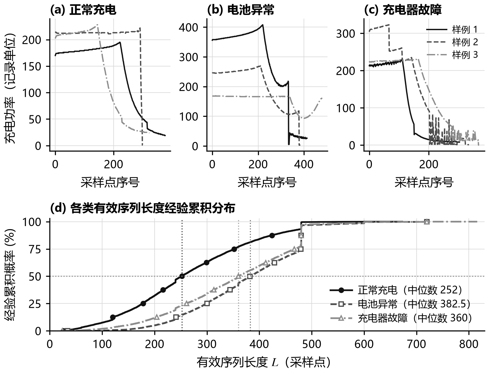
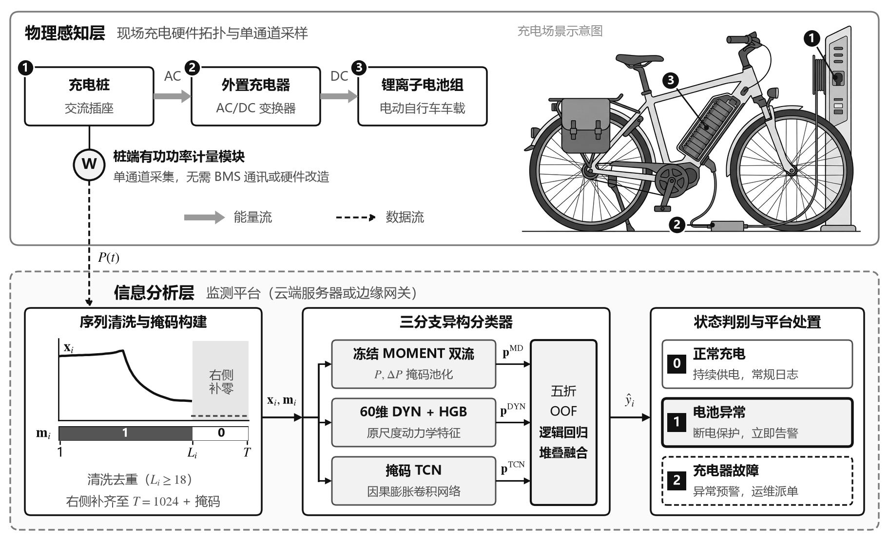
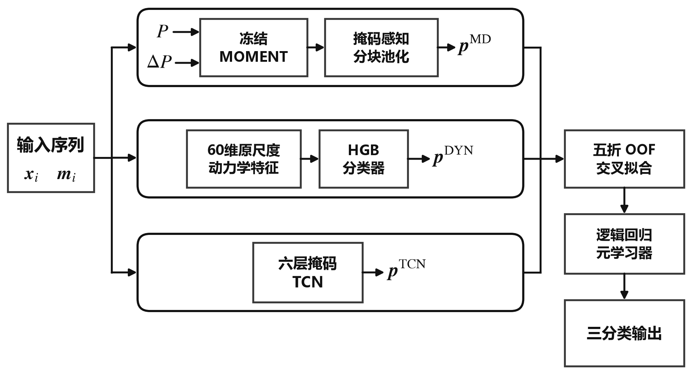
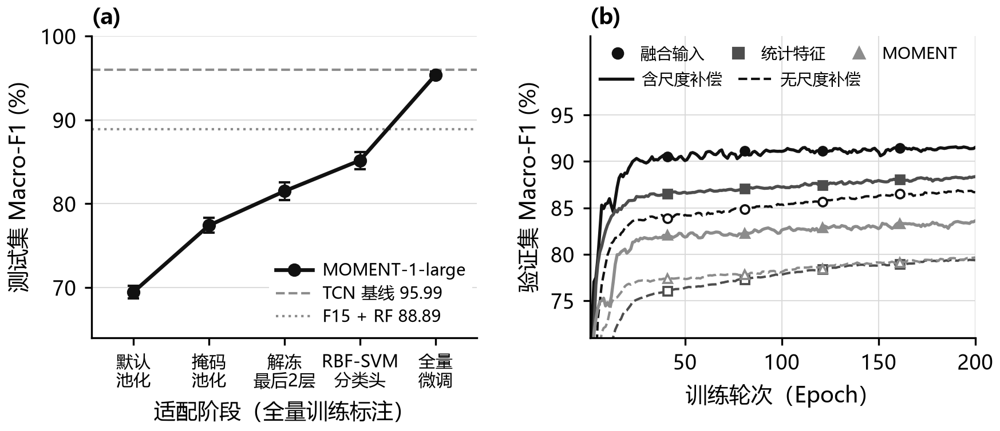
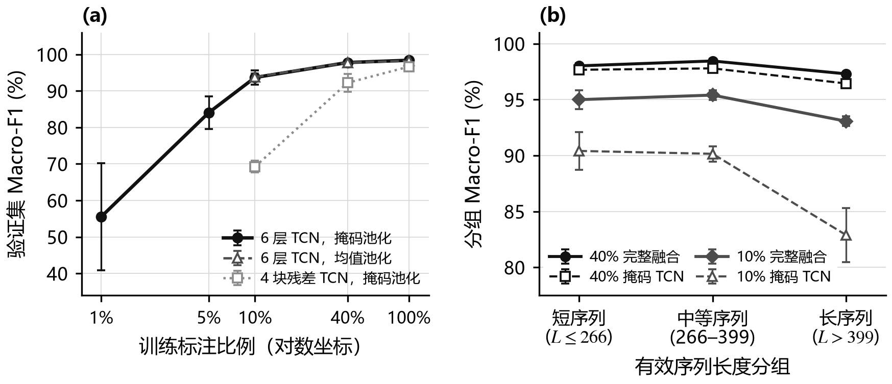
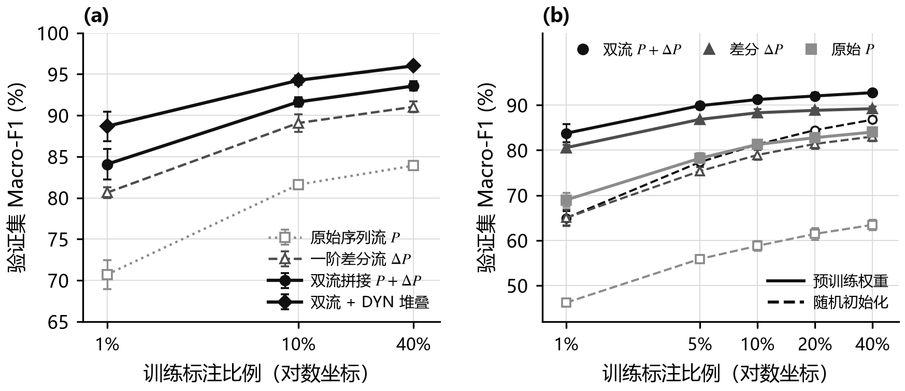
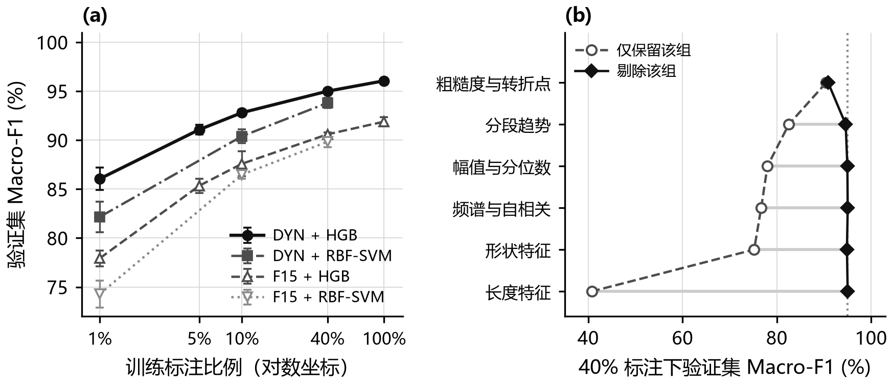
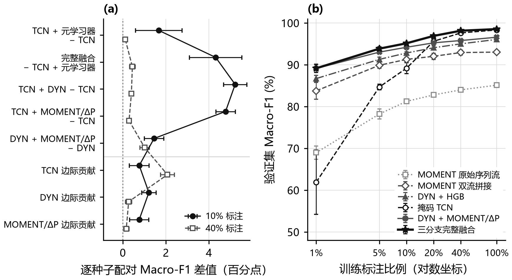
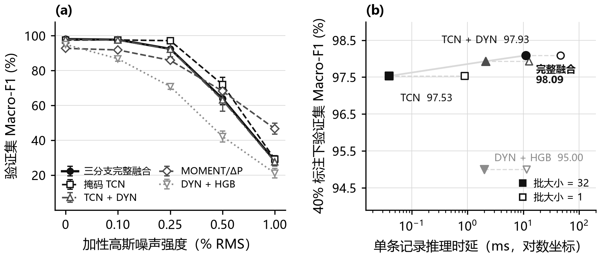

# 杭州电子科技大学信息工程学院

# 本科毕业设计

### （2026届）

|    项 目     | 内 容                                                                |
| :----------: | :------------------------------------------------------------------- |
| **题　　目** | 面向变长锂电池充电功率曲线小样本分类的掩码感知时序大模型异构融合方法 |
| **学院名称** | 杭州电子科技大学信息工程学院                                         |
| **专　　业** | 自动化（机器人）                                                     |
| **班　　级** | 三班 230950103                                                       |
| **学　　号** | 239500314                                                            |
| **学生姓名** | 冯成化                                                               |
| **指导教师** | 钱卓涛                                                               |
| **完成日期** | 2026年11月                                                           |

---

## 摘　　要

电动自行车锂离子电池充电功率曲线隐含了充电器故障与电池异常等关键安全状态信息，基于单通道充电功率序列的自动分类是实现非侵入式充电安全监测、降低充换电火灾风险的重要技术途径。然而，在实际运营与运维场景中，该类监测任务面临三重突出挑战：其一，经维修核验的真实故障标签获取成本高昂，在冷启动或增量部署阶段往往仅能获得少量标注样本，而任务专用深度网络在极低标注下极易发生跨随机种子坍塌与失稳；其二，单次充电记录的有效长度在 18 至 816 个采样点之间剧烈变化，且序列长度分布本身与故障类别存在统计关联，常规右侧补齐操作容易导致模型引入依赖补齐长度的虚假“捷径”；其三，直接迁移通用时间序列基础模型时，默认分类头的无差别全局池化会因右侧补齐稀释短序列有效表征，分块嵌入会平滑短时功率跳变，而逐序列标准化则会抹除具有物理判别意义的绝对功率幅值水平。

针对上述问题，本文提出一种融合冻结时序大模型、原尺度动力学特征与掩码时间卷积网络（TCN）的三分支异构分类方法。首先，在完全冻结 MOMENT-1-large 骨干网络全部 3.4124 亿参数的条件下，设计掩码感知分块池化（Mask-aware Patch Pooling）机制，在聚合阶段严格排除不完整分块与右侧补齐分块，消除补齐稀释效应并保障表征对补齐长度与补齐数值的严格不变性，结合离线特征缓存将下游分类头单轮训练耗时由约 2 min 缩短至约 2 s；其次，在有效观测区间内显式构造一阶差分输入流，与原始功率流共同送入共享权重的冻结 MOMENT 编码器，在不微调骨干参数的条件下恢复短时脉冲毛刺与阶跃跳变等高频变化表征；再次，直接从原始记录尺度的有效观测点提取包含幅值分位、粗糙度与转折点、分段趋势、频谱自相关、形状及长度等 6 个特征组的 60 维原尺度动力学特征（DYN），配合直方图梯度提升分类器（HGB）补回被逐序列归一化抹除的绝对功率水平信息；最后，采用训练子集内部五折分层交叉拟合（Out-of-Fold，OOF）概率堆叠策略，由轻量级正则化多项逻辑回归元学习器自适应融合三路异构互补信息，并引入全分支 0.5% 信号均方根（RMS）高斯白噪声增强训练提升采集抗扰动能力。

在 35,099 条真实有效电动自行车充电功率记录上的系统实验表明：掩码感知分块池化使冻结 MOMENT 线性探测在测试集上的 Macro-F1 由 69.46% 提升至 77.41%，一阶差分双流在 40% 标注预算下使单分支验证集 Macro-F1 从 83.91% 提升至 93.57%；同架构随机初始化对照证实，跨领域预训练先验在 1%～40% 标注预算下为双流分支稳定贡献了 6.00～18.81 个百分点的实质净增益。在统一固定超参数协议下，完整融合模型在 1%（244 条）、5%（1,227 条）和 10%（2,456 条）训练标注下的验证集 Macro-F1 分别达到 $89.15\pm0.98\%$、$93.85\pm0.43\%$ 和 $95.13\pm0.19\%$，在 1% 极低标注下较六层掩码 TCN 高出 27.24 个百分点；在采用联合双流概率块的交叉拟合配置下，40% 标注验证集 Macro-F1 达 $98.09\pm0.23\%$（电池异常召回率 98.23%，误报率 0.67%），在 3,677 条按标识符前缀簇严格隔离的封存留出集上取得 $97.76\pm0.10\%$ 的 Macro-F1。此外，全分支噪声增强训练在不损失干净数据精度的前提下将 0.5% RMS 噪声下的 40% 标注 Macro-F1 由 64.72% 提升至 97.47%，结合 RTX 4080 端到端推理时延与 ONNX FP32/int8 导出测试，明确了高标注或算力受限条件下 TCN+DYN 双分支方案（批大小 32 时 2.09 ms/条）的工程适用边界。

**关键词**：锂离子电池；充电功率曲线；时序大模型；小样本学习；掩码感知池化；集成堆叠

---

## ABSTRACT

Charging power curves of electric bicycles provide non-intrusive safety monitoring cues for identifying charger faults and battery anomalies during routine charging operations. However, deploying automated three-class classifiers in real-world centralized charging facilities faces three practical obstacles: verified fault labels derived from maintenance inspection are scarce in cold-start scenarios, where task-specific deep networks become unstable across random seeds; valid sequence lengths vary widely from 18 to 816 samples and correlate with class labels, making unmasked models vulnerable to right-padding shortcuts; and direct linear transfer of general time-series foundation models suffers from representation dilution over padded patches, smoothing of localized power transients by patch embedding, and erasure of absolute power levels under per-series standardization.

To address these challenges, this thesis proposes a three-branch heterogeneous classification framework that integrates a frozen time-series foundation model, raw-scale dynamics features, and a masked temporal convolutional network (TCN). First, while keeping all 341.24 million parameters of the MOMENT-1-large backbone completely frozen, a mask-aware patch pooling mechanism is introduced to exclude incomplete and right-padded patches, strictly guaranteeing padding invariance and reducing per-epoch classifier training time from approximately 2 min to 2 s via offline feature caching. Second, a first-difference stream is constructed within the valid observation support and fed into the shared frozen MOMENT encoder alongside the original sequence, restoring sensitivity to transient spikes and step jumps without backbone fine-tuning. Third, a 60-dimensional raw-scale dynamics (DYN) branch covering six physically interpretable descriptor groups is paired with a histogram-based gradient boosting classifier (HGB) to preserve absolute power levels and local roughness. Finally, five-fold stratified cross-fitted out-of-fold (OOF) probability stacking combines the three heterogeneous branches through an L2-regularized multinomial logistic meta-learner, supplemented by full-system Gaussian noise augmentation during training.

Extensive experiments on 35,099 operational electric-bicycle charging power records demonstrate the effectiveness of the proposed method. Mask-aware patch pooling raises the test Macro-F1 of a frozen linear probe from 69.46% to 77.41%, and the first-difference dual stream lifts single-branch validation Macro-F1 at 40% labels from 83.91% to 93.57%; same-architecture random initialization controls confirm that cross-domain pretraining provides 6.00 to 18.81 percentage points of net gain to the dual-stream branch across 1%–40% label budgets. Under a unified fixed-hyperparameter protocol, the full fusion model achieves validation Macro-F1 scores of $89.15\pm0.98\%$, $93.85\pm0.43\%$, and $95.13\pm0.19\%$ at 1%, 5%, and 10% training labels, outperforming the masked TCN by 27.24 percentage points at 1% labels. In the cross-fitted joint dual-stream configuration at 40% labels, it reaches $98.09\pm0.23\%$ validation Macro-F1 (98.23% battery-anomaly recall at a 0.67% false-positive rate) and scores $97.76\pm0.10\%$ on a 3,677-record cluster-disjoint sealed hold-out set. Furthermore, full-system noise augmentation raises 40%-label Macro-F1 under 0.5% RMS Gaussian noise from 64.72% to 97.47% without degrading clean accuracy, while end-to-end RTX 4080 latency profiling and ONNX FP32/int8 export tests delineate the practical deployment boundary of the lightweight TCN+DYN configuration.

**Key words**: lithium-ion battery; charging power curve; time-series foundation model; few-shot learning; mask-aware pooling; stacked ensemble

---

## 目　　录

- [1 引言](#1--引言)
  - [1.1 研究背景与意义](#11--研究背景与意义)
  - [1.2 国内外研究现状](#12--国内外研究现状)
    - [1.2.1 锂离子电池与充电设施状态监测研究现状](#121--锂离子电池与充电设施状态监测研究现状)
    - [1.2.2 时间序列分类与任务专用深度学习研究现状](#122--时间序列分类与任务专用深度学习研究现状)
    - [1.2.3 小样本表征学习与时间序列基础模型研究现状](#123--小样本表征学习与时间序列基础模型研究现状)
    - [1.2.4 现有研究不足与本文切入点](#124--现有研究不足与本文切入点)
  - [1.3 研究内容与主要贡献](#13--研究内容与主要贡献)
  - [1.4 论文组织结构](#14--论文组织结构)
- [2 问题描述、数据集构建与相关理论基础](#2--问题描述数据集构建与相关理论基础)
  - [2.1 三分类任务定义](#21--三分类任务定义)
  - [2.2 运行数据集与清洗规范](#22--运行数据集与清洗规范)
  - [2.3 功率曲线形态与长度分布特征](#23--功率曲线形态与长度分布特征)
  - [2.4 评价指标体系](#24--评价指标体系)
  - [2.5 相关基础模型与算法理论概述](#25--相关基础模型与算法理论概述)
    - [2.5.1 锂离子电池充电特性与异常功率演化机理](#251--锂离子电池充电特性与异常功率演化机理)
    - [2.5.2 分块时序 Transformer 与掩码重建预训练理论](#252--分块时序-transformer-与掩码重建预训练理论)
    - [2.5.3 因果膨胀时间卷积网络理论基础](#253--因果膨胀时间卷积网络理论基础)
    - [2.5.4 直方图梯度提升树与堆叠泛化集成理论](#254--直方图梯度提升树与堆叠泛化集成理论)
- [3 三分支异构融合分类方法设计](#3--三分支异构融合分类方法设计)
  - [3.1 系统架构与方法总体框架](#31--系统架构与方法总体框架)
  - [3.2 掩码感知分块池化](#32--掩码感知分块池化)
  - [3.3 一阶差分双流表征与分类头尺度补偿](#33--一阶差分双流表征与分类头尺度补偿)
  - [3.4 原尺度动力学特征分支](#34--原尺度动力学特征分支)
  - [3.5 掩码时间卷积网络分支](#35--掩码时间卷积网络分支)
  - [3.6 五折交叉拟合概率堆叠](#36--五折交叉拟合概率堆叠)
  - [3.7 面向采集扰动的噪声增强训练](#37--面向采集扰动的噪声增强训练)
- [4 实验设计与分类性能评估](#4--实验设计与分类性能评估)
  - [4.1 实验协议与运行环境](#41--实验协议与运行环境)
  - [4.2 基线对比与冻结大模型初始适配](#42--基线对比与冻结大模型初始适配)
  - [4.3 补齐敏感性诊断与 TCN 结构复原](#43--补齐敏感性诊断与-tcn-结构复原)
  - [4.4 差分双流增益与预训练先验归因](#44--差分双流增益与预训练先验归因)
  - [4.5 原尺度动力学特征消融与子集筛选](#45--原尺度动力学特征消融与子集筛选)
  - [4.6 三分支融合消融与互补性分析](#46--三分支融合消融与互补性分析)
  - [4.7 统一协议下多标注预算性能比较](#47--统一协议下多标注预算性能比较)
  - [4.8 封存留出集与簇级泛化审计](#48--封存留出集与簇级泛化审计)
- [5 噪声鲁棒性与工程部署分析](#5--噪声鲁棒性与工程部署分析)
  - [5.1 干净训练模型的采集噪声敏感性](#51--干净训练模型的采集噪声敏感性)
  - [5.2 噪声增强训练的改善效果与边界](#52--噪声增强训练的改善效果与边界)
  - [5.3 端到端推理时延与计算开销测量](#53--端到端推理时延与计算开销测量)
  - [5.4 ONNX 模型导出与静态量化分析](#54--onnx-模型导出与静态量化分析)
- [6 特征物理解释、方案选型与研究局限](#6--特征物理解释方案选型与研究局限)
  - [6.1 时序大模型在变长曲线分类中的作用机理](#61--时序大模型在变长曲线分类中的作用机理)
  - [6.2 动力学特征与已知故障形态的对应关系](#62--动力学特征与已知故障形态的对应关系)
  - [6.3 适配策略对比与工程选型准则](#63--适配策略对比与工程选型准则)
  - [6.4 研究局限性](#64--研究局限性)
- [7 结论与展望](#7--结论与展望)
  - [7.1 全文工作总结](#71--全文工作总结)
  - [7.2 后续研究展望](#72--后续研究展望)
- [参考文献](#参考文献)
- [致谢](#致谢)
- [附录](#附录)
  - [附录 A 动力学特征缩减补充实验结果](#附录-a--动力学特征缩减补充实验结果)
  - [附录 B TCN 导出与 int8 静态量化补充实验结果](#附录-b--tcn-导出与-int8-静态量化补充实验结果)

---

## 1 引言

### 1.1 研究背景与意义

近年来，随着城市短途通勤与即时配送需求的快速增长，电动自行车已成为我国城镇居民日常出行的重要交通工具，其中锂离子电池凭借能量密度高、循环寿命长与无记忆效应等优点，在电动自行车动力电源中的占比持续提高。然而，伴随在用电动自行车保有量与服役年限的不断攀升，充电过程引发的电气安全与火灾事故日益受到关注。在电动自行车充电阶段，电池组内部的电芯微短路、电芯一致性劣化、保护板失效，以及外置充电器功率变换模块的电气故障或控制环路失稳，均可能引发局部过热与异常能量累积，严重时甚至诱发链式放热反应并导致热失控事故[1]。相较于在热失控发生后依赖烟感或温感报警的被动防护手段，在充电过程早期乃至单次充电会话完成时及时识别异常行为，对于阻断高风险隐患、保障城市居民区充电安全具有重要的现实意义。

在面向新能源汽车或大型储能电站的电池故障诊断系统中，诊断算法通常依赖车载电池管理系统（BMS）同步采集的单体电池电压、极耳温度、回路电流等多通道高维物理量[2,3]。这些多维信号能够直接刻画电芯内部的电化学状态演化，从而支持较高精度的故障定位。然而，大量存量电动自行车动力电池组在成本与结构约束下并未开放标准化对外通信接口，且不同品牌、不同电压等级电池包之间的硬件架构差异显著，集中式公共充电桩几乎无法获取车辆内部 BMS 的细粒度遥测数据。相比之下，公共充电桩与智能换电柜内的计量芯片能够长期、稳定地记录每一轮充电过程中的单通道交流或直流侧有功功率时间序列。若能够仅依据桩端单通道充电功率序列，有效区分“正常充电”“电池异常”与“充电器故障”三种运行状态，即可在不改造既有车辆电池包和充电终端硬件的条件下，以完全非侵入式的方式为运营平台提供状态判别、断电保护与运维派单依据。目前，基于外部电气量实现非侵入式设备状态辨识的思路已在电动汽车充电设备故障诊断与电动自行车充电异常检测中得到初步验证[4-7]，但专门面向真实大规模运营平台变长单通道充电功率曲线的细粒度三分类研究仍相对薄弱。

将单通道充电功率曲线直接用于高可靠性三分类任务，在工程落地与算法建模层面面临三方面突出难题：第一，**变长序列与类别相关的补齐捷径问题**。受电池初始荷电状态、用户停充习惯与保护断电时机的影响，实际采集到的有效充电功率序列长度在 18 至 816 个采样点之间剧烈跨度变化。深度学习框架在批量训练与推理时需将序列统一右侧补齐（Right Padding）至定长张量，同时运行数据中不同状态类别的序列长度分布存在显著差异。若模型池化层或特征统计未能严格屏蔽补齐区域，模型极易学习到依赖补齐长度的虚假“捷径”（Shortcut），而非真实的充电功率变化规律。第二，**多时间尺度与幅值尺度上的判别证据耦合问题**。三分类任务的有效判据分布于多个相互正交的信号维度：绝对功率水平可用于区分低功率或异常供电平台；相邻采样点间的一阶差分能够放大短时脉冲毛刺与阶跃跳变；而完整序列的宏观包络形态则反映恒功率阶段向平滑衰减阶段的演化规律。单一尺度的归一化处理或平滑分块编码往往会顾此失彼。第三，**故障标注稀缺下的小样本冷启动失稳问题**。真实运行记录中的故障标签需要结合平台告警、现场维修核验与用户反馈进行人工确认，常规运营中高质量标注样本的积累成本高昂。面向新接入的充电站点或标注预算受限的场景，如何保证分类器在仅有 1%～10% 少量标注时仍具有较高的准确率与跨随机种子稳定性，是制约深度学习模型实用化的关键瓶颈。

### 1.2 国内外研究现状

#### 1.2.1 锂离子电池与充电设施状态监测研究现状

围绕锂离子电池充电过程机理与故障诊断，国内外学者已开展了大量系统性研究。在电池机理与热安全方面，Tomaszewska 等[8]系统综述了锂离子电池快速充电过程中的电化学演化、析锂风险及温度与功率边界特征；Lu 等[9]总结了车用锂电池管理系统中状态估计、均衡控制与异常保护的关键技术挑战；Feng 等[1]深入剖析了电化学内短路诱发锂离子电池热失控的多阶段放热机制，指出内短路早期表现出的异常充电行为是热失控预警的关键窗口；Kong 等[10]针对电池组微短路故障开展定量分析，证实微短路引起的漏电流会改变受影响电芯在恒流或恒功率充电阶段的能量消耗与电压响应过程；Hu 等[3]全面梳理了锂离子电池系统从故障机理、特征提取到诊断决策的完整流程；Zhang 等[2]则进一步将动力学深度学习引入真实场景下的锂电池早期故障检测。上述研究表明，无论是电池内部的微短路漏电、电芯不一致还是老化行为，都会在宏观充放电功率及响应轨迹上留下可观测特征，但多数传统研究依托多通道实验室台架或车载 BMS 信号[2,3]，难以直接照搬至缺少 BMS 通信的存量电动自行车充电桩场景。

在面向充电终端与轻型电动车的非侵入式故障监测方面，相关探索近年来逐步展开。Park 等[4]针对电动汽车快速充电机的功率变换模块构建了基于电气特征的故障诊断系统，指出功率级器件退化会显著改变输出侧电流与功率纹波特性；Duan 等[5]将机器学习与时空特征融合引入非侵入式充电桩故障识别，通过从电流与频域特征中提取判别向量实现桩端异常分类；Xu 等[6]提出了基于多特征融合深度学习的直流充电桩开路故障精准诊断模型，进一步揭示了功率变换器开路故障在输出波形上的高次谐波与高频振荡特征；Sun 等[7]则聚焦电动自行车锂离子电池异常检测任务，构建了融合卷积神经网络、长短期记忆网络与注意力机制的混合模型。然而，现有面向充电基础设施或电动车电池的研究大多针对采样频率固定、信号通道多且长度相对一致的监测数据，或者仅关注二分类异常检测，尚缺少针对大规模运营平台变长单通道充电功率序列的三分类基准评估与系统性方法设计。

#### 1.2.2 时间序列分类与任务专用深度学习研究现状

单通道充电功率曲线的自动判别在数学形式上属于单变量时间序列分类（Time Series Classification，TSC）与异常辨识问题。陈炜[11]系统梳理了时间序列分类中的特征表示、深度模型结构与数据增广方法，指出在具体工程任务中结合信号领域特性设计专用表征仍有必要；许建秋等[12]和 Schmidl 等[13]对时间序列异常检测方法进行了全面综述与实证评估，明确了不同检测与分类范式在数据特征、模型选择及跨场景适用性上的差异；Ismail Fawaz 等[14]与 Middlehurst 等[15]则对深度学习与现代时间序列分类算法开展了大规模基准评测（Bake off），将现有方法归纳为三条主要技术路线。

第一类路线是基于手工特征工程与传统机器学习分类器的方法。该路线通过构造时域统计量（均值、方差、分位数、高阶矩）、差分粗糙度、频谱能量与自相关等描述子，并结合随机森林（Random Forest，RF）[16]、梯度提升决策树（Gradient Boosting Machine，GBM）[17]或支持向量机（Support Vector Machine，SVM）[18]实现分类。该类方法计算开销低、物理可解释性强且对小样本具有较好的抗过拟合能力，但常规通用统计量往往难以充分刻画复杂的长程轨迹过渡与高阶非线性时序形态。

第二类路线是端到端学习的任务专用深度神经网络。Bai 等[19]系统对比了通用卷积网络与循环神经网络在序列建模中的表现，提出采用因果卷积与指数级膨胀卷积构成的时序卷积网络（Temporal Convolutional Network，TCN），在保持严格时序因果性的同时实现了感受野的指数扩展和高效的并行训练。针对多尺度全局依赖与局部突变形态的联合建模需求，国内外学者进一步提出了多种改进型网络：刘思捷等[20]结合多尺度 Transformer 与形态卷积提取多粒度的时序形态特征；杨煜等[21]和江涛[22]分别在雷电电场瞬态信号分类和多变量时间序列预测与分类任务中探索了改进 Transformer 架构；Zerveas 等[23]构建了面向多变量时序表征学习的无监督预训练 Transformer 框架；Nie 等[24]提出的 PatchTST 将时间序列切分为连续子序列分块（Patch）作为 Transformer 词元，兼顾了局部语义保留与长程自注意力计算效率；Wu 等[25]提出的 TimesNet 则通过傅里叶变换将一维时序转化为二维周期变化张量，统一建模周期内与周期间动态。这类专用深度模型在标注数据充足时具有极强的拟合能力，但参数量较大，在极少标注下容易发生过拟合或跨随机种子坍塌。

第三类路线是基于随机或确定性卷积核变换的轻量级高性能方法，代表性工作包括 Dempster 等依次提出的 ROCKET[26]、MiniRocket[27] 和 Hydra[28]。该类方法利用大量不同长度、膨胀系数与偏置的固定卷积核提取最大响应及正值比例（PPV）特征，配合岭回归等线性分类器即可在极低训练成本下取得与复杂深度网络相当甚至更优的分类精度，成为衡量时间序列分类方法性价比的重要强基线。

#### 1.2.3 小样本表征学习与时间序列基础模型研究现状

针对工业场景中标注样本稀缺的痛点，迁移学习与自监督对比表征学习为降低下游任务对人工标注的依赖提供了重要思路。王士同与杨子伦[29]研究了面向时序数据分类的迁移随机神经网络及其学习方法，探讨了源域与目标域分布差异下的知识迁移机制；Eldele 等[30]提出基于时序与上下文对比学习的 TS-TCC 框架，利用弱强数据增强构造正负样本对；Yue 等[31]提出的 TS2Vec 通过层次化对比学习构建了面向多尺度子序列的通用时序表征。上述自监督方法在有限监督下显著提升了分类性能，但通常仍需在目标数据集或相近领域内从头完成预训练。

受自然语言处理与计算机视觉领域基础模型（Foundation Models）范式的推动，构建在大规模、跨领域异构时间序列语料上预训练的时间序列基础模型（Time-Series Foundation Models，简称时序大模型）成为近两年的前沿研究热点。Goswami 等[32]开源了 MOMENT 时序基础模型家族，采用 T5 编码器架构与分块掩码重建任务在跨领域海量数据集上开展自监督预训练，支持分类、预测、插补与异常检测等多类下游任务；Das 等[33]提出了基于纯解码器架构的通用时序预测大模型 TimesFM；Ansari 等[34]提出的 Chronos 将连续时序值量化离散为词表并采用语言模型架构进行概率预测建模；Woo 等[35]提出了面向任意频率、任意变量维度通用预测的 Moirai 统一架构；Shi 等[36]则引入混合专家（Mixture-of-Experts，MoE）架构提出了十亿参数规模的 Time-MoE 模型。

围绕预训练基础模型向垂直工程与工业监测领域的迁移应用，国内外已有不少学者展开积极探索：邵海东等[37]与 Wang 等[38]将大模型表征与信号特征对齐机制引入旋转机械多场景通用故障诊断与剩余寿命预测，证实通用先验迁移至工程机械信号时需结合领域特征适配；Zheng 等[39]实证研究了预训练大语言模型微调在复杂系统故障诊断中的迁移规律；Sun 等[40]探索了通过微调时序大模型实现锂离子电池健康状态（SOH）估计；赵雄飞等[41]与杨俊杰[42]则分别围绕 Time-LLM 在边坡深部位移工程监测中的应用以及大模型输入表示优化对时序建模精度的影响开展了研究。

#### 1.2.4 现有研究不足与本文切入点

尽管时间序列分类与时序大模型研究已取得长足进展，但在将其应用于电动自行车变长单通道充电功率曲线三分类监测时，仍存在三方面尚未解决的关键空白：

第一，**时序大模型在变长工业序列上的直接线性迁移严重失配**。通用时序大模型大多围绕等长连续预测任务设计，对下游变长分类任务缺乏针对性适配。本文先导诊断实验表明，直接冻结 MOMENT-1-large 骨干网络并训练其默认线性分类头，在测试集上仅取得 69.46% 的 Macro-F1，远低于在原始功率尺度上从头训练的任务专用六层 TCN（95.99%）。通过深入拆解前向编码链路发现，造成这一巨大性能落差的具体原因在于：默认分类头在最终汇聚表征时对包含大量右侧补齐（Right Padding）在内的全部分块执行无差别均值池化，致使短序列有效表征被严重稀释；分块编码操作对局部短时跳变起到了低通平滑作用；内置的可逆实例归一化（RevIN）及逐序列标准化又完全抹除了绝对功率幅值尺度。

第二，**单一模型家族难以兼顾全标注区间精度与小样本稳定性**。任务专用深层卷积网络（TCN）虽然在标注充足时表现优异，但在 1%～5% 极低标注冷启动条件下跨随机种子剧烈坍塌，且常规卷积受限于有限感受野（如 $R=127$），在超长充电记录上易遗漏全局演化上下文；手工动力学特征和随机卷积核方法在小样本下较为稳健，但在高标注条件下难以精细拟合局部非线性卷积模式。如何利用不同归纳偏置模型之间的误差互补性实现无泄漏自适应融合，尚缺乏严格的多阶段实验验证。

第三，**缺乏面向真实工业边界的机制归因与工程权衡分析**。现有不少基础模型应用研究未能区分“预训练权重先验”与“庞大编码器架构高维随机投影容量”的各自贡献，也较少同时考察采集加性高斯噪声鲁棒性、ONNX 导出与 int8 量化稳定性、GPU/CPU 推理时延以及跨设备簇泛化偏差。因此，围绕电动自行车充电功率曲线分类任务，系统设计接口级适配、多分支异构融合与工程边界评估框架具有重要的理论参考与实践指导意义。

### 1.3 研究内容与主要贡献

针对上述直接迁移失配、低标注失稳与工程边界不明确的问题，本文以 35,099 条真实电动自行车充电功率运行记录为研究对象，在不更新 MOMENT-1-large 骨干网络全部 3.4124 亿参数的前提下，从池化机制、多流输入构造、原尺度特征旁路、异构概率堆叠与抗噪增强等方面展开系统研究。本文的主要研究内容与贡献归纳如下：

（1）**提出面向变长序列的掩码感知分块池化与离线特征缓存策略**。针对 MOMENT 默认分类头将右侧补齐分块计入全局池化导致短序列有效表征稀释的缺陷，设计了严格的分块级有效性掩码与掩码感知分块池化（Mask-aware Patch Pooling）机制，确保池化表征仅聚合完整有效观测分块，从而在数值上严格保持对右侧补齐长度与填充值的区间不变性；同时，验证了冻结编码器一次性离线特征缓存的可行性，将下游分类头单轮训练耗时由约 2 min 压缩至约 2 s，并揭示了高维冻结表征送入多层感知机（MLP）分类头时因输入尺度偏小引发的优化停滞问题，给出了有效的扇入尺度补偿方案。

（2）**构建冻结骨干下的一阶差分双流表征与预训练先验归因体系**。针对分块嵌入对局部突变毛刺与阶跃跳变的平滑效应，在不微调 MOMENT 骨干参数的条件下，于有效观测区间内显式构造一阶离散差分序列流，与原始功率序列流共同送入同一共享权重的冻结编码器并拼接形成 2048 维双流表征；同时，通过保持网络结构、池化方式与下游分类器完全一致的同架构随机初始化对照实验，严格剥离并定量证实了跨领域预训练先验在不同标注预算下的净增益贡献。

（3）**设计 60 维原尺度动力学特征旁路与五折交叉拟合三分支异构融合框架**。针对逐序列标准化抹除绝对功率水平的问题，从原始功率尺度的有效观测点提取 6 个物理含义明确的特征组（共 60 维动力学特征），结合直方图梯度提升分类器（HGB）提供低标注冷启动兜底与可解释物理依据，并通过全组合穷举搜索验证了 36 维精简子集的无损替代能力；进一步复原了感受野 $R=127$ 的六层掩码因果膨胀 TCN，将基础模型双流分支、DYN+HGB 分支与掩码 TCN 分支在训练子集内部通过五折分层折外（OOF）概率堆叠进行融合，利用仅含 30 个参数的 L2 正则逻辑回归元学习器实现跨归纳偏置的互补纠错，并支持温度缩放概率校准。

（4）**开展多阶段隔离验证、噪声鲁棒性边界界定与工程部署性能实测**。建立了“初始测试探测—验证集开发消融—按标识符前缀簇隔离的封存留出集与留簇审计”三阶段严格评估协议，并在 1%～100% 全标注预算范围内系统对比了各类单分支、双分支、三分支及 MiniRocket 基线性能；深入剖析了干净训练模型在加性高斯白噪声与幅值量化下的退化根源，验证了全分支 0.5% RMS 噪声增强训练对干净精度无损且显著修复抗噪能力的效果；结合 RTX 4080 端到端时延测试与 ONNX FP32/int8 静态量化导出分析，明确了三分支完整融合与轻量化 TCN+DYN 方案的工程选型准则。

### 1.4 论文组织结构

本文共分为七章，并附有两部分补充实验附录，各章具体安排如下：

第 1 章为引言，阐述电动自行车锂电池充电安全监测的研究背景与非侵入式功率分类的工程意义，从电池与充电设施故障监测、时间序列分类与专用深度网络、小样本表征与时序基础模型三个方面综述国内外研究现状，分析现有空白并归纳本文的主要工作与贡献。

第 2 章为问题描述、数据集构建与相关理论基础，给出变长充电功率序列三分类任务的数学定义，说明真实运行数据集的来源、清洗规范、抽样曲线形态与长度捷径风险，建立面向安全关键监测的多维度评价指标体系，并系统阐述锂电池充电功率演化特性以及本文涉及的 Transformer 掩码预训练、因果膨胀 TCN、HGB 与堆叠集成基础理论。

第 3 章为三分支异构融合分类方法设计，首先展示非侵入式监测系统架构与三分支总体框架，随后依次详细给出掩码感知分块池化、一阶差分双流表征与尺度补偿、60 维原尺度动力学特征及核心数学定义、六层掩码因果膨胀 TCN、五折交叉拟合概率堆叠及全分支噪声增强训练的具体算法设计。

第 4 章为实验设计与分类性能评估，阐述三阶段隔离评估协议与软硬件配置，依次报告全量标注基线与冻结适配对比、分类头尺度补偿收敛、TCN 补齐敏感性与结构复原、差分双流增益与同架构预训练归因、DYN 特征组消融、三分支融合互补性与长度分层表现、1%～100% 统一预算曲线以及 3,677 条簇级封存留出集审计结果。

第 5 章为噪声鲁棒性与工程部署分析，检验干净训练模型在 0.1%～1.0% RMS 加性高斯白噪声及幅值量化下的退化机理，评估仅 DYN 增强与全分支协同噪声增强的收益与覆盖边界，并给出 RTX 4080 端到端推理时延与 ONNX FP32/int8 静态量化导出的实测结果。

第 6 章为特征物理解释、方案选型与研究局限，深入剖析时序大模型在变长功率曲线中的作用机理与边际收益递减规律，建立 DYN 特征分布与文献已知故障形态的结构性对应关系，总结面向不同算力与数据条件的多维度工程选型指南，并客观论述本研究的四方面局限性。

第 7 章为结论与展望，全面总结全文的核心研究成果，并针对多站点独立验证、抗畸变特征优化与轻量化边缘部署提出后续研究方向。文末列出参考文献、致谢及附录 A（动力学特征子集穷举缩减实验）与附录 B（TCN 导出与 int8 静态量化补充测试数据）。

---

## 2 问题描述、数据集构建与相关理论基础

### 2.1 三分类任务定义

设智能充电设施单通道计量模块采集到的第 $i$ 条完整充电功率记录的有效序列表示为 $\boldsymbol{x}_i=(x_{i,1},x_{i,2},\ldots,x_{i,L_i})$，其中 $x_{i,t}\in\mathbb{R}_{\ge 0}$ 为第 $t$ 个采样点的有功功率测量值（以系统原始记录单位计），序列有效长度 $L_i$ 满足 $18\le L_i\le 816$。由于不同充电会话的持续时间差异悬殊，为支持深度学习模型的小批量张量并行运算，本文在有效观测区间右侧补零对齐至统一最大序列长度 $T=1024$，同时构造与之一一对应的二值有效观测掩码向量 $\boldsymbol{m}_i=(m_{i,1},m_{i,2},\ldots,m_{i,T})\in\{0,1\}^T$：当位置 $t$ 处于真实有效观测区间（$1\le t\le L_i$）时取 $m_{i,t}=1$，当位置 $t$ 处于右侧补齐区间（$L_i<t\le T$）时取 $m_{i,t}=0$。

三分类任务的建模目标是学习一个判别映射函数 $f$，如式（2-1）所示：

$$
f:(\boldsymbol{x}_i,\boldsymbol{m}_i)\mapsto y_i\in\{0,1,2\} \tag{2-1}
$$

式（2-1）中，离散状态标签 $y_i=0,1,2$ 分别代表正常充电（Normal charging）、电池异常（Battery anomaly）和充电器故障（Charger fault）。从信号处理不变性的物理要求出发，任意理想的分类器 $f$ 的预测概率与判别结果均应当仅由有效观测 $\boldsymbol{x}_{i,1:L_i}$ 决定，而对右侧补齐区域的长度 $T-L_i$ 以及补齐位置所填充的数值严格保持不变。

### 2.2 运行数据集与清洗规范

本研究使用的真实数据集源自某电动自行车集中充电运营平台的实际历史运维记录。每条原始记录包含匿名化的唯一记录标识符、平台运维状态标签以及单通道充电功率序列。原始导出文件共包含 46,535 条记录，其中 11,435 条记录被平台标记为标签 5（代表无效或未完成充电会话，经统计其有效序列长度中位数仅为 1 个采样点）。按照平台既有的数据清洗协议剔除全部标签 5 记录，并进一步过滤掉有效长度不足 18 个采样点的极短碎片序列后，最终保留 35,099 条有效三分类充电功率序列。

需要客观说明两项数据边界条件：第一，18 个采样点的最短长度过滤阈值沿用自平台既有实验协议，数据提供方未对其给出独立的硬件或物理机制依据；第二，原始导出数据未附带采样时间间隔（秒/点）与绝对物理量纲换算参数，因此本文所有分析均严格以“采样点数（Samples）”作为序列长度度量单位，并以“原始记录单位（Recorded units）”表征功率幅值，不作未经核实的分钟或小时时长换算。经逐条哈希校验与去重核查，清洗后的 35,099 条有效序列中不存在完全重复的功率轨迹或同一轨迹对应矛盾标签的冲突样本；全部有效序列的最长长度为 816 个采样点，在统一对齐长度 $T=1024$ 下均可完整保留原始观测，无需执行任何尾部截断操作。

在实验的第一阶段与第二阶段，全部 35,099 条有效记录采用按类别分层随机抽样策略，以 $7:1:2$ 的比例固定划分为训练集（24,569 条）、验证集（3,510 条）与测试集（7,020 条），各子集的样本数量与类别分布如表 2-1 所示。前两阶段的所有基线模型与对比方案在相同随机种子下严格共享完全一致的样本划分清单文件；第 4.1 节与第 4.8 节将进一步阐述第三阶段针对标识符前缀簇隔离的封存留出集（Sealed Hold-out Set）重划分方案。此外，由于该数据集来源于单一充电运营平台的一次历史导出，缺失日历时间戳、充电站点编号、设备型号、生产批次等元数据，且目前尚无具备相同三分类标签语义的公开电动自行车充电功率基准数据集，因此模型跨站点、跨季节与跨硬件型号的外推能力仍需在后续多站点独立数据上予以检验；同时，类别 1（电池异常）与类别 2（充电器故障）遵循平台侧粗粒度运维分类口径，未细分至具体电化学或电路器件级故障模式。尽管每条记录的匿名标识符互不相同，但共享前 6 位字符前缀的标识符可自然聚合成 8,075 个分组，本文将其作为部署簇（Deployment Clusters）的代理变量用于第 4.8 节的簇级泛化与留簇审计评估。

<b>表 2-1 数据集划分与类别分布</b>

| 子集   | 正常充电（0） | 电池异常（1） | 充电器故障（2） |  合计  |
| :----- | :-----------: | :-----------: | :-------------: | :----: |
| 训练集 |     8,480     |     7,014     |      9,075      | 24,569 |
| 验证集 |     1,212     |     1,002     |      1,296      | 3,510  |
| 测试集 |     2,423     |     2,004     |      2,593      | 7,020  |
| 合计   |    12,115     |    10,020     |     12,964      | 35,099 |

### 2.3 功率曲线形态与长度分布特征

为直观呈现三类充电功率记录的时序演化形态与长度分布差异，使用固定随机种子 42 从训练集中对每类随机抽取 3 条曲线（未经过任何人工挑选），同时统计全训练集内三类样本有效长度 $L$ 的经验累积分布函数（ECDF），统计结果如图 2-1 所示。

  
  
<b>图 2-1 训练集充电功率曲线样例与有效长度分布</b>

  
<small>a—正常充电样例曲线；b—电池异常样例曲线；c—充电器故障样例曲线；d—三类有效序列长度的经验累积分布函数（ECDF） 图中：$L$ 为序列有效采样点数；横轴表示采样点序号或有效长度；纵轴表示原始记录单位下的充电功率或经验累积概率；垂直虚线标出各类长度中位数。</small>

由图 2-1a～c 的抽样曲线形态可以观察到：正常充电样例通常在前中期维持一段平稳缓慢上升或近似恒定的高功率输出平台，在达到转换拐点后平滑单调衰减直至充电终止；部分电池异常（类别 1）样例则表现出明显的低功率运行平台差异、中后段功率骤降，或者在衰减末期出现反常的功率回升；而充电器故障（类别 2）样例常见明显的阶跃式下降，或在功率衰减阶段伴随高频剧烈的往复振荡波动。应当指出，上述基于随机抽样曲线的视觉形态归纳仅反映统计意义上的表观特征差异，在缺乏同步电池管理系统数据与拆检佐证时，不直接构成底层电化学或电力电子失效机理的唯一证明。

从图 2-1d 的有效序列长度经验累积分布来看，正常充电、电池异常和充电器故障的有效长度中位数分别为 252、382.5 和 360 个采样点，同时约 480 个采样点位置处的陡然跃升对应于平台单次记录的常见截断上限。可见不同运行状态之间存在显著的有效长度分布差异。进一步量化检验表明：若仅以“有效序列长度 $L_i$”这一个标量作为唯一输入特征训练最大深度为 3 的决策树，即可在测试集上取得 35.76% 的 Macro-F1，大幅高于多数类基线（17.98%）。这一结果证实序列长度本身构成了一个不可忽视的潜在分类捷径。为防止序列深度学习模型退化为“长度计数器”，本文全部序列支路均引入二值有效观测掩码严格屏蔽右侧补齐位置，并在第 4.6 节中按有效长度三分位分层报告模型分类性能。

### 2.4 评价指标体系

如表 2-1 所示，数据集三个类别的样本比例较为接近（正常充电约占 34.52%、电池异常约占 28.55%、充电器故障约占 36.93%），但并非严格均匀分布。为平等衡量模型在三个类别上的综合判别能力，本文选取三类 F1 分数的非加权算术平均值（Macro-F1）作为核心评价指标。针对第 $c\in\{0,1,2\}$ 类，精确率 $P_c$ 与召回率 $R_c$ 由式（2-2）所示：

$$
P_c=\frac{\mathrm{TP}_c}{\mathrm{TP}_c+\mathrm{FP}_c},\qquad R_c=\frac{\mathrm{TP}_c}{\mathrm{TP}_c+\mathrm{FN}_c} \tag{2-2}
$$

式（2-2）中，$\mathrm{TP}_c$、$\mathrm{FP}_c$ 和 $\mathrm{FN}_c$ 分别表示第 $c$ 类样本的真正例、假正例和假负例数目。基于各类精确率与召回率，核心评价指标 $\mathrm{Macro\text{-}F1}$ 由式（2-3）所示：

$$
\mathrm{Macro\text{-}F1}=\frac{1}{3}\sum_{c=0}^{2}\frac{2P_cR_c}{P_c+R_c} \tag{2-3}
$$

在实际充电安全运维监测中，误将正常的电源或充电器判定为故障会增加运维排查成本，而漏检“电池异常”（类别 1）则可能直接带来热失控与火灾升级风险，安全代价最高。因此，本文在报告整体准确率（Accuracy）与 $\mathrm{Macro\text{-}F1}$ 的基础上，重点报告安全关键类“电池异常”的召回率 $R_1$ 及其误报率（False-Positive Rate，FPR），其中 $\mathrm{FPR}_1$ 定义为全部非电池异常样本（包括正常充电与充电器故障）中被误判为电池异常的比例，由式（2-4）所示：

$$
\mathrm{FPR}_1=\frac{\mathrm{FP}_1}{\mathrm{FP}_1+\mathrm{TN}_1} \tag{2-4}
$$

此外，在单种子样本级深入分析中，由于精确率—召回率（PR）曲线在不平衡二分类告警场景中比受试者工作特征（ROC）曲线更能真实反映误报代价[43]，本文补充统计平均精确率（Average Precision，AP）并开展精确 McNemar 检验评估模型纠错的统计显著性。同时，为评估分类器输出后验概率的可信度以支撑分级告警阈值设定，采用期望校准误差（Expected Calibration Error，ECE）度量预测置信度与经验准确率的匹配程度[44]。将预测置信度区间 $[0,1]$ 等距划分为 $M$ 个互斥分箱 $B_1,\ldots,B_M$，ECE 由式（2-5）计算得到：

$$
\mathrm{ECE}=\sum_{m=1}^{M}\frac{|B_m|}{n}\left|\mathrm{acc}(B_m)-\mathrm{conf}(B_m)\right| \tag{2-5}
$$

式（2-5）中，$n$ 为评估样本总数，$|B_m|$ 为落入第 $m$ 个分箱的样本数，$\mathrm{acc}(B_m)$ 与 $\mathrm{conf}(B_m)$ 分别为该分箱内样本的经验准确率与平均预测最大类别概率。除特别说明外，本文所有表格中的性能指标均以百分数（%）形式报告，多随机种子实验均给出样本均值与样本标准差（$\text{均值}\pm\text{标准差}$）。

### 2.5 相关基础模型与算法理论概述

#### 2.5.1 锂离子电池充电特性与异常功率演化机理

在电动自行车交流慢充或直流快充场景中，外置充电器将电网交流电经整流与 DC/DC 功率变换后向车载锂离子电池组供电，常见控制策略为恒流—恒压（CC-CV）或恒功率—减流充电控制[8,9]。在正常充电初期，电池端电压低于充电器预设截止电压上限，系统运行在相对平稳的恒流或近似恒功率工作区，充电功率随电池端电压缓慢上升而维持稳定或微幅爬坡；当电池电压触及恒压阈值后，充电器进入恒压限流衰减阶段，充电电流呈近似指数规律单调回落，功率曲线相应平滑下降并在达到截止阈值后关断。

当电池或充电器发生故障时，上述平滑单调的功率演化过程会受到破坏：一方面，若电池内部发生微短路漏电、电芯容量严重失衡、析锂或热失控早期电化学异常，受影响电芯的等效内阻与荷电状态响应发生改变，微短路漏电流在恒流与恒功率充电阶段会吸收额外能量[1,10]，表现为充电时长异常拉长、衰减阶段末期斜率变缓或出现保护回路介入导致的稀疏大跳变与骤降[3]；另一方面，若充电器内部的功率开关器件退化、整流滤波电容失效、驱动控制环路失稳或功率级出现开路故障，则会导致输出端无法维持平滑电流调节[4,6]，在桩端单通道有功功率序列上直接体现为连续的功率阶跃、高频交替纹波振荡以及非线性瞬态跌落。尽管桩端单通道总有功功率经过了 AC/DC 变换环节的耦合平均，无法直接替代电池管理系统内部电芯单体测量，但其时域幅值水平、局部微分动态与全序列阶段过渡形态仍为非侵入式故障辨识提供了丰富的可观测证据。

#### 2.5.2 分块时序 Transformer 与掩码重建预训练理论

以 MOMENT[32] 与 PatchTST[24] 为代表的现代通用时间序列基础模型主要建立在分块时序 Transformer（Patched Time-Series Transformer）与自监督掩码重建预训练理论之上。面对跨领域、跨量纲的多源时间序列集合，基础模型通常在预处理链路首端引入可逆实例归一化（Reversible Instance Normalization，RevIN）[45]，以消除不同样本与不同数据域之间的量纲差异及非平稳均值—方差漂移。对于有效区间长度为 $L_i$ 的输入功率序列，逐序列标准化与 RevIN 的前向变换由式（2-6）所示：

$$
\tilde{x}_{i,t}=\frac{x_{i,t}-\mu_i}{\sqrt{\sigma_i^2+\varepsilon}},\qquad t=1,\ldots,L_i \tag{2-6}
$$

式（2-6）中，$\mu_i$ 与 $\sigma_i$ 分别为第 $i$ 条序列有效观测点的经验均值与标准差，$\varepsilon$ 为防止除零的小常数。标准化后的序列被补齐至固定长度 $T$ 并划分为 $N=T/P$ 个长度为 $P$ 的连续非重叠分块（Patch）。每个分块通过线性投影或轻量卷积嵌入层映射为 $d$ 维隐空间词元，随后叠加上位置编码送入多层 Transformer 编码器。编码器内部核心的多头自注意力机制通过缩放点积计算任意两个分块词元之间的全局相关性，单头注意力运算由式（2-7）所示：

$$
\mathrm{Attention}(\boldsymbol{Q},\boldsymbol{K},\boldsymbol{V})=\mathrm{softmax}\!\left(\frac{\boldsymbol{Q}\boldsymbol{K}^{\top}}{\sqrt{d_k}}+\boldsymbol{M}_{\mathrm{attn}}\right)\boldsymbol{V} \tag{2-7}
$$

式（2-7）中，$\boldsymbol{Q}$、$\boldsymbol{K}$、$\boldsymbol{V}$ 分别为由分块隐层序列线性映射得到的查询、键和值矩阵，$d_k$ 为注意力头维度，$\boldsymbol{M}_{\mathrm{attn}}$ 为由输入掩码构造的注意力偏置矩阵（对补齐区域对应位置赋予 $-\infty$ 从而抑制有效词元对补齐词元的注意力权重）。

在自监督预训练阶段，MOMENT 采用掩码分块重建（Masked Patch Modeling）范式[32]：以一定概率随机遮蔽部分连续分块，将其替换为可学习的掩码向量，训练编码器利用未被遮蔽的上下文分块表征重构被遮蔽区域的原始归一化波形，其重建损失函数由式（2-8）所示：

$$
\mathcal{L}_{\mathrm{MPM}}=\frac{1}{|\Omega_{\mathrm{mask}}|}\sum_{n\in\Omega_{\mathrm{mask}}}\left\|\hat{\boldsymbol{s}}_{i,n}-\boldsymbol{s}_{i,n}\right\|_2^2 \tag{2-8}
$$

式（2-8）中，$\Omega_{\mathrm{mask}}$ 为被随机遮蔽的分块索引集合，$\boldsymbol{s}_{i,n}\in\mathbb{R}^{P}$ 与 $\hat{\boldsymbol{s}}_{i,n}\in\mathbb{R}^{P}$ 分别为第 $n$ 个分块的真实输入片段与模型重构输出。借助在数亿级跨领域公开时间序列上的重建预训练，MOMENT 编码器内部形成了对时序趋势转折、平台维持、突变脉冲等通用波形结构的先验表达。然而，式（2-6）的实例标准化在平抑跨领域量纲的同时也抹除了绝对功率水平；分块线性投影将相邻 $P=8$ 个时间步压缩为单一词元，在捕获宏观包络时容易低通平滑局部单点毛刺；而默认分类头若在注意力层之后忽略分块掩码直接求全局均值，补齐分块仍会经前馈网络非线性映射将冗余零偏置混入最终特征向量。这三项结构特性构成了本文第 3 章方法设计的直接理论切入点。

#### 2.5.3 因果膨胀时间卷积网络理论基础

时间卷积网络（TCN）[19]通过在标准一维卷积神经网络中引入因果填充（Causal Padding）与膨胀采样（Dilated Convolution），克服了传统循环神经网络难以并行训练、长序列梯度消失等缺陷。对于一维输入功率序列 $\boldsymbol{x}_i$ 和长度为 $k$ 的一维卷积核滤波器 $F:\{0,\ldots,k-1\}\to\mathbb{R}$，第 $l$ 层膨胀系数为 $d_l$ 的因果膨胀卷积在时刻 $t$ 的输出响应由式（2-9）所示：

$$
(F *_{d_l} \boldsymbol{x}_i)(t)=\sum_{j=0}^{k-1}F(j)\cdot x_{i,\;t-d_l\cdot j} \tag{2-9}
$$

由式（2-9）可见，因果约束保证时刻 $t$ 的卷积输出仅与当前及过去时刻 $t-d_l\cdot j\le t$ 的历史观测有关，绝不跨越右侧边界读取未来时刻或右侧补齐区域的值（仅在左侧起点补充 $(k-1)d_l$ 个零以保持序列长度不变）。通过逐层按指数规律递增膨胀系数（$d_l=2^{l-1}$），网络无需大幅加深层数即可获得随深度指数扩张的感受野。在变长序列处理中，由于任意有效时间步 $t\le L_i$ 的因果卷积特征均完全独立于 $t>L_i$ 的右侧补齐内容，只要在最终全局汇聚环节严格仅对有效位置（$m_{i,t}=1$）求均值，整个 TCN 分支即可在结构上天然满足右侧补齐不变性，且能够直接在原始物理功率尺度上学习精细的局部卷积模式。

#### 2.5.4 直方图梯度提升树与堆叠泛化集成理论

直方图梯度提升分类器（Histogram-based Gradient Boosting，HGB）是梯度提升决策树（GBDT）[17]的高效工程实现。梯度提升算法采用前向分步加法模型，在第 $m$ 轮迭代中沿当前训练损失函数关于样本预测得分的负梯度方向拟合一棵弱回归树 $h_m(\boldsymbol{v}_i)$。记多分类对数损失函数为 $\ell(y_i,\hat{\boldsymbol{y}}_i)$，第 $m$ 轮正则化二阶泰勒近似目标函数由式（2-10）所示：

$$
\mathcal{L}^{(m)}\approx\sum_{i=1}^{n}\left[g_{i,m}h_m(\boldsymbol{v}_i)+\frac{1}{2}h_{i,m}h_m^2(\boldsymbol{v}_i)\right]+\Omega(h_m) \tag{2-10}
$$

式（2-10）中，$\boldsymbol{v}_i$ 为提取的动力学特征向量，$g_{i,m}$ 与 $h_{i,m}$ 分别为损失函数对上一轮模型输出的一阶梯度与二阶海森（Hessian）统计量，$\Omega(h_m)$ 为叶子节点数与 L2 叶权重正则惩罚项。与传统精确贪心分裂算法遍历全部连续特征排序阈值不同，HGB 预先将每个连续特征离散化为固定数量的直方图分箱（Bins），在树节点分裂搜索时仅需累加各分箱的一阶与二阶梯度直方图即可选出最优分割点，从而将单次分裂搜索复杂度由随样本数线性增长降至随分箱数常数级，不仅在中等规模表格动力学特征上训练极快，还凭借阈值分箱与叶节点最少样本约束对异常极值与小样本过拟合具有较强的抗噪平滑能力。

在多模型集成层面，堆叠泛化（Stacked Generalization）通过训练一个元学习器（Meta-learner）来组合多个具有不同归纳偏置的基分类器输出。若直接使用基模型在全训练集上的样本内（In-sample）预测概率拟合元学习器，在训练集上容易过拟合的深层网络（如 TCN）往往会获得虚高的训练准确率，诱使元学习器对其分配过高权重而在测试时发生泛化退化。采用 $K$ 折交叉拟合（Cross-fitting）构造无泄漏的折外（Out-of-Fold，OOF）预测概率作为元特征，能够确保元学习器观察到的是各基分支在未见样本上的真实泛化表现与误差相关性，从而在高标注、低标注以及不同序列长度区间内实现稳健的自适应权重分配。

---

## 3 三分支异构融合分类方法设计

### 3.1 系统架构与方法总体框架

面向电动自行车集中充电场景的非侵入式安全监测系统架构如图 3-1 所示。系统在结构上划分为物理感知层与信息分析层两个部分。在物理感知层，电动自行车车载锂离子电池组经由外置 AC/DC 充电器连接至智能充电桩交流插座，安装在充电桩插座回路上的单通道有功功率计量模块持续采集整轮充电过程的端到端有功功率序列 $P(t)$，无需在车辆电池组上加装传感器或建立 BMS 通信链路，兼容现有各类存量电动自行车与充电设施。在信息分析层（部署于监测平台云端服务器或本地边缘网关），首先执行序列清洗去重（剔除无效记录并过滤 $L_i<18$ 样本），右侧补零至 $T=1024$ 并生成配对二值掩码向量 $\boldsymbol{m}_i\in\{0,1\}^T$；随后将 $(\boldsymbol{x}_i,\boldsymbol{m}_i)$ 并行送入三分支异构分类器生成预测类别 $\hat{y}_i$；最后根据判别状态执行差异化平台处置动作——“正常充电（0）”保持持续供电并写入常规运行日志，“电池异常（1）”立即触发断电保护与安全告警，“充电器故障（2）”则推送异常预警并生成设备运维派单。

  
  
<b>图 3-1 面向电动自行车锂电池充电安全监测的非侵入式系统架构</b>

  
<small>上层为物理感知层拓扑及充电场景对应示意图；下层为信息分析层序列构建、三分支分类与平台处置链路 图中：编号 1、2、3 分别对应充电桩、外置充电器与车载锂离子电池组；W 为单通道有功功率计量模块；$P(t)$ 为采集功率流；$\mathbf{x}_i$、$\mathbf{m}_i$ 分别为补齐后功率序列与有效观测掩码；$\mathbf{p}^{\mathrm{MD}}$、$\mathbf{p}^{\mathrm{DYN}}$、$\mathbf{p}^{\mathrm{TCN}}$ 为三分支预测概率；$\hat{y}_i$ 为最终判别状态标签；灰色粗箭头表示能量流，虚线箭头表示数据流。</small>

本文设计的三分支异构融合分类方法总体框架如图 3-2 所示。为应对单一模型族在变长功率曲线与小样本约束下的固有短板，框架并行集成三条具备互补归纳偏置的异构特征学习分支与顶层概率堆叠元学习器：

（1）**分支Ⅰ（冻结时序大模型双流分支）**：将有效观测区间内的原始功率序列 $P$ 与一阶离散差分序列 $\Delta P$ 分别逐序列标准化后，送入同一共享权重的冻结 MOMENT-1-large 编码器，经掩码感知分块池化聚合为 2048 维双流表征，由 L2 正则多项逻辑回归输出三类预测概率 $\boldsymbol{p}_i^{\mathrm{MD}}$。该分支借助跨领域自监督预训练先验与全局自注意力机制，在小样本与长序列区间提供稳定的全局上下文支撑。

（2）**分支Ⅱ（原尺度动力学特征分支）**：跳过逐序列幅值标准化，直接从原始记录尺度的有效观测点提取包含 6 个特征组共 60 维的原尺度动力学特征（DYN），配合固定超参数的直方图梯度提升分类器（HGB）输出三类概率 $\boldsymbol{p}_i^{\mathrm{DYN}}$。该分支保留绝对功率幅值与物理可解释局部统计量，为系统提供抗坍塌的低标注冷启动锚点。

（3）**分支Ⅲ（掩码时间卷积网络分支）**：采用六层因果膨胀一维卷积网络直接对原尺度序列提取多尺度局部卷积特征，经掩码均值池化屏蔽右侧补齐后由全连接层输出三类概率 $\boldsymbol{p}_i^{\mathrm{TCN}}$。该分支专门捕捉高标注条件下精细的局部波形模式。

在融合阶段，三条基分支在当前可用训练子集内部执行五折分层交叉拟合，生成无样本内过拟合泄漏的折外（OOF）预测概率向量，拼接后训练 L2 正则化多项逻辑回归元学习器，最终输出整合三路优势的三分类预测结果。

  
  
<b>图 3-2 基于冻结时序大模型的三分支异构融合总体框架</b>

  
<small>分支Ⅰ（上）为冻结 MOMENT 差分双流分支；分支Ⅱ（中）为 60 维原尺度动力学特征与 HGB 分支；分支Ⅲ（下）为六层掩码 TCN 分支；右侧为五折 OOF 交叉拟合堆叠融合模块 图中：$\boldsymbol{x}_i$、$\boldsymbol{m}_i$ 为输入功率序列与有效掩码；$P$、$\Delta P$ 分别为原始功率流与一阶差分流；$\boldsymbol{p}^{\mathrm{MD}}$、$\boldsymbol{p}^{\mathrm{DYN}}$、$\boldsymbol{p}^{\mathrm{TCN}}$ 分别为三条分支的三类输出概率向量。</small>

### 3.2 掩码感知分块池化

本文采用开源时序基础模型 MOMENT-1-large[32]作为分支Ⅰ的通用表征骨干。该模型基于 T5-large 编码器架构构建，包含 24 层 Transformer 编码层，每层隐藏维度为 $d_m=1024$，配备 16 个自注意力头，骨干网络参数量共计 3.4124 亿（341.24 M）。与 PatchTST[24] 类似，MOMENT 将对齐至统一长度 $T=1024$ 的输入功率序列按无重叠步长切分为 $N=T/P=128$ 个长度为 $P=8$ 的连续分块（Patch），经过内置 RevIN 归一化、线性分块嵌入和 24 层编码器上下文交互后，输出分块级隐层表征序列 $\boldsymbol{h}_{i,1},\ldots,\boldsymbol{h}_{i,N}\in\mathbb{R}^{1024}$。

经逐行检查官方库 `momentfm 0.1.4` 的默认分类前向实现发现，尽管其将二值观测掩码 $\boldsymbol{m}_i$ 传入了编码器自注意力层以屏蔽有效分块对补齐位置的关注，但在最终将分块矩阵汇聚为单条样本级句向量的池化层中，却对全部 $N=128$ 个分块执行了无差别的算术平均，由式（3-1）所示：

$$
\boldsymbol{z}_i^{\mathrm{default}}=\frac{1}{N}\sum_{n=1}^{N}\boldsymbol{h}_{i,n} \tag{3-1}
$$

对于一条有效长度为 $L_i=18$ 的最短充电记录，128 个分块中仅有前 2 个分块包含完整的有效采样点（第 3 个分块仅含 2 个有效点与 6 个补零点），其余 125 个分块全部由右侧补齐构成。经过 24 层残差前馈网络和层归一化映射后，补齐分块仍保留非零激活偏置，从而在式（3-1）的等权平均中占据 98% 以上的权重，严重稀释了有效功率表征；而对于有效长度为 800 的长序列，完整有效分块占比约为 78%。这种随有效长度剧烈波动的稀释比例使分类头接收到的表征混入了强烈的序列长度伪信号。

为彻底消除补齐稀释效应，本文定义了严格的分块级有效性掩码 $\tilde{m}_{i,n}$，由式（3-2）所示：

$$
\tilde{m}_{i,n}=\prod_{t=(n-1)P+1}^{nP}m_{i,t},\qquad n=1,\ldots,N \tag{3-2}
$$

由式（3-2）可见，仅当第 $n$ 个分块内部的全部 $P=8$ 个采样点均属于有效观测（即 $m_{i,t}=1$ 恒成立）时，才判定该分块为完整有效分块并记 $\tilde{m}_{i,n}=1$；任何包含右侧补齐点或位于有效区间末尾不足 8 个采样点的残缺分块，其乘积结果均满足 $\tilde{m}_{i,n}=0$。排除残缺末尾分块能够进一步防止 0 值填充边界引入阶跃伪影。在此基础上，掩码感知分块池化（Mask-aware Patch Pooling）仅对完整有效分块执行归一化均值汇聚，由式（3-3）所示：

$$
\boldsymbol{z}_i=\frac{\sum_{n=1}^{N}\tilde{m}_{i,n}\boldsymbol{h}_{i,n}}{\sum_{n=1}^{N}\tilde{m}_{i,n}} \tag{3-3}
$$

由于第 2.2 节的数据清洗规范保证了所有保留序列均满足 $L_i\ge 18=2P+2$，每条记录至少包含 2 个完整有效分块，式（3-3）的分母恒满足 $\sum_{n=1}^{N}\tilde{m}_{i,n}\ge 2>0$，不存在除零奇异性。在有效长度介于 18 至 384 的固定合成测试序列上开展数值不变性验证：保持有效观测不变，将右侧补齐总长度由 512 改变为 1024，或者将掩码外区域（$t>L_i$）的补齐零值替换为任意幅度随机数，式（3-3）计算所得池化向量的最大绝对数值变化量不超过 $4.2\times 10^{-7}$，处于 FP32 单精度浮点数舍入误差量级。需要严格界定的是，上述不变性专门针对右侧补齐区域成立；位于有效观测支撑集内部（$1\le t\le L_i$）的样本点（包含末尾不足一个分块的余数点）仍会正常参与外部逐序列 z-score 标准化以及编码器内置 RevIN 均值与方差的统计计算。

在工程计算效率方面，由于 MOMENT-1-large 骨干网络的全部 3.4124 亿参数在整个适配与训练过程中始终保持完全冻结，给定数据集各划分的输入曲线后，各分块掩码池化表征仅需执行一次 FP32 前向传播即可按样本标识符校验并离线持久化缓存至磁盘。此后无论下游分类头在多少种标注比例或超参数网格上迭代训练，均无需重复遍历 24 层大型 Transformer，下游分类器单轮（Epoch）训练耗时由此从约 2 min 大幅缩短至约 2 s。

### 3.3 一阶差分双流表征与分类头尺度补偿

分块嵌入与实例归一化虽然提升了全局平滑趋势建模能力，但也会对局部高频变化起到显著的平滑削弱作用：当充电器发生瞬态功率毛刺或电池发生局部阶跃跳变时，若突变跨越极少采样点，其在 $P=8$ 的分块线性映射内极易被平缓邻域点平均掩盖。若采用解冻全量微调（Full Fine-tuning）或微调最后若干层虽可在一定程度上重构局部响应，但单次全量微调需更新 3.4124 亿参数、耗时约 3 h，且在 1%～10% 小样本标注下极易出现严重过拟合。

针对这一矛盾，本文在不更新、不修改预训练骨干网络任何参数的条件下，从输入信号预处理层面对局部动态变化进行显式增强，构造一阶离散差分流作为第二路并行输入。对于第 $i$ 条有效观测序列（$1\le t\le L_i$），其有效区间内的一阶差分序列 $\Delta\boldsymbol{x}_i$ 由式（3-4）所示：

$$
\Delta x_{i,t}=x_{i,t+1}-x_{i,t},\qquad t=1,\ldots,L_i-1 \tag{3-4}
$$

一阶差分算子等价于离散高通滤波器，能够消除缓慢漂移的直流功率平台分量，而将功率阶跃跳变、突变尖峰与高频纹波振荡显著转化为高信噪比的脉冲序列。将有效长度减 1 后的差分序列同样在右侧补零对齐至 $T=1024$ 并配对生成长度 $L_i-1$ 对应的二值掩码（由于 $L_i-1\ge 17\ge 2P+1$，依然保证至少存在 2 个完整有效分块）。随后，将原始功率序列与一阶差分序列各自独立执行逐序列 z-score 标准化，分别送入**同一个冻结的 MOMENT-1-large 编码器**并按式（3-3）执行掩码感知分块池化，获得原始功率流表征 $\boldsymbol{z}_i^{P}\in\mathbb{R}^{1024}$ 与一阶差分流表征 $\boldsymbol{z}_i^{\Delta P}\in\mathbb{R}^{1024}$。将二者按通道拼接即可得到 2048 维双流联合表征向量 $\boldsymbol{z}_i^{\mathrm{MD}}$，由式（3-5）所示：

$$
\boldsymbol{z}_i^{\mathrm{MD}}=\left[\boldsymbol{z}_i^{P}\,\|\,\boldsymbol{z}_i^{\Delta P}\right]\in\mathbb{R}^{2048} \tag{3-5}
$$

在融合分支设计中，在 $\boldsymbol{z}_i^{\mathrm{MD}}$ 之上拟合 L2 正则化系数 $C=1.0$ 的多项逻辑回归分类器，直接输出双流分支的三分类后验概率 $\boldsymbol{p}_i^{\mathrm{MD}}$（在多预算统一套件中也考察将 $\boldsymbol{z}_i^{P}$ 与 $\boldsymbol{z}_i^{\Delta P}$ 分别通过各自逻辑回归分支映射为独立概率块再交由元学习器融合的变体）。双流结构仅为每条记录增加一次冻结编码器离线前向计算，不新增任何骨干微调参数。

此外，在第一阶段探讨使用深度神经网络（多层感知机，MLP）作为冻结表征下游分类头时，本文发现直接将归一化后的 1024 维 MOMENT 表征与 15 维统计特征拼接输入 MLP 会引发严重的优化停滞。其根源在于：为了平衡不同维度分支对全连接层的初始贡献，两条分支特征在拼接前分别按 $\sqrt{d_m}$ 与 $\sqrt{d_s}$ 进行了缩减归一化（其中 $d_m=1024$，$d_s=15$），导致拼接后的 1039 维输入向量整体方差与首层初始激活均方根（RMS）急剧跌落至 0.024～0.029，使得反向传播梯度微弱、训练收敛极其缓慢。为此，本文推导了分类头输入扇入尺度补偿系数 $\gamma$，对拼接特征实施固定增益缩放，由式（3-6）所示：

$$
\tilde{\boldsymbol{e}}_i=\gamma\left[\frac{\mathrm{LN}(\boldsymbol{z}_i^{P})}{\sqrt{d_m}}\;\middle\|\;\frac{(\boldsymbol{s}_i-\bar{\boldsymbol{s}})\oslash\boldsymbol{\sigma}_s}{\sqrt{d_s}}\right],\qquad \gamma=\sqrt{\frac{d_m+d_s}{B}} \tag{3-6}
$$

式（3-6）中，$\mathrm{LN}(\cdot)$ 为层归一化算子，$\boldsymbol{s}_i\in\mathbb{R}^{d_s}$ 为统计特征向量，$\bar{\boldsymbol{s}}$ 与 $\boldsymbol{\sigma}_s$ 为仅在训练集上统计的均值与标准差，$\oslash$ 表示逐元素相除，$B\in\{1,2\}$ 为当前激活的分支数目。引入式（3-6）的尺度补偿后，首层初始激活 RMS 即刻恢复至 0.49～0.55 的健康优化区间，使深层 MLP 分类头能够充分释放冻结表征的判别潜力。

### 3.4 原尺度动力学特征分支

无论是式（2-6）的逐序列 z-score 标准化还是 MOMENT 内置的 RevIN，都会对每条序列减去自身均值并除以自身标准差，从而不可避免地抹除充电功率曲线的**绝对物理幅值尺度**。然而在实际充电监测中，当某条异常电池曲线长期处于较低或较高的异常恒功率平台、但其归一化后的相对包络形状与正常恒功率充电曲线高度相似时，仅依靠形状归一化的模型将产生严重混淆。前期对照实验已验证这一物理直觉：直接输入原始功率尺度的 TCN 在测试集上取得了 95.99% 的 Macro-F1，而一旦对每条序列单独施以逐序列 min--max 归一化，测试集 Macro-F1 即下跌近 4 个百分点至 92.00%。

为此，本文构建了分支Ⅱ（DYN 分支），完全绕开逐序列幅值归一化，直接从原始记录尺度的有效观测支撑集 $\boldsymbol{x}_{i,1:L_i}$ 中提取 60 维物理含义明确的原尺度统计与动力学特征，右侧补齐区域 $t>L_i$ 严格不参与任何统计计算。该 60 维特征系统保留了最初基准协议中的 15 维常规全局统计特征（记为 F15，包含有效长度、均值、标准差、极值、五分位点、末首值差、全局线性斜率以及一阶差分均值、标准差与最大绝对跳变），并进一步扩展了 45 维专门刻画局部波动粗糙度、分段趋势演变、频域能量分布与极值几何形态的高阶动力学描述子。全部 60 维特征划分为 6 个互不重叠的特征组，详细构成及物理作用如表 3-1 所示。

<b>表 3-1 60 维原尺度动力学特征（DYN）分组及物理含义</b>

| 特征分组       | 维数 | 代表性特征条目                                                                                                  | 物理含义与判别作用                                   |
| :------------- | :--: | :-------------------------------------------------------------------------------------------------------------- | :--------------------------------------------------- |
| 幅值与分位数   |  17  | 均值、标准差、极值、5%～95% 分位数、变异系数、末首比、极值均值比                                                | 保留绝对功率水平、波动强度与幅值分布                 |
| 粗糙度与转折点 |  12  | 差分均值/标准差、绝对差分均值与 90% 分位、上升步长比例、方向变化率、平台比例、最长平台占比、差分滞后 1 阶自相关 | 刻画局部高频纹波震荡、阶跃跳变与恒功率平台持续性     |
| 分段趋势       |  18  | 全局与首尾 1/10 段线性斜率、全长与尾部趋势变化量、首尾段均值/标准差、三等分各段均值/标准差及末段减首段差        | 刻画恒功率维持阶段与减流衰减阶段的斜率及阶段演化形态 |
| 频谱与自相关   |  7   | 去直流快速傅里叶功率谱四等分频带能量占比、归一化主频、水平滞后 1 阶自相关系数、10 箱幅值直方图熵                | 捕捉周期性开关振荡频率分布与序列复杂度               |
| 形状特征       |  4   | 最大回撤比例、最大上升比例、偏度、峰度                                                                          | 度量故障引起的断崖骤降、异常抬升幅度与分布偏态       |
| 长度特征       |  2   | 有效采样点数 $L_i$ 及其占最大序列长度 $T$ 的比例                                                                | 刻画有效观测样本规模                                 |

为阐明关键动力学特征的数学构造，下面给出在后续特征归因中起核心作用的四项动力学指标定义。首先，设有效观测区间内的一阶差分序列为 $\Delta x_{i,t}=x_{i,t+1}-x_{i,t}$（$t=1,\ldots,L_i-1$），提取其中所有非零差分的符号构成符号序列 $\tilde{s}_1,\ldots,\tilde{s}_K\in\{-1,+1\}$，**方向变化率（Direction-change rate）**定义为相邻非零差分符号发生正负反转的比例，由式（3-7）所示：

$$
\mathrm{TurnRate}_i=\frac{1}{\max(K-1,1)}\sum_{k=2}^{K}\mathbb{I}\!\left(\tilde{s}_k\ne \tilde{s}_{k-1}\right) \tag{3-7}
$$

方向变化率越高，说明曲线在相邻采样步之间越频繁地出现“升—降—升”往复震荡，是识别充电器功率级纹波故障的关键指标。其次，设定平台判定微阈值 $\varepsilon_p=10^{-3}$，**平台比例（Plateau fraction）**定义为相邻采样点绝对功率差值严格低于 $\varepsilon_p$ 的步数占比，由式（3-8）所示：

$$
\mathrm{PlateauFrac}_i=\frac{1}{L_i-1}\sum_{t=1}^{L_i-1}\mathbb{I}\!\left(|x_{i,t+1}-x_{i,t}|<\varepsilon_p\right) \tag{3-8}
$$

该指标与最长连续平台长度占比共同刻画恒功率稳态平台的持续程度。再次，引入累计运行极大值 $M_{i,t}=\max_{1\le q\le t}x_{i,q}$ 与累计运行极小值 $m_{i,t}^{\min}=\min_{1\le q\le t}x_{i,q}$，**最大回撤比例（Maximum drawdown）**与**最大上升比例（Maximum runup）**分别由式（3-9）和式（3-10）所示：

$$
\mathrm{MaxDrawdown}_i=\max_{1\le t\le L_i}\frac{M_{i,t}-x_{i,t}}{|M_{i,t}|+\epsilon} \tag{3-9}
$$

$$
\mathrm{MaxRunup}_i=\max_{1\le t\le L_i}\frac{x_{i,t}-m_{i,t}^{\min}}{|m_{i,t}^{\min}|+\epsilon} \tag{3-10}
$$

其中 $\epsilon=10^{-12}$ 为数值防除零常数。如第 5.1 节实验分析将进一步揭示的那样，式（3-10）直接以累计运行极小值 $|m_{i,t}^{\min}|$ 作为分母，在功率曲线接近零值的局部区域对传感器加性噪声极为敏感，这也解释了干净训练 DYN 分支抗噪脆弱性的内在数值成因。

提取出 60 维 DYN 特征向量后，本文选用直方图梯度提升分类器（HGB）进行判别建模并输出分支Ⅱ的三类概率 $\boldsymbol{p}_i^{\mathrm{DYN}}$。为严格防止跨标注预算调参带来的过拟合偏差，HGB 在全部分割协议和全部标注预算下均采用统一固定的超参数配置：最大迭代次数设为 400，学习率设为 0.08，最大叶节点数设为 31，每个叶节点最少样本数设为 20，L2 正则化系数设为 1.0。在 40% 标注预算下，全部 60 维特征提取与 HGB 模型拟合在常规多核 CPU 上仅需数秒即可完成。

### 3.5 掩码时间卷积网络分支

分支Ⅲ沿用经过结构核查与复原的六层因果膨胀时间卷积网络（TCN）架构。与第 4.3 节所诊断的早期简化版四残差块 TCN 不同，完整复原后的六层 TCN 由 6 个依次堆叠的因果膨胀一维卷积—ReLU 激活—空间丢弃（SpatialDropout，丢弃率 0.3）模块组成，不设批归一化或层归一化层。每层卷积核宽度固定为 $k=3$，隐藏通道数均设为 128，第 $l$ 层（$l=1,\ldots,6$）的膨胀系数按 2 的幂次递增，即 $d_l=2^{l-1}\in\{1,2,4,8,16,32\}$。根据一维因果膨胀卷积层叠理论，该六层网络的理论感受野 $R$ 由式（3-11）计算得到：

$$
R=1+(k-1)\sum_{l=1}^{6}d_l=1+2\times(1+2+4+8+16+32)=127 \tag{3-11}
$$

在最终汇聚层中，平台原始 TCN 代码直接对整个补齐后长度为 $T$ 的输出特征张量执行全局算术平均，导致特征表征混入右侧补齐位置的零输入响应。本文将其替换为严格受二值有效掩码 $\boldsymbol{m}_i$ 约束的掩码均值池化，设第 6 层卷积输出序列为 $\boldsymbol{c}_{i,t}\in\mathbb{R}^{128}$（$t=1,\ldots,T$），汇聚特征向量 $\boldsymbol{g}_i$ 由式（3-12）所示：

$$
\boldsymbol{g}_i=\frac{\sum_{t=1}^{T}m_{i,t}\boldsymbol{c}_{i,t}}{\sum_{t=1}^{T}m_{i,t}} \tag{3-12}
$$

由于式（2-9）的因果卷积算子保证了任意有效时间步 $t\le L_i$ 的隐层特征 $\boldsymbol{c}_{i,t}$ 仅与当前及左侧历史采样点 $x_{i,1:t}$ 相关，绝对不涉及任何 $t>L_i$ 的右侧补齐点，经式（3-12）严格屏蔽 $m_{i,t}=0$ 的补齐位置后，整条 TCN 分支在数学上即完全满足右侧补齐长度与补齐值不变性。最后，$\boldsymbol{g}_i$ 经单层全连接线性投影与 Softmax 归一化后输出三类预测概率 $\boldsymbol{p}_i^{\mathrm{TCN}}$。

在训练优化配置上，掩码 TCN 直接以原始尺度补齐功率序列（不经过逐序列幅值归一化）作为输入，采用 AdamW 优化器，初始学习率设为 $10^{-3}$，权重衰减系数设为 $10^{-4}$，批大小固定为 32，梯度范数裁剪上限设为 1.0，并配合 50 轮余弦退火学习率调度。为杜绝利用验证集逐轮挑选最佳检查点而引入选择乐观偏差，所有参与交叉拟合融合的 TCN 分支均严格固定取第 50 轮训练终点模型。此外，由于在 Tesla V100 GPU 上开启 FP16 自动混合精度训练膨胀卷积时观测到训练后期梯度/损失数值上溢，本文全部 TCN 训练过程均采用 FP32 单精度（禁用 TF32）执行。

### 3.6 五折交叉拟合概率堆叠

为充分利用基础模型双流分支（全局形态先验）、原尺度动力学分支（物理幅值与粗糙度统计）以及掩码 TCN 分支（端到端局部卷积模式）三类异构模型的互补优势，同时避免元学习器偏向在训练集上过拟合的深层神经网络，本文采用基于五折分层交叉拟合（5-fold Stratified Cross-fitting）的概率堆叠（Probability Stacking）融合框架。

具体流程如下：给定当前随机种子与标注预算下获得的可用标注训练子集 $\mathcal{D}$，首先按类别分层均匀划分为 5 个互斥折 $\mathcal{D}_1,\ldots,\mathcal{D}_5$。在第 $k$ 折（$k=1,\ldots,5$）迭代中，三条基分支模型严格仅在其余四个训练折 $\mathcal{D}\setminus\mathcal{D}_k$ 上独立从头拟合，然后对保留的验证折 $\mathcal{D}_k$ 进行前向推理，生成无泄漏的折外（Out-of-Fold，OOF）预测概率向量。当遍历全部 5 折后，训练子集 $\mathcal{D}$ 中的每一条记录均获得由未曾见过该样本的基模型所给出的客观预测概率。将三条基分支的折外概率按顺序拼接，即可构造出 9 维元特征向量 $\boldsymbol{u}_i$（在多标注预算统一套件的解耦双流配置中，原始流与差分流分别作为独立概率块参与拼接，构成 12 维元特征向量），由式（3-13）所示：

$$
\boldsymbol{u}_i=\left[\boldsymbol{p}_i^{\mathrm{TCN}},\;\boldsymbol{p}_i^{\mathrm{DYN}},\;\boldsymbol{p}_i^{\mathrm{MD}}\right]\in[0,1]^9 \tag{3-13}
$$

随后，利用全部训练子集样本的 OOF 元特征向量 $\{\boldsymbol{u}_i\}_{i\in\mathcal{D}}$ 及其真实标签 $\{y_i\}_{i\in\mathcal{D}}$，训练顶层 L2 正则化多项逻辑回归元学习器。元学习器输出样本 $i$ 属于类别 $c\in\{0,1,2\}$ 的最终融合预测概率由式（3-14）给出：

$$
P(y_i=c\mid\boldsymbol{u}_i)=\frac{\exp(\boldsymbol{w}_c^{\top}\boldsymbol{u}_i+b_c)}{\sum_{c'=0}^{2}\exp(\boldsymbol{w}_{c'}^{\top}\boldsymbol{u}_i+b_{c'})} \tag{3-14}
$$

式（3-14）中，$\boldsymbol{w}_c\in\mathbb{R}^9$ 与 $b_c\in\mathbb{R}$ 为类别 $c$ 对应的元学习器权重向量与偏置参数。该元学习器的正则化超参数（除非协议明确固定为 $C=1.0$，否则）严格在 OOF 元特征内部再执行三折交叉验证自动选取，外部验证集与测试集完全不参与元学习器拟合。待元学习器拟合完成后，三条基分支模型分别在完整的标注训练子集 $\mathcal{D}$ 上重新拟合一次以用于推理阶段。可以看出，9 维输入的元学习器仅包含 $3\times 9+3=30$ 个可训练参数，模型复杂度极低，从根源上抑制了顶层融合器的过拟合风险。

此外，当实际平台需要在低标注条件下依据预测置信度进行分级风险告警（如要求控制校准误差 ECE）时，可在 OOF 预测对数几率（Logits）$\boldsymbol{o}_i=(o_{i,0},o_{i,1},o_{i,2})$ 上通过最小化负对数似然（NLL）拟合单一标量温度系数 $\tau>0$ 实施温度缩放校准[44]，校准后概率由式（3-15）所示：

$$
\hat{P}_{\tau}(y_i=c\mid\boldsymbol{o}_i)=\frac{\exp(o_{i,c}/\tau)}{\sum_{c'=0}^{2}\exp(o_{i,c'}/\tau)} \tag{3-15}
$$

### 3.7 面向采集扰动的噪声增强训练

前文第 3.1～3.6 节所述的标准模型均在干净原始充电记录上训练。然而实际充电桩计量芯片与通信链路可能受到电磁噪声与模数转换量化误差干扰。为验证能否在不更改任何网络拓扑结构、特征定义及超参数的前提下提升系统对前端采集噪声的耐受度，本文进一步引入时间序列数据增广中标准的噪声注入范式[46]，构建了噪声增强训练（Noise-augmented Training）变体。

针对当前可用标注训练子集内的每一条干净有效序列 $\boldsymbol{x}_i$，仅在其真实有效观测区间（$1\le t\le L_i$）内逐点叠加独立的零均值高斯白噪声，并将叠加后可能出现的非物理负功率值截断至零，生成受控扰动训练副本 $\tilde{\boldsymbol{x}}_i$，由式（3-16）所示：

$$
\tilde{x}_{i,t}=\max\!\left(0,\;x_{i,t}+\epsilon_{i,t}\right),\qquad \epsilon_{i,t}\sim\mathcal{N}\!\left(0,\;(\alpha\,\sigma_{\mathrm{rms}})^2\right),\qquad t\le L_i \tag{3-16}
$$

式（3-16）中，$\sigma_{\mathrm{rms}}$ 为当前标注训练子集内全部有效观测点计算得到的信号均方根（Root Mean Square，RMS），$\alpha$ 为相对噪声强度系数；序列右侧补齐区域（$t>L_i$）以及对应的二值有效性掩码 $\boldsymbol{m}_i$ 严格保持不变。

基于式（3-16），本文设计并对比了两种具体噪声增强方案：第一种为**全系统协同噪声增强（Full-system Augmentation）**，在原始干净训练记录基础上为每条样本生成 1 份 $\alpha=0.5\%$ 的高斯噪声副本，将干净记录与噪声副本合并作为增广训练集，同步训练冻结 MOMENT 双流分支（需对噪声副本重新执行一次前向特征提取）、60 维 DYN+HGB 分支、六层掩码 TCN 分支及五折堆叠元学习器；尤为关键的是，在执行五折外层交叉拟合时，同一原始样本的干净版本与噪声副本严格绑定在同一折叠下标内，当某折作为保留折生成 OOF 预测时，其对应的噪声副本被严格排除在训练折外，从而杜绝同一底层曲线跨越折边界造成的标签泄漏。第二种为**仅 DYN 增强变体（DYN-only Augmentation）**，旨在低成本定位并修复特征工程分支的噪声敏感性，在训练 DYN+HGB 时为每条干净训练记录额外生成 2 份 $\alpha=0.25\%$ 副本和 2 份 $\alpha=0.5\%$ 副本，重新提取特征后训练 HGB 分类器，其余两条深度序列分支保持干净训练不变。

---

## 4 实验设计与分类性能评估

### 4.1 实验协议与运行环境

为全面评估模型从极低标注冷启动到全量标注充足条件下的性能演变，本文在训练集内部采用按类别分层抽样策略依次构建 1%、5%、10%、20%、40% 和 100% 六个训练标注预算梯度，分别对应 244、1,227、2,456、4,913、9,827 和 24,569 条标注训练记录。在同一随机种子与相同预算下，所有基线方法、单分支变体与融合模型均严格使用完全一致的标注训练样本清单及固定评估集合。除另有说明外，实验均报告 4 个预设随机种子（42、44、45、46）上的样本均值与样本标准差（$\text{均值}\pm\text{标准差}$）；方法间的配对比较采用逐随机种子配对差值，并报告描述性 95% 配对 $t$ 置信区间；单随机种子下的样本级纠错显著性采用精确 McNemar 检验。

为严格抑制因反复调优或多次检视同一评估集而产生的选择乐观偏差，全部实验划分为三个相互隔离的演进阶段：

（1）**第一阶段（初始测试集探测）**：使用 5 个随机种子在既定测试集（7,020 条记录）上完成传统基线、任务专用卷积网络及冻结 MOMENT 池化修正、部分解冻微调与全量微调的基准评测。由于测试集在该阶段结束后已被检视，为杜绝后续方法设计与特征工程向测试集泄漏信息，此后所有新分支开发、超参数比较与消融验证均严格限制在验证集（3,510 条记录）上进行，原始测试集不再重复用于方法迭代或重新评分。

（2）**第二阶段（验证集开发与消融）**：在 4 个随机种子（42、44、45、46）的验证集上系统完成分类头输入尺度补偿、六层掩码 TCN 复原与补齐敏感性诊断、一阶差分双流构造、同架构随机初始化归因对照、60 维 DYN 特征组消融、三分支交叉拟合消融以及 1%～100% 全标注预算曲线比较。由于各随机种子的验证集来源于同一总体划分且在方法开发中被反复使用，本阶段报告的配对置信区间旨在量化当前固定实验协议下的跨种子内部稳定性，不直接等同于对全新外部平台的独立泛化证明。

（3）**第三阶段（按簇划分的封存留出集验证）**：为评估并限制第二阶段多次使用验证集可能引入的选择偏差，本文从清洗后的全部 35,099 条有效记录中，按完整标识符 6 位字符前缀簇（共抽取 618 个完整簇）一次性划出并封存 3,677 条记录（包含正常充电 1,353 条、电池异常 925 条、充电器故障 1,399 条），构建与剩余数据在簇级别完全互斥的**封存留出集（Sealed Hold-out Set）**。该封存留出集在 4 个随机种子间保持完全恒定。在每个随机种子下，仅利用剩余 31,422 条记录按相同比例重新划分训练集与验证集，从头完成全部三条分支与五折堆叠元学习器的重训练。封存留出集不参与任何模型拟合、超参数选择、训练轮次挑选、阈值设定或温度缩放，且在每个随机种子与预算下严格仅执行一次盲测评分。同时需客观界定两项边界条件：其一，HGB 超参数与六层 TCN 网络结构继承自前序阶段，未在重划分数据上重新开展网络搜索；其二，封存集的 3,677 条记录中有 2,924 条曾出现于第一、二阶段的训练或验证划分中，另有 753 条来自第一阶段测试集。因此，封存留出集主要用于检验并排除本阶段模型拟合与集成权重选择过程中的过度乐观偏差，而非替代完全独立的外部新站点数据。

实验软硬件运行环境配置如下：软件环境基于 Python 3.11、PyTorch 2.12.1（CUDA 12.6）、`momentfm 0.1.4` 与 `scikit-learn`；冻结 MOMENT 表征离线提取与第一、二阶段深度网络训练在单卡 NVIDIA Tesla V100-PCIE（32 GB 显存）GPU 上完成；端到端推理时延与吞吐量在单卡 NVIDIA RTX 4080 GPU 上实测；统一固定超参数全标注预算复跑、封存留出集验证、噪声增强训练实验以及附录 B 的 ONNX/int8 模型导出测试在配备 NVIDIA RTX 5090 GPU 的主机上完成（其中导出与量化测试使用 PyTorch 2.8.0 与 CUDA 12.8）。

### 4.2 基线对比与冻结大模型初始适配

第一阶段在 100% 全量训练标注下各基准方法与 MOMENT 不同适配策略的 5 种子测试集性能汇总如表 4-1 所示。分析表 4-1 可见，直接输入原始功率尺度的六层 TCN 取得了 95.99% 的测试集 Macro-F1，基于 15 维常规统计特征（F15）的随机森林分类器也达到了 88.89%。相比之下，直接冻结 MOMENT-1-large 骨干网络并训练其默认分类头（按式（3-1）对全部分块求平均）时，测试集 Macro-F1 仅为 69.46%，大幅落后于任务专用网络甚至浅层统计特征基线。

当仅将默认池化替换为式（3-3）的掩码感知分块池化后，在不新增任何骨干可训练参数的条件下，冻结线性探测头在测试集上的 Macro-F1 即提升 7.95 个百分点至 77.41%；在修正后的掩码感知冻结表征上进一步改用径向基核支持向量机（RBF-SVM）替代线性分类头，测试集 Macro-F1 跃升至 85.17%；若解冻 MOMENT 编码器最后 2 层进行局部微调，线性头测试集性能达到 81.50%；而全量微调全部 3.4124 亿参数虽可取得 95.37% 的高精度，但单次训练需约 3 h，计算开销高昂且不适用于小样本低资源场景。

<b>表 4-1 全量训练标注下各基线与 MOMENT 适配策略的测试集性能（5 种子均值 ± 标准差）</b>

| 分类方法                                        | 可训练参数量 |  准确率 Accuracy（%）   |      Macro-F1（%）      |
| :---------------------------------------------- | :----------: | :---------------------: | :---------------------: |
| 多数类基线（Majority class）                    |      —       |     $36.94\pm0.00$      |     $17.98\pm0.00$      |
| F15 + 逻辑回归                                  |      —       |     $74.13\pm0.59$      |     $73.75\pm0.60$      |
| F15 + 随机森林                                  |      —       |     $88.85\pm0.23$      |     $88.89\pm0.23$      |
| 1D-CNN（逐序列 z-score）                        |    0.05 M    |     $94.29\pm1.27$      |     $94.38\pm1.27$      |
| TCN（逐序列 min–max）                           |    0.22 M    |     $91.79\pm1.37$      |     $92.00\pm1.37$      |
| TCN（逐序列 z-score）$^{\mathrm{b}}$            |    0.22 M    |     $94.92\pm1.44$      |     $95.02\pm1.43$      |
| TCN（原始尺度，Raw scale）                      |    0.22 M    | $\mathbf{95.94\pm0.74}$ | $\mathbf{95.99\pm0.73}$ |
| 冻结 MOMENT + 线性头（默认池化）$^{\mathrm{a}}$ |    3,075     |     $69.53\pm0.78$      |     $69.46\pm0.76$      |
| 冻结 MOMENT + 线性头（掩码池化）                |    3,075     |     $77.02\pm0.88$      |     $77.41\pm0.89$      |
| 冻结 MOMENT + RBF-SVM（掩码池化）               |  0（骨干）   |     $84.77\pm1.04$      |     $85.17\pm1.03$      |
| MOMENT 解冻最后两层（掩码池化）                 |   25.70 M    |     $81.08\pm1.13$      |     $81.50\pm1.06$      |
| MOMENT 全量微调（掩码池化）                     |   341.24 M   |     $95.26\pm0.41$      |     $95.37\pm0.39$      |

注：a 表示该配置有 4 个随机种子完成训练；RBF-SVM 遵循 MOMENT 原文协议，在最多 10,000 条训练样本上通过五折交叉验证选择超参数。b 表示该测试集数值（95.02%）与表 4-3 中 10% 预算下完整融合模型的验证集数值在数字上巧合相同，但二者来自不同评估协议。

图 4-1a 汇总了上述 MOMENT 适配策略的测试集性能演进序列，图 4-1b 则展示了下游 MLP 分类头实施式（3-6）输入尺度补偿前后的验证集收敛过程对比。当未加尺度补偿而直接将 1024 维冻结 MOMENT 表征与 15 维统计特征拼接（共 1039 维）输入 MLP 分类头时，由于首层激活 RMS 仅为 0.024～0.029，网络优化在第 30 轮乃至第 200 轮时收敛受阻；引入固定扇入尺度补偿系数 $\gamma=\sqrt{1039/B}$ 后，首层激活 RMS 恢复至 0.49～0.55，第 30 轮验证集 Macro-F1 提高了 6.58 个百分点，200 轮内的最佳验证集 Macro-F1 由 86.94% 提升至 91.72%。在 4 个测试集种子上，经尺度补偿充分优化后的融合 MLP 分类头达到 $91.52\pm0.38\%$，稳定高出相同特征输入下的 RBF-SVM 分类器 0.56 个百分点（95% 配对区间为 0.52～0.61）。上述结果说明，评估冻结基础模型表征质量时，必须先排除池化稀释并保证下游分类头得到充分的优化收敛。

  
  
<b>图 4-1 池化方式修正与下游分类头输入尺度优化效果</b>

  
<small>a—MOMENT 不同适配策略下的测试集 Macro-F1 对比；b—有无固定输入尺度补偿时冻结特征分类头的验证集收敛曲线对比 图中：误差棒表示跨随机种子样本标准差；水平虚线与点线分别标出 TCN 原尺度基线（95.99%）与 F15+RF 基线（88.89%）；实线与虚线曲线分别代表含尺度补偿与无尺度补偿训练。</small>

### 4.3 补齐敏感性诊断与 TCN 结构复原

为定量诊断未加掩码的全局池化对任务专用神经网络预测一致性的危害，本文在模型权重与有效观测序列完全不变的条件下，仅将批量张量的右侧补齐总长度由 $T=1024$ 人工延长至 $T=1536$。实测结果表明：平台原有的无掩码全局均值池化 TCN 的最大输出对数几率（Logit）发生了 418～531 的剧烈数值漂移，直接导致 10% 标注训练模型和 100% 标注训练模型在验证集上分别有 100 条和 33 条样本的预测类别发生翻转；而替换为式（3-12）的掩码均值池化后，所有样本的对数几率变化量严格降为 0。由于在线批量推理时同批次的补齐长度通常由该批内最长序列动态决定，未加掩码的模型会因搭档样本变化而改变同一条充电记录的诊断结论，掩码池化彻底消除了这一工程隐患。

此外，对比早期重构版本与复原完整结构版本的实验揭示了网络深度与感受野对强基线公平性的决定性影响。如图 4-2a 所示，仅含 4 个残差块的简化 TCN（感受野仅 61）在 10% 标注预算下仅取得 $69.23\pm1.61\%$ 的验证集 Macro-F1；而复原为感受野 $R=127$ 的六层因果膨胀掩码 TCN 后，其在 10%、40% 和 100% 标注预算下的验证集 Macro-F1 分别跃升至 $93.68\pm1.93\%$、$97.78\pm0.16\%$ 和 $98.40\pm0.17\%$。然而值得关注的是，当训练标注压缩至 1% 和 5% 极低水平时，六层掩码 TCN 依然表现出急剧退化与强烈的不稳定性，验证集 Macro-F1 分别跌落至 $55.51\pm14.66\%$ 和 $84.03\pm4.57\%$。后续实验统一采用该结构复原后的六层掩码 TCN 作为强基线及第三条异构融合分支，图 4-2b 同时展示了其与完整融合系统在不同有效长度分层上的表现对比。

  
  
<b>图 4-2 TCN 结构配置、池化方式对比及按序列长度分层的分类性能</b>

  
<small>a—三种 TCN 结构与池化配置在不同标注预算下的验证集 Macro-F1；b—按各随机种子训练集有效长度三分位点划分的短、中、长序列分组性能对比 图中：$L$ 为序列有效长度（采样点），三分位点约为 266 与 399 个采样点；横轴分别为对数坐标训练标注比例与序列长度分组；误差棒表示跨种子样本标准差。</small>

### 4.4 差分双流增益与预训练先验归因

图 4-3a 对比了冻结 MOMENT-1-large 骨干在单一原始功率流 $P$、单一一阶差分流 $\Delta P$ 以及双流拼接 $P+\Delta P$ 下的验证集性能。由图 4-3a 可以看出，在全部标注预算下，仅包含局部变化信息的一阶差分流即已系统性超越原始序列流；将两路表征按式（3-5）拼接为 2048 维双流表征后，在 1%、10% 和 40% 标注预算下验证集 Macro-F1 分别比单独使用原始序列流提高了 13.38、10.03 和 9.66 个百分点，且 4 个随机种子的提升方向 100% 一致。具体而言，在 40% 标注预算下，双流构造将单分支验证集 Macro-F1 由 83.91% 大幅推升至 93.57%：其中“电池异常”（类别 1）召回率由 89.42% 提高至 93.36%，误报率（FPR）由 3.81% 降至 2.56%；“充电器故障”（类别 2）召回率则由 77.87% 显著跃升至 94.31%，误报率由 9.60% 降至 3.43%。将冻结双流分支进一步与 DYN 分支概率堆叠后，仅利用 1%（244 条）标注样本即可达到 88.69% 的验证集 Macro-F1。

  
  
<b>图 4-3 一阶差分双流表征效果与同架构预训练权重归因对比</b>

  
<small>a—原始流、差分流、双流拼接及其与 DYN 堆叠的验证集 Macro-F1；b—固定 $C=1.0$ 时三种输入流下预训练权重（实线）与随机初始化权重（虚线）的同架构对比 图中：$P$ 为原始功率序列流；$\Delta P$ 为有效区间一阶差分流；$P+\Delta P$ 为双流拼接表征；误差棒为 4 个随机种子样本标准差。</small>

为严格验证冻结基础模型的性能究竟源于跨领域自监督预训练知识先验，还是仅仅源自 3.4124 亿参数 T5-large 编码器架构的高维随机投影容量效应，本文开展了一项受控的同架构预训练归因对照实验：保持编码器架构、掩码感知分块池化、输入流构造与逻辑回归分类头完全一致，仅将加载的官方预训练权重替换为随机初始化权重。测试集（5 种子 RBF-SVM）与验证集（4 种子固定 $C=1.0$ 逻辑回归）对照结果汇总如表 4-2 与图 4-3b 所示。

<b>表 4-2 预训练权重与随机初始化权重的同架构编码器对照结果（Macro-F1，%）</b>

| 评估协议与集合   | 下游分类器 | 标注预算 | 输入流配置 |   预训练权重   |   随机初始化   | 预训练净增益（百分点） |
| :--------------- | :--------- | :------: | :--------- | :------------: | :------------: | :--------------------: |
| 测试集（5 种子） | RBF-SVM    |    1%    | 原始序列   | $68.05\pm1.59$ | $39.44\pm5.00$ |        $+28.60$        |
| 测试集（5 种子） | RBF-SVM    |    5%    | 原始序列   | $77.40\pm0.93$ | $54.81\pm0.95$ |        $+22.58$        |
| 测试集（5 种子） | RBF-SVM    |   10%    | 原始序列   | $80.77\pm0.59$ | $58.76\pm1.26$ |        $+22.01$        |
| 验证集（4 种子） | 逻辑回归   |    1%    | 原始序列   | $68.97\pm1.55$ | $46.20\pm0.68$ |        $+22.77$        |
| 验证集（4 种子） | 逻辑回归   |    1%    | 一阶差分   | $80.57\pm0.63$ | $64.99\pm1.82$ |        $+15.57$        |
| 验证集（4 种子） | 逻辑回归   |    1%    | 双流拼接   | $83.76\pm1.99$ | $64.95\pm1.60$ |        $+18.81$        |
| 验证集（4 种子） | 逻辑回归   |   10%    | 原始序列   | $81.27\pm0.35$ | $58.79\pm1.13$ |        $+22.48$        |
| 验证集（4 种子） | 逻辑回归   |   10%    | 一阶差分   | $88.31\pm0.84$ | $78.94\pm1.07$ |        $+9.37$         |
| 验证集（4 种子） | 逻辑回归   |   10%    | 双流拼接   | $91.24\pm0.57$ | $81.27\pm0.91$ |        $+9.97$         |
| 验证集（4 种子） | 逻辑回归   |   40%    | 原始序列   | $84.02\pm0.53$ | $63.45\pm1.14$ |        $+20.57$        |
| 验证集（4 种子） | 逻辑回归   |   40%    | 一阶差分   | $89.20\pm0.51$ | $83.03\pm1.02$ |        $+6.17$         |
| 验证集（4 种子） | 逻辑回归   |   40%    | 双流拼接   | $92.77\pm0.58$ | $86.77\pm0.69$ |        $+6.00$         |

注：验证集各行统一固定逻辑回归正则化参数 $C=1.0$，因此双流拼接数值与正文中在 $\{0.1,1.0\}$ 内选参的单分支数值存在微小协议差异。

由表 4-2 可知，在全部实验组合与全部随机种子下，预训练权重均以较大优势超越随机初始化权重：测试集 1%、5% 和 10% 预算下预训练净增益的 95% 配对置信区间分别为 22.24～34.97、20.89～24.28 和 20.48～23.53 个百分点；验证集双流拼接分支在 1%、5%、10%、20% 和 40% 标注预算下的预训练净增益依次为 18.81、12.51、9.97、7.57 和 6.00 个百分点，清晰呈现出“标注越稀缺，预训练先验增益越突出”的单调规律。同时注意到，即便在随机初始化编码器上，引入一阶差分流仍带来大幅性能提升（如 10% 标注下从 58.79% 升至 78.94%），证明一阶差分瞬态输入构造与跨领域自监督预训练先验是两条相互独立、可正向叠加的有效改进机制。

### 4.5 原尺度动力学特征消融与子集筛选

图 4-4a 比较了 60 维原尺度动力学特征（DYN）与 15 维常规全局统计特征（F15）分别结合直方图梯度提升分类器（HGB）与 RBF-SVM 的验证集 Macro-F1 曲线。在所有测试标注预算下，60 维 DYN 均显著优于 F15，且 HGB 在各类预算下均稳定高于 RBF-SVM。在 40% 标注预算下，DYN+HGB 单分支达到了 $95.00\pm0.17\%$ 的优异成绩，高出 F15+HGB 达 4.40 个百分点；在 1%（244 条样本）极低标注预算下，DYN+HGB 即取得 86.05% 的 Macro-F1，较 F15+HGB 高出 8.12 个百分点，同时亦比冻结 MOMENT 双流单分支高出约 2 个百分点，体现了原始物理尺度动力学特征在小样本冷启动阶段的重要兜底价值。

  
  
<b>图 4-4 原尺度动力学特征（DYN）跨预算性能与特征组分贡献消融</b>

  
<small>a—F15 与 DYN 分别结合 HGB 和 RBF-SVM 的标注预算曲线；b—40% 标注预算下六个特征组的仅保留该组与剔除该组消融结果 图中：F15 为 15 维常规全局统计量；DYN 为 60 维原尺度动力学特征；图 b 中竖直虚线标出完整 60 维 DYN 基准性能（95.00%）。</small>

图 4-4b 进一步展示了 40% 标注预算下对表 3-1 六个特征组实施“仅保留该组（Keep-one）”与“剔除该组（Drop-one）”消融的结果。从消融轮廓来看，“粗糙度与转折点”是判别贡献最为突出的核心特征组：将其从 60 维集合中剔除会导致 Macro-F1 下滑 4.13 个百分点，而仅保留这 12 维特征即可单独取得 90.48% 的 Macro-F1；“分段趋势”组贡献次之（单独保留达 82.55%）。相比之下，单独剔除幅值、频谱或形状组对全集性能影响微弱，但该三组各自单独保留时依然能取得 75%～78% 的分类精度，说明各物理特征组之间存在良性的信息互补与冗余覆盖。值得强调的是，单独保留 2 维“长度特征”组仅能取得 40.81% 的 Macro-F1，直接证明了 DYN+HGB 分支的优异分类能力主要来自功率曲线内在动力学形态而非记录长度捷径。

针对上述特征组间的冗余结构，本文在固定 HGB 超参数的条件下对六个特征组的全部 $2^6-1=63$ 种非空组合进行了穷举搜索评估（详细结果见附录 A）。结果表明，仅由“长度、分段趋势、粗糙度与转折点、形状”四个组构成的 **36 维特征子集**，在 10% 和 40% 标注预算下与完整 60 维特征集的精度差距不超过 0.05 个百分点；当在完整融合系统中将该 36 维子集替换完整 60 维 DYN 特征块时，验证集 Macro-F1 反而微幅变化 $+0.19$ 和 $+0.01$ 个百分点。这表明在当前分类器配置下特征维度具备缩减 40% 的压缩空间，但并不意味着幅值或频谱特征在物理层面缺乏判别价值；除附录 A 专项缩减实验外，正文其余实验统一采用完整的 60 维 DYN 特征定义。

### 4.6 三分支融合消融与互补性分析

在统一交叉拟合框架下，采用联合双流概率块（构成 9 维 OOF 元特征）、元学习器固定 $C=1.0$ 且掩码 TCN 固定取第 50 轮终点模型，对 8 种单分支、双分支及三分支组合在 10% 与 40% 标注预算下的验证集性能进行系统评估，结果如表 4-3 所示。

<b>表 4-3 联合双流概率块设置下不同分支组合的交叉拟合验证集结果（4 种子均值 ± 标准差）</b>

| 分支组合方案                    | 10% 预算 Macro-F1（%）  | 40% 预算 Macro-F1（%）  | 10% 电池异常 Recall / FPR（%） |   40% 电池异常 Recall / FPR（%）   |
| :------------------------------ | :---------------------: | :---------------------: | :----------------------------: | :--------------------------------: |
| 单分支：TCN                     |     $89.04\pm0.38$      |     $97.53\pm0.29$      |          93.11 / 2.89          |            97.83 / 0.77            |
| 对照：TCN + 同形式元学习器      |     $90.71\pm0.99$      |     $97.65\pm0.24$      |          93.11 / 2.56          |            97.88 / 0.74            |
| 单分支：DYN                     |     $92.81\pm0.30$      |     $95.00\pm0.17$      |          92.54 / 2.76          |            95.06 / 2.10            |
| 单分支：MOMENT/$\Delta P$       |     $91.24\pm0.57$      |     $92.77\pm0.58$      |          91.42 / 3.75          |            92.61 / 2.88            |
| 双分支：DYN + MOMENT/$\Delta P$ |     $94.26\pm0.56$      |     $96.02\pm0.28$      |          93.34 / 2.03          |            96.01 / 1.65            |
| 双分支：TCN + MOMENT/$\Delta P$ |     $93.81\pm0.48$      |     $97.82\pm0.25$      |          94.46 / 2.22          |            97.95 / 0.69            |
| 双分支：TCN + DYN               |     $94.26\pm0.47$      |     $97.93\pm0.22$      |    $\mathbf{95.33}$ / 1.97     |            98.18 / 0.67            |
| **三分支完整融合（本文方法）**  | $\mathbf{95.02\pm0.33}$ | $\mathbf{98.09\pm0.23}$ |    95.28 / $\mathbf{1.87}$     | $\mathbf{98.23}$ / $\mathbf{0.67}$ |

注：表中所有数值单位均为%；Recall 与 FPR 均针对安全关键类“电池异常（类别 1）”，报告 4 个随机种子的均值。

由表 4-3 可以看出，本文提出的完整三分支融合方法在 10% 与 40% 标注预算下均取得了最高验证集 Macro-F1，分别达到 $95.02\pm0.33\%$ 和 $98.09\pm0.23\%$。在安全关键的电池异常（类别 1）检测指标上：10% 预算下单分支 TCN 虽然由于充电器故障类（类别 2）召回率仅为 77.78% 导致整体 Macro-F1 为 89.04%，但其电池异常召回率已达 93.11%；三分支完整融合将电池异常召回率提高至 95.28%，并将误报率由 2.89% 压缩至 1.87%（此时 TCN+DYN 的电池召回率略高 0.05 个百分点，为 95.33%）。在 40% 标注预算下，完整融合则同步取得最高的电池异常召回率（98.23%）与最低的误报率（0.67%）。

如图 4-5a 所示，进一步利用逐随机种子配对差值可严格剥离“多分支异构信息互补增益”与“单纯增加顶层元分类器的结构效应”。当仅将单分支 TCN 概率输入同形式逻辑回归元学习器时，在 10% 与 40% 预算下仅分别提升 1.67 和 0.12 个百分点；而在该同形式对照基础上引入 DYN 与 MOMENT/$\Delta P$ 后，完整三分支融合分别额外提升了 4.31 和 0.44 个百分点，且 4 个随机种子全部呈现同向正收益。通过单支路留一法拆解边际贡献可见：从完整融合中分别剔除 TCN、DYN 和 MOMENT/$\Delta P$，在 10% 预算下导致 Macro-F1 分别下降 0.76、1.21 和 0.76 个百分点，在 40% 预算下分别下降 2.07、0.27 和 0.16 个百分点。可见高标注下 TCN 贡献居首，而低标注下 DYN 与冻结大模型的作用明显增强——在 10% 预算下向 TCN+DYN 引入 MOMENT/$\Delta P$ 仍能带来 $+0.76$ 个百分点的稳定净增益（4/4 种子为正，95% 配对区间为 0.05～1.47）。

  
  
<b>图 4-5 分支互补性配对消融与统一协议下跨标注预算性能曲线</b>

  
<small>a—10% 与 40% 标注预算下各分支组合及边际贡献的逐种子配对 Macro-F1 差值；b—统一固定超参数协议下各模型在 1%～100% 标注预算上的验证集 Macro-F1 变化曲线 图中：pp 为百分点差值；图 a 中垂直虚线标出零差值基准，水平灰线分隔双分支对比与单分支边际贡献。</small>

在样本级统计纠错与长程依赖分析方面，40% 标注下完整融合在 4 个随机种子中分别成功纠正了单分支 TCN 的 23、26、28 和 33 条错误预测样本，同时仅新引入 9、7、6 和 7 条错误，净纠错量为 14～26 条，精确 McNemar 检验 $p$ 值依次为 $0.020$、$0.0013$、$0.0002$ 和 $4.2\times 10^{-5}$，均具有显著统计学意义。按图 4-2b 所示训练集有效长度三分位点（约 266 与 399 个采样点）分层评估表明，10% 预算下完整融合在短（$L\le 266$）、中（$266<L\le 399$）、长（$L>399$）三组均有提升，而在超出 TCN 感受野（$R=127$）的长序列组上改善幅度最为悬殊——将 TCN 的 Macro-F1 由 82.90% 大幅提升至 93.07%（净增 10.17 个百分点），直观印证了 MOMENT 全局自注意力对长程上下文建模的关键补充作用。

在概率输出校准质量方面，40% 标注下完整融合模型的期望校准误差（ECE）仅为 0.56%，折外拟合的最优温度系数 $\tau\approx 1.001$，几乎无需额外重校准；10% 预算下模型输出呈轻度欠自信特征（平均预测置信度 92.21% 低于实际准确率 95.01%，原始 ECE 为 3.52%），经式（3-15）的 OOF 温度缩放（$\tau=0.853$）修正后，ECE 大幅降至 0.94%，负对数似然由 0.1717 改善至 0.1518。同时，在 40% 预算验证集上对电池异常类别进行描述性阈值扫描表明，系统在 0.52% 实测误报率下即可获得 97.38% 的电池异常召回率，在 1.04% 误报率下召回率进一步达到 98.75%（实际线上部署时该工作点阈值应在独立校准集上锁定）。

### 4.7 统一协议下多标注预算性能比较

为在跨越两个数量级的训练样本规模（1% 至 100%）上开展严格无偏对比，本文在统一固定超参数协议下（HGB 与元学习器超参数跨预算保持恒定，TCN 固定取第 50 轮终点模型，且完整融合将原始流与差分流作为两个独立概率块拼接构成 12 维元特征）完整复跑了全部六档标注预算实验，并纳入高性能确定性随机卷积核基准 MiniRocket[27]，4 种子验证集 Macro-F1 结果如表 4-4 与图 4-5b 所示。

<b>表 4-4 统一固定超参数协议下不同训练标注预算的验证集 Macro-F1（%，4 种子均值 ± 标准差）</b>

| 分类方法                             |         1% 预算         |         5% 预算         |        10% 预算         |        20% 预算         |        40% 预算         |        100% 预算        |
| :----------------------------------- | :---------------------: | :---------------------: | :---------------------: | :---------------------: | :---------------------: | :---------------------: |
| F15 + HGB                            |     $77.91\pm0.69$      |     $85.34\pm0.55$      |     $87.75\pm1.27$      |     $89.30\pm0.50$      |     $90.57\pm0.22$      |     $91.87\pm0.31$      |
| MOMENT 原始序列流                    |     $68.97\pm1.55$      |     $78.21\pm1.20$      |     $81.24\pm0.35$      |     $82.79\pm0.42$      |     $84.00\pm0.51$      |     $85.12\pm0.55$      |
| MOMENT 双流拼接                      |     $83.76\pm1.99$      |     $89.88\pm0.72$      |     $91.28\pm0.56$      |     $92.03\pm0.75$      |     $92.92\pm0.62$      |     $93.03\pm0.31$      |
| DYN + HGB                            |     $86.70\pm0.76$      |     $91.29\pm0.53$      |     $92.81\pm0.30$      |     $94.07\pm0.43$      |     $95.00\pm0.17$      |     $96.06\pm0.20$      |
| 掩码 TCN（Masked TCN）               |     $61.91\pm7.71$      |     $84.67\pm0.66$      |     $89.17\pm1.32$      |     $95.63\pm0.26$      |     $97.62\pm0.24$      |     $98.33\pm0.11$      |
| TCN + MOMENT/$\Delta P^{\mathrm{a}}$ |     $84.21\pm1.94$      |     $91.79\pm0.39$      |     $93.98\pm0.44$      |     $96.55\pm0.04$      |     $97.96\pm0.18$      |            —            |
| TCN + DYN$^{\mathrm{b}}$             |     $86.80\pm0.93$      |     $92.31\pm0.89$      |     $94.37\pm0.38$      |     $96.76\pm0.18$      |     $98.09\pm0.09$      | $\mathbf{98.54\pm0.18}$ |
| DYN + MOMENT/$\Delta P$              |     $89.12\pm0.94$      |     $93.03\pm0.45$      |     $94.18\pm0.37$      |     $95.25\pm0.31$      |     $95.80\pm0.29$      |     $96.58\pm0.25$      |
| **完整融合（Full fusion）**          | $\mathbf{89.15\pm0.98}$ | $\mathbf{93.85\pm0.43}$ | $\mathbf{95.13\pm0.19}$ | $\mathbf{96.90\pm0.24}$ | $\mathbf{98.14\pm0.01}$ |     $98.53\pm0.16$      |
| MiniRocket 基线                      |     $86.90\pm1.78$      |     $91.59\pm0.91$      |     $92.72\pm0.34$      |     $93.59\pm0.22$      |     $94.39\pm0.18$      |     $94.94\pm0.33$      |

注：a 表示采用联合双流概率块配置，未运行 100% 预算。b 表示本协议下 40% 预算的 TCN+DYN 得分（98.09%）与表 4-3 中联合双流块完整融合得分在数值上相同，但分属不同系统配置。100% 预算作为相同超参数下的独立套件补充运行。

分析表 4-4 的跨预算演变规律，可得出以下三点重要认识：

（1）**任务专用网络在极低标注下存在严重坍塌风险，而异构融合能稳定兜底**。在 1%（仅 244 条训练样本）冷启动条件下，端到端训练的六层掩码 TCN 发生剧烈退化，平均 Macro-F1 仅得 $61.91\pm7.71\%$（跨种子波动范围为 52.62%～71.12%）；即便在验证集上逐轮回溯挑选最佳训练轮次，也仅能达到 64.89%，在 $\{3\times 10^{-4},10^{-3},3\times 10^{-3}\}$ 范围内扫描学习率同样无法消除跨种子失稳。相比之下，仅接入冻结 MOMENT 双流分支即可使 TCN+MOMENT/$\Delta P$ 跃升至 84.21%，而三分支完整融合进一步达到 $89.15\pm0.98\%$，较单分支掩码 TCN 高出 27.24 个百分点，且跨种子标准差压缩至不足 1 个百分点。

（2）**三分支完整融合在 1%～10% 小样本区间全面领先最强单支路与随机卷积核基线**。在 1%、5% 和 10% 低标注预算下，完整融合依次取得 $89.15\pm0.98\%$、$93.85\pm0.43\%$ 和 $95.13\pm0.19\%$，较各自对应最强的单一分支（DYN+HGB）均稳定净胜 2.45、2.56 和 2.32 个百分点（4/4 种子同向为正，95% 配对置信区间分别为 1.25～3.65、2.15～2.97 和 1.70～2.94 个百分点）；同时也较强基线 MiniRocket 分别领先 2.24、2.26 和 2.41 个百分点。

（3）**基础模型分支的边际收益随标注饱和而逐步收敛**。相对于不含时序大模型的轻量化双分支 TCN+DYN，三分支完整融合在 1%、5% 和 10% 低标注下的净提升依次为 2.35、1.53 和 0.77 个百分点（95% 配对区间依次为 1.52～3.18、0.78～2.29 和 0.30～1.23 个百分点）。随着训练标注增加至 20%～40%，完整融合相对 TCN+DYN 的优势缩小至 0.06～0.14 个百分点（置信区间跨零）；而在 100% 全量（24,569 条）标注下，TCN+DYN（98.54%）与完整融合（98.53%）实质持平，表明当任务专属监督信号充分饱和时，冻结通用基础模型分支已不再提供额外的边际分类收益。

### 4.8 封存留出集与簇级泛化审计

在第三阶段中，从全部数据中剥离出 3,677 条簇级封存留出集（覆盖 618 个完整的标识符前缀簇）后，在剩余 31,422 条记录上针对 4 个随机种子从头重训全部基分支与堆叠融合器，并在重划分验证集与封存留出集上执行单次盲测，结果如表 4-5 所示。

<b>表 4-5 排除封存集后重训模型在重划分验证集与封存留出集上的性能（%，4 种子均值 ± 标准差）</b>

| 标注预算 | 分类方法                 | 重划分验证集 Macro-F1 |   封存留出集 Macro-F1   |    封存集电池异常 Recall / FPR     |
| :------: | :----------------------- | :-------------------: | :---------------------: | :--------------------------------: |
|   10%    | 掩码 TCN                 |    $88.55\pm1.49$     |     $89.41\pm1.29$      |            93.97 / 2.90            |
|   10%    | DYN + HGB                |    $92.49\pm0.34$     |     $92.39\pm0.24$      |            92.46 / 3.20            |
|   10%    | MOMENT/$\Delta P$        |    $90.81\pm0.15$     |     $89.92\pm0.36$      |            91.59 / 4.69            |
|   10%    | TCN + DYN                |    $93.73\pm0.42$     |     $93.96\pm0.19$      |            94.65 / 2.23            |
|   10%    | **完整融合（本文方法）** |    $94.65\pm0.15$     | $\mathbf{94.81\pm0.29}$ |      $\mathbf{95.65}$ / 2.34       |
|   40%    | 掩码 TCN                 |    $97.41\pm0.20$     |     $97.32\pm0.07$      |            98.16 / 1.14            |
|   40%    | DYN + HGB                |    $94.78\pm0.22$     |     $94.95\pm0.29$      |            95.49 / 2.47            |
|   40%    | MOMENT/$\Delta P$        |    $92.18\pm0.31$     |     $92.04\pm0.23$      |            93.22 / 3.49            |
|   40%    | TCN + DYN                |    $97.84\pm0.12$     |     $97.68\pm0.08$      |            98.35 / 1.04            |
|   40%    | **完整融合（本文方法）** |    $97.86\pm0.11$     | $\mathbf{97.76\pm0.10}$ | $\mathbf{98.38}$ / $\mathbf{1.02}$ |

注：封存留出集含 3,677 条记录（来自 618 个标识符前缀簇），每个种子与预算仅评分一次；表中验证集列指第三阶段重划分后的验证子集，与表 4-3、表 4-4 的验证集不同。

如表 4-5 所示，40% 标注预算下完整融合模型在封存留出集上取得了 $97.76\pm0.10\%$ 的 Macro-F1（对应重划分验证集为 $97.86\pm0.11\%$），电池异常召回率达到 98.38%，误报率为 1.02%；10% 预算下封存留出集与重划分验证集的 Macro-F1 分别为 $94.81\pm0.29\%$ 与 $94.65\pm0.15\%$。40% 预算封存集得分相比第二阶段验证集估计值（98.09% 与 98.14%）略低 0.3～0.4 个百分点，这符合多次使用同一验证集开发方法可能带来轻微乐观选择偏差的统计学规律。更为重要的是，各方案在封存集上的相对性能排序保持完全不变：10% 预算下完整融合较 TCN+DYN 高出 $0.84\pm0.30$ 个百分点（4/4 种子为正），40% 预算下差值收敛至 $0.07\pm0.13$ 个百分点（3/4 种子为正），再次复现了低标注依赖预训练先验、高标注依赖局部专用拟合的核心结论。

为进一步检验顶层堆叠元学习器对特定部署簇的依赖风险，本文补充开展了**留簇交叉审计（Leave-cluster-out Audit）**：按标识符前 6 位对每个种子的验证记录聚簇后，贪心划分为 5 个簇间完全不重叠的折组；在复用的基分支预测概率基础上，每次在 4 个簇折组上重新拟合元学习器并在剩余 1 个未见簇折组上盲测。跨越 4 个种子共计 20 个评估折的结果显示，留簇交叉堆叠在 40% 和 10% 预算下分别取得 $98.14\pm0.52\%$（最低折 96.89%）和 $95.18\pm0.81\%$（最低折 93.60%），均值与同分布堆叠（$98.12\pm0.16\%$ 和 $95.14\pm0.37\%$）高度接近，仅折间离散度略微扩大。针对包含 12～23 条记录（中位数 13 条）的 71 个较大簇（共 121 个种子—簇对）统计单簇准确率发现，40% 和 10% 预算下分别有 11 个和 20 个簇的单簇准确率低于 90%；虽因单簇基数小（1～2 条错分即可使准确率降至 90% 以下），但也提示在实际跨站点迁移上线前，仍需采集包含明确站点、型号与时间戳的独立外部数据作进一步核验。

---

## 5 噪声鲁棒性与工程部署分析

### 5.1 干净训练模型的采集噪声敏感性

在真实智能充电桩前端感知环节，电流电压采样芯片易受到开关电磁干扰、接触抖动与模数转换量化误差影响。为定量评估仅在干净原始数据上训练得到的分类模型对前端测量扰动的敏感度，本文在验证集序列有效观测区间（$1\le t\le L_i$）内注入零均值加性高斯白噪声，噪声标准差分别设为训练集有效观测信号均方根（实测 $\sigma_{\mathrm{rms}}=192.31$ 原始记录单位）的 0.1%、0.25%、0.5% 和 1.0%，对应绝对物理噪声标准差约为 0.19、0.48、0.96 和 1.92 个原始记录单位。各干净训练模型在不同噪声强度下的验证集性能退化趋势如图 5-1a 所示。

  
  
<b>图 5-1 40% 标注预算下模型的加性高斯噪声敏感性与精度—推理时延折中关系</b>

  
<small>a—仅在干净数据上训练的各模型在叠加不同强度高斯白噪声后的验证集 Macro-F1；b—RTX 4080 GPU 上批大小 1 与批大小 32 的验证集 Macro-F1 与单条记录推理时延折中关系 图中：图 a 横轴为相对训练信号 RMS 的加性高斯噪声强度；图 b 横轴为对数坐标下的单条样本推理时延（ms），实心符号代表批大小 32，空心符号代表批大小 1。</small>

由图 5-1a 可以清晰观察到干净训练模型在采集噪声下的脆弱边界：在 0.1% 微弱噪声下，干净训练的完整融合模型仍保持 97.72% 的高精度；在 0.25% 噪声下轻微回落至 92.49%；然而当噪声水平达到 0.5% RMS（即仅约 1 个原始记录单位的标准差扰动）时，完整融合模型的验证集 Macro-F1 陡降至 64.00%，单分支掩码 TCN 亦降至 72.00%。进一步拆解各分支退化原因发现，60 维 DYN+HGB 分支对加性高斯噪声最为敏感（0.5% 噪声下跌破 43%），其根本数值诱因在于式（3-10）所定义的“最大上升比例”等极值比值特征直接以序列局部运行最小值为分母——在功率接近零值的平缓尾部区域，微弱的零均值加性噪声即可触发分母趋零放大，彻底畸变该特征的分布区间。相比之下，冻结 MOMENT 双流分支凭借全局分块平均与预训练平滑先验展现出最缓和的噪声退化曲线，在 0.25%、0.5% 和 1.0% 噪声下仍分别维持了 85.89%、68.23% 和 46.64% 的 Macro-F1。另开展幅值量化阶梯扰动测试发现，当输入量化步长为 2 个记录单位时完整融合保持 95.44%，而步长增大至 5 个记录单位时则滑落至 64.73%，呈现与加性噪声高度一致的退化临界规律。

从安全风险角度进一步审查干净训练完整融合模型在强噪声下的误报与漏检流向可以发现一个极易产生误判的现象：随着噪声从 0.25%、0.5% 升至 1.0%，模型针对“电池异常（类别 1）”的误报率（FPR）表面上从 0.57%、0.19% 持续下降至 0.04%，但与此同时电池异常的召回率却剧烈坍塌至 96.71%、73.28% 和 14.10%。这并非说明模型对电池异常变得更谨慎可靠，而是因为叠加的高频随机毛刺使大量原本属于“正常充电”与“电池异常”的曲线被模型大面积错判为了伴随高频纹波的“充电器故障（类别 2）”（充电器故障类的误报率同步飙升至 11.02%、53.21% 和 92.42%），从而导致高危电池异常的大规模漏检。

### 5.2 噪声增强训练的改善效果与边界

针对干净训练模型对前端高斯噪声高度敏感的问题，本文按照第 3.7 节设计的全系统协同增强与仅 DYN 增强两种方案实施噪声增强训练，并严格在完全相同的验证集随机噪声抽样下与干净训练对照组进行配对评估，结果汇总如表 5-1 所示。

<b>表 5-1 干净训练模型与噪声增强训练模型在加性高斯噪声下的验证集 Macro-F1（%，4 种子）</b>

| 标注预算 | 模型分支或系统   | 训练策略                   |     干净数据     | 0.1% 噪声 |    0.25% 噪声    |    0.5% 噪声     |    1.0% 噪声     |
| :------: | :--------------- | :------------------------- | :--------------: | :-------: | :--------------: | :--------------: | :--------------: |
|   10%    | DYN + HGB        | 干净数据训练               |      92.81       |   78.94   |      66.13       |      38.21       |      20.41       |
|   10%    | DYN + HGB        | 噪声增强（0.25%, 0.5%）    |      91.13       |   89.80   |      90.24       |      91.01       |      44.69       |
|   10%    | 完整融合系统     | 干净数据训练               |      94.84       |     —     |      80.98       |      55.39       |      25.61       |
|   10%    | **完整融合系统** | **全分支噪声增强（0.5%）** | $\mathbf{95.58}$ |     —     | $\mathbf{94.03}$ | $\mathbf{94.46}$ | $\mathbf{45.97}$ |
|   40%    | DYN + HGB        | 干净数据训练               |      95.00       |   86.78   |      71.36       |      42.30       |      21.17       |
|   40%    | DYN + HGB        | 噪声增强（0.25%, 0.5%）    |      94.30       |   92.70   |      93.21       |      93.58       |      45.60       |
|   40%    | 完整融合系统     | 干净数据训练               |      97.94       |     —     |      92.29       |      64.72       |      28.93       |
|   40%    | **完整融合系统** | **全分支噪声增强（0.5%）** | $\mathbf{97.98}$ |     —     | $\mathbf{97.00}$ | $\mathbf{97.47}$ | $\mathbf{49.30}$ |

注：噪声强度百分比相对于标注训练子集有效观测的 RMS 计算。表中干净训练完整融合模型为与增强组在相同噪声抽样下严格配对而重新训练，故干净数据得分（97.94%）与表 4-3（98.09%）存在微小重训差异。“—”表示未单独运行该档位。

分析表 5-1 的配对结果可归纳出三项明确结论：

（1）**仅针对 DYN 分支做噪声增强即可定位并修复绝大部分噪声坍塌**。在 0.5% RMS 噪声下，仅对 DYN+HGB 引入噪声副本训练，即可使其在 10% 和 40% 预算下的 Macro-F1 分别由 38.21% 跃升至 91.01%（配对增益 $+52.79\pm6.39$ 个百分点）和由 42.30% 跃升至 93.58%（配对增益 $+51.28\pm2.13$ 个百分点），从实证角度再次验证干净系统崩溃主要由特征工程分支对高频微小扰动敏感诱发。不过，仅增强 DYN 会在干净测试数据上带来约 1.68（10% 预算）和 0.70（40% 预算）个百分点的精度折损。

（2）**全分支协同噪声增强可消除干净精度折损并实现全链路高保真抗噪**。当按照第 3.7 节的折内防泄漏策略，对 MOMENT 双流、DYN+HGB、掩码 TCN 及堆叠元学习器统一施加 0.5% RMS 噪声增强时，完整融合模型在干净验证集上的 Macro-F1 不仅未受损失，反而分别提升 $+0.74\pm0.21$（10% 预算，4/4 种子为正）和 $+0.04\pm0.26$（40% 预算）个百分点；在 0.5% RMS 噪声测试下，10% 与 40% 预算系统的 Macro-F1 分别由 55.39% 跃升至 94.46%（净增 $+39.07\pm3.85$ 个百分点）、由 64.72% 跃升至 97.47%（净增 $+32.76\pm1.87$ 个百分点，4/4 种子一致提升），对应电池异常召回率亦分别由约 54% 与 73.53% 成功恢复至 95.43% 与 98.65%。

（3）**噪声增强的防护范围受限于训练噪声强度假设与分布形态**。当验证集加性高斯噪声超出训练覆盖区间达到 1.0% RMS 时，经 0.5% 噪声增强的完整融合系统得分依然会下滑至 45.97%（10% 预算）和 49.30%（40% 预算）；此外，当前增广策略仅针对零均值高斯白噪声，尚未覆盖基线漂移、通信丢包或突发脉冲等非高斯采集畸变。因此，若目标部署站点存在更高强度噪声或非高斯畸变，一方面需在对应扰动条件下扩充增强训练，另一方面应对 DYN 分支中以局部极小值为分母的比值特征引入平滑阻尼或稳健分位数定义。

### 5.3 端到端推理时延与计算开销测量

为明确各部署组合在真实硬件上的实时处理能力与资源占用，本文在单张 NVIDIA RTX 4080 GPU 上对 40% 标注预算模型开展端到端推理基准测试。计时窗口覆盖原始输入序列清洗对齐预处理、60 维 DYN 特征实时提取、两次冻结 MOMENT 编码器前向推理（原始流与差分流）、六层掩码 TCN 前向推理以及 HGB 与逻辑回归元学习器预测全过程，排除磁盘读写与网络传输耗时。各方案在不同批大小下的中位推理耗时及精度对比汇总如表 5-2 与图 5-1b 所示。

<b>表 5-2 RTX 4080 GPU 上 40% 标注模型的端到端单条记录推理时延（中位数，ms/条）</b>

| 模型方案                       | 验证集 Macro-F1（%） | 批大小 = 1 | 批大小 = 32 | 批大小 = 128 |
| :----------------------------- | :------------------: | :--------: | :---------: | :----------: |
| 掩码 TCN                       |        97.53         |    0.88    |    0.039    |    0.050     |
| DYN + HGB                      |        95.00         |   11.43    |    1.99     |     1.83     |
| 双分支：TCN + DYN              |        97.93         |   12.60    |    2.09     |     1.93     |
| **三分支完整融合（本文方法）** |      **98.09**       | **46.10**  |  **11.13**  |  **11.42**   |

由表 5-2 的实测数据可见：在批大小为 32 时，完整三分支融合模型平均每条充电记录的中位耗时为 11.13 ms（折合吞吐量约 90 条/秒），GPU 峰值显存占用 2.49 GB；在单条记录实时响应场景（批大小 = 1）下，单次推理总耗时为 46.10 ms，其中两次冻结 MOMENT-1-large 编码器前向计算耗时约 33.4 ms（占总耗时的 72%），CPU 端 60 维 DYN 特征提取耗时约 2.0 ms，六层掩码 TCN 前向推理仅需约 1.0 ms。在模型磁盘存储体积方面，FP32 精度的 MOMENT-1-large 骨干权重占据 1,302 MB，而六层掩码 TCN 仅占 0.9 MB，HGB 占 4.2 MB，顶层逻辑回归元学习器不足 1 kB。结合第 4.7 节的预算收敛规律可以看出：当可用标注较充足（如 $\ge 40\%$）且部署节点面向低显存边缘网关或高并发低时延场景时，**TCN+DYN 双分支方案**以完整融合约 1/5 的批处理耗时（2.09 ms/条 对 11.13 ms/条）和不足 6 MB 的总模型体积，即可维持仅相差 0.16 个百分点的分类精度（97.93% 对 98.09%），呈现出极高的工程部署性价比。

### 5.4 ONNX 模型导出与静态量化分析

为进一步检验轻量化分支在跨平台无 PyTorch 依赖环境下的部署兼容性与 int8 量化压缩潜力，本文将在 40% 标注下训练的 4 个随机种子六层掩码 TCN 模型（参数量 0.22 M）导出为支持动态批维度、具备信号序列与掩码双输入的 ONNX（Opset 17）标准格式（详细量化测试数值与 RTX 5090 后端吞吐量记录见附录 B）。

实验结果证实：**FP32 精度下的 ONNX 导出具有严格的数值无损性**。导出的 ONNX FP32 模型在全部样本上与原生 PyTorch 推理的最大输出对数几率（Logit）绝对偏差不超过 $2.4\times 10^{-4}$，单分支 TCN 与三分支完整融合的验证集 Macro-F1 分别精准保持在 97.53% 和 98.11% 不变；在 RTX 5090 平台实测下，ONNX FP32 模型体积仅 1.0 MB，原生 PyTorch 单分支 TCN 在 8 线程 CPU（批大小 32）下吞吐量达到 1,140 条/秒，在 CUDA GPU（批大小 32）下达到 44,631 条/秒。

与之形成鲜明对比的是，当采用 QDQ 节点格式（无符号 8 位激活、有符号 8 位逐通道权重，利用 256 条训练记录统计校准范围）对导出的 TCN 实施训练后静态 int8 量化时，模型分类性能出现剧烈崩溃：单分支 TCN 验证集 Macro-F1 由 97.53% 暴跌至 49.34%，并导致替换该分支后的完整融合系统 Macro-F1 同步下降 $18.03\pm8.49$ 个百分点至 80.08%，而 8 线程 CPU 批推理仅获得了约 1.2 倍的有限提速。进一步在种子 42 上测试熵校准、百分位校准、对称激活量化及逐张量权重量化等 4 种替代静态量化策略后，单分支 TCN 的 Macro-F1 依然徘徊在 53.20%～58.02% 之间。深入分析网络结构与中间激活分布发现，该六层因果膨胀 TCN 未设置批归一化（BatchNorm）或层归一化（LayerNorm）层，直接输入原始物理功率尺度后，深层卷积激活及输出 Logits 动态范围极宽（4 个种子下 FP32 最大 Logit 幅值高达 300～1,598），远超单一 int8 线性均匀量化的动态表达范围。因此，在当前网络结构下工程部署应当直接选用数值无损的 FP32 格式；若确需实现 int8 边缘压缩，则必须引入激活归一化约束或结合量化感知训练（Quantization-Aware Training，QAT）[47]重新训练模型。

---

## 6 特征物理解释、方案选型与研究局限

### 6.1 时序大模型在变长曲线分类中的作用机理

综合第 4 章的多阶段分类验证与第 5 章的噪声及硬件推理测试，可以清晰回答通用时间序列基础模型在电动自行车变长充电功率曲线分类中的作用机理及收益边界。首先，通用时序大模型并非可直接套用的端到端“黑盒”解决器，直接线性迁移的失效可逐项拆解为三个确定的接口与表征机制失配，且均已通过针对性设计得到验证修复：

（1）针对默认池化将大量右侧补齐分块计入均值引发的短序列稀释与长度依赖问题，掩码感知分块池化严格消除了补齐区间的干扰并保证了补齐不变性；

（2）针对分块线性嵌入与实例归一化削弱局部瞬态突变的平滑效应，一阶差分输入流在不更新骨干参数的前提下显式恢复了脉冲与阶跃判别能力；

（3）针对逐序列标准化抹除绝对物理功率幅值的缺陷，60 维原尺度动力学特征（DYN）分支补全了绝对幅值与局域统计表达。

其次，表 4-2 的同架构随机初始化对照实验有力地排除了“基础模型收益仅来源于大网络高维随机投影容量”的假设：预训练权重在 1%～40% 标注预算区间内稳定为双流分支贡献了 6.00～18.81 个百分点的净增益，且在仅有 244 条样本的 1% 冷启动条件下展现出显著优于端到端 TCN 的低跨种子方差（1.99 个百分点 对 7.71 个百分点）。在三分支堆叠融合体系中，三条分支形成了清晰的正交互补分工：冻结 MOMENT 注入跨领域宏观波形先验与全局自注意力长程上下文（在超出 TCN 感受野的 $L>399$ 长序列分组中带来高达 10.17 个百分点的改善）；DYN 分支保留绝对物理幅值并提供了具有明确物理语义的粗糙度与趋势特征；掩码 TCN 则负责在监督信号充沛时精细刻画局域非线性卷积结构。与此同时，实验客观界定了基础模型的收益边界：其相对于 TCN+DYN 双分支的增量收益从 1% 标注下的 2.35 个百分点随样本规模扩大单调衰减至 20%～40% 下的 0.06～0.14 个百分点，并在 100% 标注时完全趋零，而两次大模型前向传播却占据了约 72% 的单条推理时延和 99% 以上的磁盘存储体积。

### 6.2 动力学特征与已知故障形态的对应关系

DYN 分支所采用的物理动力学特征具备良好的统计可解释性，能够与锂离子电池及充电设备故障诊断领域的既有研究文献建立结构性对应。表 6-1 汇总了在未拟合任何分类器、未触碰验证集或测试集的条件下，直接基于训练集全部 24,569 条记录统计得到的 10 项代表性 DYN 特征按类分布（中位数及四分位距 IQR）及其一对其余（One-vs-rest）原始单特征 ROC 曲线下面积（AUC）。

<b>表 6-1 训练集（24,569 条记录）上代表性 DYN 特征的按类分布（中位数 [四分位距]）与单特征一对其余 AUC</b>

| 特征名称                   | 所属分组 |      正常充电（类别 0）       |     电池异常（类别 1）     |     充电器故障（类别 2）      | 类别 1 AUC | 类别 2 AUC |
| :------------------------- | :------: | :---------------------------: | :------------------------: | :---------------------------: | :--------: | :--------: |
| 方向变化率                 |  粗糙度  |     0.092 [0.041, 0.207]      |    0.140 [0.078, 0.239]    |     0.374 [0.257, 0.503]      |   0.369    |   0.851    |
| 平均 $\|\Delta P\|$ / 均值 |  粗糙度  |    0.0055 [0.0037, 0.0083]    |  0.0057 [0.0041, 0.0081]   |    0.0157 [0.0093, 0.0347]    |   0.328    |   0.860    |
| $\Delta P$ 标准差 / 均值   |  粗糙度  |     0.013 [0.008, 0.021]      |    0.032 [0.012, 0.048]    |     0.053 [0.024, 0.116]      |   0.505    |   0.780    |
| $\Delta P$ 滞后 1 阶自相关 |  粗糙度  |     0.218 [0.022, 0.521]      |  0.029 [$-0.003$, 0.282]   | $-0.261$ [$-0.456$, $-0.046$] |   0.630    |   0.129    |
| 上升步长比例               |  粗糙度  |     0.085 [0.057, 0.117]      |    0.152 [0.111, 0.203]    |     0.151 [0.099, 0.225]      |   0.646    |   0.646    |
| 平台比例                   |  粗糙度  |     0.619 [0.533, 0.698]      |    0.628 [0.558, 0.688]    |     0.529 [0.377, 0.647]      |   0.597    |   0.329    |
| 末段线性斜率               | 分段趋势 | $-0.141$ [$-0.513$, $-0.076$] | $-0.060$ [$-0.335$, 0.059] | $-0.167$ [$-0.671$, $-0.073$] |   0.643    |   0.419    |
| 最大回撤比例               | 形状特征 |     0.897 [0.740, 0.938]      |    0.984 [0.726, 0.992]    |     0.983 [0.901, 0.992]      |   0.565    |   0.625    |
| 最高频带能量占比           | 频谱特征 |    0.0017 [0.0012, 0.0033]    |  0.0014 [0.0009, 0.0022]   |    0.0028 [0.0016, 0.0085]    |   0.314    |   0.697    |
| 有效序列长度（点）         | 长度特征 |        252 [178, 352]         |      382.5 [300, 479]      |        360 [261, 468]         |   0.651    |   0.584    |

注：单特征 AUC 小于 0.5 表示该特征在该类别中的取值系统性低于其余两类样本。

结合表 6-1 的经验统计分布与故障机理文献，可归纳出以下三类特征形态对应关系：

（1）**正常充电记录符合标准恒流/恒功率—平滑减流轨线**。标准锂离子电池在达到充电截止电压上限前维持近似恒定功率或恒流输入，随后进入平稳单调的减流截止阶段[8]。与该物理过程相一致，表 6-1 中正常充电（类别 0）具有最低的方向变化率（中位数 0.092）与最低的上升步长比例（0.085），且其一阶差分滞后 1 阶自相关呈正值（0.218），表明相邻功率增量趋向于延续同一平滑单调衰减方向。

（2）**充电器故障高度契合功率变换模块输出纹波与高频振荡形态**。表 6-1 显示充电器故障（类别 2）的方向变化率中位数飙升至 0.374（约为正常充电的 4 倍，单特征 AUC 达 0.851），归一化平均绝对步长达到正常曲线的 2.85 倍（0.0157 对 0.0055，单特征 AUC 达 0.860），同时相邻一阶差分呈现出显著的负滞后 1 阶自相关（$-0.261$），即呈现频繁交替的“上升—下降—上升”高频纹波震荡，并伴随最高的最高频带能量占比（0.0028）与最低的平台占比（0.529）。充电桩功率变换诊断文献早已证实，开关器件性能退化或 DC 变换器开路故障会直接诱发输出电流与功率的高频纹波扰动[4,6]，这也恰恰解释了图 4-4b 中“粗糙度与转折点”特征组成为 DYN 分支最核心判别组的物理成因。

（3）**电池异常表现为平滑基底上的稀疏大跳变与末段缓慢衰减**。电池异常（类别 1）的归一化平均绝对步长（0.0057）与正常充电（0.0055）几乎没有差异，平台比例亦相近（0.628 对 0.619），但其差分标准差与均值之比却达到正常曲线的 2.5 倍（0.032 对 0.013），说明其并非如充电器故障那样呈现连续高频震荡，而是在相对平滑的功率基底中夹杂了少数幅度较大的突发跳变；同时其上升步长比例更高（0.152）、末段线性斜率更平缓（$-0.060$ 对 $-0.141$）且有效序列长度显著更长（中位数 382.5 对 252）。在锂电池失效机理文献中，电芯微短路产生的漏电流会额外消耗电荷量并可在恒流/恒功率阶段被反映出来[10]；内部故障、电芯失配与老化会改变充电电压响应与截止阶段持续时间[3,9]，而内短路更是电池热失控的公认前兆[1]。此外，两类故障（类别 1 与类别 2）的最大回撤比例中位数均接近 0.984（正常充电为 0.897），符合故障触发保护中断引起的功率断崖式跌落形态。需要再次谨慎声明的是，在缺少同步 BMS 单体监测信号与实体拆检佐证的情况下，上述基于单通道宏观功率的统计对应关系仅反映宏观表观相关性，不可直接作为电化学器件级因果定位依据。

### 6.3 适配策略对比与工程选型准则

除第 4.2 节对比的线性探测、RBF-SVM、部分解冻与全量微调外，本文还针对 MOMENT-1-large 全部 24 层编码器自注意力投影矩阵评估了秩 $r=8$ 的低秩适配（Low-Rank Adaptation，LoRA）[48]策略。跨 4 个随机种子的对比实验表明，启用 LoRA 参数高效微调相对于充分优化（含尺度补偿）的冻结融合分类头仅能带来 0.45 个百分点的微弱精度提升，但单次训练时间却上升了 1 个数量级以上，且训练过程仍需在显存中贯穿全部 3.41 亿参数骨干网络执行反向传播与梯度缓存。综合计算开销与边际回报，保持骨干网络完全冻结配合多路异构融合在工程上是更为均衡合理的选择。

综合全书在训练标注规模、传感器噪声强度与边缘/云端推理算力成本三个维度的实证结论，表 6-2 系统归纳了面向不同实际工程约束条件的模型选型准则。

<b>表 6-2 基于验证集实验证据的充电功率曲线分类模型工程选型指南（时延按批大小 32 计）</b>

| 运行场景与约束条件                               | 核心实验证据支撑                                                                          | 推荐部署方案                                              |
| :----------------------------------------------- | :---------------------------------------------------------------------------------------- | :-------------------------------------------------------- |
| 1%～10% 极低标注预算，输入较干净                 | 完整融合比 TCN+DYN 高 0.77～2.35 个百分点，比 MiniRocket 高 2.24～2.41 个百分点（表 4-4） | 三分支完整融合                                            |
| 10%～40% 标注预算，存在 $\le 0.5\%$ RMS 采集噪声 | 噪声增强完整融合在 0.5% 噪声下保持 94.46% 与 97.47% Macro-F1（表 5-1）                    | 噪声增强完整融合$^{\mathrm{a}}$                           |
| 长序列记录占比较高（$L>399$），10% 标注预算      | 完整融合在长序列组比单分支掩码 TCN 高出 10.17 个百分点（图 4-2b）                         | 三分支完整融合                                            |
| 40% 标注预算，具备 GPU 算力资源                  | 完整融合达 98.14%（表 4-4）/ 98.09%（表 4-3），封存留出集达 97.76%（表 4-5）              | 三分支完整融合                                            |
| 100% 全量标注预算                                | TCN+DYN 达 98.54%，与完整融合（98.53%）持平，大模型无额外净增益（表 4-4）                 | TCN + DYN 双分支                                          |
| $\ge 40\%$ 标注预算，显存受限或追求低时延        | TCN+DYN 仅比完整融合低 0.16 个百分点，但时延仅为 2.09 ms/条（对 11.13 ms/条，表 5-2）     | TCN + DYN 双分支                                          |
| 强采集噪声环境（$\ge 1.0\%$ RMS，最强测试档位）  | 0.5% 噪声增强完整融合仍跌至 $\le 49.30\%$（表 5-1）                                       | 优先改善前端采集，或在该噪声强度下重训增强$^{\mathrm{a}}$ |

注：a 表示该结论基于验证集噪声扰动实验得出。

### 6.4 研究局限性

尽管本文围绕变长充电功率曲线小样本分类开展了多阶段审计验证与归因实验，本研究仍存在以下四方面客观局限，需在后续工程推广中予以明晰边界：

（1）**数据来源单一与跨平台外推局限**。全部 35,099 条有效记录均来自单一电动自行车集中充电运营平台的一次历史导出，数据中缺失日历时间戳、具体站点地理编码、充电器及电池型号、生产批次与精确采样时间间隔等元数据，且当前学术界尚无具备相同三分类标签语义的公开锂电池充电功率基准数据集。因此，模型跨运营平台、跨季节温差及跨硬件代际的外部泛化能力尚未获得多源独立数据集的直接检验。

（2）**封存留出集与留簇审计的边界局限**。第三阶段的封存留出集虽然按完整的 618 个标识符前缀簇进行了严格隔离且未参与该阶段重训调参，但其样本仍采集自同一历史总体分布，且因沿用了前序阶段既定的网络架构与 HGB 超参数，以及部分封存记录曾出现于早期划分中，它不能等价于完全未知的新建充电站测试集；留簇审计也仅重拟合了顶层元学习器，标识符前缀仅作为物理站点或设备批次的代理变量。

（3）**噪声覆盖假定与数值稳定性局限**。本文的噪声增强训练目前仅针对零均值加性高斯白噪声（$\le 0.5\%$ RMS）进行了验证，尚未覆盖实际工业现场常见的基线温漂、通信间歇丢包或非高斯脉冲毛刺等畸变形式；同时，DYN 分支中以局部极小值为分母的最大上升比值等特征在近零区域存在数值放大风险，而 TCN 静态 int8 量化性能坍塌的具体层级误差累积机制也有待混合精度对比试验进一步定位。

（4）**粗粒度运维标签局限**。原始数据中的类别 1（电池异常）与类别 2（充电器故障）遵循平台运维端的粗粒度归类定义，未能细化标注电芯微短路、析锂、容量衰减或充电器功率级开关管开路、控制板异常等具体底层故障模式。单通道功率波形统计特征与高 AUC 指标仅能支持设备端异常筛查与报警分流，不能取代结合同步 BMS 电压/温度数据及拆解检验的电化学机理诊断。

---

## 7 结论与展望

### 7.1 全文工作总结

针对电动自行车锂离子电池集中充电场景下故障标注稀缺、单通道功率序列长度剧烈变化导致通用时序基础模型直接迁移失配以及任务专用深度网络低标注失稳的问题，本文提出了融合冻结时序大模型、原尺度动力学特征与六层掩码 TCN 的三分支异构分类方法，并在 35,099 条真实有效充电记录上完成了多阶段系统验证。全文核心研究工作与结论总结如下：

（1）**掩码感知分块池化彻底消除了右侧补齐稀释效应，保障了表征的区间不变性**。严格排除不完整与右侧补齐分块后，冻结 MOMENT-1-large 线性探测的测试集 Macro-F1 由 69.46% 提高到 77.41%（RBF-SVM 达到 85.17%），且补齐扰动引起的表征变化量低于 $4.2\times 10^{-7}$；配合一次性离线特征缓存与分类头扇入尺度补偿，下游分类器单轮训练耗时由约 2 min 缩短至约 2 s，融合 MLP 分类头验证集精度由 86.94% 提升至 91.72%。

（2）**一阶差分双流表征在不微调骨干参数的条件下恢复了高频局部瞬态信息，同架构对照证实了预训练先验的核心贡献**。在有效观测区间内构造的一阶差分流与原始功率流共享冻结 MOMENT 编码器拼接后，在 1%、10% 和 40% 标注下较单一原始序列流依次提升 13.38、10.03 和 9.66 个百分点（40% 标注下达 93.57%）；同架构随机初始化对照试验剥离了模型容量效应，证实跨领域预训练先验在 1%～40% 标注预算下为双流分支贡献了 6.00～18.81 个百分点的净增益，且标注越稀缺收益越突出。

（3）**60 维原尺度动力学特征与五折交叉拟合三路堆叠实现了跨归纳偏置的互补纠错与全标注预算领先**。DYN 分支保留了被实例归一化抹除的绝对功率幅值与粗糙度特征，在 1% 与 40% 标注下单独配合 HGB 分别取得 86.70% 与 95.00% 的 Macro-F1，且其中 36 维极简子集即可实现无损替代；在统一固定超参数协议下，五折 OOF 三路堆叠在 1%、5% 和 10% 低标注下分别达到 $89.15\pm0.98\%$、$93.85\pm0.43\%$ 和 $95.13\pm0.19\%$，在 1% 预算下超越六层掩码 TCN 达 27.24 个百分点，超越 MiniRocket 达 2.24 个百分点。

（4）**联合交叉拟合系统在 40% 标注验证集与簇级封存留出集上均展现出优异的安全关键识别性能**。采用联合双流概率块的完整融合系统在 40% 标注预算下验证集 Macro-F1 达 $98.09\pm0.23\%$，电池异常召回率为 98.23%，误报率仅 0.67%；经 OOF 温度缩放校准后，10% 预算模型的 ECE 由 3.52% 降至 0.94%；在按完整标识符前缀簇隔离的 3,677 条封存留出集上，重训模型盲测 Macro-F1 达 $97.76\pm0.10\%$（电池异常召回率 98.38%，误报率 1.02%）。

（5）**噪声增强边界与推理开销实测明确了云端高精度与边缘轻量化方案的工程选型准则**。全分支协同 0.5% RMS 高斯噪声增强训练在不损失干净样本精度的条件下，将 10% 与 40% 标注模型在 0.5% 噪声下的 Macro-F1 分别从 55.39% 和 64.72% 恢复至 94.46% 和 97.47%；结合 RTX 4080 端到端时延测试与 ONNX 导出结果可知，基础模型主要在低标注与长序列（$L>399$）区间贡献显著净增益，而在高标注或算力受限部署场景下，支持无损 FP32 ONNX 导出的 TCN+DYN 双分支（批大小 32 时仅 2.09 ms/条）具有最佳工程性价比。

### 7.2 后续研究展望

立足于本文的成果积淀与所界定的研究局限，后续研究可围绕以下四个方向持续深化：

（1）**多站点外部独立验证与早中期在线前缀分类拓展**。联合运营平台采集记录有完整设备型号、站点编号、环境温度、采样间隔及同期 BMS 诊断或拆检报告的跨站点独立数据集，系统评估模型在真实分布偏移下的跨平台外推能力；同时，借鉴序列早期分类（Early Classification）研究思路，探索仅依据充电起始阶段部分前缀曲线实现不依赖完整充电会话的在线早期故障预警。

（2）**抗强扰动特征重构与非高斯采集畸变增强**。针对 DYN 分支中以局部极小值作分母引发的高斯噪声敏感性缺陷，引入平滑阻尼分母或稳健分位数比值表达；同时将增广扰动类型从 $\le 0.5\%$ RMS 高斯白噪声扩展至更强噪声、基线漂移、通信丢包及异常突发毛刺等复杂工业传感器故障模式。

（3）**高性价比随机卷积核分支融合机制探索**。在第 4.7 节基线对比中 MiniRocket 展现出较强的小样本起点与极快训练效率，后续可进一步探索将 MultiRocket、Hydra 等轻量确定性卷积变换与 60 维原尺度动力学特征及预训练表征相结合，寻求进一步压缩大模型推理依赖的同时维持 1%～10% 极低标注下的性能优势。

（4）**面向边缘网关的量化感知训练与跨分支知识蒸馏**。针对六层掩码 TCN 在静态 int8 量化下因输出与激活范围过大引发的精度坍塌问题，在网络结构中引入归一化约束或采用量化感知训练（QAT）实现无损 int8 低比特压缩；并进一步探索通过知识蒸馏（Knowledge Distillation）将三分支异构融合系统在小样本下学到的全局先验与纠错边界迁移至单一轻量级边缘网络中，在低功耗嵌入式网关上同时兼顾高精度、高吞吐与低内存占用。

---

## 参考文献

[1] Feng X, Ouyang M, Liu X, et al. Thermal runaway mechanism of lithium ion battery for electric vehicles: a review[J]. Energy Storage Materials, 2018, 10: 246-267.

[2] Zhang J, Wang Y, Jiang B, et al. Realistic fault detection of Li-ion battery via dynamical deep learning[J]. Nature Communications, 2023, 14: 5940.

[3] Hu X, Zhang K, Liu K, et al. Advanced fault diagnosis for lithium-ion battery systems: a review of fault mechanisms, fault features, and diagnosis procedures[J]. IEEE Industrial Electronics Magazine, 2020, 14(3): 65-91.

[4] Park S J, Kim W J, Kang B S, et al. Development of a fault-diagnosis system through the power conversion module of an electric vehicle fast charger[J]. Energies, 2022, 15(14): 5056.

[5] Duan Y, Shu S, Zhao Y, et al. Machine learning-based spatiotemporal fusion method for non-intrusive charging pile fault identification[J]. Frontiers in Electronics, 2024, 5: 1490939.

[6] Xu Y, Zou Z, Liu Y, et al. Deep learning-based multifeature fusion model for accurate open-circuit fault diagnosis in electric vehicle DC charging piles[J]. IEEE Transactions on Transportation Electrification, 2025, 11(1): 2243-2254.

[7] Sun Z, Ye W, Mao Y, et al. A hybrid CNN–LSTM–attention mechanism model for anomaly detection in lithium-ion batteries of electric bicycles[J]. Batteries, 2025, 11: 384.

[8] Tomaszewska A, Chu Z, Feng X, et al. Lithium-ion battery fast charging: a review[J]. eTransportation, 2019, 1: 100011.

[9] Lu L, Han X, Li J, et al. A review on the key issues for lithium-ion battery management in electric vehicles[J]. Journal of Power Sources, 2013, 226: 272-288.

[10] Kong X, Zheng Y, Ouyang M, et al. Fault diagnosis and quantitative analysis of micro-short circuits for lithium-ion batteries in battery packs[J]. Journal of Power Sources, 2018, 395: 358-368.

[11] 陈炜. 基于深度学习的时序数据分类方法研究[D]. 武汉: 华中科技大学, 2021.

[12] 许建秋, 胡伟, 靳多思, 等. 时序数据异常检测方法综述[J]. 计算机科学与探索, 2026, 20(6): 1517-1544.

[13] Schmidl S, Wenig P, Papenbrock T. Anomaly detection in time series: a comprehensive evaluation[J]. Proceedings of the VLDB Endowment, 2022, 15: 1779-1797.

[14] Ismail Fawaz H, Forestier G, Weber J, et al. Deep learning for time series classification: a review[J]. Data Mining and Knowledge Discovery, 2019, 33(4): 917-963.

[15] Middlehurst M, Schäfer P, Bagnall A. Bake off redux: a review and experimental evaluation of recent time series classification algorithms[J]. Data Mining and Knowledge Discovery, 2024, 38(4): 1958-2031.

[16] Breiman L. Random forests[J]. Machine Learning, 2001, 45(1): 5-32.

[17] Friedman J H. Greedy function approximation: a gradient boosting machine[J]. The Annals of Statistics, 2001, 29(5): 1189-1232.

[18] Cortes C, Vapnik V. Support-vector networks[J]. Machine Learning, 1995, 20(3): 273-297.

[19] Bai S, Kolter J Z, Koltun V. An empirical evaluation of generic convolutional and recurrent networks for sequence modeling[EB/OL]. arXiv:1803.01271, 2018.

[20] 刘思捷, 孙建彬, 秦宇琪, 等. 基于多尺度Transformer和形态卷积的时间序列分类方法[J]. 系统工程与电子技术, 2026: 1-14.

[21] 杨煜, 胡凯, 黄宇, 等. 基于改进Transformer的甚低频/低频雷电电场时序信号分类方法[J]. 高电压技术, 2026: 1-16.

[22] 江涛. 基于改进Transformer的多变量时间序列预测和分类研究[D]. 淮南: 安徽理工大学, 2026.

[23] Zerveas G, Jayaraman S, Patel D, et al. A transformer-based framework for multivariate time series representation learning[C]//Proceedings of the 27th ACM SIGKDD Conference on Knowledge Discovery and Data Mining, 2021: 2114-2124.

[24] Nie Y, Nguyen N H, Sinthong P, et al. A time series is worth 64 words: long-term forecasting with Transformers[C]//Proceedings of the 11th International Conference on Learning Representations (ICLR), 2023.

[25] Wu H, Hu T, Liu Y, et al. TimesNet: temporal 2D-variation modeling for general time series analysis[C]//Proceedings of the 11th International Conference on Learning Representations (ICLR), 2023.

[26] Dempster A, Petitjean F, Webb G I. ROCKET: exceptionally fast and accurate time series classification using random convolutional kernels[J]. Data Mining and Knowledge Discovery, 2020, 34(5): 1454-1495.

[27] Dempster A, Schmidt D F, Webb G I. MiniRocket: a very fast (almost) deterministic transform for time series classification[C]//Proceedings of the 27th ACM SIGKDD Conference on Knowledge Discovery and Data Mining, 2021: 248-257.

[28] Dempster A, Schmidt D F, Webb G I. Hydra: competing convolutional kernels for fast and accurate time series classification[J]. Data Mining and Knowledge Discovery, 2023, 37(5): 1779-1805.

[29] 王士同, 杨子伦. 时序数据分类的迁移随机神经网络及其学习方法[J]. 科学技术与工程, 2026, 26(23): 10050-10061.

[30] Eldele E, Ragab M, Chen Z, et al. Time-series representation learning via temporal and contextual contrasting[C]//Proceedings of the 30th International Joint Conference on Artificial Intelligence (IJCAI), 2021: 2352-2359.

[31] Yue Z, Wang Y, Duan J, et al. TS2Vec: towards universal representation of time series[C]//Proceedings of the AAAI Conference on Artificial Intelligence, 2022, 36(8): 8980-8987.

[32] Goswami M, Szafer K, Choudhry A, et al. MOMENT: a family of open time-series foundation models[C]//Proceedings of the 41st International Conference on Machine Learning (PMLR), 2024, 235: 16115-16152.

[33] Das A, Kong W, Sen R, et al. A decoder-only foundation model for time-series forecasting[C]//Proceedings of the 41st International Conference on Machine Learning (PMLR), 2024, 235: 10148-10167.

[34] Ansari A F, Stella L, Turkmen C, et al. Chronos: learning the language of time series[EB/OL]. arXiv:2403.07815, 2024.

[35] Woo G, Liu C, Kumar A, et al. Unified training of universal time series forecasting transformers[C]//Proceedings of the 41st International Conference on Machine Learning (PMLR), 2024, 235: 53140-53164.

[36] Shi X, Wang S, Nie Y, et al. Time-MoE: billion-scale time series foundation models with mixture of experts[C]//Proceedings of the 13th International Conference on Learning Representations (ICLR), 2025.

[37] 邵海东, 王杰, 张家乐, 等. 大模型驱动的旋转机械多场景通用故障诊断[J]. 机械工程学报, 2026: 1-11.

[38] Wang Y, Yu Y, Sun K, et al. RmGPT: a foundation model with generative pretrained transformer for fault diagnosis and prognosis in rotating machinery[J]. IEEE Internet of Things Journal, 2025, 12: 41562-41573.

[39] Zheng S, Pan K, Liu J, et al. Empirical study on fine-tuning pre-trained large language models for fault diagnosis of complex systems[J]. Reliability Engineering & System Safety, 2024, 252: 110382.

[40] Sun W, Wu C, Xie C, et al. Fine-tuning enables state of health estimation for lithium-ion batteries via a time series foundation model[J]. Energy, 2025, 318: 134177.

[41] 赵雄飞, 李子毅, 王志国, 等. 基于Time-LLM的边坡深部位移预测研究[J]. 湖南交通科技, 2026, 52(4): 29-34.

[42] 杨俊杰. 基于大模型输入表示优化的时间序列预测方法研究[D]. 重庆: 重庆理工大学, 2026.

[43] Saito T, Rehmsmeier M. The precision-recall plot is more informative than the ROC plot when evaluating binary classifiers on imbalanced datasets[J]. PLoS ONE, 2015, 10(3): e0118432.

[44] Guo C, Pleiss G, Sun Y, et al. On calibration of modern neural networks[C]//Proceedings of the 34th International Conference on Machine Learning (PMLR), 2017, 70: 1321-1330.

[45] Kim T, Kim J, Tae Y, et al. Reversible instance normalization for accurate time-series forecasting against distribution shift[C]//Proceedings of the 10th International Conference on Learning Representations (ICLR), 2022.

[46] Wen Q, Sun L, Yang F, et al. Time series data augmentation for deep learning: a survey[C]//Proceedings of the 30th International Joint Conference on Artificial Intelligence (IJCAI), 2021: 4653-4660.

[47] Jacob B, Kligys S, Chen B, et al. Quantization and training of neural networks for efficient integer-arithmetic-only inference[C]//Proceedings of the IEEE Conference on Computer Vision and Pattern Recognition (CVPR), 2018: 2704-2713.

[48] Hu E J, Shen Y, Wallis P, et al. LoRA: low-rank adaptation of large language models[C]//Proceedings of the 10th International Conference on Learning Representations (ICLR), 2022.

---

## 致谢

时光荏苒，大学四年求学生涯即将画上句号。在完成本篇本科毕业设计及论文写作之际，谨向一路以来给予我悉心指导、宝贵帮助与温暖关怀的师长、同事及亲友致以最诚挚的谢意。

首先，由衷感谢我的指导教师钱卓涛老师。从本科毕业设计初期的课题论证、开题报告撰写，到后续针对电动自行车充电功率曲线的掩码感知池化机制、一阶差分双流构造、三路交叉拟合堆叠架构及多阶段隔离评估协议的反复推敲，再到中文论文正文与实验图表的逐字审校，钱老师始终以其深厚的学术功底、严谨求实的治学态度与敏锐的工程洞察力给予我耐心细致的指点。本课题研究亦得到了杭州电子科技大学信息工程学院科研基金项目（项目编号：KYP0223008）的资助支持，使各项算力实验与理论探索得以顺利开展。

同时，衷心感谢合作电动自行车充电运营平台提供真实且经过脱敏处理的充电功率运行记录及运维状态标签数据，为本研究在真实工程复杂场景下开展变长序列分析、噪声压力测试与封存留出集检验奠定了坚实的数据基础。

此外，感谢杭州电子科技大学信息工程学院自动化（机器人）专业全体授课教师在过去四年专业课程学习与实践训练中的倾囊相授，为我打下了扎实的控制理论、信号处理与深度学习工程基础；感谢在课题实验推进、代码审计与环境配置过程中热心交流并提出宝贵意见的各位老师、同门及室友同学。

最后，深深感谢父母及家人在我求学路上始终如一的无私理解、鼓励与支持。未来我将继续秉持严谨求真、勇于探索的态度，在工作与学习中不断砥砺前行。

---

## 附录

### 附录 A 动力学特征缩减补充实验结果

在固定全部随机种子与标注预算下直方图梯度提升分类器（HGB）超参数保持恒定的前提下，对表 3-1 所列 6 个动力学特征组的全部 $2^6-1=63$ 种非空组合开展了穷举评估。按照预先确定的筛选准则：在特征总维数介于 30～40 维的候选组合中选取验证集 Macro-F1 最高的特征子集，当最高得分差距不超过 0.10 个百分点时优先选择维数更少的组合。主要候选特征组合的验证集分类性能如表 A-1 所示。

实验结果表明，完全剔除 2 维“长度特征”组后的 34 维特征组合在 10% 标注预算下会出现 0.38 个百分点的明显性能回撤，因此最终选定由“长度特征、分段趋势、粗糙度与转折点、形状特征”四个组构成的 36 维特征子集。在完整三分支融合模型替换验证中，冻结掩码 TCN 与 MOMENT/$\Delta P$ 双流分支预测概率块不变，仅利用缩减后的 36 维特征子集重新拟合 DYN+HGB 分支与顶层逻辑回归元学习器，其在 40% 与 10% 预算下分别达到 $98.12\pm0.18\%$ 与 $95.29\pm0.38\%$ 的验证集 Macro-F1，与完整 60 维基准保持无损持平。此外，噪声增强训练在该 36 维精简子集上同样有效：在 0.5% RMS 加性高斯白噪声下，噪声增强使 36 维 DYN+HGB 在 10% 预算下的验证集 Macro-F1 由 35.68% 提升至 90.78%，在 40% 预算下由 42.60% 提升至 93.52%。

<b>表 A-1 DYN 特征子集缩减前后的验证集 Macro-F1 对比（%，4 种子）</b>

| 特征组组合方案                  |  维数  | DYN+HGB（40% 预算） | 相对 60 维 $\Delta$ | DYN+HGB（10% 预算） | 相对 60 维 $\Delta$ |  完整融合（40% 预算）   |  完整融合（10% 预算）   |
| :------------------------------ | :----: | :-----------------: | :-----------------: | :-----------------: | :-----------------: | :---------------------: | :---------------------: |
| 全部六个特征组（基准）          |   60   |   $95.00\pm0.15$    |          —          |   $92.81\pm0.26$    |          —          |     $98.11\pm0.14$      |     $95.09\pm0.31$      |
| **长度 + 趋势 + 粗糙度 + 形状** | **36** |   $94.98\pm0.37$    |       $-0.03$       |   $92.76\pm0.49$    |       $-0.05$       | $\mathbf{98.12\pm0.18}$ | $\mathbf{95.29\pm0.38}$ |
| 趋势 + 粗糙度 + 形状            |   34   |   $94.95\pm0.51$    |       $-0.06$       |   $92.43\pm0.64$    |       $-0.38$       |            —            |            —            |
| 趋势 + 粗糙度 + 频谱 + 形状     |   41   |        95.05        |       $+0.04$       |        92.82        |       $+0.01$       |            —            |            —            |

注：$\Delta$ 表示相对于完整 60 维特征集的百分点变化；表中 60 维完整融合基准因独立重新拟合了 DYN 概率块与元学习器，与表 4-3 存在 0.02～0.07 个百分点的微小重训差异。

### 附录 B TCN 导出与 int8 静态量化补充实验结果

将 40% 标注预算下训练得到的 4 个随机种子六层掩码 TCN 模型（参数量 0.22 M）导出为 ONNX（Opset 17）格式，导出计算图包含动态批大小维度以及独立的功率信号与二值掩码双输入接口。训练后静态 int8 量化采用 QDQ 节点格式（无符号 8 位激活值、有符号 8 位逐通道权重），并使用 256 条训练集记录执行动态范围校准。评估完整融合模型精度时，保持其余分支概率块不变，仅将掩码 TCN 分支替换为对应导出后端推理输出的概率预测并在五折 OOF 元特征上重新拟合元学习器。此外，在随机种子 42 上进一步测试了熵校准（Entropy）、百分位校准（Percentile）、对称激活量化及逐张量权重量化 4 种替代静态量化方案，其单分支 TCN 验证集 Macro-F1 均仅停留在 53.20%～58.02% 之间（对应 FP32 基准为 97.61%）。表 B-1 汇总了各导出后端的分类精度以及在 RTX 5090 主机上重复测试 11 次测得的中位推理耗时与吞吐量（需注意本测试硬件平台及单分支局部计时范围与表 5-2 的 RTX 4080 全系统端到端测试不同，不宜直接跨表对比绝对耗时数值）。

<b>表 B-1 40% 标注下掩码 TCN 模型导出精度与不同后端推理性能（4 种子）</b>

| 推理后端与精度配置    | TCN 单分支 Macro-F1（%） | 完整融合 Macro-F1（%） |   最大 Logit 绝对偏差   | 模型体积 | CPU 线程数 | 批大小 | 单条耗时（ms/条） | 吞吐量（条/秒） |
| :-------------------- | :----------------------: | :--------------------: | :---------------------: | :------: | :--------: | :----: | :---------------: | :-------------: |
| PyTorch FP32（基准）  |          97.53           |         98.11          |            —            |    —     |     —      |   —    |         —         |        —        |
| ONNX FP32             |          97.53           |         98.11          | $\le 2.4\times 10^{-4}$ |  1.0 MB  |     —      |   —    |         —         |        —        |
| ONNX int8（静态量化） |          49.34           |         80.08          |         1213.9          |  0.3 MB  |     —      |   —    |         —         |        —        |
| PyTorch CUDA FP32     |            —             |           —            |            —            |    —     |     —      |   1    |       0.22        |      4,604      |
| PyTorch CUDA FP32     |            —             |           —            |            —            |    —     |     —      |   32   |       0.02        |     44,631      |
| PyTorch CPU FP32      |            —             |           —            |            —            |    —     |     8      |   32   |       0.88        |      1,140      |
| ONNX Runtime CPU FP32 |            —             |           —            |            —            |    —     |     8      |   32   |       1.23        |       811       |
| ONNX Runtime CPU int8 |            —             |           —            |            —            |    —     |     8      |   32   |       0.99        |      1,012      |
| PyTorch CPU FP32      |            —             |           —            |            —            |    —     |     1      |   1    |       4.02        |       249       |
| ONNX Runtime CPU int8 |            —             |           —            |            —            |    —     |     1      |   1    |       1.20        |       836       |

注：静态 int8 量化导致完整融合模型的验证集 Macro-F1 平均下降 $18.03\pm8.49$ 个百分点（4 个种子分别为 $-25.97$、$-7.73$、$-26.85$ 和 $-11.59$ 个百分点）。
