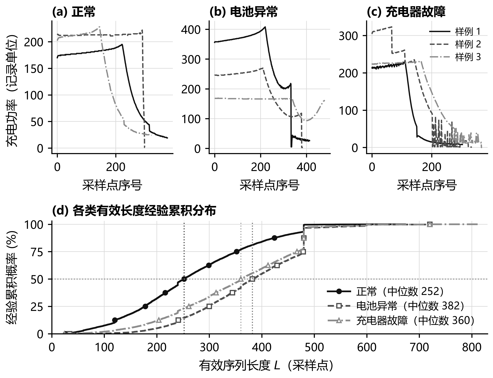
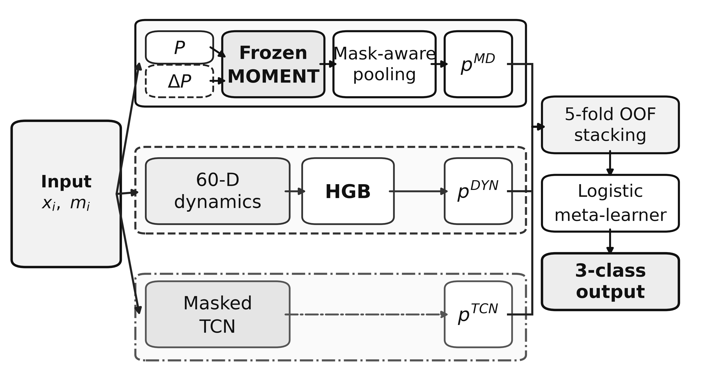
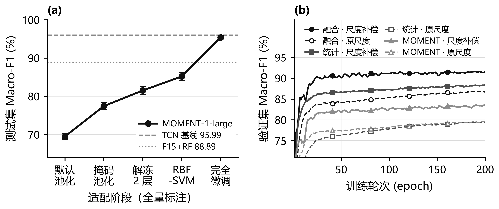
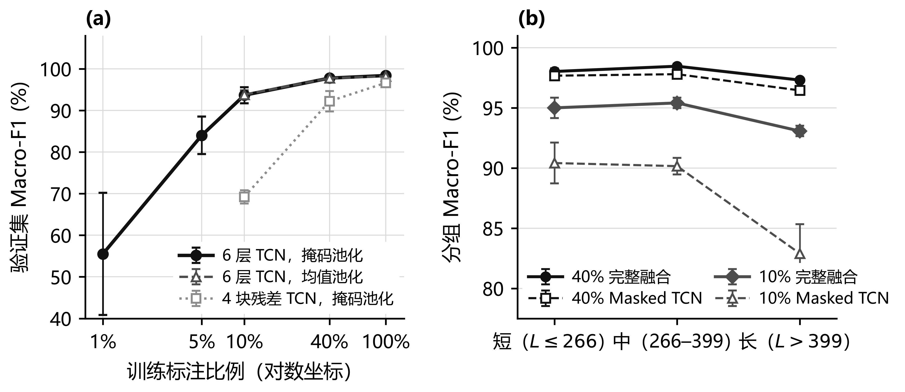
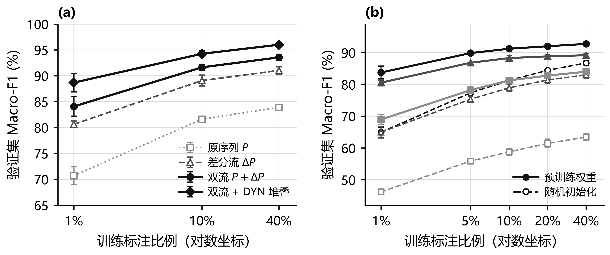
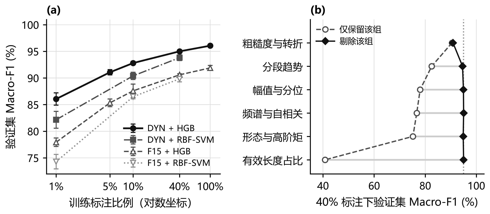
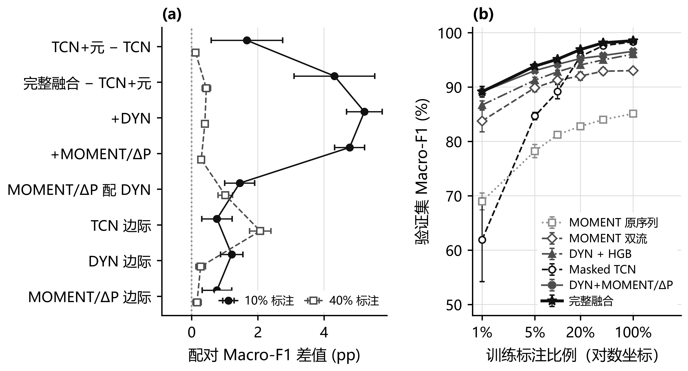
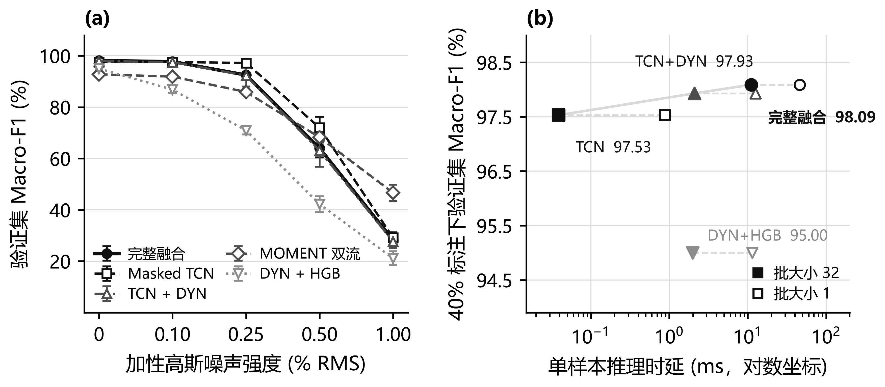

# 杭州电子科技大学信息工程学院

# 本科毕业设计

### （20××届）

| 项 目 | 内 容 |
| :---: | :--- |
| **题　　目** | 基于时序大模型的小样本锂电池充电功率曲线分类方法研究与实现 |
| **学院名称** | 杭州电子科技大学信息工程学院 |
| **专　　业** | 自动化（机器人） |
| **班　　级** | XXX（9位数字班级号） |
| **学　　号** | 239500314 |
| **学生姓名** | 冯成化 |
| **指导教师** | 钱卓涛 |
| **完成日期** | 2026年5月 |

---

## 摘　　要

电动自行车锂离子电池充电功率曲线隐含了充电器故障与电池异常等关键安全状态信息，基于单通道功率曲线的自动分类是实现非侵入式充电安全监测的重要途径。然而在实际运维场景中，经人工核验的故障标签获取成本高昂，且单次充电记录的有效长度在 18 至 816 个采样点之间剧烈变化。直接迁移通用时间序列基础模型在该类变长曲线上的表现不佳，而任务专用深度网络在极少标注样本下容易发生跨随机种子退化与失稳。针对上述问题，本文提出一种融合冻结时序大模型、原尺度动力学特征与掩码时间卷积网络（TCN）的小样本充电功率曲线三分类方法。

本文的主要研究工作与结果如下：首先，针对 MOMENT 默认分类头将右侧补齐区域计入全局平均池化而稀释有效表征的缺陷，设计了掩码感知分块池化（Mask-aware Patch Pooling），仅聚合完整有效观测对应的分块表征，确保冻结表征对补齐长度与补齐值严格不变，使冻结线性探测在测试集上的 Macro-F1 由 69.46% 提升至 77.41%，并结合离线表征缓存将下游分类头单轮训练耗时由约 2 min 降至约 2 s。其次，在不更新 3.4124 亿骨干网络参数的前提下引入一阶差分双流表征，补偿分块编码与实例归一化对局部功率跳变的平滑效应，在 40% 训练标注下使单分支验证集 Macro-F1 由 83.91% 提高到 93.57%。再次，构建 60 维原尺度动力学特征（DYN）分支并结合直方图梯度提升分类器（HGB），显式恢复被逐序列归一化抹除的绝对功率幅值与局部粗糙度信息；分组与全组合筛选表明，其中的 36 维子集即可在不损失精度的条件下保持等效判别力。最后，采用训练子集内五折交叉拟合（Out-of-Fold，OOF）概率堆叠策略，自适应融合冻结双流表征、原尺度动力学特征与六层掩码 TCN 三路异构判别信息。

在 35,099 条真实有效电动自行车充电功率记录上的系统实验表明：在统一固定超参数协议下，仅使用 1%（244 条）、5%（1,227 条）和 10%（2,456 条）训练标注时，完整融合模型的验证集 Macro-F1 分别达到 $89.15\pm0.98\%$、$93.85\pm0.43\%$ 和 $95.13\pm0.19\%$，在各预算下均稳定高于最强单一组成支路 2.3～2.6 个百分点，并在 1% 极低标注下比掩码 TCN 高出 27.24 个百分点。在采用联合双流概率块的交叉拟合配置下，模型在 40% 标注下取得 $98.09\pm0.23\%$ 的验证集 Macro-F1，电池异常召回率达 98.23%，误报率（FPR）仅为 0.67%；排除按标识符前缀簇划分的 3,677 条封存留出集后重新训练，模型在封存留出集上取得 $97.76\pm0.10\%$ 的 Macro-F1（电池异常召回率 98.38%，误报率 1.02%）。同架构随机初始化对照证实，预训练权重在 1%～40% 标注预算下为双流分支贡献了 6.00～18.81 个百分点的实质性增益。此外，全分支噪声增强训练使 40% 标注模型在 0.5% 信号均方根（RMS）高斯噪声下的验证集 Macro-F1 由 64.72% 提升至 97.47% 且不损失干净数据精度，同时结合 RTX 4080 端到端推理时延与 ONNX 模型导出测试，明确了完整三分支方案与轻量化 TCN+DYN 方案的适用边界。

**关键词**：锂离子电池；充电功率曲线；时序大模型；小样本学习；掩码感知池化；集成堆叠

---

## **ABSTRACT**

Charging power curves of electric bicycles carry information on charger faults and battery anomalies, but verified fault labels are costly and record lengths vary from 18 to 816 samples. A general time-series foundation model transfers poorly to such curves, whereas a task-specific network becomes unstable with few labels. We develop a three-class method that combines a frozen time-series foundation model with raw-scale dynamics features and a masked temporal convolutional network (TCN).

Mask-aware patch pooling prevents padded patches from entering the pooled MOMENT representation and raises the test Macro-F1 of a frozen linear probe from 69.46% to 77.41%. A first-difference stream restores local changes that patch encoding tends to smooth, increasing the single-branch validation Macro-F1 from 83.91% to 93.57% with 40% of the training labels. A 60-dimensional dynamics branch retains absolute power levels, and five-fold cross-fitted probability stacking combines the three branches. On 35,099 operational charging records under a unified fixed-hyperparameter protocol, the complete model reaches validation Macro-F1 scores of $89.15\pm0.98\%$, $93.85\pm0.43\%$ and $95.13\pm0.19\%$ with 1%, 5% and 10% of the training labels, 2.3–2.6 percentage points above its strongest single branch at each budget and 27.24 points above the masked TCN at 1%. In the cross-fitted configuration with a joint dual-stream probability block, it reaches $98.09\pm0.23\%$ with 40% of the labels, with 98.23% battery-anomaly recall at a 0.67% false-positive rate, and a retrained model scores $97.76\pm0.10\%$ on a sealed hold-out set of 3,677 records drawn by identifier cluster. Pretraining contributes 6.00–18.81 percentage points to the dual-stream branch. Training all branches with noisy copies raises the 40%-label Macro-F1 under Gaussian noise of 0.5% of the signal root mean square from 64.72% to 97.47% without lowering clean accuracy, but stronger noise remains a failure point.

**Key words**: lithium-ion battery; charging power curve; time-series foundation model; few-shot learning; mask-aware pooling; stacked ensemble

---

## 目　　录

- [1  引言](#1--引言)
  - [1.1  研究背景与意义](#11--研究背景与意义)
  - [1.2  国内外研究现状](#12--国内外研究现状)
  - [1.3  研究内容与主要贡献](#13--研究内容与主要贡献)
  - [1.4  论文组织结构](#14--论文组织结构)
- [2  问题描述与数据集构建](#2--问题描述与数据集构建)
  - [2.1  三分类任务定义](#21--三分类任务定义)
  - [2.2  运行数据集与清洗规范](#22--运行数据集与清洗规范)
  - [2.3  功率曲线形态与长度分布特征](#23--功率曲线形态与长度分布特征)
  - [2.4  评价指标体系](#24--评价指标体系)
- [3  三分支异构融合分类方法设计](#3--三分支异构融合分类方法设计)
  - [3.1  方法总体框架](#31--方法总体框架)
  - [3.2  掩码感知分块池化](#32--掩码感知分块池化)
  - [3.3  一阶差分双流表征](#33--一阶差分双流表征)
  - [3.4  原尺度动力学特征分支](#34--原尺度动力学特征分支)
  - [3.5  掩码时间卷积网络分支](#35--掩码时间卷积网络分支)
  - [3.6  五折交叉拟合概率堆叠](#36--五折交叉拟合概率堆叠)
  - [3.7  面向采集扰动的噪声增强训练](#37--面向采集扰动的噪声增强训练)
- [4  实验设计与分类性能评估](#4--实验设计与分类性能评估)
  - [4.1  实验协议与运行环境](#41--实验协议与运行环境)
  - [4.2  基线对比与冻结大模型初始适配](#42--基线对比与冻结大模型初始适配)
  - [4.3  补齐敏感性诊断与TCN结构复原](#43--补齐敏感性诊断与tcn结构复原)
  - [4.4  差分双流增益与预训练先验归因](#44--差分双流增益与预训练先验归因)
  - [4.5  原尺度动力学特征消融与子集筛选](#45--原尺度动力学特征消融与子集筛选)
  - [4.6  三分支融合消融与互补性分析](#46--三分支融合消融与互补性分析)
  - [4.7  统一协议下多标注预算性能比较](#47--统一协议下多标注预算性能比较)
  - [4.8  封存留出集与簇级泛化审计](#48--封存留出集与簇级泛化审计)
- [5  噪声鲁棒性与工程部署分析](#5--噪声鲁棒性与工程部署分析)
  - [5.1  干净训练模型的采集噪声敏感性](#51--干净训练模型的采集噪声敏感性)
  - [5.2  噪声增强训练的改善效果与边界](#52--噪声增强训练的改善效果与边界)
  - [5.3  端到端推理时延与计算开销测量](#53--端到端推理时延与计算开销测量)
  - [5.4  ONNX模型导出与静态量化分析](#54--onnx模型导出与静态量化分析)
- [6  特征物理解释、方案选型与研究局限](#6--特征物理解释方案选型与研究局限)
  - [6.1  时序大模型在变长曲线分类中的作用机理](#61--时序大模型在变长曲线分类中的作用机理)
  - [6.2  动力学特征与已知故障形态的对应关系](#62--动力学特征与已知故障形态的对应关系)
  - [6.3  适配策略对比与工程选型准则](#63--适配策略对比与工程选型准则)
  - [6.4  研究局限性](#64--研究局限性)
- [7  结论与展望](#7--结论与展望)
  - [7.1  全文工作总结](#71--全文工作总结)
  - [7.2  后续研究展望](#72--后续研究展望)
- [参考文献](#参考文献)
- [致谢](#致谢)
- [附录](#附录)
  - [附录A  动力学特征缩减补充实验结果](#附录a--动力学特征缩减补充实验结果)
  - [附录B  TCN导出与int8静态量化补充实验结果](#附录b--tcn导出与int8静态量化补充实验结果)

---

## 1  引言

### 1.1  研究背景与意义

锂离子电池是城市短途出行电动自行车的主要动力来源。在充电过程中，电芯内短路、电芯失配、充电器输出异常或保护电路失效等故障均可能导致电池过热，严重时还会引发热失控[1]。因此，在充电阶段及时检测异常行为是降低火灾风险的重要组成部分。

目前，许多电池故障诊断系统依赖电池管理系统（BMS）采集的单体电压、温度、电流等多维信号[2,3]。这些多通道物理量能够支持较高精度的诊断，但在大量存量电动自行车电池上难以获取——不同型号电池差异明显，且普遍缺少对外的通信接口。相比之下，集中式充电设施通常只能稳定采集单通道的充电功率序列。若能够仅依据这一功率序列有效区分“正常充电”、“电池异常”与“充电器故障”，充电设施便可在不改造电池硬件的条件下提供非侵入式安全监测。相关研究已在电动汽车充电设备故障辨识与充电数据异常检测中验证了这一思路[4-7]，但专门针对电动自行车充电功率曲线的细粒度分类研究仍相对较少。

将单通道充电功率曲线用于三分类任务面临三方面实际困难：第一，记录的有效长度在 18 至 816 个采样点之间剧烈变化，批量训练与推理时需要执行大量右侧补齐（Right Padding），而序列长度本身又与类别存在相关性，导致模型极易学习到依赖补齐长度的“捷径”（Shortcut），而非真实的功率变化形态；第二，判别证据分布在多个时间尺度上，绝对功率水平可用于区分低功率平台，局部一阶差分能够揭示脉冲毛刺与阶跃跳变，而完整曲线形态则反映了从恒功率阶段向衰减阶段的过渡过程；第三，真实故障标签需要结合运维与维修记录进行人工核验，在常规运营中十分稀缺，要求模型在小样本（Few-shot）标注约束下仍能保持稳健。

### 1.2  国内外研究现状

时间序列分类与异常检测方法已在既有文献中得到广泛综述[8-11]。现有分类器主要涵盖三类技术路线：第一类是基于手工特征的方法，提取时域统计量或频域特征后结合随机森林（Random Forest）[12]、梯度提升机（Gradient Boosting Machine）[13]或支持向量机（SVM）[14]进行分类，具有计算开销低、物理意义清晰的优点；第二类是任务专用深度神经网络，包括时间卷积网络（TCN）[15]、多尺度与改进型 Transformer 变体[16-18]以及基于二维周期变化建模的 TimesNet[19]；第三类是基于随机卷积核变换的方法，如 ROCKET、MiniRocket 与 Hydra[20-22]，能够在较低计算成本下获得较强的局部形状表征能力。

当标注样本受限时，迁移学习与自监督表征学习可有效降低下游任务的标注需求[23,24]。近年来，MOMENT、TimesFM、Chronos、Moirai 和 Time-MoE 等时间序列基础模型（Time-Series Foundation Models，简称时序大模型）通过在大规模、跨领域的异构时间序列集合上进行预训练，获得了较强的通用表征能力[25-29]。围绕此类基础模型的表征迁移，已有学者在旋转机械多场景故障诊断、边坡深部位移预测以及输入表示优化等工程任务中展开探索[30-32]。

然而，在本课题针对的电动自行车变长充电功率曲线分类任务中，直接迁移通用时序大模型的效果并不理想。实验表明，直接冻结 MOMENT-1-large 骨干网络并训练其默认线性分类头，在测试集上仅取得 69.46% 的 Macro-F1，远低于在原始尺度曲线上从头训练的任务专用 TCN（95.99%）。本文通过诊断分析发现，这一性能失配主要源于三个具体操作环节：第一，默认分类头在最终池化时对包括右侧补齐在内的全部分块（Patch）求平均，导致短序列的有效表征被严重稀释；第二，分块编码操作平滑了短时功率突变；第三，逐序列标准化抹除了绝对功率幅值信息。

### 1.3  研究内容与主要贡献

针对上述直接迁移失配问题，本文在不更新 MOMENT-1-large 骨干网络全部 3.4124 亿参数的前提下，对池化方式、输入表征和分支融合机制进行系统设计，构建了一种融合冻结时序大模型、原尺度动力学特征与掩码 TCN 的三分类方法。本文的主要研究工作与贡献归纳如下：

（1）提出**掩码感知分块池化（Mask-aware Patch Pooling）**。在池化阶段严格排除不完整分块与右侧补齐分块，使冻结大模型表征对右侧补齐区域的长度和取值保持不变，消除了补齐稀释效应，并通过离线特征缓存大幅缩短下游分类器的训练时间。

（2）构建**冻结骨干下的一阶差分双流表征（First-difference Dual-stream Representation）**。将原始功率序列与有效区间内的一阶差分序列分别送入同一冻结 MOMENT 编码器并拼接池化特征，在不增加任何可训练骨干参数的条件下，向模型补充了局部阶跃与毛刺等高频变化信息。

（3）设计 **60 维原尺度动力学特征（DYN）分支与五折交叉拟合概率堆叠（Cross-fitted Probability Stacking）**。通过原尺度统计与动力学特征恢复绝对幅值和可解释局部动态，利用训练子集内部的五折折外（OOF）预测概率训练逻辑回归元学习器，有效融合基础模型分支、动力学特征分支与掩码 TCN 分支的互补信息。

（4）严格界定方法的有效性与工程适用边界。通过逐随机种子配对消融、同架构随机初始化预训练对照以及 1%～100% 标注预算实验拆解各模块的性能贡献；构建按标识符前缀簇划分的封存留出集（Sealed Hold-out Set）并开展留簇审计（Leave-cluster-out Audit），评估验证集重复使用带来的选择偏差；结合噪声增强训练、端到端推理时延测量与 ONNX/int8 模型导出实验，给出不同标注预算、噪声水平和硬件约束下的模型选型准则。

### 1.4  论文组织结构

本文共分为七章，各章内容安排如下：

第 1 章为引言，阐述电动自行车锂电池充电功率曲线分类的研究背景与意义，综述时间序列分类与时序大模型的研究现状，并概括本文的主要工作与组织结构。

第 2 章为问题描述与数据集构建，给出变长充电功率序列三分类任务的数学定义，说明实际运行数据的清洗规则、序列长度分布特征、长度捷径风险以及多维度评价指标体系。

第 3 章为三分支异构融合分类方法设计，详细介绍总体框架、掩码感知分块池化、一阶差分双流表征、60 维原尺度动力学特征、六层掩码 TCN、五折交叉拟合概率堆叠以及噪声增强训练策略。

第 4 章为实验设计与分类性能评估，阐述三阶段评估协议，依次报告基线对比、冻结分类头尺度补偿、TCN 补齐敏感性诊断、差分双流与预训练归因、动力学特征消融、三分支融合互补性、多标注预算曲线以及封存留出集实验结果。

第 5 章为噪声鲁棒性与工程部署分析，考察干净训练模型在加性高斯噪声与量化扰动下的退化规律，评估噪声增强训练的改善效果与边界，并测试 RTX 4080 端到端推理时延及 ONNX FP32/int8 导出性能。

第 6 章为特征物理解释、方案选型与研究局限，探讨时序大模型的作用机理，分析动力学特征与文献已知故障形态的对应关系，总结工程部署选型指南，并客观讨论本研究的局限性。

第 7 章为结论与展望，总结全文核心研究结论，并提出后续研究方向。文末附录给出动力学特征缩减与 TCN 导出量化的详细补充数据。

---

## 2  问题描述与数据集构建

### 2.1  三分类任务定义

设第 $i$ 条充电记录的有效功率序列为 $\boldsymbol{x}_i=(x_{i,1},x_{i,2},\dots,x_{i,L_i})$，其中有效长度满足 $18\le L_i\le 816$。为支持深度网络的批量张量运算，在序列右侧补齐至统一长度 $T=1024$，同时配对构造二值有效观测掩码 $\boldsymbol{m}_i\in\{0,1\}^T$：当位置 $t$ 为真实有效观测时取 $m_{i,t}=1$，当位置 $t$ 为右侧补齐区域时取 $m_{i,t}=0$。分类器的学习目标是构建映射关系，由式（2-1）所示：

$$
f:(\boldsymbol{x}_i,\boldsymbol{m}_i)\mapsto y_i\in\{0,1,2\} \tag{2-1}
$$

式（2-1）中，类别标签 $y_i=0,1,2$ 分别代表正常充电（Normal charging）、电池异常（Battery anomaly）和充电器故障（Charger fault）。理想的分类器 $f$ 应当对右侧补齐区域的长度以及补齐位置所填充的数值严格保持不变。

### 2.2  运行数据集与清洗规范

本研究使用的数据集采集自某电动自行车集中充电运营平台的实际运维记录。每条记录包含匿名化的唯一标识符、运维状态标签以及单通道充电功率序列。原始导出数据共计 46,535 条记录，其中 11,435 条记录带有平台定义的标签 5（代表无效或未完成记录，其序列长度中位数仅为 1 个采样点）。按照平台既有的数据处理规范剔除全部标签 5 记录，并进一步剔除有效长度不足 18 个采样点的超短序列后，最终保留 35,099 条有效充电功率序列。

上述 18 个采样点的最短长度阈值沿用自既有实验协议，数据提供方未对其给出独立的物理机制解释；同时，原始数据未附带采样时间间隔字段，因此本文所有序列长度均严格以“采样点数（Samples）”为单位进行报告，不换算为分钟或小时等实际充电时长。经严格核查，清洗后的 35,099 条有效序列中不存在重复序列或标签冲突；最长有效序列包含 816 个采样点，在统一补齐长度 $T=1024$ 下无需进行任何截断。

在实验的前两个阶段，数据集按类别分层抽样策略以 $7:1:2$ 的比例划分为训练集、验证集与测试集，各子集的样本分布如表 2-1 所示。前两阶段的所有对比方法均共享完全相同的划分清单文件；第 4.1 节与第 4.8 节将进一步介绍第三阶段面向封存留出集（Sealed Hold-out Set）的重划分方案。此外，原始数据不包含时间戳、充电站点编号、设备型号或生产批次字段；虽然每条记录的匿名标识符均不相同，但共享前 6 位字符前缀的标识符可自然聚合成 8,075 个分组，本文将其作为部署簇（Deployment Clusters）的代理变量用于第 4.8 节的簇级泛化评估。

<b>表2-1  数据集划分与类别分布</b>

| 子集 | 正常充电（0） | 电池异常（1） | 充电器故障（2） | 合计 |
| :---: | :---: | :---: | :---: | :---: |
| 训练集 | 8,480 | 7,014 | 9,075 | 24,569 |
| 验证集 | 1,212 | 1,002 | 1,296 | 3,510 |
| 测试集 | 2,423 | 2,004 | 2,593 | 7,020 |
| 合计 | 12,115 | 10,020 | 12,964 | 35,099 |

### 2.3  功率曲线形态与长度分布特征

为直观展示三类充电记录的时序形态，使用固定随机种子 42 从训练集中每类随机抽取 3 条曲线（未经人工挑选），并统计三类样本有效长度的经验累积分布函数（ECDF），结果如图 2-1 所示。

  
  
<b>图2-1  训练集充电功率曲线样例与有效长度分布</b>

图 2-1 中：（a）为正常充电曲线样例；（b）为电池异常曲线样例；（c）为充电器故障曲线样例，横轴均为采样点序号，纵轴为原始记录单位下的充电功率；（d）为三类序列有效长度的经验累积分布及中位数位置，约 480 个采样点处的陡升反映了平台记录的常见截断上限。

从图 2-1（a）～（c）可以看出，正常充电曲线通常包含一段平稳的恒功率区间，随后平滑衰减至结束；部分电池异常样例表现出功率骤降、不同的功率平台水平或充电末期功率异常回升；而充电器故障样例则常见明显的阶跃变化或在衰减阶段出现高频反复波动。需要强调的是，这些视觉特征仅用于描述抽样记录的统计表观形态，并不直接构成底层物理失效机理的证明。

从图 2-1（d）的长度分布来看，正常充电、电池异常和充电器故障的有效长度中位数分别为 252、382.5 和 360 个采样点，不同类别之间存在显著的长度分布差异。若仅使用“有效序列长度”这一个标量特征训练深度为 3 的决策树，即可在测试集上获得 35.76% 的 Macro-F1，明显高于多数类基线（17.98%）。这表明序列长度本身是一个潜在的分类捷径。为此，本文所有序列模型均引入二值掩码严格屏蔽右侧补齐区域，并在第 4.6 节中按序列长度分层报告模型性能。

### 2.4  评价指标体系

由于三类样本数量接近但并非严格相等，本文采用三类 F1 分数的非加权算术平均值（Macro-F1）作为核心评价指标，其计算公式由式（2-2）所示：

$$
\mathrm{Macro\text{-}F1}=\frac{1}{3}\sum_{c=0}^{2}\frac{2P_cR_c}{P_c+R_c} \tag{2-2}
$$

式（2-2）中，$P_c$ 与 $R_c$ 分别表示第 $c$ 类样本的精确率（Precision）与召回率（Recall）。

考虑到在实际安全监测中漏检“电池异常”（类别 1）的风险代价最高，本文同时报告电池异常类的召回率及其误报率（False-Positive Rate，FPR），其中 FPR 定义为非电池异常记录（即正常充电或充电器故障）被误判为电池异常的比例。在单种子深入分析中，由于精确率—召回率（PR）曲线在不平衡二分类评估中比受试者工作特征（ROC）曲线更具信息量[33]，本文亦补充考虑平均精确率（Average Precision，AP）。此外，模型输出概率的校准质量采用期望校准误差（Expected Calibration Error，ECE）进行度量[34]。除另有说明外，本文所有表格中的性能指标均以百分数（%）表示。

---

## 3  三分支异构融合分类方法设计

### 3.1  方法总体框架

本文提出的三分支异构融合分类框架如图 3-1 所示。系统由三条具有不同归纳偏置的并行分支及顶层概率堆叠元学习器组成：

（1）**分支Ⅰ（冻结时序大模型双流分支）**：将原始功率序列 $P$ 与一阶差分序列 $\Delta P$ 分别送入共享权重的冻结 MOMENT-1-large 编码器，通过掩码感知分块池化提取全局与局部变化表征，拼接后由正则化多项逻辑回归输出三类概率 $\boldsymbol{p}_i^{\mathrm{MD}}$；

（2）**分支Ⅱ（原尺度动力学特征分支）**：直接从有效观测点提取 60 维原尺度动力学特征（DYN），保留绝对功率水平与可解释局部统计量，通过直方图梯度提升分类器（HGB）输出三类概率 $\boldsymbol{p}_i^{\mathrm{DYN}}$；

（3）**分支Ⅲ（掩码时间卷积网络分支）**：采用六层因果膨胀 TCN 对原尺度序列提取多尺度局部卷积特征，经掩码均值池化与全连接层输出三类概率 $\boldsymbol{p}_i^{\mathrm{TCN}}$。

在训练阶段，各分支通过训练子集内部的五折分层交叉拟合生成折外（Out-of-Fold，OOF）预测概率，拼接构成 9 维元特征向量，用于训练多项逻辑回归元学习器（Meta-learner）。

  
  
<b>图3-1  基于冻结时序大模型的三分支异构融合总体框架</b>

图 3-1 中：原始功率序列 $P$ 与一阶差分序列 $\Delta P$ 共享同一个冻结 MOMENT 编码器；另外两条分支分别采用 60 维原尺度动力学特征与掩码 TCN；五折折外（OOF）预测概率用于训练逻辑回归元学习器。

### 3.2  掩码感知分块池化

MOMENT-1-large 采用 T5-large 编码器架构，包含 24 层 Transformer 编码层，隐藏层维度为 1024，注意力头数为 16，骨干网络参数量共计 3.4124 亿（341.24 M）。与 PatchTST[35]的分块思想一致，MOMENT 将长度为 $T=1024$ 的输入序列划分为 $N=T/P=128$ 个互不重叠、长度为 $P=8$ 的分块（Patch），经编码器映射后输出分块表征序列 $\boldsymbol{h}_{i,1},\dots,\boldsymbol{h}_{i,N}\in\mathbb{R}^{1024}$。

在官方实现 `momentfm 0.1.4` 中，默认分类头虽然将二值输入掩码 $\boldsymbol{m}_i$ 传入了编码器的自注意力层，但在最终汇聚序列表征时却对全部 $N$ 个分块执行了无差别等权平均，由式（3-1）所示：

$$
\boldsymbol{z}_i^{\mathrm{default}}=\frac{1}{N}\sum_{n=1}^{N}\boldsymbol{h}_{i,n} \tag{3-1}
$$

对于一条有效长度 $L_i=18$ 的短序列，128 个分块中仅有前 2 个分块包含完整有效观测，其余 126 个包含右侧补齐的分块在式（3-1）中占据了主导地位；相比之下，当序列有效长度为 800 时，约 78% 的分块为有效分块。这意味着默认池化表征被补齐区域稀释的程度直接取决于有效序列长度。

为消除补齐稀释效应，本文定义分块级有效性掩码 $\tilde{m}_{i,n}$，由式（3-2）所示：

$$
\tilde{m}_{i,n}=\prod_{t=(n-1)P+1}^{nP}m_{i,t},\qquad n=1,\dots,N \tag{3-2}
$$

式（3-2）表明，仅当第 $n$ 个分块内部的全部 $P=8$ 个采样点均为有效观测（$m_{i,t}=1$）时，才记 $\tilde{m}_{i,n}=1$；任何包含右侧补齐点或末尾不足 8 点的残缺分块均满足 $\tilde{m}_{i,n}=0$。在此基础上，仅对完整有效分块执行加权均值池化，由式（3-3）所示：

$$
\boldsymbol{z}_i=\frac{\sum_{n=1}^{N}\tilde{m}_{i,n}\boldsymbol{h}_{i,n}}{\sum_{n=1}^{N}\tilde{m}_{i,n}} \tag{3-3}
$$

由于清洗后的数据集满足 $L_i\ge 18$，每条记录至少包含 2 个完整有效分块，式（3-3）的分母恒大于零。在有效长度介于 18 至 384 的固定合成序列上进行数值不变性验证：将补齐总长度由 512 改变为 1024，或将掩码外的补齐零值替换为任意随机数，式（3-3）所得池化表征的最大绝对变化量不超过 $4.2\times 10^{-7}$，处于单精度浮点数舍入误差量级。需要指出，该不变性严格针对右侧补齐区域而言；外部逐序列 z-score 标准化以及模型内置的可逆实例归一化（RevIN）[36]在计算均值与方差时，仍会使用末尾残缺分块内的有效观测点。

此外，由于 MOMENT 骨干参数完全冻结，所有数据划分上的分块池化表征只需执行一次前向传播即可离线缓存至磁盘。下游分类头在训练时无需重复计算 3.4124 亿参数的编码器前向过程，单轮（Epoch）训练时间由此从约 2 min 缩短至约 2 s。

### 3.3  一阶差分双流表征

分块编码与实例归一化有利于捕捉全局平滑趋势，但容易平滑掉区分三类状态所需的短时毛刺、斜率突变和平台阶跃。若采用全量微调（Full Fine-tuning）虽可使骨干网络重新适应局部变化，但在本任务设置下每次训练耗时约 3 h，需更新全部 3.4124 亿参数，且在低标注预算下极易过拟合。为此，本文在不改动、不重训骨干网络的前提下，将局部变化量显式构造为第二路输入流。在序列的有效观测区间内，定义一阶差分序列 $\Delta\boldsymbol{x}_i$ 由式（3-4）所示：

$$
\Delta x_{i,t}=x_{i,t+1}-x_{i,t},\qquad t=1,\dots,L_i-1 \tag{3-4}
$$

经式（3-4）差分变换后，缓慢变化的功率基线趋近于零，而阶跃跳变与瞬态毛刺则被转化为显著的脉冲信号。将原始功率序列与一阶差分序列分别独立进行逐序列 z-score 标准化，送入**同一个冻结的 MOMENT-1-large 编码器**，并按式（3-3）分别执行掩码感知分块池化，得到原始流表征 $\boldsymbol{z}_i^{P}$ 与差分流表征 $\boldsymbol{z}_i^{\Delta P}$，再将二者拼接为 2048 维双流表征向量，由式（3-5）所示：

$$
\boldsymbol{z}_i^{\mathrm{MD}}=\left[\boldsymbol{z}_i^{P}\,\|\,\boldsymbol{z}_i^{\Delta P}\right]\in\mathbb{R}^{2048} \tag{3-5}
$$

在 $\boldsymbol{z}_i^{\mathrm{MD}}$ 之上训练正则化参数 $C=1.0$ 的 L2 正则多项逻辑回归分类器，即可映射得到双流分支的类别概率输出 $\boldsymbol{p}_i^{\mathrm{MD}}$。该设计仅需为每条记录增加一次冻结编码器前向传播，不引入任何新的骨干可训练参数。

### 3.4  原尺度动力学特征分支

逐序列 z-score 标准化与 RevIN 会完全抹除功率曲线的绝对幅值信息。当某条异常曲线长期停留在低功率平台、但其归一化形状与正常恒功率充电相似时，缺失绝对幅值会导致严重混淆。早期对照实验表明，原尺度 TCN 在测试集上的 Macro-F1 达 95.99%，而对每条序列做 min–max 归一化后则降至 92.00%。

为此，DYN 分支直接从原始记录尺度的有效观测点（$1\le t\le L_i$）中提取 60 维统计与动力学特征，右侧补齐区域完全不参与计算。这 60 维特征划分为 6 个物理含义明确的特征组，如表 3-1 所示。其中，前 15 维为常规全局统计特征（记为 F15），其余 45 维专门刻画局部波动粗糙度、分段趋势、频域能量分布与极值形态。例如，“方向变化率（Direction-change rate）”定义为相邻非零一阶差分符号发生反转的比例，用于捕捉反复震荡；“平台比例（Plateau fraction）”定义为相邻采样点绝对差值小于 $10^{-3}$ 的比例，用于刻画恒功率平台占比。

<b>表3-1  60维原尺度动力学特征（DYN）分组及物理含义</b>

| 特征分组 | 维数 | 代表性特征 | 物理含义与判别作用 |
| :--- | :---: | :--- | :--- |
| 幅值与分位数 | 17 | 均值、标准差、极值、5%～95%分位数、变异系数、末首比 | 绝对功率水平与幅值分布 |
| 粗糙度与转折点 | 12 | 绝对差分统计量、上升比例、方向变化率、平台比例、最长平台占比 | 局部波动剧烈程度与跳变频率 |
| 分段趋势 | 18 | 全局与各分段线性斜率、分段均值与标准差、末段减首段均值差 | 恒功率维持与衰减阶段形态 |
| 频谱与自相关 | 7 | 四频带能量占比、主频、滞后自相关系数、直方图熵 | 周期性振荡与信号复杂度 |
| 形状特征 | 4 | 最大回撤（Maximum drawdown）、最大上升、偏度、峰度 | 功率骤降/骤升幅度与分布偏态 |
| 长度特征 | 2 | 有效采样点数 $L_i$ 及其占总长 $T$ 的比例 | 有效观测样本规模 |

提取 60 维 DYN 特征后，采用固定超参数的直方图梯度提升分类器（HGB）进行分类：最大迭代次数设为 400，学习率设为 0.08，最大叶节点数设为 31，每个叶节点最少样本数设为 20，L2 正则化系数设为 1.0。该超参数配置在所有标注预算下保持恒定；在 40% 标注预算下，特征提取与 HGB 训练在 CPU 上仅需数秒即可完成。

### 3.5  掩码时间卷积网络分支

分支Ⅲ沿用平台原有的六层因果膨胀 TCN 架构：卷积核大小 $k=3$，第 $l$ 层（$l=1,\dots,6$）的膨胀系数为 $d_l=2^{l-1}$，每层通道数设为 128，采用 ReLU 激活函数与丢弃率 0.3 的空间丢弃（SpatialDropout）。该六层因果膨胀卷积网络的理论感受野 $R$ 由式（3-6）计算得到：

$$
R=1+(k-1)\sum_{l=1}^{6}d_l=1+2\times 63=127 \tag{3-6}
$$

平台原始 TCN 对整个补齐后的长度 $T$ 张量执行全局均值池化，导致预测结果受右侧补齐长度影响。本文将最后一层卷积输出 $\boldsymbol{c}_{i,t}\in\mathbb{R}^{128}$ 的聚合方式替换为掩码均值池化，由式（3-7）所示：

$$
\boldsymbol{g}_i=\frac{\sum_{t=1}^{T}m_{i,t}\boldsymbol{c}_{i,t}}{\sum_{t=1}^{T}m_{i,t}} \tag{3-7}
$$

由于因果卷积保证了任意有效时刻 $t\le L_i$ 的特征表示仅依赖其左侧的有效历史观测，完全不受右侧补齐区域影响，再经式（3-7）屏蔽补齐位置输出后，整条 TCN 分支即严格具备补齐不变性。汇聚特征 $\boldsymbol{g}_i$ 经全连接层与 Softmax 变换后输出三类概率 $\boldsymbol{p}_i^{\mathrm{TCN}}$。

在训练配置上，掩码 TCN 直接以原尺度功率序列作为输入，采用 AdamW 优化器（学习率 $10^{-3}$，权重衰减 $10^{-4}$），批大小设为 32，梯度裁剪上限设为 1.0，使用 50 轮余弦退火学习率调度。为避免利用验证集挑选最佳训练轮次而引入选择偏差，所有融合实验均固定取第 50 轮训练终点模型。由于在 Tesla V100 GPU 上开启 FP16 半精度训练膨胀卷积时观测到训练后期数值上溢，TCN 全程采用 FP32 单精度训练。

### 3.6  五折交叉拟合概率堆叠

若直接使用各分支在训练集上的样本内（In-sample）预测概率训练顶层元学习器，元学习器会过度偏向在训练集上过拟合的分支。为此，本文将当前可用标注训练子集 $\mathcal{D}$ 按类别分层划分为 5 个互斥折 $\mathcal{D}_1,\dots,\mathcal{D}_5$。对于第 $k$ 折（$k=1,\dots,5$），三条分支均在其余四折 $\mathcal{D}\setminus\mathcal{D}_k$ 上独立完成训练，并对保留折 $\mathcal{D}_k$ 生成折外（OOF）预测概率。遍历全部五折后，每条训练样本均获得无泄漏的 9 维元特征向量 $\boldsymbol{u}_i$，由式（3-8）所示：

$$
\boldsymbol{u}_i=\left[\boldsymbol{p}_i^{\mathrm{TCN}},\boldsymbol{p}_i^{\mathrm{DYN}},\boldsymbol{p}_i^{\mathrm{MD}}\right]\in[0,1]^9 \tag{3-8}
$$

随后，在五折 OOF 元特征集合上拟合 L2 正则化多项逻辑回归元学习器，其预测分布由式（3-9）给出：

$$
P(y_i=c\mid\boldsymbol{u}_i)=\frac{\exp(\boldsymbol{w}_c^{\top}\boldsymbol{u}_i+b_c)}{\sum_{c'=0}^{2}\exp(\boldsymbol{w}_{c'}^{\top}\boldsymbol{u}_i+b_{c'})} \tag{3-9}
$$

元学习器的正则化强度通过在 OOF 特征内部执行三折交叉验证自动选取；在完成元学习器拟合后，三条基分支分别在完整标注子集 $\mathcal{D}$ 上重新训练一次以供推理阶段使用。整个堆叠过程中，验证集与测试集均不参与任何参数拟合或超参数选择。该元学习器仅包含 $3\times 9+3=30$ 个可训练参数，几乎不存在过拟合风险。此外，当下游应用需要高可靠性的校准概率时，可在 OOF 对数几率（Logits）上通过最小化负对数似然拟合单一标量温度系数 $\tau$ 进行温度缩放[34]。

### 3.7  面向采集扰动的噪声增强训练

前文所述的三条分支均在干净原始序列上进行训练。为检验能否在不改动任何网络结构与超参数的前提下降低模型对传感器采集噪声的敏感性（详见第 5.1 节），本文进一步设计了噪声增强训练（Noise-augmented Training）变体，这是时间序列深度学习中一种标准的数据增广范式[37]。具体而言，仅在每条标注训练序列的有效观测区间（$t\le L_i$）内叠加零均值高斯白噪声，并将可能出现的非物理负功率值截断为零，生成扰动副本 $\tilde{\boldsymbol{x}}_i$，由式（3-10）所示：

$$
\tilde{x}_{i,t}=\max\!\left(0,\;x_{i,t}+\epsilon_{i,t}\right),\qquad \epsilon_{i,t}\sim\mathcal{N}\!\left(0,(\alpha\,\sigma_{\mathrm{rms}})^2\right),\qquad t\le L_i \tag{3-10}
$$

式（3-10）中，$\sigma_{\mathrm{rms}}$ 为当前标注训练子集内全部有效观测值的均方根（Root Mean Square，RMS），$\alpha$ 为相对噪声强度系数；序列掩码 $\boldsymbol{m}_i$ 与右侧补齐区域保持不变。

本文实现了两种噪声增强配置：第一种为**全系统增强变体（Full-system Augmentation）**，在干净训练记录基础上为每条序列生成 1 份 $\alpha=0.5\%$ 的噪声副本，将二者合并后训练全部三条分支与交叉拟合堆叠器；在五折外层交叉拟合时，同一条原始记录的干净样本与噪声副本严格绑定在同一训练折内，折外验证部分则完全排除待评估样本的噪声副本以防数据泄漏。第二种为**仅 DYN 增强变体（DYN-only Augmentation）**，在训练 DYN+HGB 分支时为每条训练序列额外生成 2 份 $\alpha=0.25\%$ 副本和 2 份 $\alpha=0.5\%$ 副本，从各副本重新提取 60 维特征后送入 HGB 训练。所有模型在测试评估时均在干净验证集或独立抽样扰动的验证集上进行评分。

---

## 4  实验设计与分类性能评估

### 4.1  实验协议与运行环境

为系统评估不同标注规模下的模型表现，从训练集分层抽取 1%、5%、10%、20%、40% 和 100% 的训练标注预算，分别对应 244、1,227、2,456、4,913、9,827 和 24,569 条训练记录。在同一随机种子下，所有对比方法严格使用完全相同的标注训练子集与评估记录。除特别说明外，实验结果均报告 4 个随机种子（42、44、45、46）上的样本均值与样本标准差；方法间的配对比较采用逐种子配对差值，并报告描述性 95% 配对 $t$ 置信区间；单种子样本级纠错分析采用精确 McNemar 检验。

全部实验划分为三个严格隔离的演进阶段：

（1）**第一阶段（初始测试集探测）**：使用 5 个随机种子在相同的测试集划分上评估冻结 MOMENT 的池化修正、适配策略与预训练归因对照。由于在此阶段后测试集已被检视，为防止针对测试集反复调优带来的信息泄漏，此后所有方法开发、特征设计与消融实验均严格限制在验证集上进行，原始测试集不再重复评分。

（2）**第二阶段（验证集开发与消融）**：在 4 个随机种子的验证集上完成双流设计、DYN 消融、三路堆叠与统一标注预算比较。由于不同种子的验证集来源于同一数据集且在方法开发过程中被多次使用，本阶段报告的配对置信区间仅用于描述当前固定协议下的内部不确定性，不等同于外部独立泛化证明。

（3）**第三阶段（按簇划分的封存留出集验证）**：为限制第二阶段反复使用验证集可能引入的选择偏差，从全部 35,099 条有效记录中按完整标识符前缀簇（共 618 个簇）一次性抽取并封存 3,677 条记录（含正常充电 1,353 条、电池异常 925 条、充电器故障 1,399 条），构建与其余数据在簇级别完全互斥的**封存留出集（Sealed Hold-out Set）**。该封存集对所有随机种子保持恒定。在每个随机种子下，将剩余 31,422 条记录重新划分为训练集与验证集，从头重新训练全部三条分支与元学习器。封存留出集不参与任何模型拟合、超参数选择、训练轮次挑选、阈值设定或温度缩放，且在每个种子和标注预算下仅评分一次。需要客观说明两点边界：其一，HGB 超参数与六层 TCN 架构继承自前序阶段，并未重新搜索；其二，封存集的 3,677 条记录中有 2,924 条曾出现在早期的训练或验证划分中，另有 753 条来自早期测试集。因此，封存留出集主要旨在消除本阶段模型训练与组合选择中的偏差，而非替代完全独立的外部新平台数据。

实验软硬件环境配置如下：软件环境基于 Python 3.11、PyTorch 2.12.1（CUDA 12.6）、`momentfm 0.1.4` 与 `scikit-learn`；MOMENT 表征提取与深度网络训练在 NVIDIA Tesla V100-PCIE（32 GB 显存）GPU 上完成；端到端推理时延在单张 NVIDIA RTX 4080 GPU 上实测；统一标注预算复跑、封存留出集实验、噪声增强实验以及附录 B 的模型导出测试在配备 NVIDIA RTX 5090 GPU 的主机上完成（其中模型导出使用 PyTorch 2.8.0 与 CUDA 12.8）。

### 4.2  基线对比与冻结大模型初始适配

第一阶段在 100% 训练标注下的 5 种子测试集基准性能如表 4-1 所示。在原始尺度曲线上训练的六层 TCN 取得了 95.99% 的测试集 Macro-F1，基于 15 维常规统计特征（F15）的随机森林也达到了 88.89%。相比之下，冻结 MOMENT-1-large 配合默认池化线性分类头的测试集 Macro-F1 仅为 69.46%。仅将默认池化替换为式（3-3）的掩码感知分块池化，线性分类头的测试集 Macro-F1 即提升 7.95 个百分点至 77.41%；在修正后的冻结表征上改用径向基核支持向量机（RBF-SVM）可进一步提升至 85.17%；解冻编码器最后 2 层微调达到 81.50%；而全量微调全部 3.4124 亿参数虽然可达到 95.37%，但训练耗时高达约 3 h/次。

<b>表4-1  全量训练标注下各基线与MOMENT适配策略的测试集性能（5种子均值±标准差）</b>

| 分类方法 | 可训练参数量 | 准确率 Accuracy（%） | Macro-F1（%） |
| :--- | :---: | :---: | :---: |
| 多数类基线（Majority class） | — | $36.94\pm0.00$ | $17.98\pm0.00$ |
| F15 + 逻辑回归 | — | $74.13\pm0.59$ | $73.75\pm0.60$ |
| F15 + 随机森林 | — | $88.85\pm0.23$ | $88.89\pm0.23$ |
| 1D-CNN（逐序列 z-score） | 0.05 M | $94.29\pm1.27$ | $94.38\pm1.27$ |
| TCN（逐序列 min–max） | 0.22 M | $91.79\pm1.37$ | $92.00\pm1.37$ |
| TCN（逐序列 z-score）$^{\mathrm{b}}$ | 0.22 M | $94.92\pm1.44$ | $95.02\pm1.43$ |
| TCN（原始尺度，Raw scale） | 0.22 M | $\mathbf{95.94\pm0.74}$ | $\mathbf{95.99\pm0.73}$ |
| 冻结 MOMENT + 线性头（默认池化）$^{\mathrm{a}}$ | 3,075 | $69.53\pm0.78$ | $69.46\pm0.76$ |
| 冻结 MOMENT + 线性头（掩码池化） | 3,075 | $77.02\pm0.88$ | $77.41\pm0.89$ |
| 冻结 MOMENT + RBF-SVM（掩码池化） | 0（骨干） | $84.77\pm1.04$ | $85.17\pm1.03$ |
| MOMENT 解冻最后两层（掩码池化） | 25.70 M | $81.08\pm1.13$ | $81.50\pm1.06$ |
| MOMENT 全量微调（掩码池化） | 341.24 M | $95.26\pm0.41$ | $95.37\pm0.39$ |

注：a 表示该配置有 4 个随机种子完成训练；RBF-SVM 遵循 MOMENT 原文协议，在最多 10,000 条训练样本上通过五折交叉验证选择超参数。b 表示该测试集数值（95.02%）与表 4-3 中 10% 预算下完整融合模型的验证集数值在数字上巧合相同，但二者来自不同评估协议。

图 4-1（a）汇总了上述适配演进序列，图 4-1（b）则揭示了下游神经网络分类头中的另一个关键优化问题。当直接将 1024 维冻结 MOMENT 表征与 15 维统计特征拼接（共 1039 维）送入多层感知机（MLP）分类头时，由于冻结特征幅值较小，首层初始激活值的均方根（RMS）仅为 0.024～0.029，导致梯度微弱、收敛极慢。若对输入特征乘以固定尺度补偿系数 $\gamma=\sqrt{1039/B}$（其中 1039 为分类头输入总维度，$B$ 为激活分支数），首层初始激活 RMS 即可恢复至 0.49～0.55。如图 4-1（b）所示，该尺度补偿在第 30 轮时使验证集 Macro-F1 提高了 6.58 个百分点，200 轮内的最佳验证集 Macro-F1 由 86.94% 升至 91.72%。在 4 个测试集种子上，经尺度修正的融合分类头达到 $91.52\pm0.38\%$，稳定高出同特征输入下的 RBF-SVM 达 0.56 个百分点（95% 配对区间为 0.52～0.61）。这表明，在评估冻结基础模型表征时，必须首先确保下游分类头得到了充分优化。

  
  
<b>图4-1  池化方式修正与下游分类头输入尺度优化效果</b>

图 4-1 中：（a）为 MOMENT 不同适配策略下的测试集 Macro-F1 对比，误差棒表示跨种子样本标准差；（b）为有无固定输入尺度补偿时冻结特征分类头的验证集收敛曲线对比。

### 4.3  补齐敏感性诊断与TCN结构复原

平台原有的全局平均池化 TCN 同样存在严重的右侧补齐敏感性。在保持模型权重与有效观测序列完全不变的条件下，仅将右侧补齐后的张量总长度由 1024 延长至 1536，未加掩码的全局平均池化 TCN 的最大输出对数几率（Logit）便发生了 418～531 的剧烈漂移，直接导致 10% 标注模型和 100% 标注模型在验证集上分别有 100 条和 33 条记录的预测类别发生翻转。而替换为式（3-7）的掩码均值池化后，实测对数几率变化量严格降为 0。由于实际批处理推理时的补齐长度通常由同一批次内的最长序列决定，未引入掩码的模型会因为同批次搭档样本的变化而改变对同一条曲线的诊断结论。

此外，复原完整的六层膨胀卷积结构对保证基线公平性同样关键。如图 4-2（a）所示，早期重构的四残差块 TCN（感受野仅为 61）在 10% 标注预算下仅取得 $69.23\pm1.61\%$ 的验证集 Macro-F1；而复原为感受野 $R=127$ 的六层掩码 TCN 后，其在 10%、40% 和 100% 标注预算下的验证集 Macro-F1 分别大幅提升至 $93.68\pm1.93\%$、$97.78\pm0.16\%$ 和 $98.40\pm0.17\%$。然而，在 1% 和 5% 极低标注预算下，六层掩码 TCN 分别跌落至 $55.51\pm14.66\%$ 和 $84.03\pm4.57\%$，表现出强烈的跨种子不稳定性。本文后续实验统一采用该复原后的六层掩码 TCN 作为强基线与第三条融合分支。

  
  
<b>图4-2  TCN结构配置、池化方式对比及按序列长度分层的分类性能</b>

图 4-2 中：（a）为三种 TCN 结构与池化配置在不同标注预算下的验证集 Macro-F1；（b）为按各随机种子训练集有效长度三分位点（约 266 与 399 个采样点）划分的短、中、长序列分组性能对比，长序列超出 TCN 感受野，在 10% 标注预算下表现出最大的融合增益。

### 4.4  差分双流增益与预训练先验归因

图 4-3（a）对比了冻结 MOMENT 在原始序列流、一阶差分流以及双流拼接下的验证集表现。实验显示，单独使用一阶差分流的性能已高于原始序列流；将两路表征按式（3-5）拼接为双流表征后，在 1%、10% 和 40% 标注预算下分别比原始序列流提高 13.38、10.03 和 9.66 个百分点（4 个随机种子方向完全一致）。在 40% 标注预算下，单分支验证集 Macro-F1 由 83.91% 提升至 93.57%，其中电池异常召回率由 89.42% 提高至 93.36%，误报率由 3.81% 降至 2.56%；充电器故障召回率则由 77.87% 大幅提升至 94.31%，误报率由 9.60% 降至 3.43%。将双流分支进一步与 DYN 分支堆叠，在 1% 极低标注下即可达到 88.69%。

为严格区分“预训练先验知识的贡献”与“3.41 亿参数编码器架构本身的容量效应”，在保持网络结构、掩码池化、数据预处理与下游分类器完全不变的前提下，将 MOMENT-1-large 的预训练权重替换为随机初始化权重，同架构对照结果如表 4-2 与图 4-3（b）所示。

<b>表4-2  预训练权重与随机初始化权重的同架构编码器对照结果（Macro-F1，%）</b>

| 评估协议与集合 | 下游分类器 | 标注预算 | 输入流配置 | 预训练权重 | 随机初始化 | 预训练净增益（百分点） |
| :--- | :---: | :---: | :---: | :---: | :---: | :---: |
| 测试集（5 种子） | RBF-SVM | 1% | 原始序列 | $68.05\pm1.59$ | $39.44\pm5.00$ | $+28.60$ |
| 测试集（5 种子） | RBF-SVM | 5% | 原始序列 | $77.40\pm0.93$ | $54.81\pm0.95$ | $+22.58$ |
| 测试集（5 种子） | RBF-SVM | 10% | 原始序列 | $80.77\pm0.59$ | $58.76\pm1.26$ | $+22.01$ |
| 验证集（4 种子） | 逻辑回归 | 1% | 原始序列 | $68.97\pm1.55$ | $46.20\pm0.68$ | $+22.77$ |
| 验证集（4 种子） | 逻辑回归 | 1% | 一阶差分 | $80.57\pm0.63$ | $64.99\pm1.82$ | $+15.57$ |
| 验证集（4 种子） | 逻辑回归 | 1% | 双流拼接 | $83.76\pm1.99$ | $64.95\pm1.60$ | $+18.81$ |
| 验证集（4 种子） | 逻辑回归 | 10% | 原始序列 | $81.27\pm0.35$ | $58.79\pm1.13$ | $+22.48$ |
| 验证集（4 种子） | 逻辑回归 | 10% | 一阶差分 | $88.31\pm0.84$ | $78.94\pm1.07$ | $+9.37$ |
| 验证集（4 种子） | 逻辑回归 | 10% | 双流拼接 | $91.24\pm0.57$ | $81.27\pm0.91$ | $+9.97$ |
| 验证集（4 种子） | 逻辑回归 | 40% | 原始序列 | $84.02\pm0.53$ | $63.45\pm1.14$ | $+20.57$ |
| 验证集（4 种子） | 逻辑回归 | 40% | 一阶差分 | $89.20\pm0.51$ | $83.03\pm1.02$ | $+6.17$ |
| 验证集（4 种子） | 逻辑回归 | 40% | 双流拼接 | $92.77\pm0.58$ | $86.77\pm0.69$ | $+6.00$ |

注：验证集各行统一固定逻辑回归正则化参数 $C=1.0$，因此双流拼接数值（如 40% 下的 92.77%）与正文中在 $\{0.1,1.0\}$ 内选参的单分支数值（93.57%）存在微小协议差异。

由表 4-2 可知，在全部报告条件与所有随机种子下，预训练权重均显著优于随机初始化。测试集上 1%、5% 和 10% 预算下的 95% 配对置信区间分别为 22.24～34.97、20.89～24.28 和 20.48～23.53 个百分点。在验证集上，双流分支在 1%、5%、10%、20% 和 40% 标注预算下的预训练净增益分别为 18.81、12.51、9.97、7.57 和 6.00 个百分点，呈现出“标注越稀缺，预训练先验增益越显著”的单调规律。同时，一阶差分流对随机初始化编码器同样带来了大幅提升（如 10% 标注下由 58.79% 升至 78.94%），证明局部差分构造与跨领域预训练先验是两个相互独立、可正向叠加的改进来源。

  
  
<b>图4-3  一阶差分双流表征效果与同架构预训练权重归因对比</b>

图 4-3 中：（a）为原始流、差分流、双流拼接及其与 DYN 堆叠的验证集 Macro-F1；（b）为固定 $C=1.0$ 时三种输入流下预训练权重（实线）与随机初始化权重（虚线）的同架构对比。

### 4.5  原尺度动力学特征消融与子集筛选

图 4-4（a）比较了 60 维原尺度动力学特征（DYN）与 15 维常规全局统计量（F15）分别配合 HGB 和 RBF-SVM 时的表现。在所有标注预算下，DYN 均显著优于 F15，且 HGB 分类器均优于 RBF-SVM。在 40% 标注预算下，DYN+HGB 达到 $95.00\pm0.17\%$，高出 F15+HGB 达 4.40 个百分点；在 1% 预算下达到 86.05%，高出 F15+HGB 达 8.12 个百分点，并比冻结双流分支高约 2 个百分点。

图 4-4（b）给出了 40% 标注预算下对表 3-1 六个特征组的“仅保留该组（Keep-one）”与“剔除该组（Drop-one）”消融分析。结果表明，“粗糙度与转折点”是最核心的特征组：从完整 DYN 中将其剔除会导致 Macro-F1 下降 4.13 个百分点，而仅使用这 12 维特征即可达到 90.48%。“分段趋势”组次之（单独保留达 82.55%）。单独剔除幅值、频谱或形状组对整体性能影响很小，但每组单独保留时仍可达到 75%～78%，说明特征组之间存在良性信息冗余。单独保留 2 维“长度”特征仅得 40.81%，证实 DYN 分支主要依赖真实的功率变化形态而非记录时长。

  
  
<b>图4-4  原尺度动力学特征（DYN）跨预算性能与特征组分贡献消融</b>

图 4-4 中：（a）为 F15 与 DYN 分别结合 HGB 和 RBF-SVM 的标注预算曲线；（b）为 40% 标注预算下六个特征组的单组保留与单组剔除消融结果，竖直虚线表示完整 60 维 DYN 基准（95.00%）。

考虑到组间存在冗余，本文进一步在固定 HGB 超参数的条件下对六个特征组的全部 $2^6-1=63$ 种非空组合进行了穷举搜索（详见附录 A）。实验发现，仅保留“长度、分段趋势、粗糙度与转折点、形状”四个组构成的 **36 维特征子集**，在 10% 和 40% 标注预算下与完整 60 维特征的差距不超过 0.05 个百分点；在完整融合模型中将该 36 维子集替换 60 维 DYN 块，验证集 Macro-F1 分别变化 $+0.19$ 和 $+0.01$ 个百分点。这一结果说明在当前分类器配置下特征维度可精简 40%，但并不意味着幅值或频谱特征本身不含判别信息。除附录 A 专项实验外，正文其余实验仍统一保持 60 维特征定义。

### 4.6  三分支融合消融与互补性分析

在采用联合双流概率块（9 维 OOF 元特征）、逻辑回归固定 $C=1.0$ 且 TCN 固定取第 50 轮终点的统一交叉拟合协议下，8 种分支组合在 10% 与 40% 标注预算下的验证集结果如表 4-3 所示。

<b>表4-3  联合双流概率块设置下不同分支组合的交叉拟合验证集结果（4种子）</b>

| 分支组合方案 | 10% 预算 Macro-F1（%） | 40% 预算 Macro-F1（%） | 10% 电池异常 Recall / FPR（%） | 40% 电池异常 Recall / FPR（%） |
| :--- | :---: | :---: | :---: | :---: |
| 单分支：TCN | $89.04\pm0.38$ | $97.53\pm0.29$ | 93.11 / 2.89 | 97.83 / 0.77 |
| 对照：TCN + 同形式元学习器 | $90.71\pm0.99$ | $97.65\pm0.24$ | 93.11 / 2.56 | 97.88 / 0.74 |
| 单分支：DYN | $92.81\pm0.30$ | $95.00\pm0.17$ | 92.54 / 2.76 | 95.06 / 2.10 |
| 单分支：MOMENT/$\Delta P$ | $91.24\pm0.57$ | $92.77\pm0.58$ | 91.42 / 3.75 | 92.61 / 2.88 |
| 双分支：DYN + MOMENT/$\Delta P$ | $94.26\pm0.56$ | $96.02\pm0.28$ | 93.34 / 2.03 | 96.01 / 1.65 |
| 双分支：TCN + MOMENT/$\Delta P$ | $93.81\pm0.48$ | $97.82\pm0.25$ | 94.46 / 2.22 | 97.95 / 0.69 |
| 双分支：TCN + DYN | $94.26\pm0.47$ | $97.93\pm0.22$ | $\mathbf{95.33}$ / 1.97 | 98.18 / 0.67 |
| **三分支完整融合（本文方法）** | $\mathbf{95.02\pm0.33}$ | $\mathbf{98.09\pm0.23}$ | 95.28 / $\mathbf{1.87}$ | $\mathbf{98.23}$ / $\mathbf{0.67}$ |

注：表中所有数值单位均为 %；Recall 与 FPR 均针对电池异常类（类别 1），报告 4 个随机种子的均值。

由表 4-3 可见，完整三分支融合在 10% 与 40% 标注预算下均取得了最高 Macro-F1（分别为 $95.02\pm0.33\%$ 和 $98.09\pm0.23\%$）。在安全关键的电池异常指标上：10% 预算下单分支 TCN 虽然整体 Macro-F1 为 89.04%（主要受限于充电器故障召回率仅为 77.78%），但其电池异常召回率已达 93.11%；完整融合将电池异常召回率提升至 95.28%，并将误报率（FPR）由 2.89% 降至 1.87%（此时 TCN+DYN 的电池召回率略高 0.05 个百分点，达 95.33%）。在 40% 预算下，完整融合将电池异常召回率提升至 98.23%，误报率降至 0.67%。

图 4-5（a）通过逐种子配对差值严格区分了“多源信息互补增益”与“增加一层分类器的结构效应”。仅将 TCN 概率输入同形式逻辑回归元学习器时，10% 和 40% 预算下分别仅提升 1.67 和 0.12 个百分点；而完整融合在此同形式对照基础上进一步提升了 4.31 和 0.44 个百分点（4 个种子全部同向为正）。从完整融合中分别移除 TCN、DYN 和 MOMENT/$\Delta P$ 分支，在 10% 预算下会导致 Macro-F1 分别下降 0.76、1.21 和 0.76 个百分点，在 40% 预算下分别下降 2.07、0.27 和 0.16 个百分点。可见，标注充足时 TCN 贡献最大，而在低标注预算下 DYN 与冻结大模型分支贡献更为突出：在 10% 预算下，向 TCN+DYN 引入 MOMENT/$\Delta P$ 仍可带来 $+0.76$ 个百分点的稳定净增益（4/4 种子为正，95% 配对区间为 0.05～1.47）。

  
  
<b>图4-5  分支互补性配对消融与统一协议下跨标注预算性能曲线</b>

图 4-5 中：（a）为 10% 与 40% 标注预算下各分支组合及边际贡献的逐种子配对 Macro-F1 差值；（b）为统一固定超参数协议下各模型在 1%～100% 标注预算上的验证集 Macro-F1 变化曲线。

在样本级纠错表现上，40% 预算下完整融合在 4 个随机种子中分别纠正了单分支 TCN 的 23、26、28 和 33 条错误预测，同时仅新引入 9、7、6 和 7 条错误，净纠错样本数为 14～26 条，精确 McNemar 检验 $p$ 值分别为 $0.020$、$0.0013$、$0.0002$ 和 $4.2\times 10^{-5}$。同时，按图 4-2（b）的序列长度三分位组统计，10% 预算下完整融合在长序列组（$L>399$）上将 TCN 的 Macro-F1 从 82.90% 大幅提升至 93.07%（提高 10.17 个百分点），在三个长度组中增益最大，直观印证了 MOMENT 全局自注意力对超出 TCN 局部感受野（$R=127$）长程依赖信息的有效补充。

在输出概率质量方面，40% 预算下融合模型的期望校准误差（ECE）低至 0.56%，折外拟合的最优温度系数 $\tau\approx 1.001$，无需额外重标定；10% 预算下模型整体偏保守（平均预测置信度 92.21% 低于实际准确率 95.01%，ECE 为 3.52%），经 OOF 温度缩放（$\tau=0.853$）后 ECE 降至 0.94%，负对数似然由 0.1717 降至 0.1518。在 40% 预算验证集上对类别 1 进行描述性阈值扫描可见，在 0.52% 实测误报率下电池异常召回率可达 97.38%，在 1.04% 误报率下可达 98.75%（实际部署时需在独立校准集上锁定阈值）。

### 4.7  统一协议下多标注预算性能比较

为全面考察从极低标注（1%）到全量标注（100%）的性能演变，在统一固定超参数协议下（HGB 与逻辑回归超参数跨预算恒定，TCN 固定取第 50 轮终点，且完整融合将原始流与差分流作为两个独立概率块输入元学习器，构成 12 维元特征）运行了全预算实验，并纳入确定性随机卷积核方法 MiniRocket[21]作为强基线对照，结果如表 4-4 与图 4-5（b）所示。

<b>表4-4  统一固定超参数协议下不同训练标注预算的验证集Macro-F1（%，4种子）</b>

| 分类方法 | 1% 预算 | 5% 预算 | 10% 预算 | 20% 预算 | 40% 预算 | 100% 预算 |
| :--- | :---: | :---: | :---: | :---: | :---: | :---: |
| F15 + HGB | $77.91\pm0.69$ | $85.34\pm0.55$ | $87.75\pm1.27$ | $89.30\pm0.50$ | $90.57\pm0.22$ | $91.87\pm0.31$ |
| MOMENT 原始序列流 | $68.97\pm1.55$ | $78.21\pm1.20$ | $81.24\pm0.35$ | $82.79\pm0.42$ | $84.00\pm0.51$ | $85.12\pm0.55$ |
| MOMENT 双流拼接 | $83.76\pm1.99$ | $89.88\pm0.72$ | $91.28\pm0.56$ | $92.03\pm0.75$ | $92.92\pm0.62$ | $93.03\pm0.31$ |
| DYN + HGB | $86.70\pm0.76$ | $91.29\pm0.53$ | $92.81\pm0.30$ | $94.07\pm0.43$ | $95.00\pm0.17$ | $96.06\pm0.20$ |
| 掩码 TCN（Masked TCN） | $61.91\pm7.71$ | $84.67\pm0.66$ | $89.17\pm1.32$ | $95.63\pm0.26$ | $97.62\pm0.24$ | $98.33\pm0.11$ |
| TCN + MOMENT/$\Delta P^{\mathrm{a}}$ | $84.21\pm1.94$ | $91.79\pm0.39$ | $93.98\pm0.44$ | $96.55\pm0.04$ | $97.96\pm0.18$ | — |
| TCN + DYN$^{\mathrm{b}}$ | $86.80\pm0.93$ | $92.31\pm0.89$ | $94.37\pm0.38$ | $96.76\pm0.18$ | $98.09\pm0.09$ | $\mathbf{98.54\pm0.18}$ |
| DYN + MOMENT/$\Delta P$ | $89.12\pm0.94$ | $93.03\pm0.45$ | $94.18\pm0.37$ | $95.25\pm0.31$ | $95.80\pm0.29$ | $96.58\pm0.25$ |
| **完整融合（Full fusion）** | $\mathbf{89.15\pm0.98}$ | $\mathbf{93.85\pm0.43}$ | $\mathbf{95.13\pm0.19}$ | $\mathbf{96.90\pm0.24}$ | $\mathbf{98.14\pm0.01}$ | $98.53\pm0.16$ |
| MiniRocket 基线 | $86.90\pm1.78$ | $91.59\pm0.91$ | $92.72\pm0.34$ | $93.59\pm0.22$ | $94.39\pm0.18$ | $94.94\pm0.33$ |

注：a 表示采用联合双流概率块配置，未运行 100% 预算；b 表示本协议下 40% 预算的 TCN+DYN 得分（98.09%）与表 4-3 中联合双流块完整融合得分在数值上相同，但分属不同系统配置。100% 预算作为相同超参数下的独立套件补充运行。

分析表 4-4 可得出以下关键结论：

（1）在 1% 极低标注（仅 244 条训练样本）下，端到端训练的掩码 TCN 发生严重退化，平均 Macro-F1 仅为 $61.91\pm7.71\%$（跨种子波动于 52.62%～71.12%）；即便在验证集上挑选最佳轮次也仅能达到 64.89%，在 $\{3\times 10^{-4},10^{-3},3\times 10^{-3}\}$ 范围内扫描学习率同样无法消除该跨种子坍塌。而引入冻结 MOMENT 双流分支后，TCN+MOMENT/$\Delta P$ 跃升至 84.21%，完整融合模型更是达到 $89.15\pm0.98\%$，比掩码 TCN 高出 27.24 个百分点。

（2）在 1%、5% 和 10% 低标注区间内，完整融合分别取得 $89.15\pm0.98\%$、$93.85\pm0.43\%$ 和 $95.13\pm0.19\%$，在每个预算下均显著超越其最强的单一组成支路（DYN+HGB），净增益分别为 2.45、2.56 和 2.32 个百分点（4/4 种子同向为正，95% 配对区间分别为 1.25～3.65、2.15～2.97 和 1.70～2.94）；同时分别领先 MiniRocket 达 2.24、2.26 和 2.41 个百分点。

（3）相对于不含大模型的双分支方案 TCN+DYN，完整融合在 1%、5% 和 10% 预算下的净提升分别为 2.35、1.53 和 0.77 个百分点（95% 配对区间分别为 1.52～3.18、0.78～2.29 和 0.30～1.23）。当标注预算增加至 20%～40% 时，完整融合相对 TCN+DYN 的增量缩小至 0.06～0.14 个百分点（配对区间跨零）；而在 100% 全量标注下，TCN+DYN（98.54%）与完整融合（98.53%）基本持平，表明当任务专属监督信号极为充足时，冻结时序大模型分支不再提供额外净增益。

### 4.8  封存留出集与簇级泛化审计

第三阶段在排除 3,677 条封存留出集（共 618 个完整标识符前缀簇）后重新训练各模型，其在重划分验证集与封存留出集上的单次盲测结果如表 4-5 所示。

<b>表4-5  排除封存集后重训模型在重划分验证集与封存留出集上的性能（%，4种子）</b>

| 标注预算 | 分类方法 | 重划分验证集 Macro-F1 | 封存留出集 Macro-F1 | 封存集电池异常 Recall / FPR |
| :---: | :--- | :---: | :---: | :---: |
| 10% | 掩码 TCN | $88.55\pm1.49$ | $89.41\pm1.29$ | 93.97 / 2.90 |
| 10% | DYN + HGB | $92.49\pm0.34$ | $92.39\pm0.24$ | 92.46 / 3.20 |
| 10% | MOMENT/$\Delta P$ | $90.81\pm0.15$ | $89.92\pm0.36$ | 91.59 / 4.69 |
| 10% | TCN + DYN | $93.73\pm0.42$ | $93.96\pm0.19$ | 94.65 / 2.23 |
| 10% | **完整融合（本文方法）** | $94.65\pm0.15$ | $\mathbf{94.81\pm0.29}$ | $\mathbf{95.65}$ / 2.34 |
| 40% | 掩码 TCN | $97.41\pm0.20$ | $97.32\pm0.07$ | 98.16 / 1.14 |
| 40% | DYN + HGB | $94.78\pm0.22$ | $94.95\pm0.29$ | 95.49 / 2.47 |
| 40% | MOMENT/$\Delta P$ | $92.18\pm0.31$ | $92.04\pm0.23$ | 93.22 / 3.49 |
| 40% | TCN + DYN | $97.84\pm0.12$ | $97.68\pm0.08$ | 98.35 / 1.04 |
| 40% | **完整融合（本文方法）** | $97.86\pm0.11$ | $\mathbf{97.76\pm0.10}$ | $\mathbf{98.38}$ / $\mathbf{1.02}$ |

注：封存留出集含 3,677 条记录（来自 618 个标识符前缀簇），每个种子与预算仅评分一次；表中验证集列指第三阶段重划分后的验证子集，与表 4-3、表 4-4 的验证集不同。

如表 4-5 所示，在 40% 标注预算下，完整融合模型在封存留出集上取得 $97.76\pm0.10\%$ 的 Macro-F1（对应重划分验证集为 $97.86\pm0.11\%$），封存集电池异常召回率达 98.38%，误报率为 1.02%；在 10% 标注预算下，封存留出集与重划分验证集 Macro-F1 分别为 $94.81\pm0.29\%$ 和 $94.65\pm0.15\%$。40% 预算下的封存集得分比第二阶段验证集估计值（98.09% 与 98.14%）低约 0.3～0.4 个百分点，符合反复使用验证集可能带来轻微乐观偏差的统计学预期。同时，各模型在封存留出集上的相对排序保持完全一致：10% 预算下完整融合比 TCN+DYN 高出 $0.84\pm0.30$ 个百分点（4/4 种子为正），而 40% 预算下差距缩小至 $0.07\pm0.13$ 个百分点（3/4 种子为正），再次验证了基础模型边际贡献随标注量增加而递减的结论。

此外，为检验顶层堆叠元学习器是否依赖特定的标识符簇，本文开展了**留簇交叉审计（Leave-cluster-out Audit）**：将每个种子的验证记录按标识符前 6 位分组，贪心划分为 5 个簇间完全不重叠的折；每次在其中 4 个簇分组的 OOF 概率上重新拟合元学习器，并在剩余 1 个未见簇分组上评估（基分支预测复用，以单独隔离堆叠层效应）。跨越 4 个种子共 20 个评估折的结果表明，留簇堆叠在 40% 和 10% 预算下分别达到 $98.14\pm0.52\%$（最低折 96.89%）和 $95.18\pm0.81\%$（最低折 93.60%），与同分布堆叠均值（$98.12\pm0.16\%$ 和 $95.14\pm0.37\%$）几乎一致，仅折间离散度有所增加。对包含 12～23 条记录（中位数 13 条）的 71 个较大簇（共 121 个种子—簇对）统计单簇准确率发现，40% 和 10% 预算下分别有 11 个和 20 个簇的准确率低于 90%。由于单簇样本量较小，1～2 条错误即可使单簇准确率跌破 90%，这一尾部现象提示模型在不同部署簇之间仍存在一定波动。

---

## 5  噪声鲁棒性与工程部署分析

### 5.1  干净训练模型的采集噪声敏感性

在实际充电桩运行环境中，功率采样可能受到传感器噪声与模数转换量化的干扰。为检验仅在干净数据上训练的模型对采集扰动的敏感性，在验证集序列的有效观测区间上叠加零均值高斯白噪声，噪声标准差分别设为训练集有效观测均方根（$\sigma_{\mathrm{rms}}=192.31$ 原始记录单位）的 0.1%、0.25%、0.5% 和 1%，对应绝对标准差约为 0.19、0.48、0.96 和 1.92 个原始记录单位。各干净训练模型的验证集性能退化曲线如图 5-1（a）所示。

  
  
<b>图5-1  40%标注预算下模型的加性高斯噪声敏感性与精度—推理时延折中关系</b>

图 5-1 中：（a）为仅在干净数据上训练的各模型在叠加不同强度高斯白噪声后的验证集 Macro-F1（噪声增强训练结果见表 5-1）；（b）为 RTX 4080 GPU 上批大小 1 与批大小 32 的验证集 Macro-F1 与单条记录推理时延折中关系。

如图 5-1（a）所示，在 0.1% 微弱噪声下，干净训练的完整融合模型保持在 97.72%；在 0.25% 噪声下轻微降至 92.49%；但当噪声强度达到 0.5% RMS（约 1 个原始记录单位）时，完整融合骤降至 64.00%，而单分支 TCN 仍保持在 72.00%。诊断发现，DYN 分支对加性噪声最为敏感，核心原因在于其“最大上升（Maximum rise）”等极值比值特征以序列运行最小值作为分母，当曲线局部接近零值时，微小的加性扰动会被分母急剧放大。相比之下，冻结 MOMENT 双流分支的退化最为平缓，在 0.25%、0.5% 和 1% 噪声下仍分别保有 85.89%、68.23% 和 46.64% 的 Macro-F1。输入幅值量化实验同样呈现出一致规律：当量化步长为 2 个记录单位时完整融合保持 95.44%，而当步长增至 5 个记录单位时则跌落至 64.73%。

进一步分析安全风险指标可以发现，干净训练模型在强噪声下的误报率（FPR）下降具有误导性：在 0.25%、0.5% 和 1% 噪声下，干净训练完整融合的电池异常召回率依次跌至 96.71%、73.28% 和 14.10%，其电池异常 FPR 则同步降至 0.57%、0.19% 和 0.04%——此处的低误报率实际上是因为模型将大量真实电池异常误判为了充电器故障（充电器故障 FPR 飙升至 11.02%、53.21% 和 92.42%），导致电池异常严重漏检，而非鲁棒性提升。

### 5.2  噪声增强训练的改善效果与边界

为克服上述噪声退化问题，采用第 3.7 节设计的噪声增强训练方案，令干净训练组与噪声增强组在完全相同的随机噪声抽样下进行配对评估，结果如表 5-1 所示。

<b>表5-1  干净训练模型与噪声增强训练模型在加性高斯噪声下的验证集Macro-F1（%，4种子）</b>

| 标注预算 | 模型分支或系统 | 训练策略 | 干净数据 | 0.1% 噪声 | 0.25% 噪声 | 0.5% 噪声 | 1.0% 噪声 |
| :---: | :--- | :--- | :---: | :---: | :---: | :---: | :---: |
| 10% | DYN + HGB | 干净数据训练 | 92.81 | 78.94 | 66.13 | 38.21 | 20.41 |
| 10% | DYN + HGB | 噪声增强（0.25%, 0.5%） | 91.13 | 89.80 | 90.24 | 91.01 | 44.69 |
| 10% | 完整融合系统 | 干净数据训练 | 94.84 | — | 80.98 | 55.39 | 25.61 |
| 10% | **完整融合系统** | **全分支噪声增强（0.5%）** | $\mathbf{95.58}$ | — | $\mathbf{94.03}$ | $\mathbf{94.46}$ | $\mathbf{45.97}$ |
| 40% | DYN + HGB | 干净数据训练 | 95.00 | 86.78 | 71.36 | 42.30 | 21.17 |
| 40% | DYN + HGB | 噪声增强（0.25%, 0.5%） | 94.30 | 92.70 | 93.21 | 93.58 | 45.60 |
| 40% | 完整融合系统 | 干净数据训练 | 97.94 | — | 92.29 | 64.72 | 28.93 |
| 40% | **完整融合系统** | **全分支噪声增强（0.5%）** | $\mathbf{97.98}$ | — | $\mathbf{97.00}$ | $\mathbf{97.47}$ | $\mathbf{49.30}$ |

注：噪声强度百分比相对于标注训练子集有效观测的 RMS 计算。表中干净训练完整融合模型为与增强组在相同噪声抽样下严格配对而重新训练，故干净数据得分（97.94%）与表 4-3（98.09%）存在微小重训差异。“—”表示未单独运行该档位。

分析表 5-1 可得三项重要结论：

（1）**仅增强 DYN 分支即可定位并修复大部分噪声坍塌**。在 0.5% RMS 噪声下，仅对 DYN 分支做噪声增强，即可使其在 10% 和 40% 标注预算下的验证集 Macro-F1 分别由 38.21% 跃升至 91.01%（配对增益 $+52.79\pm6.39$ 个百分点）、由 42.30% 跃升至 93.58%（配对增益 $+51.28\pm2.13$ 个百分点），证实了此前干净模型在 0.5% 噪声下的崩溃主要源自特征工程分支。但仅增强 DYN 会在干净数据上产生 1.68（10% 预算）和 0.70（40% 预算）个百分点的精度损失。

（2）**全分支协同噪声增强可完全消除干净数据精度代价**。当对三条分支及交叉拟合堆叠器统一引入 $\alpha=0.5\%$ 的噪声副本训练时，完整融合模型在干净验证集上的 Macro-F1 不仅没有下降，反而分别变化了 $+0.74\pm0.21$（10% 预算，4/4 种子为正）和 $+0.04\pm0.26$（40% 预算）个百分点；与此同时，在 0.5% RMS 噪声下的验证集 Macro-F1 分别由 55.39% 大幅提升至 94.46%（净增 $+39.07\pm3.85$ 个百分点）、由 64.72% 提升至 97.47%（净增 $+32.76\pm1.87$ 个百分点，4/4 种子全部正向提升）。在 0.5% 噪声下，电池异常召回率也从约 54%（10% 预算）和 73.53%（40% 预算）成功恢复至 95.43% 和 98.65%。

（3）**噪声增强的保护范围受限于训练噪声水平**。当测试噪声强度翻倍至超出训练覆盖范围的 1.0% RMS 时，经 0.5% 噪声增强的完整融合模型仍会跌落至 45.97%（10% 预算）和 49.30%（40% 预算）。因此，若实际部署环境存在更强的采集噪声，需在对应噪声强度下开展针对性增强或重构比值类特征的数值稳定性定义。

### 5.3  端到端推理时延与计算开销测量

表 5-2 与图 5-1（b）给出了 40% 标注模型在单张 NVIDIA RTX 4080 GPU 上的端到端推理时延实测结果。计时范围涵盖原始序列预处理、60 维 DYN 特征提取、两次冻结 MOMENT 编码器前向传播、掩码 TCN 前向传播以及所有分类头计算，不包括磁盘读写与网络服务开销。

<b>表5-2  RTX 4080 GPU上40%标注模型的端到端单条记录推理时延（中位数，ms/条）</b>

| 模型方案 | 验证集 Macro-F1（%） | 批大小 = 1 | 批大小 = 32 | 批大小 = 128 |
| :--- | :---: | :---: | :---: | :---: |
| 掩码 TCN | 97.53 | 0.88 | 0.039 | 0.050 |
| DYN + HGB | 95.00 | 11.43 | 1.99 | 1.83 |
| 双分支：TCN + DYN | 97.93 | 12.60 | 2.09 | 1.93 |
| **三分支完整融合（本文方法）** | **98.09** | **46.10** | **11.13** | **11.42** |

实验数据显示：在批大小（Batch size）为 32 时，完整融合模型处理每条记录的中位耗时为 11.13 ms，折合吞吐量约为 90 条/秒，GPU 峰值显存占用为 2.49 GB；在单样本实时推理（批大小为 1）时，总耗时为 46.10 ms，其中两次冻结 MOMENT 前向传播耗时约 33.4 ms（占总耗时的 72%），DYN 特征提取耗时约 2.0 ms，TCN 前向耗时约 1.0 ms。在模型磁盘存储开销方面，FP32 精度的 MOMENT-1-large 骨干权重占 1,302 MB，掩码 TCN 仅占 0.9 MB，HGB 占 4.2 MB，逻辑回归元学习器不足 1 kB。可见，当训练标注较为充足（如 $\ge 40\%$）且部署环境受限于显存或时延时，**TCN+DYN 双分支方案**以完整融合约 1/5 的批处理耗时（2.09 ms 对 11.13 ms）和极小的存储体积，即可达到仅相差 0.16 个百分点的分类精度（97.93% 对 98.09%），是极具性价比的轻量化工程运行点。

### 5.4  ONNX模型导出与静态量化分析

为进一步评估轻量化分支的跨平台部署能力，本文将 40% 标注下的掩码 TCN 模型（0.22 M 参数）导出为支持动态批大小、具有独立信号与掩码双输入的 ONNX（Opset 17）格式（详细数据见附录 B）。实验证实，**FP32 精度的 ONNX 导出是严格无损的**：其与 PyTorch 原生推理的最大对数几率（Logit）绝对偏差不超过 $2.4\times 10^{-4}$，单分支 TCN 与三分支完整融合的验证集 Macro-F1 分别保持 97.53% 和 98.11% 不变；在 RTX 5090 主机上，单分支 TCN 在 8 线程 CPU（批大小 32）下吞吐量达 1,140 条/秒，在 GPU（批大小 32）下达 44,631 条/秒。

然而，当采用 QDQ 格式对导出的 TCN 执行训练后静态 int8 量化（Post-training Static Quantization，使用 256 条训练记录校准）时，单分支 TCN 的验证集 Macro-F1 暴跌至 49.34%，并拖累融合模型降至 80.08%，而 CPU 批处理推理仅获得约 1.2 倍的微弱加速。即使进一步尝试熵校准（Entropy）、百分位校准（Percentile）、对称激活量化或逐张量权重量化等 4 种替代配置，种子 42 上的 TCN Macro-F1 仍仅停留在 53.20%～58.02% 之间。本文推测，这是因为该六层 TCN 未包含批归一化（BatchNorm）或层归一化（LayerNorm）层，原尺度输入下的内部激活与输出对数几率动态范围过大（FP32 下跨种子最大 Logit 幅值达 300～1,598），超出了单一 int8 线性量化尺度的表达能力。因此，当前工程部署应直接采用无损的 FP32 模型，若需 int8 压缩则必须结合量化感知训练（QAT）[38]或引入归一化层后重新训练。

---

## 6  特征物理解释、方案选型与研究局限

### 6.1  时序大模型在变长曲线分类中的作用机理

综合第 4 章与第 5 章的实验证据可以看出，通用时序大模型并非“开箱即用”的黑盒分类器，其在变长充电功率曲线上的直接迁移失败有着明确的机制原因，且每一项缺陷均可通过针对性的接口设计予以修复：

（1）针对默认池化混入右侧补齐分块导致的表征稀释，掩码感知分块池化恢复了表征的长度不变性；

（2）针对分块嵌入与实例归一化平滑局部瞬态跳变的问题，一阶差分流在不微调骨干的条件下显式提取了高频变化信息；

（3）针对逐序列归一化抹除绝对功率水平的问题，60 维原尺度动力学特征（DYN）补齐了幅值与局部粗糙度信息。

同架构随机初始化对照（表 4-2）有力地排除了“性能提升仅源于大模型高维随机投影”的假设：预训练权重在 1%～40% 标注预算下为双流分支贡献了 6.00～18.81 个百分点的净增益，且在 1% 极低标注下表现出远优于端到端 TCN 的跨种子稳定性（标准差 1.99 个百分点对 7.71 个百分点）。在三分支堆叠系统中，三条支路展现出清晰的互补分工：冻结 MOMENT 提供跨领域形状先验与长距离全局上下文（在 $L>399$ 的长序列上增益达 10.17 个百分点）；DYN 分支提供可解释的绝对功率幅值与转折粗糙度；掩码 TCN 则在标注充足时精细拟合局部卷积模式。同时，实验也明确划定了基础模型的收益边界：其相对于 TCN+DYN 的净增益从 1% 标注时的 2.35 个百分点递减至 20%～40% 时的 0.06～0.14 个百分点，并在 100% 全量标注下完全消失，而两次大模型前向传播却占据了约 72% 的单样本推理时延与超过 99% 的存储体积。

### 6.2  动力学特征与已知故障形态的对应关系

DYN 分支良好的可解释性使其能够与电池及充电器故障诊断文献中记载的物理故障形态建立联系。表 6-1 统计了训练集全部 24,569 条记录上若干代表性 DYN 特征的按类分布（中位数与四分位距 IQR）及其一对其余（One-vs-rest）原始特征 ROC 曲线下面积（AUC）。需要说明，该表是在不拟合任何分类器、不使用验证集或测试集数据的条件下直接计算的描述性统计量；下文的对比旨在建立“统计特征”与“文献已知故障形态”之间的结构性对应关系，而非对单条记录作物理失效机理的因果归因。

<b>表6-1  训练集（24,569条记录）上代表性DYN特征的按类分布（中位数 [四分位距]）与单特征一对其余AUC</b>

| 特征名称 | 所属分组 | 正常充电（类别 0） | 电池异常（类别 1） | 充电器故障（类别 2） | 类别 1 AUC | 类别 2 AUC |
| :--- | :---: | :---: | :---: | :---: | :---: | :---: |
| 方向变化率 | 粗糙度 | 0.092 [0.041, 0.207] | 0.140 [0.078, 0.239] | 0.374 [0.257, 0.503] | 0.369 | 0.851 |
| 平均 $\|\Delta P\|$ / 均值 | 粗糙度 | 0.0055 [0.0037, 0.0083] | 0.0057 [0.0041, 0.0081] | 0.0157 [0.0093, 0.0347] | 0.328 | 0.860 |
| $\Delta P$ 标准差 / 均值 | 粗糙度 | 0.013 [0.008, 0.021] | 0.032 [0.012, 0.048] | 0.053 [0.024, 0.116] | 0.505 | 0.780 |
| $\Delta P$ 滞后1阶自相关 | 粗糙度 | 0.218 [0.022, 0.521] | 0.029 [$-0.003$, 0.282] | $-0.261$ [$-0.456$, $-0.046$] | 0.630 | 0.129 |
| 上升步长比例 | 粗糙度 | 0.085 [0.057, 0.117] | 0.152 [0.111, 0.203] | 0.151 [0.099, 0.225] | 0.646 | 0.646 |
| 平台比例 | 粗糙度 | 0.619 [0.533, 0.698] | 0.628 [0.558, 0.688] | 0.529 [0.377, 0.647] | 0.597 | 0.329 |
| 末段线性斜率 | 分段趋势 | $-0.141$ [$-0.513$, $-0.076$] | $-0.060$ [$-0.335$, 0.059] | $-0.167$ [$-0.671$, $-0.073$] | 0.643 | 0.419 |
| 最大回撤比例 | 形状特征 | 0.897 [0.740, 0.938] | 0.984 [0.726, 0.992] | 0.983 [0.901, 0.992] | 0.565 | 0.625 |
| 最高频带能量占比 | 频谱特征 | 0.0017 [0.0012, 0.0033] | 0.0014 [0.0009, 0.0022] | 0.0028 [0.0016, 0.0085] | 0.314 | 0.697 |
| 有效序列长度（点） | 长度特征 | 252 [178, 352] | 382.5 [300, 479] | 360 [261, 468] | 0.651 | 0.584 |

注：单特征 AUC 小于 0.5 表示该特征在该类别中的取值系统性低于其余类别。

结合表 6-1 与相关领域文献可得以下三方面对应关系：

（1）**正常充电记录符合标准恒流/恒功率—减流充电轨线**。常规锂离子电池充电器在达到上限截止电压前维持近似恒流或恒功率输出，随后平滑衰减[39]。与之对应，表 6-1 中正常充电的方向变化率最低（中位数 0.092）、上升比例最低（0.085），且一阶差分具有正的滞后 1 阶自相关（0.218），表明相邻功率变化倾向于保持同一单调衰减方向。

（2）**充电器故障高度契合功率变换模块输出振荡形态**。表 6-1 中充电器故障（类别 2）的方向变化率中位数高达 0.374（约为正常充电的 4 倍，单特征一对其余 AUC 达 0.851），归一化平均绝对步长是正常曲线的 2.85 倍（0.0157 对 0.0055，AUC 达 0.860），且相邻差分呈显著负自相关（$-0.261$），表现为高频的“升—降—升”交替纹波振荡，同时伴随更高的最高频带能量占比与更低的平台占比。既有充电桩故障诊断文献指出，功率变换模块退化或功率级开路故障会直接引发输出电流与功率纹波扰动[4,6]。这恰好解释了为何第 4.5 节中“粗糙度与转折点”组会成为 DYN 分支最具判别力的核心特征组。

（3）**电池异常表现为平滑基底上的稀疏大跳变与尾部慢衰减**。电池异常（类别 1）的平均绝对步长与正常曲线几乎一致（0.0057 对 0.0055），但差分标准差与均值之比却达到正常曲线的 2.5 倍（0.032 对 0.013），说明其并非持续高频振荡，而是在平缓曲线中夹杂了少数大幅度功率跳变；同时其上升比例更高（0.152）、末段衰减更慢（斜率 $-0.060$ 对 $-0.141$）且有效长度更长（中位数 382.5 对 252）。在锂电池故障机理文献中，微短路（Micro-short circuit）产生的漏电流会改变受影响电芯所需的总充电量，并可在恒流与恒功率充电阶段被检出[40]；内部故障、电芯不一致与老化则会改变充电响应及充电终止行为[3,41]，而内短路更是热失控的公认前兆[1]。此外，两类故障的最大回撤中位数均接近 0.984（正常为 0.897），符合保护动作或故障引起的充电中途断崖式跌落特征。

### 6.3  适配策略对比与工程选型准则

除冻结线性探测与全量微调外，本文还在全部 24 层编码器的注意力投影矩阵上评估了秩为 8 的低秩适配（LoRA）[42]。在 4 个随机种子上的对比显示，LoRA 相对于充分优化的冻结融合分类头仅带来 0.45 个百分点的微弱提升，但训练耗时增加了 1 个数量级以上，且仍需将反向传播梯度传遍整个 3.41 亿参数骨干网络。综合训练成本与收益，冻结骨干方案是更为合理的工程选择。

结合全文在标注预算、采集噪声与硬件推理成本三个维度的实验结论，表 6-2 总结了面向实际工程应用的模型选型准则。

<b>表6-2  基于验证集实验证据的充电功率曲线分类模型工程选型指南（时延按批大小32计）</b>

| 运行场景与约束条件 | 核心实验证据支撑 | 推荐部署方案 |
| :--- | :--- | :--- |
| 1%～10% 极低标注预算，输入较干净 | 完整融合比 TCN+DYN 高 0.77～2.35 个百分点，比 MiniRocket 高 2.24～2.41 个百分点（表 4-4） | 三分支完整融合 |
| 10%～40% 标注预算，存在 $\le 0.5\%$ RMS 采集噪声 | 噪声增强完整融合在 0.5% 噪声下保持 94.46% 与 97.47% Macro-F1（表 5-1） | 噪声增强完整融合$^{\mathrm{a}}$ |
| 长序列记录占比较高（$L>399$），10% 标注预算 | 完整融合在长序列组比单分支掩码 TCN 高出 10.17 个百分点（图 4-2（b）） | 三分支完整融合 |
| 40% 标注预算，具备 GPU 算力资源 | 完整融合达 98.14%（表 4-4）/ 98.09%（表 4-3），封存留出集达 97.76%（表 4-5） | 三分支完整融合 |
| 100% 全量标注预算 | TCN+DYN 达 98.54%，与完整融合（98.53%）持平，大模型无额外净增益（表 4-4） | TCN + DYN 双分支 |
| $\ge 40\%$ 标注预算，显存受限或追求低时延 | TCN+DYN 仅比完整融合低 0.16 个百分点，但时延仅为 2.09 ms/条（对 11.13 ms/条，表 5-2） | TCN + DYN 双分支 |
| 强采集噪声环境（$\ge 1.0\%$ RMS，最强测试档位） | 0.5% 噪声增强完整融合仍跌至 $\le 49.30\%$（表 5-1） | 优先改善前端采集，或在该噪声强度下重训增强$^{\mathrm{a}}$ |

注：a 表示该结论基于验证集噪声扰动实验得出。

### 6.4  研究局限性

本研究仍存在以下四方面局限性，需在成果应用时予以明确界定：

（1）**数据来源与跨平台外推局限**。全部 35,099 条记录均来自单一充电运营平台的一次历史导出，缺失设备型号、站点位置、日历时间戳及采样间隔元数据，且目前尚无具有相同三分类语义的公开电动自行车充电功率基准数据集。因此，模型跨站点、跨季节和跨硬件型号的外部泛化能力尚未得到直接验证。

（2）**封存留出集与留簇审计的边界**。第三阶段的封存留出集虽按完整标识符前缀簇划分且未参与该阶段调优，但其样本仍取自同一总体分布，部分记录曾出现在前两阶段的训练/验证划分中，且沿用了早期的网络结构与 HGB 超参数；留簇审计仅重新拟合了堆叠层，前缀分组也仅是真实物理站点的代理。正式上线前仍需采集全新的独立外部测试集。

（3）**噪声模型与特征数值稳定性局限**。噪声增强训练仅在训练覆盖的 $\le 0.5\%$ RMS 加性高斯噪声范围内有效，尚未涵盖基线漂移、通信丢包或突发脉冲等非高斯采集故障；DYN 分支中以运行最小值作分母的极值比值特征在近零区域仍存在数值不稳定性；TCN 在静态 int8 量化下的精度崩溃原因也有待通过混合精度对照试验作进一步因果确认。

（4）**粗粒度运维标签局限**。原始数据集中的类别 1（电池异常）和类别 2（充电器故障）遵循平台方的粗粒度运维约定，未细分具体的物理失效模式（如内短路、析锂、老化或特定变换器器件故障）。功率曲线形态与特征重要性仅能揭示统计相关性，不能替代结合同步 BMS 数据的物理机理级健康诊断。

---

## 7  结论与展望

### 7.1  全文工作总结

本文围绕变长电动自行车锂电池充电功率曲线的小样本三分类问题，系统剖析了通用时间序列基础模型直接迁移失效的机制原因，提出了融合冻结 MOMENT-1-large 双流表征、60 维原尺度动力学特征与六层掩码 TCN 的异构交叉拟合堆叠方法，并在 35,099 条真实运行记录上完成了多阶段实验验证。全文核心结论如下：

（1）掩码感知分块池化彻底消除了右侧补齐分块对冻结表征的稀释效应，使冻结线性探测的测试集 Macro-F1 由 69.46% 提升至 77.41%，并严格保证了补齐区域不变性；结合离线表征缓存，下游分类器单轮训练时间由约 2 min 降至约 2 s。

（2）一阶差分双流表征在不微调骨干参数的条件下有效恢复了局部功率跳变信息，在 1%～40% 标注预算下比单一原始序列流提升 9.66～13.38 个百分点；同架构随机初始化对照证实，跨领域预训练权重为双流分支提供了 6.00～18.81 个百分点的实质性先验增益，且标注越稀缺增益越大。

（3）60 维原尺度动力学特征（DYN）有效补回了被归一化抹除的绝对功率幅值与局部粗糙度信息，在 40% 标注预算下单独配合 HGB 即可达到 95.00% 的 Macro-F1；全组合穷举筛选表明，其中由长度、趋势、粗糙度和形状构成的 36 维子集即可实现无损替代表达。

（4）五折交叉拟合三路概率堆叠在联合双流块配置下于 10% 和 40% 标注预算分别达到 $95.02\pm0.33\%$ 和 $98.09\pm0.23\%$ 的验证集 Macro-F1（40% 预算下电池异常召回率达 98.23%，误报率仅 0.67%）；在统一固定超参数协议下，1%、5% 和 10% 低标注预算分别达到 $89.15\pm0.98\%$、$93.85\pm0.43\%$ 和 $95.13\pm0.19\%$，在 1% 预算下比掩码 TCN 高出 27.24 个百分点；在按标识符簇划分的 3,677 条封存留出集上，重训后的 40% 预算模型取得了 $97.76\pm0.10\%$ 的盲测 Macro-F1。

（5）全分支噪声增强训练使 10% 和 40% 预算模型在 0.5% RMS 高斯噪声下的 Macro-F1 分别保持在 94.46% 和 97.47% 且不损失干净数据精度；同时，实测明确了基础模型分支主要在低标注与长序列（$L>399$）场景下提供净增益，而在高标注或算力受限场景下，支持无损 ONNX FP32 导出的 TCN+DYN 双分支方案是更具性价比的工程部署选择。

### 7.2  后续研究展望

后续研究工作将重点围绕以下四个方向展开：

（1）**多站点独立外部验证与机理级标注构建**：联合充电运营平台采集包含明确时间戳、采样间隔、站点编号与充电器型号的多站点新数据，并结合拆检或同步 BMS 记录建立细粒度故障机理标签，开展跨站点、跨时期的外部泛化验证及充电早期前缀预警研究。

（2）**抗噪特征重构与非高斯扰动增强**：对 DYN 分支中以运行极值作分母的敏感特征引入稳健分位数或阻尼分母定义，并将数据增强策略扩展至 >0.5% RMS 强噪声、基线漂移及随机缺失点等复杂工业采集条件。

（3）**融合更多样化的轻量级时序变换分支**：探索将 MultiRocket、Hydra 等高性能随机/竞争卷积核特征与原尺度动力学特征相融合，进一步提升极低标注预算下的分类精度上限。

（4）**面向边缘端部署的量化感知训练与知识蒸馏**：在 TCN 分支中引入归一化与激活范围约束，开展量化感知训练（QAT）以解决静态 int8 量化崩溃问题，并探索将三分支融合系统的暗知识（Dark Knowledge）蒸馏至单一轻量级网络中，从而在边缘网关侧同时兼顾大模型先验精度与毫秒级低开销推理。

---

## 参考文献

[1] Feng X, Ouyang M, Liu X, et al. Thermal runaway mechanism of lithium ion battery for electric vehicles: a review[J]. Energy Storage Materials, 2018, 10: 246-267.

[2] Zhang J, Wang Y, Jiang B, et al. Realistic fault detection of Li-ion battery via dynamical deep learning[J]. Nature Communications, 2023, 14: 5940.

[3] Hu X, Zhang K, Liu K, et al. Advanced fault diagnosis for lithium-ion battery systems: a review of fault mechanisms, fault features, and diagnosis procedures[J]. IEEE Industrial Electronics Magazine, 2020, 14(3): 65-91.

[4] Park S J, Kim W J, Kang B S, et al. Development of a fault-diagnosis system through the power conversion module of an electric vehicle fast charger[J]. Energies, 2022, 15(14): 5056.

[5] Duan Y, Shu S, Zhao Y, et al. Machine learning-based spatiotemporal fusion method for non-intrusive charging pile fault identification[J]. Frontiers in Electronics, 2024, 5: 1490939.

[6] Xu Y, Zou Z, Liu Y, et al. Deep learning-based multifeature fusion model for accurate open-circuit fault diagnosis in electric vehicle DC charging piles[J]. IEEE Transactions on Transportation Electrification, 2025, 11(1): 2243-2254.

[7] Sun Z, Ye W, Mao Y, et al. A hybrid CNN–LSTM–attention mechanism model for anomaly detection in lithium-ion batteries of electric bicycles[J]. Batteries, 2025, 11: 384.

[8] 陈炜. 基于深度学习的时序数据分类方法研究[D]. 武汉: 华中科技大学, 2021.

[9] 许建秋, 胡伟, 靳多思, 等. 时序数据异常检测方法综述[J]. 计算机科学与探索, 2026, 20(6): 1517-1544.

[10] Ismail Fawaz H, Forestier G, Weber J, et al. Deep learning for time series classification: a review[J]. Data Mining and Knowledge Discovery, 2019, 33(4): 917-963.

[11] Middlehurst M, Schäfer P, Bagnall A. Bake off redux: a review and experimental evaluation of recent time series classification algorithms[J]. Data Mining and Knowledge Discovery, 2024, 38(4): 1958-2031.

[12] Breiman L. Random forests[J]. Machine Learning, 2001, 45(1): 5-32.

[13] Friedman J H. Greedy function approximation: a gradient boosting machine[J]. The Annals of Statistics, 2001, 29(5): 1189-1232.

[14] Cortes C, Vapnik V. Support-vector networks[J]. Machine Learning, 1995, 20(3): 273-297.

[15] Bai S, Kolter J Z, Koltun V. An empirical evaluation of generic convolutional and recurrent networks for sequence modeling[EB/OL]. arXiv:1803.01271, 2018.

[16] 刘思捷, 孙建彬, 秦宇琪, 等. 基于多尺度Transformer和形态卷积的时间序列分类方法[J]. 系统工程与电子技术, 2026: 1-14.

[17] 杨煜, 胡凯, 黄宇, 等. 基于改进Transformer的甚低频/低频雷电电场时序信号分类方法[J]. 高电压技术, 2026: 1-16.

[18] 江涛. 基于改进Transformer的多变量时间序列预测和分类研究[D]. 淮南: 安徽理工大学, 2026.

[19] Wu H, Hu T, Liu Y, et al. TimesNet: temporal 2D-variation modeling for general time series analysis[C]//Proceedings of the 11th International Conference on Learning Representations (ICLR), 2023.

[20] Dempster A, Petitjean F, Webb G I. ROCKET: exceptionally fast and accurate time series classification using random convolutional kernels[J]. Data Mining and Knowledge Discovery, 2020, 34(5): 1454-1495.

[21] Dempster A, Schmidt D F, Webb G I. MiniRocket: a very fast (almost) deterministic transform for time series classification[C]//Proceedings of the 27th ACM SIGKDD Conference on Knowledge Discovery and Data Mining, 2021: 248-257.

[22] Dempster A, Schmidt D F, Webb G I. Hydra: competing convolutional kernels for fast and accurate time series classification[J]. Data Mining and Knowledge Discovery, 2023, 37(5): 1779-1805.

[23] 王士同, 杨子伦. 时序数据分类的迁移随机神经网络及其学习方法[J]. 科学技术与工程, 2026, 26(23): 10050-10061.

[24] Yue Z, Wang Y, Duan J, et al. TS2Vec: towards universal representation of time series[C]//Proceedings of the AAAI Conference on Artificial Intelligence, 2022, 36(8): 8980-8987.

[25] Goswami M, Szafer K, Choudhry A, et al. MOMENT: a family of open time-series foundation models[C]//Proceedings of the 41st International Conference on Machine Learning (PMLR), 2024, 235: 16115-16152.

[26] Das A, Kong W, Sen R, et al. A decoder-only foundation model for time-series forecasting[C]//Proceedings of the 41st International Conference on Machine Learning (PMLR), 2024, 235: 10148-10167.

[27] Ansari A F, Stella L, Turkmen C, et al. Chronos: learning the language of time series[EB/OL]. arXiv:2403.07815, 2024.

[28] Woo G, Liu C, Kumar A, et al. Unified training of universal time series forecasting transformers[C]//Proceedings of the 41st International Conference on Machine Learning (PMLR), 2024, 235: 53140-53164.

[29] Shi X, Wang S, Nie Y, et al. Time-MoE: billion-scale time series foundation models with mixture of experts[C]//Proceedings of the 13th International Conference on Learning Representations (ICLR), 2025.

[30] 邵海东, 王杰, 张家乐, 等. 大模型驱动的旋转机械多场景通用故障诊断[J]. 机械工程学报, 2026: 1-11.

[31] 赵雄飞, 李子毅, 王志国, 等. 基于Time-LLM的边坡深部位移预测研究[J]. 湖南交通科技, 2026, 52(4): 29-34.

[32] 杨俊杰. 基于大模型输入表示优化的时间序列预测方法研究[D]. 重庆: 重庆理工大学, 2026.

[33] Saito T, Rehmsmeier M. The precision-recall plot is more informative than the ROC plot when evaluating binary classifiers on imbalanced datasets[J]. PLoS ONE, 2015, 10(3): e0118432.

[34] Guo C, Pleiss G, Sun Y, et al. On calibration of modern neural networks[C]//Proceedings of the 34th International Conference on Machine Learning (PMLR), 2017, 70: 1321-1330.

[35] Nie Y, Nguyen N H, Sinthong P, et al. A time series is worth 64 words: long-term forecasting with Transformers[C]//Proceedings of the 11th International Conference on Learning Representations (ICLR), 2023.

[36] Kim T, Kim J, Tae Y, et al. Reversible instance normalization for accurate time-series forecasting against distribution shift[C]//Proceedings of the 10th International Conference on Learning Representations (ICLR), 2022.

[37] Wen Q, Sun L, Yang F, et al. Time series data augmentation for deep learning: a survey[C]//Proceedings of the 30th International Joint Conference on Artificial Intelligence (IJCAI), 2021: 4653-4660.

[38] Jacob B, Kligys S, Chen B, et al. Quantization and training of neural networks for efficient integer-arithmetic-only inference[C]//Proceedings of the IEEE Conference on Computer Vision and Pattern Recognition (CVPR), 2018: 2704-2713.

[39] Tomaszewska A, Chu Z, Feng X, et al. Lithium-ion battery fast charging: a review[J]. eTransportation, 2019, 1: 100011.

[40] Kong X, Zheng Y, Ouyang M, et al. Fault diagnosis and quantitative analysis of micro-short circuits for lithium-ion batteries in battery packs[J]. Journal of Power Sources, 2018, 395: 358-368.

[41] Lu L, Han X, Li J, et al. A review on the key issues for lithium-ion battery management in electric vehicles[J]. Journal of Power Sources, 2013, 226: 272-288.

[42] Hu E J, Shen Y, Wallis P, et al. LoRA: low-rank adaptation of large language models[C]//Proceedings of the 10th International Conference on Learning Representations (ICLR), 2022.

---

## 致谢

在本毕业设计课题的研究、实验推进与论文撰写过程中，我得到了老师和同学们的悉心指导与热忱帮助。

首先，衷心感谢我的指导教师钱卓涛老师。从课题方向的确定、实验协议的设计、掩码池化与三路融合方法的论证，到英文原稿与毕业论文的字句审阅，钱老师始终给予我严谨细致的指导。本课题的深入开展亦得到了杭州电子科技大学信息工程学院科研基金项目（编号：KYP0223008）的支持。钱老师严谨求实的治学态度和敏锐的学术洞察力令我受益匪浅。

同时，感谢合作充电运营平台提供宝贵的匿名化充电功率运行记录及运维状态标签支持，感谢在课题实验与代码复核过程中给予我帮助的各位老师和同学。最后，感谢母校杭州电子科技大学信息工程学院在大学四年间对我的培养，以及家人一直以来给予我的理解与支持。

---

## 附录

### 附录A  动力学特征缩减补充实验结果

在固定各随机种子与各标注预算下 HGB 超参数不变的条件下，对表 3-1 中六个动力学特征组的全部 63 种非空组合进行了穷举评估。按照预先注册的筛选规则：在特征总维数介于 30～40 维的候选组合中选取验证集 Macro-F1 最高的组合，当最高得分差距不超过 0.10 个百分点时优先选择维数更少的组合。主要候选组合的验证集性能如表 A-1 所示。实验表明，剔除 2 维长度特征后的 34 维组合在 10% 标注预算下会损失 0.38 个百分点，因此最终选定由“长度、分段趋势、粗糙度与转折点、形状”构成的 36 维特征子集。在完整融合模型测试中，冻结 TCN 与 MOMENT/$\Delta P$ 分支预测不变，仅使用缩减后的特征子集重新拟合 DYN 分支与顶层元学习器。此外，噪声增强训练在该 36 维子集上同样有效：在 0.5% RMS 高斯噪声下，噪声增强使 36 维 DYN+HGB 在 10% 预算下的 Macro-F1 由 35.68% 提升至 90.78%，在 40% 预算下由 42.60% 提升至 93.52%。

<b>表A-1  DYN特征子集缩减前后的验证集Macro-F1对比（%，4种子）</b>

| 特征组组合方案 | 维数 | DYN+HGB（40%预算） | 相对60维 $\Delta$ | DYN+HGB（10%预算） | 相对60维 $\Delta$ | 完整融合（40%预算） | 完整融合（10%预算） |
| :--- | :---: | :---: | :---: | :---: | :---: | :---: | :---: |
| 全部六个特征组（基准） | 60 | $95.00\pm0.15$ | — | $92.81\pm0.26$ | — | $98.11\pm0.14$ | $95.09\pm0.31$ |
| **长度 + 趋势 + 粗糙度 + 形状** | **36** | $94.98\pm0.37$ | $-0.03$ | $92.76\pm0.49$ | $-0.05$ | $\mathbf{98.12\pm0.18}$ | $\mathbf{95.29\pm0.38}$ |
| 趋势 + 粗糙度 + 形状 | 34 | $94.95\pm0.51$ | $-0.06$ | $92.43\pm0.64$ | $-0.38$ | — | — |
| 趋势 + 粗糙度 + 频谱 + 形状 | 41 | 95.05 | $+0.04$ | 92.82 | $+0.01$ | — | — |

注：$\Delta$ 表示相对于完整 60 维特征集的百分点变化；表中 60 维完整融合基准因重新拟合了 DYN 块与元学习器，与表 4-3 存在 0.02～0.07 个百分点的微小重训差异。

### 附录B  TCN导出与int8静态量化补充实验结果

将 40% 标注预算下训练的 4 个随机种子掩码 TCN 模型（参数量 0.22 M）导出为 ONNX（Opset 17）格式，包含动态批大小维度及独立的信号与掩码双输入。训练后静态 int8 量化采用 QDQ 节点格式（无符号 8 位激活值、有符号 8 位逐通道权重），并使用 256 条训练记录进行校准。计算融合模型得分时，仅将 TCN 分支替换为对应导出后端的预测概率块，并在 OOF 元特征上重新拟合元学习器。在种子 42 上进一步测试了另外 4 种静态量化配置（熵校准、百分位校准、对称激活量化、逐张量权重量化），其单分支 TCN 的验证集 Macro-F1 均仅在 53.20%～58.02% 之间（FP32 下为 97.61%）。表 B-1 汇总了各导出后端的分类精度与在 RTX 5090 主机上重复 11 次测得的中位推理时延（与表 5-2 的 RTX 4080 端到端测试平台及计时范围不同，不宜直接横向对比）。

<b>表B-1  40%标注下掩码TCN模型导出精度与不同后端推理性能（4种子）</b>

| 推理后端与精度配置 | TCN单分支 Macro-F1（%） | 完整融合 Macro-F1（%） | 最大Logit绝对偏差 | 模型体积 | CPU线程数 | 批大小 | 单条耗时（ms/条） | 吞吐量（条/秒） |
| :--- | :---: | :---: | :---: | :---: | :---: | :---: | :---: | :---: |
| PyTorch FP32（基准） | 97.53 | 98.11 | — | — | — | — | — | — |
| ONNX FP32 | 97.53 | 98.11 | $\le 2.4\times 10^{-4}$ | 1.0 MB | — | — | — | — |
| ONNX int8（静态量化） | 49.34 | 80.08 | 1213.9 | 0.3 MB | — | — | — | — |
| PyTorch CUDA FP32 | — | — | — | — | — | 1 | 0.22 | 4,604 |
| PyTorch CUDA FP32 | — | — | — | — | — | 32 | 0.02 | 44,631 |
| PyTorch CPU FP32 | — | — | — | — | 8 | 32 | 0.88 | 1,140 |
| ONNX Runtime CPU FP32 | — | — | — | — | 8 | 32 | 1.23 | 811 |
| ONNX Runtime CPU int8 | — | — | — | — | 8 | 32 | 0.99 | 1,012 |
| PyTorch CPU FP32 | — | — | — | — | 1 | 1 | 4.02 | 249 |
| ONNX Runtime CPU int8 | — | — | — | — | 1 | 1 | 1.20 | 836 |

注：静态 int8 量化导致完整融合模型的验证集 Macro-F1 平均下降 $18.03\pm8.49$ 个百分点（4 个种子分别为 $-25.97$、$-7.73$、$-26.85$ 和 $-11.59$ 个百分点）。
